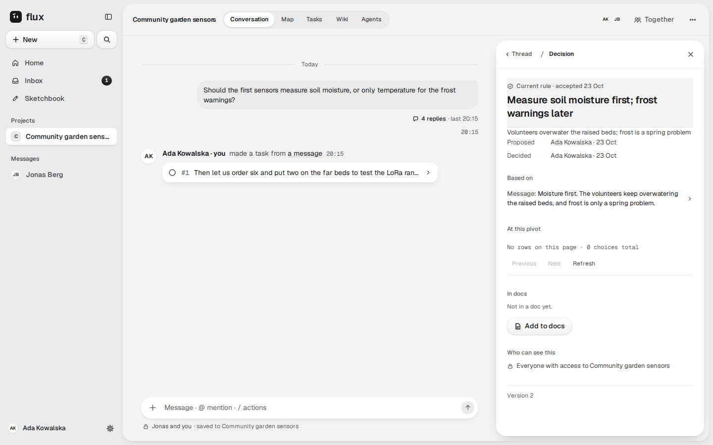
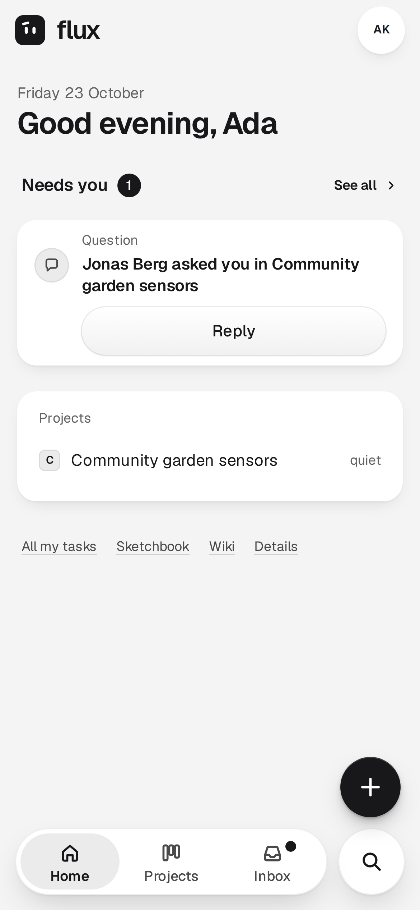

<p align="center">
  <picture>
    <source media="(prefers-color-scheme: dark)" srcset="docs/assets/brand/kreska-dark.svg">
    
  </picture>
</p>

<h1 align="center">Flux</h1>

<p align="center"><b>An open source, self-hosted workspace where people and AI agents work on the same projects.</b></p>

<p align="center">
  <a href="https://github.com/ColdPhase/flux/actions/workflows/application-checks.yml"></a>
  <a href="LICENSE"></a>
  <a href="https://github.com/ColdPhase/flux/milestone/2"></a>
  <a href="#quick-start"></a>
  <a href="https://coldphase.github.io/flux/"></a>
</p>

<p align="center">
  <a href="https://coldphase.github.io/flux/"><b>Documentation</b></a> ·
  <a href="#quick-start">Quick start</a> ·
  <a href="#self-hosting">Self-hosting</a> ·
  <a href="#connect-your-own-agent">Connect your agent</a> ·
  <a href="docs/CONTRIBUTING.md">Contributing</a>
</p>

<p align="center">
  <picture>
    <source media="(prefers-color-scheme: dark)" srcset="docs/assets/promo/flux-promo-dark.svg">
    
  </picture>
</p>

<p align="center"><sub>An animated sketch of the idea (<a href="docs/assets/promo/README.md">how it is made</a>); the
<a href="docs/assets/demo/flux-demo.gif">recording of the running app</a> and the screenshots below show the real thing.</sub></p>

<p align="center">
  
  
</p>

<p align="center"><sub>A project on a 1440&nbsp;px desktop and a 390&nbsp;px phone, captured from the running
application on the fictional <code>./flux demo</code> data (<a href="docs/assets/readme/README.md">how these were made</a>).</sub></p>

<!-- MEDIA SLOT (#780): the two stills above and the GIF below are recaptured with scripts/record_media.sh
     from the release candidate after the #763 round-2 review, light and dark, desktop and phone. -->

Flux keeps a team's conversations and the work that comes out of them in one place: tasks,
decisions with their reasons, documents and sketches, each linked to the message it came from. The
people on the team and the agents they connect, such as Claude Code or Codex, work in the same
projects, with the same permissions model. You run it on your own server.

**Who it is for.** Small software teams, such as a product lead, a designer and an engineer, who
already hand some work to coding agents. When you come back to a project after a break, Flux shows
what changed, what was decided and what is next, so you do not have to ask around.

## Highlights

- **Conversations that turn into work.** One action makes a message a task, a decision with its
  reason, or a result, and each stays linked to the message it came from.
- **Come back and catch up.** Home shows what changed since you left, what was decided and what
  needs you, so you do not have to ask around.
- **Your own agent, with your permission.** Connect Claude Code, Codex or any MCP client to the
  projects you choose. It runs on your computer with your own model account; Flux never sees it.
- **One project, three views.** The conversation, the map and the wiki, plus tasks, direct
  messages, a private sketchbook and search.
- **Everywhere you are.** One calm design on the computer and the phone, installable as a PWA, with
  Web Push notifications and an inbox.
- **Yours to run.** One Docker Compose stack started with `./flux up`, with backups, restore,
  project export, upgrades, single sign-on, and spaces that can be AI-free or encrypted at rest.

<!-- MEDIA SLOT (#780): one small image per highlight (task from a message, Home catch-up, connect an
     agent, map and wiki, phone and push, encrypted space), captured after the #763 round-2 review. -->

## Why Flux

| Instead of | Flux gives you |
| --- | --- |
| A chat where decisions scroll away | Decisions and tasks made from messages, linked back to them, and a Home that tells you what changed |
| A separate tracker, wiki and whiteboard | The project's conversation, tasks, wiki and map in one place, with one search |
| Agents that see everything, or nothing | Each agent gets only the projects and actions you grant; what it suggests waits in your Inbox until you answer |
| A hosted service holding your team's work | Your server, your database, open formats: [project export](docs/operations/export.md) is JSON plus files |

Flux is open source under the AGPL-3.0. Its public API types and SDK are Apache-2.0, so agents and
integrations can use them freely ([licensing](docs/product/licensing.md)).

## Project status

**Pre-release.** No version has been published yet, so there is no upgrade promise or
supported deployment; do not use it for sensitive data or production teams.

The [current milestone](https://github.com/ColdPhase/flux/milestone/2) tracks the rest of
the first release, including installation and notifications on real phones and tablets.

The application follows one design for the computer and the phone, the
[final design "Prostota"](docs/design/final/README.md). Its screens and guidelines are the
reference for every UI change.

## Quick start

Prerequisites: Git and Docker Engine (or Docker Desktop) with Compose. No host Node.js or PostgreSQL
([requirements](docs/operations/requirements.md)).

```sh
git clone --depth 1 https://github.com/ColdPhase/flux.git
cd flux
./flux up      # creates docker/.env with random secrets once, builds, migrates, starts, prints the URL
./flux demo    # optional: sample workspace, project, conversation and note; prints two logins
```

Then open the URL that `./flux up` prints, <http://127.0.0.1:8081/> by default. If port 8081 is
taken, start the first time with another free port, for example `FLUX_PORT=8090 ./flux up`. The first
`./flux up` takes a few minutes, because it downloads the dependencies and builds Flux
([measured times](docs/development/time-to-first-run.md)). To connect your own MCP client, such
as Claude Code or Codex, follow [Connect your own agent](#connect-your-own-agent).

Flux can also run Claude Code or Codex for people on the server, signed in with their own Claude or
ChatGPT subscription. The first `./flux up` in a terminal asks once
whether to allow it (Enter means yes, for Codex; Claude Code needs a typed `y` to Anthropic's
Commercial Terms; a host that cannot run it gets one line saying why instead); `./flux ai on` asks
later, and without a terminal nothing is asked ([operator guide](docs/operations/agent-runtime.md)).
`./flux up` never overwrites an existing `docker/.env`.

Other commands: `./flux down`, `./flux logs`, `./flux reset` (deletes data after confirmation),
`./flux clean` (also removes the images this checkout built) and `./flux help`. The shallow clone
skips older commits and their review captures, which remain available through the
[evidence archive](docs/agents/evidence/README.md); `git fetch --unshallow` brings the full history.

## Self-hosting

To run Flux for a team on your own domain, start with the
[self-hosting guide](https://coldphase.github.io/flux/operate/) ([source](docs/operations/README.md)):

| Guide | Covers |
| --- | --- |
| [Requirements](docs/operations/requirements.md) | Linux with Docker Compose, 4 GB of memory, a domain name |
| [Installation](docs/operations/install.md) | A production server from a source checkout, step by step |
| [HTTPS and reverse proxies](docs/operations/reverse-proxy.md) | Caddy, nginx and Traefik examples, each tested |
| [Configuration reference](docs/operations/configuration.md) | Every setting with its type and default, generated from the code |
| [Backup and restore](docs/operations/backup-restore.md), [upgrade](docs/operations/upgrade.md) | `./flux backup`, `./flux restore`, `./flux upgrade` |
| [Administration in the app](docs/operations/administration.md) | Spaces, roles, invite links, the AI switch, encrypted spaces |
| [Monitoring](docs/operations/monitoring.md), [hardening](docs/operations/hardening.md), [troubleshooting](docs/operations/troubleshooting.md) | Keeping it healthy and safe |

## Connect your own agent

Your own MCP client, such as Claude Code or Codex, can read the projects you choose. It runs on your
computer with your own model account, which Flux never sees. On the `./flux demo` data:

1. Sign in as Ada, the workspace owner (`./flux demo` prints her password), and open the Connect page:
   your name at the bottom left → **All settings** → **Agents and AI** → **Local co-work on this
   computer** → **Manage**, or go straight to <http://127.0.0.1:8081/connect-agent>. 8081 is the
   default port; use the one `./flux up` printed.
2. **Create your personal agent.** Keep the workspace "Riverside Makers (demo)", give the agent a
   name and choose **Create personal agent**. The form is already open on a first visit. The demo
   seeds no agent.
3. **Grant it the project.** Under **New connection**, name the connection and pick your client.
   Next to "Community garden sensors", keep **Read and propose** and choose **Grant**; only a
   project manager can do this, and Ada is one. Under **Allowed actions**, **Read selected project
   context** and **Suggest a next step** are ticked.
   - **Claude Code** asks for three permissions when it connects, but you can grant fewer: it gets
     only the ones you ticked, and a tool outside them answers that the permission wasn't granted.
     Keep the two.
   - **Codex** asks for the same three and, like Claude Code, gets only the ones you ticked.

   Tick the project and choose **Save connection**.
4. **Add Flux to your client** with the commands the page shows:

   ```sh
   claude mcp add --transport http flux http://127.0.0.1:8081/mcp   # Claude Code
   claude mcp login flux

   codex mcp add flux --url http://127.0.0.1:8081/mcp               # Codex; adding starts the sign-in
   codex mcp login flux
   ```

   `claude mcp login flux` needs a terminal: outside one it stops with "stdin isn't a terminal".
   If the login times out before you choose **Allow access**, run it again. Claude Code adds the
   server for the folder where you run `claude mcp add` and nowhere else: start `claude` from that
   folder, or add `--scope user` to use it from any folder.

5. **Consent.** The login opens Flux in your browser. Choose the saved connection, then
   **Continue to consent**. Check that access goes to an address on your own computer and to the
   selected project only, and choose **Allow access**. The client then says it is authenticated
   (`claude mcp list` shows Connected).
6. **Ask it something**, for example: "Using Flux, what is the Community garden sensors project
   working on, and what is still open?" The client reads the project's conversations, tasks and
   docs with Flux's read tools, and answers in your client; nothing in Flux changes. Claude Code
   asks before it uses each Flux tool the first time: allow it. From a script, `claude -p "…"
   --allowedTools mcp__flux` gives the same approval. Replying in
   Flux or creating tasks needs **Run approved project actions** and a standing grant: on the same
   page, under **Standing grants** for your connection, add the grant you want. A suggestion the
   agent sends waits in your **Inbox** under **Needs you**, with what it saw, what it makes of it, what it
   suggests and the source; choose **Got it** or **Decline**.

The loopback `http://` address works only for a client on the same computer. A client on another
computer needs an HTTPS address: the operator sets `FLUX_PUBLIC_ORIGIN` behind a TLS reverse proxy
([agent connection](docs/development/agent-connection.md),
[integrations for operators](docs/integrations/README.md#for-operators)). Flux accepts clients
only through their public client metadata documents, so the server needs outbound HTTPS when a
client signs in. Both clients were run through these steps against a clean clone
([record](docs/development/time-to-first-run.md)).

## Documentation

- [Documentation site](https://coldphase.github.io/flux/): getting started, self-hosting, integrating
  and security, generated from the files in [`docs/`](docs/README.md).
- [Integrating with Flux](docs/integrations/README.md): the MCP connection, permissions and the
  project export format.
- [Product foundation](docs/product/README.md): the direction, human and agent collaboration,
  continuity of project knowledge, self-hosting and extensibility.
- [Security policy](docs/SECURITY.md) and [encrypted spaces](docs/product/encrypted-workspaces.md).

## Contribute

Bug reports, documentation, accessibility feedback and focused fixes are welcome.
Read [CONTRIBUTING.md](docs/CONTRIBUTING.md) first and discuss larger features or
architecture changes in an issue before starting.

- [Report a bug or propose a feature](https://github.com/ColdPhase/flux/issues/new/choose)
- [Project board](https://github.com/orgs/ColdPhase/projects/1)
- [Discussions](https://github.com/ColdPhase/flux/discussions)
- [Report a security vulnerability privately](docs/SECURITY.md)

Develop with hot reload in Docker with `./flux dev`. Run the checks, all in Docker; each run uses its
own Compose project and removes only its own test data:

```sh
./scripts/check_application.sh   # build, type check, lint, API, architecture and end-to-end tests
./scripts/check_ui.sh            # browser tests of the web app (Playwright)
./scripts/check_runtime.sh       # production-mode stack: worker jobs, migration and restart keep data
python3 scripts/check_agent_setup.py
python3 -m unittest discover -s tests -p 'test_*.py'
```

Changes to the launcher or operations also have `./scripts/check_flux_cli.sh` and
`./scripts/check_backup.sh`. [Contributing](docs/CONTRIBUTING.md) says which checks fit
which change; the [application foundation guide](docs/development/application-foundation.md) and
[containers](docs/development/containers.md) describe the launcher and every service.

Much of the development is done by two coding agents (Codex and Claude) working
through GitHub issues and pull requests with independent review; see
[agent collaboration](docs/agents/README.md). The [documentation index](docs/README.md)
lists everything else.

### Repository layout

| Path | Contents |
| --- | --- |
| `app/apps/server` | API: HTTP routes, identity, push, serving the web build |
| `app/apps/worker` | Background jobs and Web Push delivery |
| `app/apps/web` | Browser application and PWA |
| `app/packages/core` | Domain rules, authorization, use cases and ports |
| `app/packages/db` | Database schema, SQL migrations and persistence adapters |
| `app/packages/contracts` | Public API wire types (Apache-2.0) |
| `app/packages/sdk` | TypeScript client for the public API (Apache-2.0) |
| `app/packages/agent-runtime` | Optional model/provider adapter |
| `app/examples/external-agent` | An external agent using the SDK (Apache-2.0) |
| `app/` | Sole pnpm workspace, lockfile, TypeScript/ESLint config and application variable reference |
| `app/tooling` | Migration and operations entry points |
| `docker` | Dockerfiles, source/dev/test/live Compose, pull-only operator example and executable env template |
| `app/tests` | Application checks and Python/Playwright browser checks |
| `tests` | Repository and agent tooling checks |
| `flux` | One-command launcher: `up`, `demo`, `dev`, `down`, `reset`, `clean`, `backup`, `restore`, `export`, `upgrade` |
| `scripts` | Check scripts, the demo seed and repository tooling |
| `docs` | Product, design, development and agent documentation |
| `site` | The [documentation site](https://coldphase.github.io/flux/) (Astro Starlight), generated from `docs` |
| `docs/assets` | The README promo animation, screenshots and the demo GIF (each folder says how it was made) and `brand/`, the Kreska logo. The app icons are `app/apps/web/public/icons`, rendered from Kreska ([final design §3](docs/design/final/README.md#3-kreska-logo-agent-icon-and-mascot)) by `app/apps/web/scripts/generate-icons.ts` |

Dependency directions between these are described and enforced in
[architecture](docs/development/architecture.md).

## License

The application is licensed under the [GNU Affero General Public License v3](LICENSE).
`app/packages/contracts`, `app/packages/sdk` and `app/examples/external-agent` are licensed under
Apache-2.0 so that external agents and clients can use them; see
[licensing](docs/product/licensing.md).
