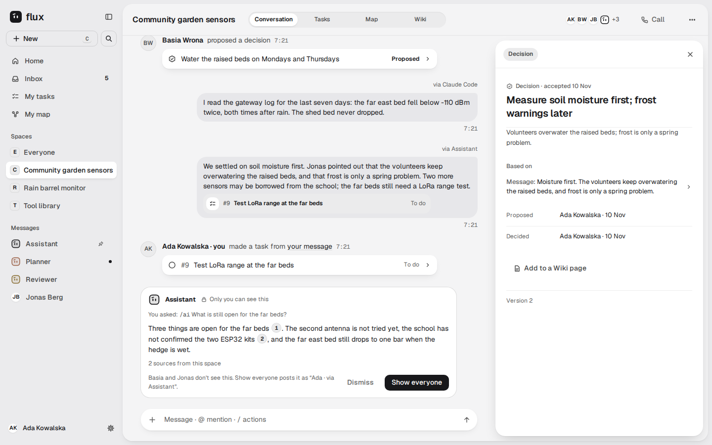
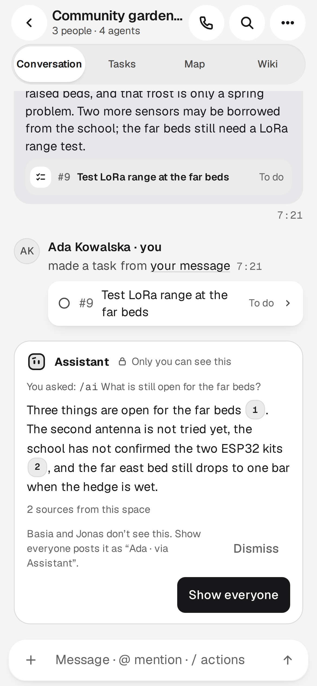
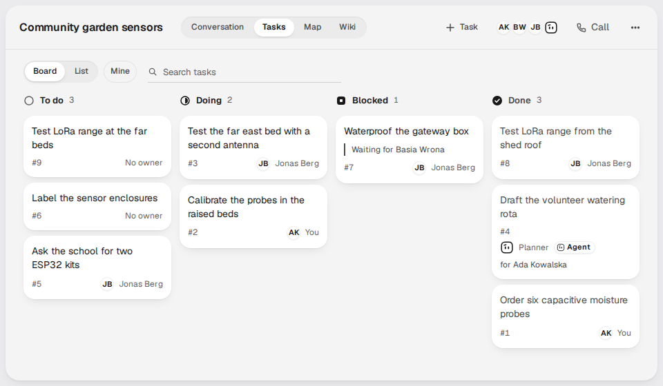
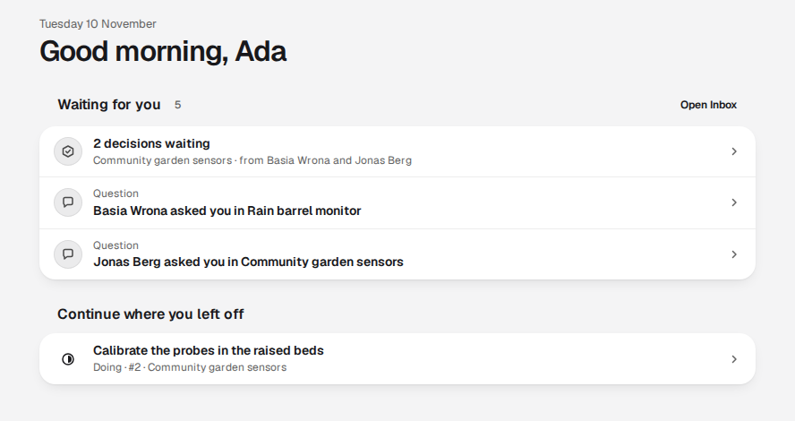
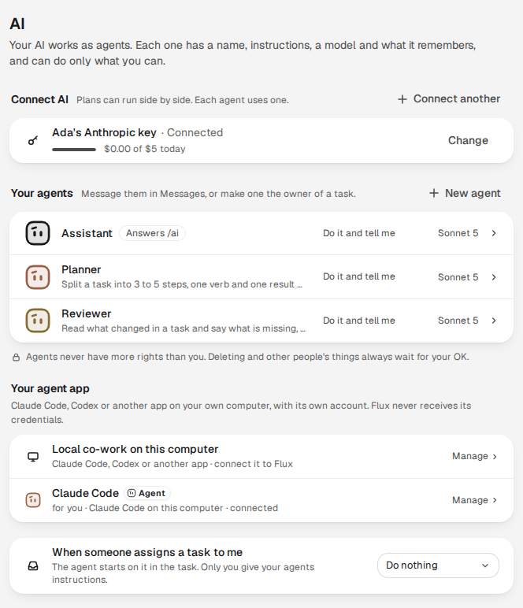
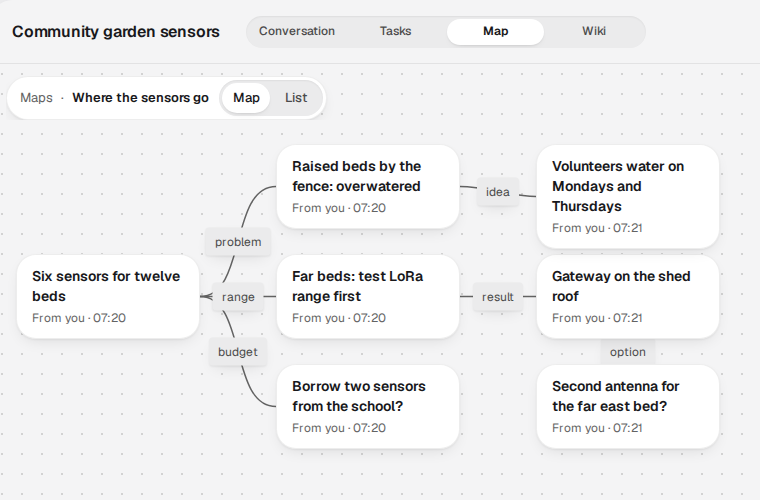
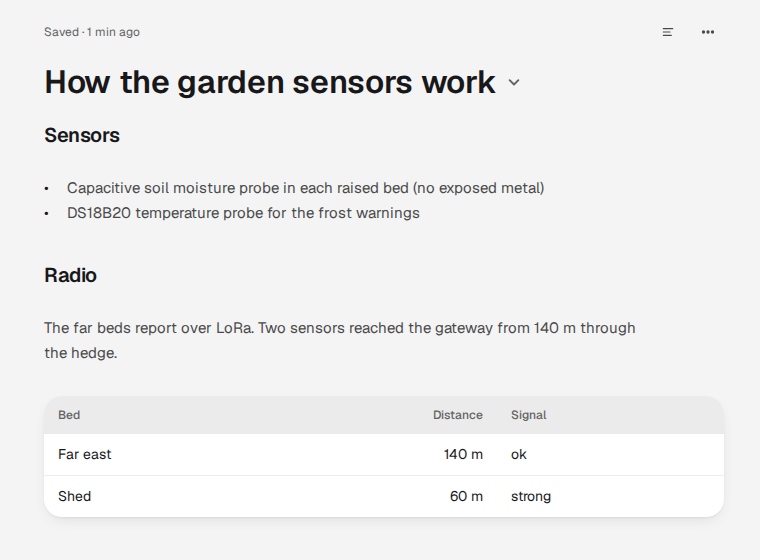
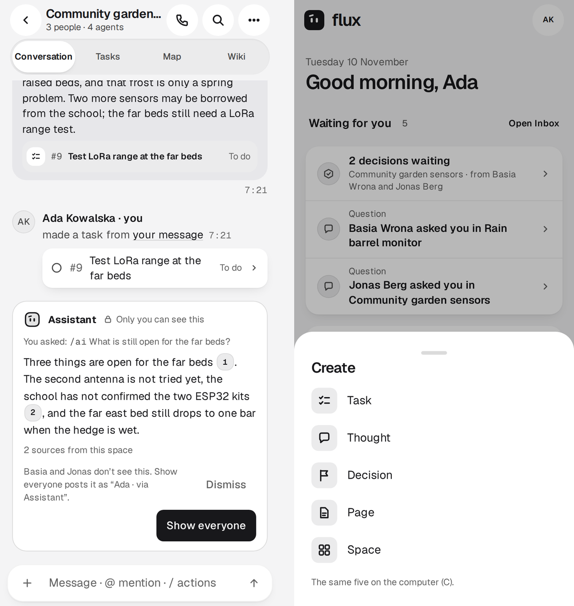

<p align="center">
  <picture>
    <source media="(prefers-color-scheme: dark)" srcset="docs/assets/brand/kreska-dark.svg">
    
  </picture>
</p>

<h1 align="center">Flux</h1>

<p align="center"><b>An open source, self-hosted workspace where people and AI agents work in the same spaces.</b></p>

<p align="center">
  <a href="https://github.com/ColdPhase/flux/actions/workflows/application-checks.yml"></a>
  <a href="LICENSE"></a>
  <a href="https://github.com/ColdPhase/flux/releases/latest"></a>
  <a href="#quick-start"></a>
  <a href="https://coldphase.github.io/flux/"></a>
</p>

<p align="center">
  <a href="https://coldphase.github.io/flux/"><b>Documentation</b></a> ·
  <a href="#quick-start">Quick start</a> ·
  <a href="#self-hosting">Self-hosting</a> ·
  <a href="#connect-your-own-agent">Connect your agent</a> ·
  <a href="docs/CONTRIBUTING.md">Contributing</a>
</p>

<p align="center">
  <picture>
    <source media="(prefers-color-scheme: dark)" srcset="docs/assets/readme/conversation-desktop-dark.webp">
    
  </picture>
  <picture>
    <source media="(prefers-color-scheme: dark)" srcset="docs/assets/readme/conversation-phone-dark.webp">
    
  </picture>
</p>

<p align="center"><sub>A space on a 1440&nbsp;px desktop and on a 390&nbsp;px phone, in your light or dark theme, captured from the
running application on the fictional <code>./flux demo</code> data. The <a href="docs/assets/demo/flux-demo.gif">recording of the running app</a>
walks the same journey (<a href="docs/assets/readme/README.md">how these were made</a>).</sub></p>

Flux keeps a company's conversations and the work that comes out of them in one place: tasks,
decisions with their reasons, a Wiki and maps of connected thoughts, each linked to the message it
came from. One Flux is one company, and the company works in **spaces**: a team, a department or a
project. The people and their AI agents, and the Claude Code or Codex on their own computers, work
in the same spaces, and an agent can do exactly what its owner can and no more. You run it on your
own server.

**Who it is for.** Small companies and teams, such as a product lead, a designer and an engineer,
who already hand some work to AI. When you come back to a space after a break, your Inbox shows
what needs you, so you do not have to ask around.

## Highlights

- **Conversations that turn into work.** One action makes a message a task or a decision with its
  reason, and each stays linked to the message it came from.
- **One company, many spaces.** The first account sets up the company and its default space,
  **Everyone**. Everything else happens in spaces, and you see only the spaces you were added to.
  Each space has its own AI switch, and can be encrypted.
- **Simple AI: everything is an agent.** Connect AI once (a Claude plan, a ChatGPT plan or an API
  key). You get an **Assistant** and can add more agents, each with its own instructions, model and
  memory. `/ai` answers privately in any conversation, an agent can take a task, and you can
  schedule one by asking. An agent searches the web and reads pages, and lists what it used.
- **An agent has your rights, no more.** Each agent has one switch, **Ask me first**: off, it does
  the work and tells you; on, every change waits for your OK. Deleting and other people's things
  always wait for your OK in the Inbox, and every change has **Undo**.
- **Your own Claude Code or Codex.** Sign in with one click and the client acts with your rights, on
  your computer, with your own model account. Flux never sees it.
- **What needs you, in one place.** The Inbox holds what waits for you: questions, tasks handed
  back, and changes an agent asks you to approve. Home shows its top three.
- **Wiki and Map.** Pages you edit where you read them, with versions saved by themselves, and
  maps of connected thoughts, plus **My map**, your own private one.
- **Everywhere you are.** One calm design on the computer and the phone, installable as a PWA, with
  Web Push notifications.
- **Yours to run.** One Docker Compose stack started with `./flux up`, with backups, restore,
  export, upgrades, single sign-on and encrypted spaces, on a small server (2 cores and 4 GB is the
  [recommended](docs/operations/requirements.md) size).

<table>
  <tr>
    <td width="50%" valign="top"><br><sub><b>A message becomes a task.</b> A task keeps the message it came from, and the board says who has it: a person, an agent or nobody yet.</sub></td>
    <td width="50%" valign="top"><br><sub><b>What needs you, in one place.</b> Home shows the top of your Inbox and the next step where you left off.</sub></td>
  </tr>
  <tr>
    <td width="50%" valign="top"><br><sub><b>Everything is an agent.</b> Connect AI once and you get an Assistant; add more agents, and connect your own Claude Code or Codex.</sub></td>
    <td width="50%" valign="top"><br><sub><b>A Map for thinking out loud.</b> Thoughts link to each other, and nothing on a Map has to become a task.</sub></td>
  </tr>
  <tr>
    <td width="50%" valign="top"><br><sub><b>A Wiki you edit where you read.</b> Pages of the space, with versions saved by themselves.</sub></td>
    <td width="50%" valign="top"><br><sub><b>Everywhere you are.</b> The same space on a 390&nbsp;px phone, and the + that makes a task, thought, decision, page or space; installable as a PWA.</sub></td>
  </tr>
</table>

<p align="center"><sub>Captured from the running application on the same <code>./flux demo</code> data
(<a href="docs/assets/screens/README.md">how these were made</a>).</sub></p>

## Why Flux

| Instead of | Flux gives you |
| --- | --- |
| A chat where decisions scroll away | Decisions and tasks made from messages, linked back to them, and an Inbox that tells you what needs you |
| A separate tracker, wiki and whiteboard | A space's conversation, tasks, Wiki and Map in one place, with one search |
| Agents that see everything, or nothing | Each agent has exactly its owner's rights, in spaces where AI is on; deleting and other people's things wait for the owner's OK |
| A hosted service holding your team's work | Your server, your database, open formats: [project export](docs/operations/export.md) is JSON plus files |

Flux is open source under the AGPL-3.0. Its public API types and SDK are Apache-2.0, so agents and
integrations can use them freely ([licensing](docs/product/licensing.md)).

## Project status

**Flux v0.2 is the current version, and this page describes it.** It is an early version: its
security was reviewed by an agent that did not write the code, and an external human audit is still
planned, so keep [backups](docs/operations/backup-restore.md) from the start. The
[v0.2 release notes](docs/product/release-notes-v0.2.0.md) say what is in it and what is not. The
first published version, [v0.1.0](https://github.com/ColdPhase/flux/releases/tag/v0.1.0), had no
users, so **v0.2 does not upgrade it**: install v0.2 fresh ([upgrade guide](docs/operations/upgrade.md)).
The image (`ghcr.io/coldphase/flux`) is built for `linux/amd64` only; `linux/arm64` is planned for
v0.3 ([#833](https://github.com/ColdPhase/flux/issues/833)). To run it on a server, download every
file of the [latest release](https://github.com/ColdPhase/flux/releases/latest) and follow its
`INSTALL.md` ([install from a release](docs/operations/install-release.md)). To look around first,
use the quick start below.

What comes next is tracked in the [milestones](https://github.com/ColdPhase/flux/milestones).

The application follows one design for the computer and the phone, the
[final design "Prostota"](docs/design/final/README.md). Its screens and guidelines are the
reference for every UI change.

## Quick start

Prerequisites: Git and Docker Engine 25 or newer (or Docker Desktop) with Compose. No host Node.js or PostgreSQL
([requirements](docs/operations/requirements.md)).

```sh
git clone --depth 1 https://github.com/ColdPhase/flux.git
cd flux
./flux up      # creates docker/.env with random secrets once, builds, migrates, starts, prints the URL
./flux demo    # optional: a sample company with a space, conversation, Map and Wiki page; prints two logins
```

Then open the URL that `./flux up` prints, <http://127.0.0.1:8081/> by default. If port 8081 is
taken, start the first time with another free port, for example `FLUX_PORT=8090 ./flux up`. The first
`./flux up` takes a few minutes, because it downloads the dependencies and builds Flux
([measured times](docs/development/time-to-first-run.md)). To connect your own MCP client, such
as Claude Code or Codex, follow [Connect your own agent](#connect-your-own-agent).

AI is off until someone connects it in **Settings › AI**. An API key needs the operator's
`FLUX_PERSONAL_RUNS=on` and a key file ([configuration](docs/operations/configuration.md#ai-providers)).
To let people use their own Claude or ChatGPT subscription, Flux runs the Claude Code or Codex on the
server for them, in one isolated runtime. The first `./flux up` in a terminal asks once
whether to allow it (Enter means yes, for Codex; Claude Code needs a typed `y` to Anthropic's
Commercial Terms; a host that cannot run it gets one line saying why instead); `./flux ai on` asks
later, and without a terminal nothing is asked ([operator guide](docs/operations/agent-runtime.md)).
`./flux up` never overwrites an existing `docker/.env`.

Other commands: `./flux down`, `./flux logs`, `./flux reset` (deletes data after confirmation),
`./flux clean` (also removes the images this checkout built) and `./flux help`. The shallow clone
skips older commits and their review captures, which remain available through the
[evidence archive](docs/agents/evidence/README.md); `git fetch --unshallow` brings the full history.

## Self-hosting

To run Flux for a team on your own domain, start with the
[self-hosting guide](https://coldphase.github.io/flux/operate/) ([source](docs/operations/README.md)):

| Guide | Covers |
| --- | --- |
| [Requirements](docs/operations/requirements.md) | Linux with Docker Compose, 4 GB of memory, a domain name |
| [Install from a release](docs/operations/install-release.md) | A production server from the published image, without the source |
| [Installation](docs/operations/install.md) | A production server from a source checkout, step by step |
| [HTTPS and reverse proxies](docs/operations/reverse-proxy.md) | Caddy, nginx and Traefik examples, each tested |
| [Configuration reference](docs/operations/configuration.md) | Every setting with its type and default, generated from the code |
| [Backup and restore](docs/operations/backup-restore.md), [upgrade](docs/operations/upgrade.md) | `./flux backup`, `./flux restore`, `./flux upgrade` (v0.1 is not upgraded) |
| [Administration in the app](docs/operations/administration.md) | The company and its spaces, roles, invite links, AI in a space, encrypted spaces, agents and connections |
| [Monitoring](docs/operations/monitoring.md), [hardening](docs/operations/hardening.md), [troubleshooting](docs/operations/troubleshooting.md) | Keeping it healthy and safe |

## Connect your own agent

Your own MCP client, such as Claude Code or Codex, can work in Flux as you. It runs on your computer
with your own model account, which Flux never sees. Signing in is one click, and nothing is set up
first. On the `./flux demo` data:

1. **Add Flux to your client** with the commands the Connect page shows. Sign in as Ada, the company's
   owner (`./flux demo` prints her password), and open it: your name at the bottom left → **All
   settings** → **AI** → **Connect another** (**Connect AI** while nothing is connected) → **Claude Code or Codex on your computer** (then
   **Show the command**), or go straight to
   <http://127.0.0.1:8081/connect-agent>. 8081 is the default port; use the one `./flux up` printed.

   ```sh
   claude mcp add --transport http flux http://127.0.0.1:8081/mcp   # Claude Code
   claude mcp login flux

   codex mcp add flux --url http://127.0.0.1:8081/mcp               # Codex; adding starts the sign-in
   codex mcp login flux
   ```

   `claude mcp login flux` needs a terminal: outside one it stops with "stdin isn't a terminal".
   If the login times out before you choose **Allow**, run it again. Claude Code adds the
   server for the folder where you run `claude mcp add` and nowhere else: start `claude` from that
   folder, or add `--scope user` to use it from any folder.
2. **Allow it, once.** The login opens Flux in your browser. Check that access goes to an address on
   your own computer and choose **Allow**. That is the whole setup: Flux makes the client's agent and its
   connection, and the client says it is authenticated (`claude mcp list` shows Connected).
3. **It acts as you.** The client sees and changes what you can, in the spaces where AI is on, and no
   more. It starts at **Do it and tell me** (its tag on its row in Settings → AI); turn on **Ask me first**
   any time and every change waits for your OK. Deleting something and changing other people's things
   always wait for your OK in your **Inbox**, whatever you choose, and only you can approve them.
4. **Ask it something**, for example: "Using Flux, what is the Community garden sensors space
   working on, and what is still open?" The client reads the space's conversation, tasks and
   Wiki with Flux's tools, and answers in your client. Claude Code asks before it uses each Flux
   tool the first time: allow it. From a script, `claude -p "…" --allowedTools mcp__flux` gives the
   same approval. **Disconnect** on the same page ends its access at once.

The loopback `http://` address works only for a client on the same computer. A client on another
computer needs an HTTPS address: the operator sets `FLUX_PUBLIC_ORIGIN` behind a TLS reverse proxy
([agent connection](docs/development/agent-connection.md),
[integrations for operators](docs/integrations/README.md#for-operators)). Flux accepts clients
only through their public client metadata documents, so the server needs outbound HTTPS when a
client signs in. Both clients were run through these steps against a clean clone
([record](docs/development/time-to-first-run.md)).

## Documentation

- [Documentation site](https://coldphase.github.io/flux/): getting started, self-hosting, integrating
  and security, generated from the files in [`docs/`](docs/README.md).
- [Integrating with Flux](docs/integrations/README.md): the MCP connection, permissions and the
  project (space) export format.
- [Release notes](docs/product/release-notes-v0.2.0.md): what is in v0.2 and what is not.
- [Product foundation](docs/product/README.md): the direction, human and agent collaboration,
  continuity of knowledge, self-hosting and extensibility.
- [Security policy](docs/SECURITY.md) and [encrypted spaces](docs/product/encrypted-workspaces.md).

## Contribute

Bug reports, documentation, accessibility feedback and focused fixes are welcome.
Read [CONTRIBUTING.md](docs/CONTRIBUTING.md) first and discuss larger features or
architecture changes in an issue before starting.

- [Report a bug or propose a feature](https://github.com/ColdPhase/flux/issues/new/choose)
- [Project board](https://github.com/orgs/ColdPhase/projects/1)
- [Discussions](https://github.com/ColdPhase/flux/discussions)
- [Report a security vulnerability privately](docs/SECURITY.md)

Develop with hot reload in Docker with `./flux dev`. Run the checks, all in Docker; each run uses its
own Compose project and removes only its own test data:

```sh
./scripts/check_application.sh   # build, type check, lint, API, architecture and end-to-end tests
./scripts/check_ui.sh            # browser tests of the web app (Playwright)
./scripts/check_runtime.sh       # production-mode stack: worker jobs, migration and restart keep data
python3 scripts/check_agent_setup.py
python3 -m unittest discover -s tests -p 'test_*.py'
```

Changes to the launcher or operations also have `./scripts/check_flux_cli.sh` and
`./scripts/check_backup.sh`. [Contributing](docs/CONTRIBUTING.md) says which checks fit
which change; the [application foundation guide](docs/development/application-foundation.md) and
[containers](docs/development/containers.md) describe the launcher and every service.

Much of the development is done by two coding agents (Codex and Claude) working
through GitHub issues and pull requests with independent review; see
[agent collaboration](docs/agents/README.md). The [documentation index](docs/README.md)
lists everything else.

### Repository layout

| Path | Contents |
| --- | --- |
| `app/apps/server` | API: HTTP routes, identity, push, serving the web build |
| `app/apps/worker` | Background jobs and Web Push delivery |
| `app/apps/web` | Browser application and PWA |
| `app/packages/core` | Domain rules, authorization, use cases and ports |
| `app/packages/db` | Database schema, SQL migrations and persistence adapters |
| `app/packages/contracts` | Public API wire types (Apache-2.0) |
| `app/packages/sdk` | TypeScript client for the public API (Apache-2.0) |
| `app/packages/agent-runtime` | Optional model/provider adapter |
| `app/examples/external-agent` | An external agent using the SDK (Apache-2.0) |
| `app/` | Sole pnpm workspace, lockfile, TypeScript/ESLint config and application variable reference |
| `app/tooling` | Migration and operations entry points |
| `docker` | Dockerfiles, source/dev/test/live Compose, pull-only operator example and executable env template |
| `app/tests` | Application checks and Python/Playwright browser checks |
| `tests` | Repository and agent tooling checks |
| `flux` | One-command launcher: `up`, `demo`, `dev`, `down`, `reset`, `clean`, `backup`, `restore`, `export`, `upgrade` |
| `scripts` | Check scripts, the demo seed and repository tooling |
| `docs` | Product, design, development and agent documentation |
| `site` | The [documentation site](https://coldphase.github.io/flux/) (Astro Starlight), generated from `docs` |
| `docs/assets` | The README screenshots, the documentation screens and the demo GIF (each folder says how it was made; recorded on v0.2), `promo/` (a note on the animation generator, which no page uses now) and `brand/`, the Kreska logo. The app icons are `app/apps/web/public/icons`, rendered from Kreska ([final design §3](docs/design/final/README.md#3-kreska-logo-agent-icon-and-mascot)) by `app/apps/web/scripts/generate-icons.ts` |

Dependency directions between these are described and enforced in
[architecture](docs/development/architecture.md).

## License

The application is licensed under the [GNU Affero General Public License v3](LICENSE).
`app/packages/contracts`, `app/packages/sdk` and `app/examples/external-agent` are licensed under
Apache-2.0 so that external agents and clients can use them; see
[licensing](docs/product/licensing.md).
