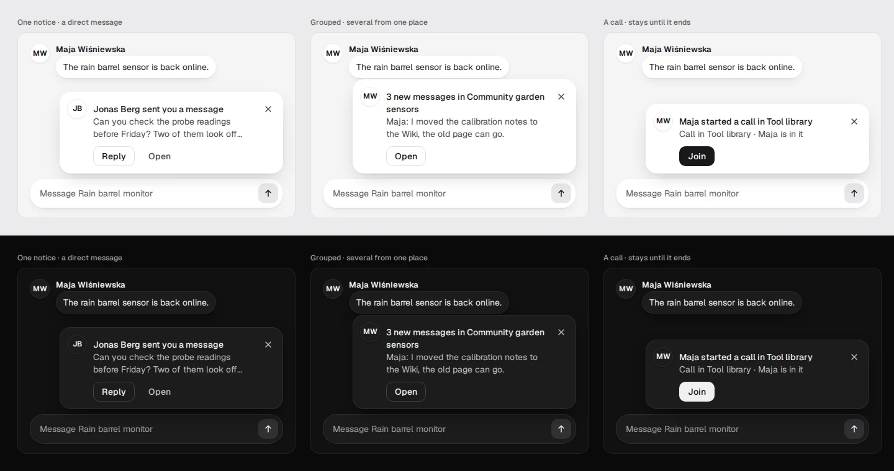
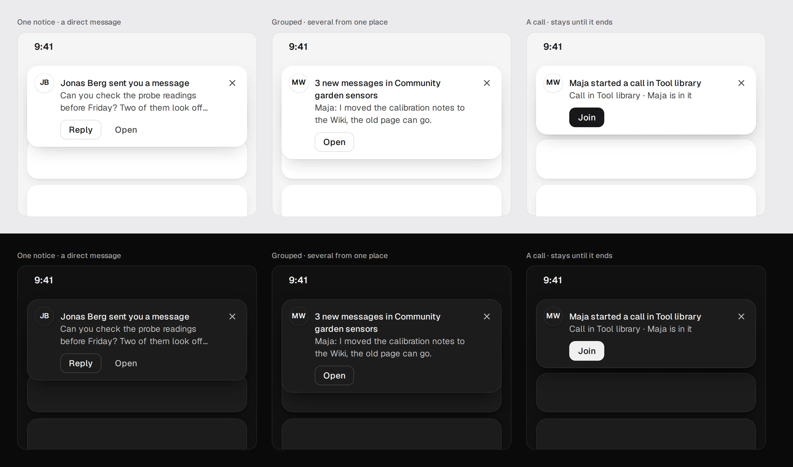
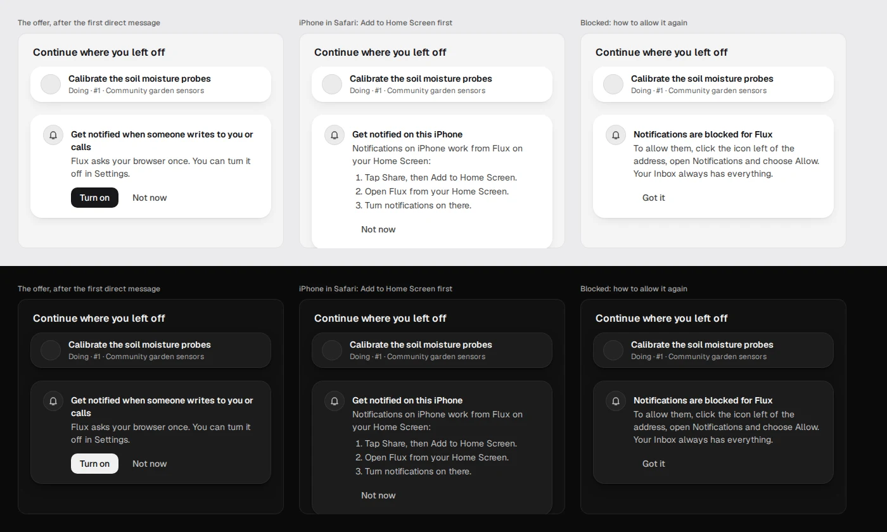

# Flux final design: Prostota

**Status.** Founder direction by Hubert ([@PelikanFix16](https://github.com/PelikanFix16)) on
2026-10-07, recorded as [F-026](../../product/decisions.md) and tracked in
[#336](https://github.com/ColdPhase/flux/issues/336). Updated for v0.2 to the screens Hubert approved
on 2026-11-03 ([#853](https://github.com/ColdPhase/flux/issues/853),
[#864](https://github.com/ColdPhase/flux/issues/864)), recorded as
[F-036, F-037 and F-038](../../product/decisions.md#f-036-to-f-038-the-v02-direction-2026-11-03).
This is the **only** UI and UX direction for Flux on the computer and the phone. Implement it as
drawn. Founders own changes to it; agents implement it and do not re-decide it.

- **Drawings.** [`screens/`](screens/) holds a render of every v0.2 screen (section 7) and the
  reference boards. Computer renders are 1440 × 900 (Settings is 1440 × 1140), and phone renders are
  390 × 844 at 2×. They are rendered from the v0.2 canvas, which only the founders can open:
  <https://claude.ai/artifact/SUV9hgQaWUKbeXe4vkcdrV>. Its notes are in Polish; this guide states
  what they decide. The first Prostota canvas, <https://claude.ai/artifact/UnQv8mJcyLWrDmKg7nMYDf>,
  is history wherever this guide differs from it.
- **What wins.** Product, data, access and AI contracts are in
  [the decision register](../../product/decisions.md) and [agents](../../product/assistant.md). Where
  an older contract describes how something looks or where it sits, this guide wins. Where a later
  founder decision differs from this guide, the decision wins and the guide is corrected.
- **Refinement.** [Spokój](../spokoj/README.md) (founder direction, 2026-10-15) adds the rule that
  a control never changes place, limits the layout to two content columns and adds the `--own` and
  `--pick` tokens. Where Spokój and this guide differ, this guide wins.
- **Motion.** [Motion in Flux](../motion.md) holds the one motion rule set (F-038,
  [#863](https://github.com/ColdPhase/flux/issues/863)).
- **Implementation.** The v0.2 issues are #865 (Inbox and Home), #866 (Thought and Map), #867
  (Create and message actions), #868 (Tasks), #869 (Wiki), #870 (Search), #871 (words), #872
  (Settings), #873 (space header), #874 (Spaces), #854–#860, #841 and #842 (agents), and #863
  (motion). The first implementation was #338–#354, on #336.

## 1. Principles

1. **One calm language on both devices.** The computer looks and behaves like the phone, with
   more room.
2. **One place for what needs you.** The Inbox holds decisions, questions, blocked tasks that
   wait for you, mentions and agent work that waits for your OK. Home shows the top three.
   Nothing else counts what needs you, and there is no Decisions view.
3. **Everything belongs to its message.** Files, links, photos and references sit inside the
   message bubble.
4. **Shape, not colour, carries meaning.** The surfaces are monochrome. Status is a glyph plus a
   word. The only colours are user content (photos) and each agent's own colour on its Kreska.
5. **Agents are recognisable, never mistaken for people.** People are grey circles with initials,
   or with the photo they chose (F-039). Agents are Kreska and carry one label everywhere:
   "Planner · Ada's agent", and never have a photo.
6. **Undo instead of confirmations.** Quick actions apply at once and offer Undo. Deleting and
   other people's things always wait for an OK.
7. **One plain word per thing, and controls stay put.** Space, Task, Thought, Map, Decision, Page:
   one label on every device. A control keeps its place when a view or a state changes
   ([Spokój](../spokoj/README.md) rule 7).
8. **Small moments, never noise.** The mascot appears only in loading, waiting, empty and success
   moments. A person can turn it off.

## 2. Visual system: Soft volume

### Tokens

| Token | Light | Dark | Use |
| --- | --- | --- | --- |
| `--side` | `#EBEBED` | `#0B0B0B` | Outer background (behind the panel and sidebar) |
| `--bg` | `#F4F4F5` | `#111111` | Screen or panel background |
| `--el` | `#FFFFFF` | `#1C1C1C` | Cards, bubbles, inputs, sheets, menus |
| `--sub` | `#EBEBEC` | `#242424` | Fills: chips, attachment rows, an off switch's track |
| `--hov` | `#E3E3E5` | `#2C2C2C` | Hover and pressed fills |
| `--line` | `rgba(0,0,0,.07)` | `rgba(255,255,255,.08)` | Hairlines, card outlines |
| `--line2` | `rgba(0,0,0,.14)` | `rgba(255,255,255,.16)` | Strong outlines |
| `--t1` | `#18181B` | `#F0F0F0` | Primary text |
| `--t2` | `#4A4A4A` | `#BDBDBD` | Secondary text (APCA Lc at least 60 on `--bg`, `--el` and `--sub`) |
| `--t3` | `#636363` | `#A1A1A1` | Meta text (at least 4.5:1 on `--bg`, `--el`, `--side`, `--sub` and `--hov`; APCA Lc at least 45) |
| `--inv` / `--oninv` | `#18181B` / `#FFFFFF` | `#F0F0F0` / `#111111` | Inverted chips, the one primary button per screen (2026-10-31) |
| `--own` | `#E7E7EA` | `#313134` | Own message bubbles ([Spokój](../spokoj/README.md#token), 2026-10-15) |
| `--seg` / `--seg-on` / `--seg-off` | `--act` / `--el` / `--t2` | `--sub` / `--pick` / `--t3` | A segmented control: its track, the selected option's pill and an unselected label (#1238). Roles over existing colours, no new colour |

Founder direction (Maurycy, 2026-10-10): dark-theme secondary text raised for readability; APCA t2 ≥ 60, t3 ≥ 45
([#432](https://github.com/ColdPhase/flux/issues/432)). Dark `--t2` was `#ACACAC` and `--t3` was `#8C8C8C`.
`scripts/check_contrast.py` enforces the APCA bounds (`--t1` ≥ 90) in both themes.

**Shadows**
- Card: `0 1px 2px rgba(0,0,0,.05), 0 6px 16px -6px rgba(0,0,0,.12)`.
- Pop-over: `0 1px 2px rgba(0,0,0,.06), 0 12px 30px -10px rgba(0,0,0,.22)`.
- Field: `inset 0 0 0 1px rgba(0,0,0,.05), 0 1px 2px rgba(0,0,0,.05), 0 6px 16px -8px rgba(0,0,0,.12)`.
- Dark mode uses inset 1 px light outlines plus deeper shadows. Layers get lighter as they rise.

**Gradients**
- Own bubbles, toasts and inverted chips: `linear-gradient(#3B3B3F, #18181B)`. In dark mode it is
  `linear-gradient(#FFFFFF, #D9D9D9)` with dark text.
- Buttons have no gradient (amendment 2026-10-31 below).

**Radii:** 10 (small, buttons), 14 (rows, fields), 18–20 (cards, bubbles, panels) and full (pills,
chips, avatars). The phone sheet top corners are 26.

**Buttons: quiet, one accent per screen.** Founder decision (Hubert, 2026-10-31, comment on
[#763](https://github.com/ColdPhase/flux/issues/763); mock-up board "C · Quiet") amends the Soft-volume
buttons above, which read as too strong:
- At most one primary button per screen or region: flat `--inv` with `--oninv` text
  (hover `--inv-hov`, light `#2E2E33`, dark `#D9D9D9`). Where a list repeats an action, the rows use
  outline or text buttons and only the open item carries the primary one (the Inbox's Accept).
- Secondary actions are text buttons: transparent, `--t2` text, `--hov` fill on hover.
- Choices among a few options (an agent's ready answers, a pick between settings) are thin outlines:
  1 px `--choice` (light `rgba(0,0,0,.12)`, dark `rgba(255,255,255,.16)`), `--t1` text.
- Destructive actions keep a clear style: a 1 px `--t2` outline with `--t1` text, never the inverted fill.
- No gradient and no drop shadow on any button; `--grad-btn`, `--sh-btn` and `--sh-pri` are retired.
- Button radius 10 (`--r-btn`); `--r-pill` stays for chips, avatars and segmented tracks.
- A segmented choice with options of different lengths (Model) sizes each option to
  its label with 14 px each side and never gives the longest an equal share (`seg--fit`); where the
  group has no room for one row (a phone) its options wrap onto the next row and keep their label width (an
  option alone on a row is not a bar), and the track takes the large radius (`--r-lg`). Equal slots stay for the views, the map's
  Map / List and the live stage's picker.
- Buttons are 32 px high in rows and toolbars and 36 px in dialogs; a primary button and the
  button beside it have the same height. Touch targets stay at least 44 px (the system below).
- Counts are quiet mono numbers ("Waiting for you 5", "Inbox 5"), never pills.
- A composer's Send is a soft fill (`--own`) with the arrow icon.
- The phone's floating "+" is a soft fill like Send (`--own`, `--t1` icon, 56 px, no shadow), so each
  phone screen has at most one dark button (founder decision, 2026-10-31, follow-up on #763).
`tests/test_ui_tokens.py` (`QuietButtons`) guards the flat buttons, the radius and the retired tokens.

**The button system** (#1233, v0.2.1): one set of buttons on every screen. Hubert saw an empty Wiki with a card-like "New page", a
grey-text "Import a Markdown file" at another height and weight, and a sign-in that did not match the others. Every action is a `Button`
(`ui/Button.tsx`, class `ui-btn`) or an `IconButton`; no screen draws a button class of its own.

| Role | Component | Looks | Use |
| --- | --- | --- | --- |
| Primary | `Button variant="primary"` | flat `--inv`, `--oninv` text | The one main action of a screen or region: Create, Sign in, New page. At most one dark button per screen or region |
| Secondary | `Button` (`secondary`, the default) | transparent, `--t2` text, `--hov` on hover | Other actions: Cancel, Back, Open, Try again |
| Outline | `variant="outline"` | 1 px `--choice`, `--t1` text | A choice among a few; the second action beside a primary in an empty state ("Import a Markdown file"); a row's main action ("Turn on") |
| Quiet | `variant="quiet"` | transparent, `--t3` text | A repeated text action in a row or a toolbar: Change, Edit, Remove |
| Danger | `variant="danger"` | 1 px `--t2` outline, `--t1` text | A destructive action |
| Soft | `variant="soft"` | `--own` fill | A composer's Send |
| Link | `variant="link"` | underlined `--t1` text | An action inside a sentence or a status line: "Retry", "Try again", "Show all" |
| Icon button | `IconButton` | 32 px round, `--t2` icon, a tooltip | An action with an icon and no words; always named (`label`) |

- **One shape.** Radius 10, weight 500 and no shadow for every role. **One height per density:** 32 px (`md` and `sm`, in rows,
  toolbars and menus), 36 px in a dialog's footer, 44 px (`lg`) for a form's own button (sign in, sign up, an invitation, a reset,
  the Create window), and 44 px for every button on a touch screen. A screen does not set a height or a font size of its own; `sm`
  is the same height with a 12 px label for a row.
- **A row's actions** are small buttons (`size="sm"`): the row's main action ("Turn on", "Connect") is `outline`, the others
  ("Change", "Edit", "Remove") are `quiet`. They are never links, never bare text, and never `lg`.
- **An empty state has one primary action and, if there is a second, an outline button beside it,** never a card next to a text link:
  the Wiki's "New page" and "Import a Markdown file", the maps' "New map", Home's "Create a space". The naming field that "New page"
  opens takes the button's place, with its "Create" as the primary, in the same row.
- **Sign-in, sign-up, an invitation, a password reset and single sign-on use the same pair,** both `lg` and as wide as the form: the
  primary action ("Sign in", "Create account", "Join Acme", "Send reset link"), and, where there is a second way, a `secondary` below it.
  With single sign-on as the only way in, "Sign in with *provider*" is the primary. The page's other actions are links in a line under the form.
- **A dialog's Cancel is `secondary`**, beside its one primary.
- **Not an action button.** Some controls are not buttons of the system and draw themselves: a menu row, a whole row or card that
  opens something, the shell's own controls (the sidebar, the phone's bar), the composer's and a message's controls, an inline text
  link, a chip, a dismiss cross, a map tool. Each kind and its classes are listed in `app/tests/app/button-classes.json`.
- **A guard keeps it so.** `app/tests/app/button-system-core.test.ts` (a portable core test: it runs in `./scripts/check_application.sh` and in the pull-request check, with the other
  architecture rules) fails on a `<button>` that is neither a `ui-btn` or `ui-icon-btn`, nor of a role that is not an action (menu
  item, tab, radio, switch), nor one of the listed classes. It fails on `role="button"` on any other element and on a listed class
  no button uses, so the list only shrinks. It also fails on a stylesheet that gives a `.ui-btn` a pill or a circle: a button of the
  system has radius 10 on every screen, the map's dock included. A new screen uses `Button`; it does not add a class to the list.

**Chips and tags** are one line high with a fixed height: 24 px for a tag (`--sub` fill, `--t2`
text, 12 / 500) and 28 px for a person chip in a field, with a 20 px face and ×. They never wrap;
a long name ends in an ellipsis.

**Switches** are 36 × 22 (the live panel's 32 × 20). One style of switch across the app: Settings, the
live panel and the connection's permissions (#1238).
- On: the `--inv` track with an `--oninv` knob. Unmistakable in both themes.
- Off: the `--sub` track with a 1 px `--t3` edge and a `--t3` knob. The edge and the knob are at least 3:1 against the card and the screen
  (`--t3` is 6.0:1 in light and 6.6:1 in dark on `--el`), and the knob is at least 3:1 on its track. A grey knob on a grey track is not enough:
  the old off switch (`--hov` track, white knob) was 1.3:1 in light.
- High-contrast mode (`forced-colors`) draws the edge and knob in `ButtonText` and an on switch in `Highlight`.

**Segmented controls** (#1238) are one style: the Map / List switch, Board / List, Model, Text size,
the live stage and screen mode, and access. (The space views, Conversation | Tasks | Map | Wiki, become underline
tabs under #1239; until then they read the same three tokens.) A selected state never rests on a 1.1:1 difference
(WCAG 2.2 1.4.11 asks for 3:1 for a state a person needs to see; the design asks for this much at least, and adds an edge):
- The track is `--seg` and the selected option is a raised pill, `--seg-on`, with a 1 px `--line2` edge and `--sh-raise`. In light that is
  `--el` on `--act` (1.51:1); in dark `--pick` on `--sub` (1.51:1). In dark the pill is lighter than the track (it was darker, 1.1:1).
  `scripts/check_contrast.py` holds the fill at 1.5:1 or more in both themes, and `tests/ui/test_switches_visible.py` measures it in the
  running app. The existing colours gave 1.45:1 and 1.44:1, so `--act` (light) and `--pick` (dark) moved one notch to reach 1.5:1; in dark
  the edge adds 2.3:1 against the track.
- The selected label is `--t1`, an unselected label `--seg-off` (`--t2` in light, `--t3` in dark, 6:1 on the track); a hovered one is `--t1`.
- High-contrast mode (`forced-colors`) keeps the selection: the pill is `Highlight` with `HighlightText`.
- Sizing is not part of this rule (the options' widths follow their labels, #1219).

**Concentric corners** (founder, 2026-10-08): a frame that tightly holds a tile or an avatar takes
the inner radius plus the gap. A space tile (radius 6) inside a place picker with a 4 px inset sits
in a 10 px frame, not in a pill. Spaces stay rounded squares and people stay circles, so a lettered
circle never stands for a space.

**Profile photos** (founder request, Hubert, 2026-11-10, [#1226](https://github.com/ColdPhase/flux/issues/1226),
[F-039](../../product/decisions.md)): a person's photo is user content, the one colour allowed beside Kreska.
- It fills the same avatar circle, at the same sizes (20, 26 and 32 px), with the same hairline ring, in every place
  an avatar is drawn: messages, people lists, owners, mentions, the live strip, the faces in a header and the
  account row. Nothing else about the row or the bubble changes, so a photo never moves a control.
- The initials stay underneath: they show while the photo loads, when it cannot load and after the person removes
  it. There is no placeholder graphic and no coloured initials.
- Agents never have a photo; they keep Kreska everywhere.
- **Settings › Account** holds it as the first row of "Your details": **Photo**, its value "Your photo" or "Your
  initials", and Change. Change opens the form in place like the other rows: **Choose a picture…** (a text
  button that opens the device's file chooser for PNG, JPEG or WebP), then a preview of the chosen picture as the
  32 and 20 px circles people will see, with the line "Flux keeps the middle square.", and one primary
  **Save photo**. With a photo set, the form also offers **Remove photo** (a text button), which goes back to the
  initials. Errors are one plain line under the buttons ("Choose a PNG, JPEG or WebP picture.", "A photo is at
  most 5 MB."). On the phone it is the same row in Settings › Account.

**Space icons** (founder request, Hubert, 2026-11-10, [#1227](https://github.com/ColdPhase/flux/issues/1227),
[F-040](../../product/decisions.md)): a space keeps its rounded-square tile, and its admins may put an icon in it.
- Every space starts with its letter and keeps it until someone chooses otherwise. The tile keeps its size, its
  radius 6 and its place in every view that draws it: the sidebar and the rail, the phone's Spaces list, Settings ›
  Company's spaces, the Create window's place picker, a Search result and the space's overview. Nothing beside it
  moves when it changes.
- **An emoji** sits centred in the same tile, on the same `--sub` fill, at two thirds of the tile's size, whatever the tile's size.
- **A picture** fills the tile, cropped to its middle square, with the tile's radius and hairline. It is user
  content, the one colour the design allows beside Kreska, like a profile photo.
- **An encrypted space** keeps its letter tile and its small lock after the name; while it waits to be unlocked its
  tile is the lock glyph, as before. Its settings change neither its name nor its icon.
- **Space settings** holds it under Name, as a second row of the same card: **Icon**, the tile and its kind
  ("Letter", "Emoji" or "Picture"), and Change for the people who can rename the space. Change opens in place:
  a grid of 32 emoji in rows of 8, fewer on a narrow phone (each a 44 px target with a 28 px tile inside, pressed
  when chosen; the saved one is pressed when the picker opens), then the
  text buttons **Choose a picture…** (PNG, JPEG or WebP, at most 2 MB) and **Use the letter**, and one primary
  **Save icon** once something new is chosen. The tile beside the space's name shows the choice before it is
  saved. Errors are one plain line, as for a photo.
- A change reaches every open sidebar at once (the space's `project.updated` event), with no reload.

**Typography:** Geist 400 / 500 / 600 and Geist Mono for task numbers (#12), keys and file
labels. A time is Geist with tabular figures, as the line under a message already is ([#1231](https://github.com/ColdPhase/flux/issues/1231),
[#1373](https://github.com/ColdPhase/flux/issues/1373)), never a monospace. Bold text is 600, never the browser's 700.
- Title: 32 / 600 on the computer, 28–30 on the phone.
- Section: 16–17 / 600.
- Body: 14 / 20 on the computer, 15–16 on the phone.
- Meta: 12, and at least 12.5 on the phone.
- The phone follows the system text size.
- Every size is a `--fs-*` token. The initials of a 16 px face (the `Avatar` `xs`, the faces under a message, the face in a
  mention chip) are `--fs-face` (px, #1370) scaled by .72 with a transform, so the type stays a token and two letters never run wider than the circle.
- **The offline page** (`/offline.html`, what an offline navigation shows) uses the same tokens: Geist (the app serves it from `/fonts`,
  and its service worker caches it), `--t1` and `--t3`, a 20 px title at 600, and one flat primary button, "Try again", with radius 10 (32 px high, 44 on touch).

**Motion:** one rule set, in [Motion in Flux](../motion.md). Feedback comes within 100 ms. A view
switch shows the new screen at once. Panels, dialogs, menus and sheets enter in 180 ms and leave
in 120 ms, with no scale and no overshoot. Press is colour only; small controls may scale to .98,
with no spring. Only opacity and transform move, with one named exception: the sidebar's fold to
the rail and its unfold keep their smooth width animation, and the content beside it adapts during
the fold (Hubert, 2026-11-03, #720). Reduced motion sets every duration and delay to zero. Nothing
moves for its own sake.

**Theme:** Light, Dark and Match system, with those words on every device (the phone does not say "System", #1424). There is no accent colour and no colour picker, and no line that says so. The v0.2
renders are light; dark comes from the tokens.


This board dates from 2026-10-07. Its palette, type and radii stand. What it draws and this guide
has superseded:
- gradient buttons (buttons are flat, 2026-10-31);
- the press of 0.97 with a spring of about 250 ms ([motion](../motion.md));
- the old text values: light `--t3` `#6B6B6B`, and dark `--t2` `#ACACAC` and `--t3` `#8C8C8C` (the
  token table above);
- the task words and objects: Open, In progress, Not pursued, the "Needs you" pill and the Result
  card (status glyphs below, and P4 and P5);
- "colour only in the Agents section" (each agent's colour shows everywhere, below).

### Status glyphs

A task is To do (outline circle), Doing (half-filled circle), Blocked (filled rounded square) or
Done (filled circle with a check). A word always accompanies the glyph. A task that was dropped
is Done with a "dropped" note.

A decision is the **flag** glyph wherever it appears (Create's Decision, Home, the Inbox, the conversation's cards, Search and the Wiki
card), as the renders draw it ([#1373](https://github.com/ColdPhase/flux/issues/1373)); the hexagon with a check is retired.

### Agent colours

The palette is muted OKLCH with equal lightness: L 0.55 light, 0.80 dark. Each agent has its own
calm Kreska face colour from it, either chosen when the agent is created or assigned automatically
(Hubert, 2026-11-03), in the order Teal, Indigo, Ochre, Rose, Sage, Plum, Clay, the colours furthest
apart first, so a person's first agents differ at the size of a sidebar row (#1377). The colour shows everywhere the agent appears: Messages, the Owner picker, a
task's owner and discussion, Home, the Inbox and Settings › AI. It replaces "agent colours only in
the Agents section" of the first Prostota canvas. The v0.2 screens draw Assistant in ink (`--inv`)
and Planner, Reviewer and Jonas's Fieldbot in Teal, Indigo and Ochre. Kreska's lines take the
colour, and the face fill is the same colour at 12%. Everything else is monochrome.

| Name | Light | Dark |
| --- | --- | --- |
| Clay | `#9B6147` | `#E8AF96` |
| Ochre | `#886D32` | `#D4BB86` |
| Sage | `#4B8057` | `#9CCCA4` |
| Teal | `#208181` | `#82CDCD` |
| Indigo | `#5E6FA4` | `#ABBCEF` |
| Plum | `#886191` | `#D4AFDC` |
| Rose | `#9C5C66` | `#E9AAB3` |

## 3. Kreska: logo, agent icon and mascot


This board dates from 2026-10-07. The face, its construction, the sizes, the line weights and the
palette stand. What it draws and this guide has superseded:
- the card "Kolory agentów — tylko w sekcji Agents" and its line that an agent is black and white
  outside that section (each agent's colour shows everywhere, section 2);
- the expression "Świętuje · cel projektu osiągnięty" (goal reached), because the goal is gone and
  the table below has 15 expressions;
- the Agents section, as a place for agents (they live in Settings › AI and Messages);
- the Polish names of the colours (section 2 gives Clay, Ochre, Sage, Teal, Indigo, Plum and Rose).

The tiles "Cześć" (hello), "Śpi" (asleep) and "Świętuje" (celebrate) were redrawn on 2026-11-08 (#849) with the
marks outside the frame, as `app/apps/web/src/ui/kreska-geometry.ts` draws them. A mark keeps a gap of at least
0.5 px from the frame at every size from 24 to 112 px (`app/tests/app/kreska-marks.test.ts`).

Kreska is a monoline face in a squircle: one raised brow, two eyes and no mouth.

| Role | Form | Where |
| --- | --- | --- |
| **Logo** | Solid tile (`--inv`) with the face knocked out, plus the "flux" wordmark. Nothing extends past the tile. | Sidebar, phone Home, sign-in, splash, app icon, favicon |
| **Agent icon** | Outline squircle on an `--el` fill, in the agent's colour (section 2). Sizes are 16 / 20 / 24 / 32 / 48. Line weights: frame / eyes / brow 1.8 / 2.2 / 1.7 at 32 px or less, 1.5 / 2.0 / 1.55 at 40–63 px and 1.15 / 1.7 / 1.3 at 64 px or more | Every agent, its label, the map cursor |
| **Mascot** | The same face at 56–112 px | Small moments only (below) |

The v0.2 screens draw agents as a simplified filled tile with two eyes; build the icon from this
section.

**Expressions (they replace status dots).** Each has a static frame and its own short motion that says
what it means (founder decision 2026-11-13, [#1342](https://github.com/ColdPhase/flux/issues/1342)). Calm first: a
small moment, never noise.
- A one-shot motion plays once when the face appears or its expression changes, and ends on the static frame.
- Only the ongoing states loop: Thinking, Loading, Working, Asleep and Idle. A loop pauses off screen, in a hidden tab
  and under a modal.
- Only `transform` and `opacity` move, with durations and easings from the motion tokens
  ([Motion in Flux](../motion.md)): a one-shot takes `--dur-highlight` (600 ms) or twice it, a loop a multiple of
  `--dur-loop`.
- Nothing moves under reduced motion (the system's or Settings → Appearance) or with Kreska's small moments off
  (Settings → Appearance); every face is then its static frame.
- A face that shows no state (an agent's icon beside its name, with no expression given) stays still, and so does a
  face of 20 px or less, apart from the three loops that already moved there (Thinking, Loading, Working).
- A mark keeps its 0.5 px gap from the frame through the whole motion, the writing pen inside the frame as well as
  the marks outside it (`app/tests/app/kreska-marks.test.ts`).

| Expression | When | Motion |
| --- | --- | --- |
| Idle | The agent is present and doing nothing | A rare blink, every 8 s (loop) |
| Working | It is working on a task | A slow blink, every 4 s (loop) |
| Thinking | It is composing a reply; the brow waves | The brow waves (loop, 1.6 s) |
| Writing | It is editing the Wiki or a task | The pen makes a few short strokes, once (1.2 s) |
| Reading | It is reading files or a thread | The eyes scan a line from left to right, once (1.2 s) |
| Waiting for you | Something waits for your OK; the eyes look at the composer | The eyes move down toward the composer, once (600 ms) |
| Asking | It needs clarification | The brow lifts, once (600 ms) |
| Looking | No results; it looks aside | The eyes and the brow glance aside and stay there, once (600 ms) |
| Loading | Dots flow through the eyes | The dots flow through the eyes (loop, 1.2 s) |
| Surprised | A new mention, or a pull to refresh | The eyes pop open and the brow jumps, once (600 ms) |
| Done | A task is done, or the Inbox is empty | The eyes settle into the smile, once (600 ms) |
| Wink | A task was closed (in the toast) | One eye closes, once (1.2 s) |
| Hello | The first start, or a new space | The wave mark waves out of the corner twice, once (1.2 s) |
| Asleep | Offline, paused, or idle for days | The z drifts up and fades (loop, 3.2 s); the face breathes slowly (loop, 4 s) |
| Worried | Something failed, gently | The brow drops, once (600 ms) |

Celebrate stays drawn (the sparkle, with the smiling eyes) for a moment that may use it; its motion is the
sparkle turning in once while the eyes settle into the smile (600 ms).

**Small moments.** These are the only places the mascot appears, and Settings → Appearance can
turn them off with one switch, **"Show the face on loading and empty screens"** on every device (the name Kreska is not in the words, #1424):
- splash;
- space loading;
- an agent is thinking, with Stop;
- empty Inbox;
- the offline banner;
- no search results;
- pull to refresh;
- the toast after a task is closed.

The mascot never appears in errors, security, payments, apologies or deletion. It never covers
content and never nags.


This board dates from 2026-10-07. Its moments stand, apart from what this guide has superseded:
- moment 11, "goal reached" (the goal is gone, and so is its moment);
- moment 7, "No match in this project" with its "Search all projects" button (one search covers
  everything you can see, S16; no results show the Looking face);
- "project" as a word for a place (it is a Space), and agent labels such as "Claude Code for Ada"
  (an agent carries one label, "Planner · Ada's agent").

## 4. Structure and navigation

### Computer

- **Sidebar (248 px)**, the same on every screen:
  - the logo, and a button to collapse the sidebar (`[`);
  - **New** (`C`) and Search (`⌘K`);
  - Home, Inbox (with its count), My tasks, My map;
  - **Spaces**: one flat list with no group headers. Everyone, the space that holds the whole
    company, comes first and never moves; you order the rest yourself
    ([Ordering spaces](#ordering-spaces-unread-and-mark-all-as-read)). A space with unread messages
    shows its name in `--t1`, semibold. An encrypted space has a small lock after its name. A space
    you muted has a small muted mark there too ([Muting and following](#muting-a-place-and-following-a-thread)).
    You see only the spaces you were added to;
  - **Messages**: your agents and people. Assistant is pinned first, then your other agents, then
    people. A dot marks an unread report or message. With no agent and no message yet, the heading has the phone's "+" (**New message**),
    so it is never a heading over nothing (#1424);
  - your name at the bottom, with your face. It opens Settings, the one way in, as your face does on the phone
    (founder decision, Hubert, 2026-11-13, [#1419](https://github.com/ColdPhase/flux/issues/1419)). There is no gear beside it and no
    account menu; Sign out is in Settings › Account.
  - **The drawer (a narrow window) holds the sidebar's items in the same places** (#1375): no "+" beside
    Spaces or Messages (New is the one way to create; only an empty Messages has its "+", as above), the ⋯ beside Spaces, no email under the name,
    and no frame around the drawer; the rail's people are faces, not links. Where a list is longer than the window, the edge it can still
    scroll towards fades softly, and it opens with the current place in view.
- **Collapsed rail (64 px).** Icons only. Folding to the rail and unfolding animate the sidebar's
  width smoothly, and the content beside it adapts during the fold. This is the one named exception
  to "opacity and transform only" ([motion](../motion.md), Hubert, 2026-11-03, #720).
- **Space header.** One row in which every item has a fixed slot, so nothing moves when a count
  or a face is absent: the space's name (a 220 px slot), the views **Conversation · Tasks · Map ·
  Wiki** as [underline tabs](#underline-tabs-the-views-switch), the people's faces (people active now first, then the others, an agent last; with a working agent's
  face only while it works), **Call** (Join while a call of the space is on, [Calls](#calls)) and ⋯. The tabs are as tall as the row, so their underline sits on the
  header's hairline. The faces sit side by side and touch, as drawn, so two-letter initials stay whole:
  at most three people (two in a header pane narrower than 70 rem, a tablet or a computer window of about 1001 to 1380 px) and,
  while one of your own agents works on a task of the space, its Kreska after them, then one "+N" face of the same size (a circle for
  "+5", "99+" from a hundred). **Agents are not members** (founder decision on [#1419](https://github.com/ColdPhase/flux/issues/1419), #1424):
  "+N", the button's accessible name ("Basia, Jonas, you and 2 others, who can see this space") and the phone's line count people only,
  and an empty Everyone does not say "1 agent". The people's button is as wide as its faces and ends at the right edge of its slot, so no grey area shows
  where there is no face; the slot keeps its width (100 px, 120 px from 70 rem) whatever the number of people. Where the row is
  too short for the name's 220 px slot beside everything else (a header under 780 px, as on an 820 px tablet in portrait), the
  people go into ⋯ first, as its People row, and Call stays in the row; under 44 rem Call follows them (#1375). The ⋯ menu holds the space's settings and
  **Mute space** / **Unmute space**; there is no Space details panel (founder decision, Hubert, 2026-11-13, #1419): who is in the space, its
  AI switch and its **GitHub** row are all in the space's settings ([Spaces](#spaces)). It has no row for the sidebar:
  the sidebar folds with its own control and `[`, and the rail and the navigation button open it ([#1376](https://github.com/ColdPhase/flux/issues/1376)). There is no Agents view, no Focus, no goal and no "needs you" count. **⋯ is there only where it has rows** (#1424, #1460): Home, My tasks, My map, an
  agent's chat on the computer and a page of Settings have none, so they show no ⋯ and no empty menu.
- **One detail panel.** A task, a decision or a thread opens in the same right-hand panel, and the
  conversation stays visible. Opening another object replaces the panel's content, with "‹ back".
  `Esc` closes it. It is **one card in one place on every computer and tablet view** (#1365): under the
  header, 10 px from the right edge and the window's bottom, in Conversation, Tasks, Map and Wiki alike,
  and it never covers the header or a call's strip, so the name, the views, the faces, Call and ⋯ stay in
  view and live. It is never modal: no scrim, the work beside it stays usable, `Esc` in it closes it and
  focus goes back to what opened it. Above 1000 px it docks beside the work, which narrows (the Tasks
  board then scrolls its columns sideways inside itself, with a thin bar); from 641 to 1000 px the same
  card lies over the work's right edge; on the phone it is the sheet below.
  A reply the person has just sent stays whole above the field in a thread, also in the phone's sheet, whatever the
  engine does with the list as the reply is stored ([#1424](https://github.com/ColdPhase/flux/issues/1424)).
- **Search.** ⌘K, the sidebar's Search and the phone's Search open the same tool (S16).
- **Settings.** One list of sections on the left and the section on the right, under a header that
  never changes. No section is lost at 820 px.

### Phone

- **Tab bar.** Home · Spaces (the four-square grid, the same glyph as Create's Space) · Inbox, in a floating capsule, with a separate round **Search**
  button. Spaces lists your spaces and then Messages, with Assistant pinned first.
- **Home** adds rows under the waiting items, because the phone has no sidebar: "My tasks (N)"
  and, next to it, "My map" (Hubert, 2026-11-03). The tab bar stays at three tabs. Your face at the
  top of Home opens Settings.
- **One "+".** A floating soft-fill button above the tab bar opens the Create window, **straight on Task**
  (founder direction, Hubert, 2026-11-13, [#1438](https://github.com/ColdPhase/flux/issues/1438) point 8). There is no list of types first: Task,
  Thought, Decision, Page and Space are the window's own tabs, the same five as on the computer, so a task is two taps (the "+", then
  the title) and the other four are one tap more. There is one "+" for each thing (founder
  decision, Hubert, 2026-11-13, #1419): the Spaces tab has no "+ New space" button (the "+" › Space is the one way in), and the
  Messages list has no floating "+" (it cannot make a message), only its own **+ New message**, which starts a message.
- **Inside a space.** Founder direction, Hubert, 2026-11-12 (#1239); the approved mock-up is the
  v0.2.1 canvas, boards "Phone header" and "Phone: long names + view switch options", variant A.
  - **Title row: Back, the space's name and ⋯, and nothing else.** Search and Call are the first
    rows of ⋯. Back and ⋯ are plain icons, not buttons with a fill: a 24 px chevron and three
    dots, drawn with the app's icon stroke in `--t1`, with an invisible 44 px hit area, no filled
    circle and no shadow. Only a press shows the 44 px target (`--act`).
  - **A live call shows Join.** The one dark pill (#1230) sits between the name and ⋯ and never
    shrinks, as ⋯ never shrinks. It folds into ⋯ below 360 px, as before, with the live mark on ⋯.
  - **A long name wraps to at most two lines, then an ellipsis.** The full name is the heading's
    text, so it is the accessible name, and its title. The line "3 people" (agents are not members, #1424) stays one
    line under it, in `--t3`.
  - **The views are the same [underline tabs](#underline-tabs-the-views-switch) as on the computer
    and the tablet,** in the row under the title, left-aligned; the title is not a view menu.
  - **Spacing, in px:** 8 under the safe area above the title row, 12 between the title row and
    the tabs, and then the tabs' hairline closes the header. Everything respects the safe areas
    (`env(safe-area-inset-*)`), and the side padding is 12 around the title row and 18 before the
    first word of the tabs, as the page's own padding.
  - There are no chip rows.
  - **There is no tab bar in a conversation;** the composer sits at the bottom.
  - **A direct message's title row is a space's** (founder decision on [#1374](https://github.com/ColdPhase/flux/issues/1374), 2026-11-13): Back, the name with the line "Messages" (a group names its people) under it, and ⋯, with **Search** as its first row, then Mute conversation and "Message info". A direct message has no calls (a call belongs to a space's conversation, a task, a map or a page), so it has no Join and no Call row, never a greyed one. Back and ⋯ are the same plain 44 px icons; there are no Call and Search icons in the row and the name is not a menu (a direct message has one view). A long name wraps to two lines as a space's does. The tablet and the computer keep their own header.
- **Sheets.** They have a grabber and two heights: half (the conversation stays visible) and full
  (dragged up). **A choice on the phone opens as a bottom sheet** with the field's name as its title: the Select, and a
  task's Status and Owner (#1359), whose pop-over ran out of a 320 px window. The rows are 48 px.
- **Gestures.** Founder amendment 2026-10-16 ([#343](https://github.com/ColdPhase/flux/issues/343)),
  applied to the v0.2 message actions:
  - **In a conversation, long press** on a message opens one sheet with the message and its
    actions in the computer's order: Reply in thread, Create task, Add to map, Copy link, Copy text
    (founder direction 2026-11-08), and Edit and Delete on your own messages.
  - **Swipe right** on a message opens Reply in thread.
  - **No swipe-left actions on messages.** Messages have no done or snooze state.
  - **Swipe stays only in the Inbox and Tasks lists** (Done and Not now, as in Gmail). Every
    swipe action has a visible button or menu alternative, because a gesture is never the only
    way to an action. On the computer, hover actions are unchanged.
  - **The visible alternative to long press is a quiet ⋯ on every message** (#763 FT-4, #1357, v0.2.1). It is a
    44 × 44 px target at the bubble's top, **beside the bubble on the side away from its author** (right of other people's
    messages, left of your own), the touch twin of the computer's pill. The layout keeps a 32 px lane free beside the bubble
    (the other 12 px of the 44 px target reach into the pane's own side padding), so the ⋯ never covers a word, a card or a button of the message,
    in a group or alone, in a space, a thread or a direct message. It opens the same sheet as a long press.
- **Targets and text.** Touch targets are at least 44 px. Meta text is at least 12.5 px. Body
  text is 15–16 px.

### Underline tabs (the views switch)

Founder direction, Hubert, 2026-11-12 (#1239), replacing the segmented views of #873. **One style on
every device:** the phone, the tablet and the computer. The segmented control stays for choices
inside a screen (the Create window), not for the views of a space.

- **Left-aligned, each tab as wide as its word.** The words are 22 px apart: 11 px of padding on each
  side of a word, which also makes every tab at least 44 px wide. The row is `--fs-md`.
- **The current tab** is `--t1` at weight 500, with a 2 px `--t1` underline under the word (not the
  padding). **The others** are `--t3` at weight 400, and `--t1` on hover. A word's width never
  depends on its weight, so choosing a tab never moves its neighbours.
- **One hairline,** `--line` at 1 px, under the whole row; the underline sits on it. Nothing else
  is drawn: no pill, no track, no shadow.
- **Height.** On the phone a tab is 40 px high with a 44 px hit area (the 4 px below the hairline
  belong to it). On the computer and the tablet the tabs are as tall as the header's row (64 px),
  so the underline sits on the header's own hairline.
- **At 320 px or with large text the row scrolls sideways inside itself.** The page never scrolls
  sideways, and the current tab is brought into view.
- **Keyboard and semantics.** The row is a tab list named "Space views"; each view is a tab, and
  the current one is selected (`aria-selected`) and `aria-current="page"`. Only the current tab is
  in the tab order. Left and Right (wrapping), Home and End move focus along the tabs; Enter or
  Space opens the tab in focus, so moving along the row never loads a view by accident.
- **Motion.** The underline slides between tabs with `transform` only, as before
  ([motion](../motion.md) rule 4).

### Keyboard (computer)

| Keys | Action |
| --- | --- |
| `C` | New (task by default) |
| `⌘K` | Search |
| `G` `I` | Go to Inbox |
| `J` / `K` | Move in a list |
| `E` | Done |
| `S` | Not now |
| `A` | Accept |
| `Z` | Undo |
| `R` | Reply in thread |
| `T` | Create a task from a message |
| `1`–`4` | Task state |
| `[` | Collapse the sidebar |
| `Esc` | Close a panel or menu |

The keys show next to their actions in menus.

Settings has one address per section, and no earlier address is kept: nothing is kept
compatible before the first public release (founder direction, 2026-11-09, #1096). Preserve
Back and history without restoring the former appearance.

## 5. Behaviour

The IDs come from the first Prostota canvas; rules that no longer apply are left out.

| ID | Rule |
| --- | --- |
| S1 | **The Inbox is the one list of what needs you.** Each agent run is one item, with Approve all and Open. Home shows the top three with the same count. **There is no Decisions view and no archive,** and agent reports never go to the Inbox. |
| S2 | The phone tab bar is Home · Spaces · Inbox plus Search. There is none in a conversation. My map is a row on Home, not a tab. |
| S3 | **One Create.** New, `C` and "+" open the same window or sheet everywhere, with Task, Thought, Decision, Page and Space. In context there are only "+ Task" in Tasks, `/task` in the composer and Create task on a message. |
| S4 | One detail panel on the computer and one sheet on the phone, for tasks, decisions and threads. At most two content columns. |
| S5 | The composer has `@` to mention and `/` for actions (`/task`, `/decide`, `/ai`, `/file`: these four, no more), with no separate buttons. Attaching is a paperclip, because "+" means Create. The hint reads "Message · @ mention · / actions". **`@` mentions people only** (founder decision, Hubert, 2026-11-13, [#1419](https://github.com/ColdPhase/flux/issues/1419)): the assistant is not in it (asking it is `/ai`) and agents are not members of a space, so they are not listed (giving work to an agent is the task's Owner, S12). The assistant's suggestions are in the `/` menu, under `/ai`, and nowhere else (see [Agents and AI](#agents-and-ai)). |
| S6 | **Message actions.** On the computer, hovering a message shows Reply in thread, Create task and ⋯. The ⋯ menu has one level, in the same order everywhere: Add to map, Copy link, Copy text, then Edit and Delete on your own messages. **Copy text** (founder direction by Hubert, 2026-11-08) is on every message a person can read, not only their own: it copies the message's plain words, with no markup (a mention as `@name`, a Wiki page as its title, a quote without its `>` marks). A deleted message has none. On the phone, long press opens the same list and swipe right replies in thread (#343). |
| S8 | Several task updates in a row fold into one expandable line. |
| S9 | One tap on the state glyph (or `1`–`4`) changes the state. Swipe left, then Done, then a toast with **Undo**. |
| S10 | Title and properties are edited in place. |
| S11 | A decision shows who can accept it and who is still waiting. Not now is one button, with no menu: it puts the item off until tomorrow morning, with Undo ([Inbox](#inbox)). |
| S12 | **Giving a task to an agent is its Owner field.** The picker lists people and then "Your agents", only your own. In a space with AI off, "Your agents" disappear from the picker and it lists people only. Each agent shows its Kreska in its own colour. There is no hand-off window. |
| S13 | A working agent is always visible: one state line under its last message in the task's discussion, with Stop, and its face in the space header while it works. The agent's owner or the space admin can Stop it. |
| S14 | An agent's question is a message with two to four ready answers, and an Inbox item for the person asked. |
| S15 | On the phone the map is for viewing and for adding a thought. Connecting and arranging happen on the computer. |
| S16 | **One search** over spaces, people, messages, tasks, Wiki pages, files and thoughts you can see, grouped by kind, with no filter chips. |
| S17 | Larger small text on the phone; the phone's text size setting applies. At 200 % (Android's font scale, large text; the type tokens are rem) nothing overlaps and nothing is lost (#1370): **initials sit inside their circle at any text size** (the face tokens `--fs-face`, `--fs-face-lg` and `--fs-face-xl` are px on purpose, like `--fs-input-touch`), the space's header folds the people and Call into ⋯ as on a narrow window (its container queries are in rem), and **the composer's hint is one line**: it shortens from "Message · @ mention · / actions" to "Message · @ · /" and then "Message" when the field has no room for more. |
| S18 | Keyboard shortcuts, shown in menus. |
| S19 | A collapsible sidebar. Quiet hours, in Notifications, is the only way to pause notifications. |
| S20 | **A new space is one window:** name, people, AI (on) and Encrypted (off). No template and no goal. |
| S21 | Every space shows Conversation, Tasks, Map and Wiki from the start. |
| S22 | Notifications are one level (Only what needs me, Everything, Nothing), Email me too to one or more confirmed addresses, this device, and Quiet hours as one row. |
| S23 | **Open where you left off** (founder pick by Hubert, 2026-11-10, [#1246](https://github.com/ColdPhase/flux/issues/1246)). One behaviour in every conversation: a space's, a direct message, a thread, a task's discussion and an agent's chat. It opens on its first new message, with a quiet **New** divider above it (one rule with the word, like a day line, in the same place in each), or at its end when nothing is new. The first new message starts its own group, as after a day line: its author is named again, whoever wrote the message above the divider. While you read above the end, what arrives is counted in one line over the foot of the conversation, **↓ 3 new** (a soft pill, the `--own` fill with the pop shadow and the down arrow, 32 px with a mouse and 44 px on touch): a click or tap goes to the end, so does **End** (outside a text field), and the line goes when you reach the end; used from the keyboard it leaves focus on the newest message. Nothing moves under you: a message that arrives while you read above stays below. There is no setting and no screen. What is new is what you had not seen: in a space, what changed since you left it (S7's return point); in a direct message, a thread and a task's discussion, the messages by others after the last one you viewed (the same viewing as "Seen by"); in an agent's chat, what the agent said after you last had the chat open. Everything in a conversation you have never opened is new (founder decision, 2026-11-12, [#1246](https://github.com/ColdPhase/flux/issues/1246)): a direct message, a thread, a task's discussion or an agent's chat opens at its **first** message with the divider above it, from the very top (who is in the conversation, a thread's root shown whole), and **↓ N new** leads to the end. A long one is read back a page or two at most (200 messages beyond the newest 50); past that the divider stands above the oldest message read, with Show earlier above it. A space has no such first message to open on: one you have never visited has no return point and opens at its end. Coming back to a place you left (Back, the way back) is coming back to a screen you have seen: a New divider that would stand inside that screen is not drawn, because it would push down what you were reading ([#1335](https://github.com/ColdPhase/flux/issues/1335)); above the screen or below it, it stays. |
| P1 | **Home** has two parts: Waiting for you (the top three, with Open Inbox) and Continue where you left off. Every row is clickable and ends in an arrow. |
| P3 | Kreska is the agent icon everywhere (section 3). |
| P4 | **A decision is one card on both devices:** who proposed it, the decision, its reason, then Accept / Not now / Discuss and who can accept it. Plain sentences appear only when they apply: "This replaces the decision **Wi-Fi in every bed** (12 Oct)." and "Shown on the Wiki page **Sensor network**." Accepting only marks the replaced decision "replaced"; Flux never moves or parks tasks. |
| P5 | **Creating a task is separate from its notice.** The conversation only announces it, in one line with its source: "Ada created #1 …", "created a task from Jonas's message", "Planner · Ada's agent is on it". A new task is **created** everywhere it is said: the line, the toast ("Task #12 created"), the task's activity ("created the task", "created it from a message") and Home's "since you were away" line (#1424). (The Map has no Create task, #867.) Founder report 2026-10-28 ([#694](https://github.com/ColdPhase/flux/issues/694)): a decision is announced the same way, because a decision proposed in a thread left no trace anywhere. One line, "Ada proposed a decision" (or "accepted a decision"; a message has no Propose a decision, #867), then the decision as one card with its state now (Proposed, Accepted, Replaced) that opens it in the one panel. The line is in the space's stream by time and in the thread it came from; it updates for every member who can read the space, and it is information, not a message. There is no result card: Done may carry one "What came of it" line in the task's discussion. |
| P6 | Attachments sit inside their message (section 6). |
| P7 | Monochrome with light, dark and system; no accent colour. |
| P8 | The action is called "Create task", never "Create work". |
| P9 | **Agents belong to people.** They live in Settings › AI and in Messages, and reach a space only as task owners, in task discussions and as a face in the header while working. |
| P10 | **Task details are calm:** rows of label and value (Status, Owner, Due, In this task), subtasks, then one discussion with its composer. Empty sections are hidden. A blocked task shows what it waits for. |
| P12 | On the map you drag from a thought's dot to connect it. Releasing on empty space adds a connected thought, as a local draft until it is saved. |

**Alignment rules for conversations**
- **Founder clarification, Hubert, 2026-10-11 ([#481](https://github.com/ColdPhase/flux/issues/481)):**
  the signed-in person's messages are on the right; every other person's and every agent's
  messages are on the left, in spaces and direct messages, including replies and pending
  sends. The side follows the actual author, never the agent's owner.
- Keep other people's and agents' names and 32 px avatars with their message on its
  corresponding side; the signed-in person's own bubbles have neither
  ([Spokój](../spokoj/README.md#token), 2026-10-15).
  Bubbles, attachments and actions stay together, with a 12 px author gap on the computer,
  10 on the phone. Neutral event rows retain their readable author column on the left.
- Small 20 px avatars appear only as owners inside task rows.

**Connection labels on the map (#481, 2026-10-11)**

- On the computer and tablet, click a connection line or its existing label to name it.
  The line has a forgiving hit area. A selected thought also exposes **Connections**, a
  named keyboard/touch path listing the connected thoughts and **Add label** / **Edit label**.
  Keep the complete action bar inside the visible canvas, with space above the topmost
  thought so its actions do not cover the connection label.
  Unnamed lines adjacent to the selection show **+ Label**. Keep the rest of the map calm.
- Use the existing Prostota dialog, field, buttons and monochrome tokens. Show the two
  connected thoughts, one optional Label field, Save and Cancel. Clearing the field removes
  only the label. Preserve map position/selection and return focus on close.
- Saving is atomic and checks the label the person opened. A conflict shows the current
  saved label, keeps the draft, and requires explicit review before retry. Network errors
  retain the draft. Phone layouts retain S15's view/add boundary.

### Date and time pickers

Founder direction (Hubert, 2026-11-10, [#1251](https://github.com/ColdPhase/flux/issues/1251)): the browser's own date
and time controls draw their popup outside the app, so it ignores the tokens, the dark theme and the phone sheet. The
app has none. A **date field** and a **time field** (`ui/DateField.tsx`, `ui/TimeField.tsx`) are the only way to choose a
day or a clock time: a task's Due, a schedule's time and Quiet hours' From and Until. No `<input type="date">`,
`type="time"` or `<datalist>` stays anywhere (a test fails when one comes back). They add no colour, radius, shadow or
icon: they are made of the select's field, its list and sheet, the quiet buttons and the tokens.

```
Field (32 px, 44 on touch)          Date picker, a popover under the field        Time picker, a list under the field
+---------------------------+       +--------------------------------+            +-----------+
| 14 Nov 2026            v  |       |  <     November 2026     >     |            | 8:00      |
+---------------------------+       |  Mo  Tu  We  Th  Fr  Sa  Su    |            | 8:30      |
  text you can type in, and a       |  27  28  29  30  31   1   2    |            | 9:00  [v] |   the chosen one is ticked,
  chevron that opens the picker     |   3   4   5   6   7   8   9    |            | 9:30      |   the arrows' one is --sub
                                    |  10  11 (12) 13 [14] 15  16    |            | 10:00     |
 (12) today, outlined --t2          |  17  18  19  20  21  22  23    |            +-----------+
 [14] the chosen day, --inv fill    |  24  25  26  27  28  29  30    |
                                    |  Today   Tomorrow        Clear |
                                    +--------------------------------+
```

- **The field** looks like the select: `--el` fill, 1 px `--line2`, radius 14, `--fs-md` text with tabular numbers, the
  same soft focus (a `--t1` hairline inside and a `--sub` ring); in Quiet hours it is 36 px on a computer, level with the Time
  zone select beside it. It is a text field with a chevron at its right edge; the
  chevron (a 44 px target on touch) opens the picker, so a click or tap on the text puts the caret there and **typing
  always works**, on every device. The value reads as the app writes it everywhere else ("14 Nov 2026", "9:00") and is
  stored as `YYYY-MM-DD` and `HH:MM`.
- **Typed entry** takes what people say. A date: "14 Nov", "14 November 2026", "Nov 14", "14.11", "2026-11-14", "today",
  "tomorrow" (no year means the next time that day comes, so "5 Jan" typed in December is next January). An empty date
  field shows how a day is written ("14 Nov 2026") in `--t3`. A time: "9:00", "9", "9.30", "0930", "21:15", "9 pm", "9:30am", "noon". Enter, or
  leaving the field, commits it and shows it in the field's own form; Esc puts the last value back. Enter in a field
  that holds no change is left to the form around it. Text that is not a date or a time keeps what was typed, marks the
  field invalid (the 1.5 px `--t1` inset ring of the other invalid fields) and says why in a live region ("Not a date.
  Try 14 Nov or 2026-11-14."); leaving the field then puts the last value back.
- **Date picker.** A popover under the field (over it when there is no room), the select's list surface (`--el`,
  `--line`, radius 14, the pop-over shadow). A header with the month and year between two quiet arrows (previous and next
  month), the weekdays in `--t3`, the month as a grid of 36 px days (44 on touch), the first day of the week from the
  language (Monday when unknown). Days of the neighbouring months are shown in `--t3` and can be chosen. **Today** has a 1 px
  `--t2` outline; **the chosen day** is filled `--inv` with `--oninv`; a hovered day takes `--sub`; a day outside the
  allowed range is `--t3` and cannot be chosen. A footer of three quiet small buttons: **Today**, **Tomorrow** and
  **Clear** (only where a date may be empty, such as a task's Due; disabled while empty). Choosing a day, Today, Tomorrow
  or Clear saves at once and closes it; nothing needs a second confirmation.
- **Time picker.** A list of the day in 30-minute steps, 0:00 to 23:30, in the select's own list (tick on the chosen
  one, `--sub` under the arrows, 36 px rows, 44 on touch), opening on the chosen time. A time that is not on the half hour
  (8:45, typed) is added to the list in its place, so what is chosen is always seen. Moving through the list shows each time
  in the field; Enter or a click chooses it.
- **On a phone** (and any narrow window) either picker is the same bottom sheet as the select's: a grabber, the field's
  name as its title, the calendar or the list inside it, the 44 px targets; the scrim, Esc and choosing close it and focus
  returns to the field. Text typed in the field is kept (or put back) as the sheet opens, so closing the sheet with no choice
  leaves nothing half-typed behind. A task's Due opens it as soon as "Add a date" is tapped.
- **Focus.** A key gives focus back to where the picker came from: Esc, Enter, a chosen day (a task's "Due" button again). A
  press outside the picker closes it and keeps nothing from it, and focus stays where the press went (the composer, the Status
  menu), so the next thing typed goes there.
- **Keys.** The chevron, Down and Alt+Down open the picker; Esc closes it and keeps the value. In the calendar: the arrows
  move by a day and by a week, Home and End to the start and end of the week, Page Up and Page Down by a month (with Shift a
  year), Enter or Space chooses, Tab moves through the month arrows, the days and the footer and wraps inside it. In the time
  list: Up, Down, Page Up and Page Down move, Enter chooses, typing narrows to a time, Tab leaves and keeps what is in the
  field.
- **Screen readers.** The field is a labelled text field described by "Type a date, for example 14 Nov" (or a time);
  its chevron is a button, "Choose a date" or "Choose a time", `aria-expanded`. The date picker is a dialog named by the
  field, a `grid` of day buttons that read in full ("Saturday, 14 November 2026", with "today" and "selected"), the month
  announced when it changes. The time list is a `listbox` with `aria-activedescendant`, as the select's. Reduced motion
  and the other [motion](../motion.md) rules are the select's: the pop-over fades in 180 ms and out in 120 ms, nothing scales.
- **Where it is used.** A task's Due (the value in the task panel opens the field and the picker together), a schedule's
  time (Change in My agents), Quiet hours' From and Until (Settings, Notifications).

### Kept map and board behaviour

These functional rules from UI116-4 remain required:

- A map thought's task count opens **all** its related tasks under current access checks,
  with exact task IDs, current states and people. Closing the related-task view returns to
  the same map camera and selection. Preserve many-to-many relations and accessible named
  links; simplifying their display does not delete tasks, relations or data.
- In the map's **List** the selected thought is a quiet filled row (`--el`, the ordinary row radius
  `--r-sm`, no outline) that starts after the tree connector, so the branch line and the vertical
  guide run unbroken. Every row's title keeps the same left edge (the toggle or leaf slot is
  reserved equally), and a one-line row's title and its Edit / + Child / ⋯ share a centre line.
  The focus ring (a 2 px outline) stays distinct from the selection.
- On the task board, a drop outside a valid target does nothing. A failed transition restores
  the true current state. The column header and an empty column are usable drop targets.
  Drag feedback clears on leave, drop or cancel. Keep touch and keyboard/menu alternatives
  to dragging; this adds no card-ordering semantics.

## 6. Files, references and photos


- **A file** is a page icon with a folded corner. The pictogram sits below the fold, with a mono
  label underneath: PDF (inverted band), CSV, XLSX, DOCX, MD, code, ZIP, audio, video, image,
  other. The row shows the icon, the name, "type · detail · size" and a download button. A voice
  note shows a waveform and a play button.
- **Files in direct messages** (founder direction, Hubert, 2026-11-13, [#1438](https://github.com/ColdPhase/flux/issues/1438) point 10, C-64). The paperclip
  of a direct message and of its thread is the one of a space: the same tray under the field with the draft's files, thumbnails, progress and Remove,
  the same photo grid, file rows with Preview and Download, the dark photo viewer and the video player, drag and paste. A message may be files alone
  (no empty bubble of words above them); the conversation's list says "Sent a file" under its name when that was the last message. The paperclip is
  greyed, "(not available here)", only while the draft is a question to the agent (`/ai …`), whose private answer is not a message of the conversation.
  Only the conversation's people reach a file, on every request.
- **Files in an agent's chat** (the same founder direction, C-64 point 4). The composer of the private chat with one of your agents has the same
  paperclip, tray, drop and paste: photos, videos and files go with your message to the agent, or alone. Your message shows them as any message does
  (the photo grid above the words, file rows with Preview and Download, the dark viewer and the player); nobody else sees them. The agent looks at a
  photo and reads a file's text when you ask about it; it says so in its answer like anything else it read.
- **References** to Flux objects are cards with the object icon, the kind, the title and the
  state: task, Wiki page, decision, thought, message. In text they are inline chips aligned to
  the text baseline: `@person`, `#4`, a Wiki page.
  Founder decision 2026-10-30 ([F-034](../../product/decisions.md)): a decision in a Wiki page is
  the drawn one-line card with its short reason (the first sentence of the rationale) under it;
  it opens the decision and shows its current state, and is never copied text.
- **A link** shows a preview: the site icon, the domain, the title, the description and an
  optional image. Founder direction 2026-10-16 ([#469](https://github.com/ColdPhase/flux/issues/469)):
  the Flux server may fetch link previews. Decision [F-031](../../product/decisions.md): the card
  shows the domain, the page's own title and its description in three lines (the address stays as the
  third line when a page has none); no image. The fetch is off unless the operator sets
  `FLUX_LINK_PREVIEWS=on`, blocks private, loopback, link-local and metadata addresses (SSRF), allows
  only http and https on the default ports, sets a timeout and a size limit, caches the result, and
  never happens for an encrypted space or for a reader who may not read the message.
- **A photo** has no file frame. It has radius 16 and its caption below. 2–4 photos form a grid,
  with "+N" on the last one.
  - Sending, offline and failure show on the photo itself: progress in %, "sends when you're
    back", Retry.
  - Before sending, thumbnails with × sit in the composer.
  - On the phone the system's own picker numbers your choices as you make them and hands them back in that
    order. Flux adds no picker of its own (founder review 2026-11-13, [#1424](https://github.com/ColdPhase/flux/issues/1424)):
    the files arrive in the draft at once, each with its name, numbered "Sends 1", "Sends 2" on its thumbnail. The
    full-screen viewer is always dark, with Reply, Create task, Save and Share.
- **A file preview** (founder decisions 2026-11-10 and 2026-11-12, [#1252](https://github.com/ColdPhase/flux/issues/1252),
  [C-60](../../product/decisions.md)). HTML, plain text (`.txt`, `.log`, source code), Markdown, JSON,
  CSV/TSV and PDF open in the photo viewer's frame. Pressing the row's name opens the preview; the
  row's download button still downloads. Other files keep the whole row as the download.
  - **The frame** is the photo viewer's: always dark, full screen on every size (on the phone it is
    the full sheet), Close (×) at the top left, the file name with "type · size" under it in the
    middle, Esc closes and focus returns to the row. The bottom bar holds Download; nothing else
    takes its place.
  - **The stage** holds the file on one page sheet: `--el` with `--t1` text, radius `--r`, the
    reading column wide (`--col`) for text and Markdown and up to 1200 px for tables, HTML and PDF.
    On the phone the sheet fills the stage edge to edge without a radius. HTML keeps a white page,
    as its author wrote it; PDF is Flux's own viewer (below), never the browser's own.
  - **Under the sheet** one quiet meta line in the caption place says what is not shown. HTML:
    "External images and scripts are blocked." followed by a quiet link button **Run scripts**.
    After the press the line reads "Scripts are on for this preview. A script may contact the
    internet." and closing the viewer turns them off again. Markdown and HTML: **View source** /
    **Preview** as the same quiet link button. A file that is not valid UTF-8 adds "Shown as
    Windows-1252 text." A PDF that needs a password says "This PDF needs a password. Download it
    to open it."; one that cannot be read says "This file could not be shown. Download it to open
    it." The sheet shows nothing else then.
  - **While it opens** the sheet shows the spinner with the file name (a PDF's until its first page
    is drawn); a person who lost access sees "You no longer have access to this file." and nothing
    else.
  - **A PDF** ([#1350](https://github.com/ColdPhase/flux/issues/1350), C-60) is drawn by Flux, never
    by the browser's own PDF viewer, which follows a link in the file in the top window. The pages
    stack on the sheet, white, 12 px apart, as wide as the sheet up to 960 px, centred, each drawn
    only while it is near the view; the sheet scrolls and the text can be selected. The same on the
    phone, edge to edge. A link in the file is invisible until hovered or focused (then a soft tint
    of the system highlight over its area). Pressing one never leaves Flux: the line under the
    sheet reads "This PDF links to https://example.com/x · **Open link** · **Dismiss**", where
    **Open link** is the quiet link button and opens the address in a new tab; nothing opens
    before it is pressed. Only `http` and `https` addresses are offered; a link to a place in the
    PDF, and its next, previous, first and last page actions, scroll the sheet and say nothing.
    Every other link does nothing at all.
  - Text and source: Geist Mono `--fs-base`, wrapped; line numbers stay off until the quiet
    **Show line numbers** under the sheet. JSON: pretty, two-space
    indents, each object and array folds with a chevron; a large file starts folded below the
    second level; invalid JSON shows the text with the parse error line above it. CSV/TSV: a table
    of every row with the header row sticky, mono numbers right-aligned, a cell that starts with
    `=`, `+`, `-` or `@` shown as written text; the line under the sheet says how many rows. A table
    wider than 200 columns shows the first 200 and says "Showing the first 200 of N columns. Download to see
    them all."
- **A video** (founder decision 2026-11-13, [#1352](https://github.com/ColdPhase/flux/issues/1352),
  [C-61](../../product/decisions.md)). MP4, WebM and MOV that the browser plays natively play inside
  Flux; the drawing adds no new surface, only the row's picture and the viewer's stage.
  - **The row** is the file row, unchanged in size (56 px, radius `--r`, `--sub`): in place of the
    page icon a 72 × 40 poster (the first frame the sender's browser drew), radius `--r-sm`, cropped
    to fill, with the play glyph (the voice note's icon) centred on it over the same dark scrim as a
    photo grid's "+N", no other colour. The
    name, "Video · 0:42 · 14.2 MiB" (the playing time only when the file says it) and the download
    button follow as in any file row. Pressing the poster or the name opens the viewer; the download
    button downloads. A video without a poster (the sender's browser could not draw one, or an
    encrypted space) keeps the page icon with its video pictogram and the same row. The phone draws
    the same row; under 480 px the poster is 56 × 32 so that the name and "Video · 0:42 · 14.2 MiB"
    keep their room.
  - **The viewer** is the file preview's frame (always dark, Close at the top left, the name with
    "Video · size" in the middle, Download in the bottom bar, Esc closes and focus returns to the
    row). The stage holds the player, `object-fit: contain` on black, up to the stage's size, with
    the browser's own controls (`controls`, `playsinline`) and the poster shown until the first frame. The
    row's ▶ is Play: the viewer opens **playing** (one click, founder review 2026-11-13,
    [#1424](https://github.com/ColdPhase/flux/issues/1424)); a browser that refuses sound before a press on the
    player itself leaves it paused with its controls. It
    starts at once and seeks without loading the file: the bytes come in ranges. On the phone the
    stage is the whole screen between the bars, and the browser's controls and full-screen button do
    the rest. Closing stops the video and its download.
  - **A video this browser cannot play** (its codec is not one the browser has) shows on the stage
    "This browser can't play this video." with Download as the one button, as a PDF does. A person
    who lost access sees "You no longer have access to this file." and nothing else.
  - **The limits line** ("Private until sent · 5 MiB each, videos 200 MiB · 10 files / 20 MiB per message") is not under
    the composer the whole time files are attached ([#1424](https://github.com/ColdPhase/flux/issues/1424)): each row already
    says "Ready, private". It shows below the files only when a file or the draft was refused, or when the draft is
    within two files of the count or at four fifths of the message's bytes (the videos together against their own cap).
    After the picker the focus is back in the message field on a computer (on a phone the field is tapped, so no keyboard
    rises over the files), and no single-key shortcut (`C`, `G` `I`, `[`, the Inbox's and a task's keys, `End`) fires anywhere
    inside a composer, its paperclip, Send and a file's × included.
  - **In the composer** a video is a thumbnail like a photo's (its poster once drawn, else the page
    icon), with its name, "Video · size · Uploading 42%" and ×; Retry upload as for any file. Over the
    limit it says "A video can be at most 200 MiB." (the operator's number); in an encrypted space a
    video is an ordinary file ("A file can be at most 5 MiB.") and downloads.

| | |
| --- | --- |
|  Photo viewer |

These boards date from 2026-10-07. Their files, references and photos are current; their task
words and the conversation header follow sections 2 and 4.

### Formatted text in a message

Founder pick, Hubert, 2026-11-10 ([#1247](https://github.com/ColdPhase/flux/issues/1247)). One
renderer (`app/MessageText.tsx`) draws the words of a message in a space, a thread, a task's
discussion, a direct message, an agent's chat and an assistant's answer; a later surface that shows the same text (a Markdown file preview, #1252) reuses it. It
draws a small subset, from the stored Markdown text, with existing tokens only; nothing else in
a message is formatted and there is no formatting toolbar.

| Typed | Drawn |
| --- | --- |
| `**bold**` | Weight 600, same size and colour. |
| `*italic*` | Italic of the same face, same size and colour. |
| `` `code` `` | The Wiki's inline code: Geist Mono at .86 em on `--sub`, a 1 px inset `--line`, radius 4, padding 1 / 5. It is only text, so marks and references inside it stay as typed. |
| ```` ``` ```` fence | A code block on `--sub` with a 1 px inset `--line`, radius `--r-sm`. A quiet bar on top holds the language when one was written (mono, `--fs-xs`, `--t3`) and **Copy** (quiet small button, the `copy` icon; it reads "Copied" with the `check` icon for two seconds). The code is Geist Mono 13 / 1.55, never wraps, and scrolls sideways inside the block on its own focusable region (keyboard: Tab, then the arrow keys). |
| `- item` / `1. item` | One list, bullets or numbers in `--t3`, indented 1.4 em, 2 px between items. An indented item is an item of the same list; there are no nested lists. |
| `> quote` | As already drawn: a `--sub` block with a 2 px `--line2` rule, and an attribution line "Name:" first. |

- A mention, `#4`, a Wiki page or a web address inside bold or italic stays a chip or a link. In
  code, nothing is a chip.
- **Not drawn, shown as typed:** headings (`#`), tables, images, HTML, Markdown links and
  `_`, `~`. Text that only looks like a mark (`2 * 3 * 4`, a lone `*`) stays text. There is no
  escape character: marks that must show as typed go in `code`.
- In your own message, whose bubble is the `--own` grey, code and a code block sit on `--el` so
  they still read as a block; elsewhere they sit on `--sub`.
- A one-line preview (the DM list, a notification, Copy text) shows the words without the marks.
- Keys: `Ctrl/⌘ B` and `Ctrl/⌘ I` wrap the selected words in the composer (and in editing a
  message) and take the marks off again; nothing selected puts the pair of marks down with the
  caret between them. The hint under the composer is unchanged.
- The agent's brief allows exactly this subset ([assistant](../../product/assistant.md), AG-4).

## 7. Screens

The v0.2 screens, as Hubert approved them on 2026-11-03. Every render is light; dark comes from the
tokens. People are Ada Kowalska (the viewer), Jonas Berg and Maja Wiśniewska; the spaces are
Community garden sensors, Rain barrel monitor and Tool library.

### Home

| | |
| --- | --- |
|  |  |

- The date, "Good morning, Ada", then two cards. **Waiting for you** (the count, and "Open Inbox"
  on the right) holds the top three Inbox items. Decisions are one row, "2 decisions waiting",
  without Accept; an agent run is one row, "Planner · Ada's agent · 3 things wait for you".
- **Continue where you left off** holds what you last worked on, such as a task with its state
  ("Doing · #1 · Community garden sensors") or a Wiki page you edited. **Nothing appears twice** (#1424): what "Waiting for you"
  already shows (the decision, the task or the question of one of its rows, a decision inside "2 decisions waiting") is not offered
  again here; the row is the next thing that is not there, and the section is gone when there is none.
- On the phone, "My tasks (4)" is a row under the waiting items, with "My map" next to it. The
  render draws "My tasks" only; the "My map" row follows this text. Home has nothing else: no
  spaces card, footer links, keyboard hints or assistant banner, except the first-steps card below.
- **First steps** (founder decisions, Hubert, 2026-11-13, [#1438](https://github.com/ColdPhase/flux/issues/1438)): every new
  person but a guest gets one card on Home, above Waiting for you, titled "First steps", with at most three rows and one quiet
  **Hide** (a `link` button at the card's head) that hides it for good on every device. It replaces the old empty-Home line for a
  new member: one concept, not two. Each row is a Home row (face, title, one quiet line, the arrow) and leaves when what it asks
  is done; when none is left the card is gone. **Only a new person has it:** someone who joined the company in the last 30 days and
  has a step left, until they hide it or finish it. The first time no step is left (or on Hide) it is done for that person, saved
  on the server, so it never returns, on another device or when a step becomes undone later (a removed photo). Someone who joined
  longer ago never sees it, and notifications alone never make it: the notifications row only sits beside a step that is left, and
  notifications stay offered where they are today (Settings › Notifications, and the one-time offer after a first
  mention or question). The rows follow the person's company role:
  - **An owner or admin:** **Name your company** (the company still has the name setup gave it; opens Settings › Company with the
    name's editor open), **Invite people** (nobody else is in the company and no invite link was ever made; opens Settings › Company
    with the invite form open) and **Connect AI** (the person has no AI connection yet; opens Settings › AI's Connect AI).
  - **A member:** **Write your first message** (the person has written none; opens Everyone with the composer ready), **Add your
    photo** (no profile photo; opens Settings › Account) and **Get notifications on this phone** (only beside one of those two rows,
    where push is available and this device is not subscribed; the same flow as the one-time offer, which then does not show
    separately).
  - **A guest:** no card.

### Inbox

| | |
| --- | --- |
|  |  |

- The list on the left, the open item on the right, with no filters. Each item names its kind,
  who it is from and its space: "Decision · Maja · Community garden sensors", "Question · Jonas",
  "Blocked · waits for you".
- **No filters, and no pill** (founder decision, Hubert, 2026-11-13, #1367). The Inbox is one list of what needs you (S1), **newest first**,
  so there is no "All · Decisions · Questions" row and no "6 need you · all spaces" line, and nothing is grouped by kind: the count is the quiet mono number
  after the title ("Inbox 5", never a pill) and the sidebar's. How much reaches a person is the notification level, which is set in Settings and not
  in the Inbox. Every item needs you, so none is marked "Needs you" (§2 lists the pill as superseded).
- **Two columns where there is room, one column on the phone.** From a 1001 px window (the width at which the detail panel stops
  being an overlay) the list is the left column, about 360 px, and the open item is the right column, as drawn. In the list each
  item is one row: kind · who · space, the title (two lines at most) and one line of what it says, with no button; every kind has the same shape
  (a muted line "Kind · who · space" that starts with the kind, no bold name before it and no time, #1424). A question or a mention is titled by what it
  says, a call by its place ("Call in Gesture lamp", "At “Order sensors”"); the notification's own sentence ("Jonas asked you in Rain barrel monitor") stays in
  Notices, push and the API. A message between two people has a sender and no space ("Question · Jonas"); a group message keeps its sentence, which names the group; the open row is
  the raised `--el` row, and the first item is open until another is chosen. The right column is the open item as its card with no
  box around it: the face, who and where and when, the title (`--fs-xl`), its words, its actions, then who can accept it. Nothing in
  the list moves when another item opens. **In one column** (a tablet in portrait, the phone) the open item is the card that is
  expanded inside the list, and the others stay one row with their one quiet action, as the phone is drawn.
  `J` and `K` move between items, and `A`, `E` and `S` act on the open one. The keys are shown in menus and on their buttons
  (Accept's `A`), never as a legend under the list ([#1419](https://github.com/ColdPhase/flux/issues/1419) item 13).
- **Not now is one button, with no menu** (S11, #1367). It puts the item off until tomorrow at 08:00 and offers Undo ("Not now.
  Back tomorrow morning"); the item returns then. There is no "Ask me again" menu, no "Next week", no "When #N is done" and no
  "Decline for good" on a decision: a decision waits until someone accepts it. A line under the list says how many are put off
  ("2 for later"). The one dark primary of the open item is its first action (Accept, Approve all, Join).
- **A call is a Call, never a Question** (F-041, #1368). An invitation to a call or a call started in your space is one item,
  "Call · Nia · Gesture lamp", with **Join** as its primary and Open as its second action; it is on Home and in the Inbox only while
  someone is in the call and you are not. It leaves when you join (from here, from the notice, from the space's Join or from the
  call line) and when the call ends.
- **One item per agent run:** "Planner · Ada's agent · Rain barrel monitor", "3 things wait for
  you", what they are (Delete the page “Old notes” · a task for Jonas · a task for Maja), then
  Approve all and Open. The phone lists the three things and the line "Deleting and other
  people's things always wait for your OK." The same requests also show in the task's discussion.
- A decision opens as its card (P4). An empty Inbox is a small moment.

### Notices

Founder direction (Hubert, 2026-11-10 and 2026-11-12, [#1243](https://github.com/ColdPhase/flux/issues/1243)).
Drawn by the agents before it was built; the rules of what triggers a notice are in
[mobile and PWA](../../product/mobile-pwa.md#while-flux-is-open-1243).

| | |
| --- | --- |
|  |  |

- **A notice is its own card**, not a toast. Undo toasts stay at the bottom centre, one at a time
  (#1206); a notice never replaces a toast and a toast never replaces a notice.
- **Where.** At the bottom right on the computer and the tablet, 20 px from the edges, 360 px wide;
  it stands 8 px above a composer, a toast or the map's toolbar that reaches its corner, so it never
  covers the composer or Send. On the phone it is at the top, 8 px under the safe area, 16 px from
  each side, on a band of the page's ground (`--bg`) from the screen's top edge to 8 px under the card, so
  nothing of the header shows at its corners. While a dialog or a sheet is open, it waits and shows when that closes.
- **The card.** `--el`, `--sh-pop` (the dark theme's inset outline comes with it) and `--r-card`.
  The sender's face on the left: `Avatar` 32 for a person, Kreska 32 for an agent. Then two lines:
  the title in 14 / 20, 500, `--t1` ("Jonas Berg sent you a message"), and the preview in 14 / 20
  `--t2`, each at most two lines with an ellipsis. The close × (`IconButton`, 44 px on touch)
  is at the top right. The buttons are a row under the text, 32 px high:
  - anything said in a direct message (a message, or a question asked there): **Reply** (outline) and **Open** (text button);
  - a mention, a question, a task, a decision or an agent: **Open** (outline);
  - a call: **Join**, the card's one primary button, and the title says who started it or invited you,
    and where ("Maja started a call in Tool library", "Maja invited you to a call in Tool library").
- **One at a time.** A newer notice replaces the one shown, in place and without motion. Notices
  from one place in a row are grouped: "3 new messages in Community garden sensors", with the
  newest face and preview, which in a space always starts with the sender's first name ("Maja: I moved the
  calibration notes…"; a preview that opens with "@" and your own name drops it); Open opens the newest. A call notice is replaced only by another call;
  while it shows, other notices are not shown (they are in the Inbox).
- **How long.** About 6 s, paused while the pointer is over it or focus is in it. A call notice
  stays until the call ends or the person closes it.
- **Calm.** Nothing for your own actions, and nothing for the place you are looking at (the space
  or the direct message on screen). It follows your level and quiet hours; Nothing shows none. It
  is announced politely (`role=status`) and never takes focus. Tab reaches its buttons (the actions, then
  Close), and Escape inside it closes it and gives focus back to where it came from.
- **Motion** is the surfaces' ([motion](../motion.md#how-the-rules-apply-to-existing-motion)): it
  enters in `--dur-in` on `--ease-out` with an 8 px travel from its edge (up from the bottom on
  the computer, down from the top on the phone) and leaves in `--dur-out` on `--ease-in`; reduced
  motion shows and removes it at once.

### Asking for notifications

Founder direction (Hubert, 2026-11-10, [#1243](https://github.com/ColdPhase/flux/issues/1243)); drawn by the agents before it was
built. The contract is in [mobile and PWA](../../product/mobile-pwa.md#while-flux-is-open-1243).



- **One card on Home, last on the page** (after Continue, [motion](../motion.md) rule 6: it may not come, so nothing sits
  under it). A Home card (`--el`, `--sh-card`, `--r-card`) with the bell in a 32 px icon face, a title and a line in 14 / 20,
  and its buttons under the text.
- **When.** After the first direct message, mention or question to you, while this browser has not been asked, Flux can push
  and you did not say Not now in the last 14 days. Once.
- **The offer.** "Get notified when someone writes to you or calls" · "Flux asks your browser once. You can turn it off in
  Settings." · **Turn on** (the screen's one primary; it asks the browser from the tap) and **Not now** (text button).
  Turned on, the card goes and a toast says "Notifications are on for this device".
- **iPhone and iPad in Safari** (no Home Screen app yet): "Get notified on this iPhone" with the three numbered steps (Share,
  then Add to Home Screen; open Flux from the Home Screen; turn notifications on there) and Not now. The Home Screen app then
  makes the offer. **Android** adds **Install Flux** (text button) where the browser offers installation.
- **Blocked.** When the browser answers Block, the card says "Notifications are blocked for Flux", how to allow them for
  this browser, that the Inbox has everything, and **Got it**.
- **In the call strip.** When someone invites you to a call, the invitation's strip carries the same card under its row:
  the same words, buttons, conditions and 14 days of Not now (one answer for both places). No earlier message is needed:
  the invitation is the reason. It sits inset as the row is (20 px from the left, 12 px from the right, 10 px below; on a
  phone 16 px and 12 px), is the Home card as it is (no extra shadow or colour), and comes without motion. The strip's Join,
  Later and Reply in text stay where they are; the card is read once when the strip opens, so the work below moves down once
  at most, and back when the strip is answered (the strip is above the work and goes with the answer).

### A space: header, conversation and message actions

| | |
| --- | --- |
|  |  |

- The header follows section 4: name, Conversation · Tasks · Map · Wiki in fixed slots, faces,
  Call and ⋯.
- The right-hand drawing's list of types under the phone's "+" is replaced: the "+" opens the Create
  window on Task (#1438 point 8, [Phone](#phone)); the message actions beside it are as drawn.
- The reading column is at most 760 px. A task event is one line: "Ada created #1 Calibrate the
  soil moisture probes · 8:05".
- The message toolbar sits at the bubble's top corner, as
  [Spokój](../spokoj/README.md#message-toolbar-and-selection) places it. A line in the ⋯ menu
  divides Add to map, Copy link and Copy text from Edit and Delete.
- The composer has the paperclip, the hint and Send. A conversation with its usual audience shows
  no "who can see this" text.

### Muting a place and following a thread

Founder pick on [#1249](https://github.com/ColdPhase/flux/issues/1249) (v0.2.1). Two plain actions where the thing is; no new
screen, setting or mode, and Settings › Notifications stays the overview. Everything is built from the parts that exist: the ⋯
menu's rows, the sidebar's end slot, the panel head's quiet actions and the existing icons and tokens.

- **Mute and Unmute** are one row of ⋯ in a space's header (the computer's and the phone's) and in a direct message's header menu (the
  computer's ⋯; on the phone the direct message's ⋯, after Search and one row above "Message info"). A space reads **Mute space** /
  **Unmute space**, a direct message **Mute conversation** / **Unmute conversation**. The row has no key, no switch and no
  confirmation: it acts and the menu closes. Under the label, one line of the menu's small muted text says what it does, so the
  person need not guess: "Quiet for ordinary messages. What needs you still arrives." while it is on, and "Muted. What needs you still
  arrives." under **Unmute**. A muted place sends no notice, push, email or sound for an ordinary message (a reply or a direct message);
  everything that needs the person still arrives: a mention, a question, a task for them, a decision about their work, a call
  invitation and an agent waiting for their OK (founder decision, #1249).
- **The muted mark** is the `quiet` icon at 12 px in the muted text colour (`--t3`), after the name in the same end slot as the
  encrypted lock, on the sidebar's row of a muted space or direct message and on the Spaces page's row. It is a mark, not a button.
  The 64 px rail has no slot for it: it puts ", muted" in the tile's name and tooltip.
- **Unread in a muted place is a quiet count, never bold.** Where an unread place has its name in bold
  ([Ordering spaces](#ordering-spaces-unread-and-mark-all-as-read), #1250), a muted one shows the number of new things in `--t3` at the
  small size, regular weight, tabular figures, in the dot's place (the muted mark stays before it). The dot is for what needs the
  person; a muted space that holds such an item and has nothing unread shows it as the others do. Names never change weight. A muted place adds nothing to the Inbox count except what needs the person and still arrives.
- **Follow and Following** are one quiet button in a thread's panel head, between its reply count and the close control (the head's
  "quiet actions" slot): **Follow** with the plus icon, **Following** with the check (the label says the state), the `Button`'s quiet variant at the small
  size, no colour of its own. It is the same on the computer's panel, the tablet's overlay and
  the phone's sheet. A thread is followed without choosing when the person started it, wrote in it or was mentioned in it; **Following**
  then stops its replies from notifying (**Follow** shows again). A mention of or a question to the person still arrives in a thread they unfollowed.
- **Everything stays in step.** The ⋯ row, the sidebar mark, the Settings list and the thread's button read and write the same
  preferences that the Inbox, push and email use, and a change in one tab shows in the person's other open tabs without a reload.

### Call audio

Not in the drawings; composed from the drawn parts for [#1244](https://github.com/ColdPhase/flux/issues/1244) (founder request
2026-11-10; the approved "Calls" board shows the Audio panel and the per-person popover). The contract and the browser support are in
[live collaboration](../../product/live-collaboration.md#call-audio-devices-and-volumes-1244). Only the live strip's parts are used:
`lv-pop` (the strip's popover), `Sheet` on the phone, `Select`, the settings' `SwitchRow`, `Button`, `IconButton`, the `Avatar` face and
the existing icons (`mic`, `hearing`, `quiet`, `chevron-down`, `chevron-right`). The one new part is the **slider**, below.

```
Strip, computer: the microphone has a small arrow
 ● Live   Call in Gesture lamp     (A)(J)(N)     Show this   [🎙|▾] [📷] [🖥]  ⋯   [Leave]

Audio settings (a popover under the strip, 360 px; a sheet on the phone, opened from ⋯ › You › Audio settings)
┌──────────────────────────────────────────────┐
│ Audio                                     ✕  │
├──────────────────────────────────────────────┤
│ Microphone                                   │
│ [ Built-in microphone                  ▾ ]   │
│ ▮▮▮▮▮▮▮▯▯▯▯▯▯▯▯▯▯▯▯▯   Speaking              │
│ Only you hear this check. Nothing is sent.   │
│ Microphone volume      ──────●────   120%    │
│ Reduce background noise               ( ● )  │
│ Cancel echo                           ( ● )  │
│ Even out my volume                    ( ● )  │
├──────────────────────────────────────────────┤
│ Speakers or headphones                       │
│ [ Headphones                  ▾ ]  [Test sound] │
│ Everything you hear    ───────────●   100%   │
└──────────────────────────────────────────────┘

Where the browser cannot choose the output or set its volume (an iPhone): one line and Test sound, no select and no slider
│ Speakers or headphones                       │
│ [Test sound]                                 │
│ 🔈 Use your phone’s volume buttons.           │

A person's sound (a popover under their face in the strip; the same two rows under their name in ⋯ › Here now)
┌──────────────────────────────┐
│ Nia Okafor                   │
│ Volume        ───●────  80%  │
│ Mute for me             ( ○ )│
│ Only you hear this change.   │
└──────────────────────────────┘
```

- **Where it opens.** On a computer the microphone button has a small arrow (`chevron-down`, 20 × 32 px, 28 × 44 px on a touch
  screen) beside it; it opens the popover under the strip, right-aligned like ⋯'s panel. On every device ⋯'s panel has the row
  **Audio settings** in its "You" section (the `hearing` icon, `chevron-right`), which closes the panel and opens the same
  popover (a sheet on the phone, and wherever ⋯'s own panel is a sheet). The arrow is absent on the phone, which keeps one
  microphone button. While you work quietly the strip has no devices, so there is no arrow. Escape or a click outside closes it
  and focus returns to the arrow (or to ⋯).
- **Microphone.** A `Select` (label "Microphone") with the devices the browser lists, "Default" first. A fixed 8 px **level
  meter** under it: a track the width of the popover in `--hov`, filled from the left in `--t1` (`--r-pill`, moving with
  `transform` only, never eased), with the word beside it, "Speaking" or "Quiet" (`--fs-sm`, `--t2`, held for a moment so it does not
  flicker). The track is an image named "Microphone level: Speaking" and the word is its text alternative, so a screen reader reads it
  on request and is not interrupted by it. While the microphone is off the meter listens only while the popover is open and only if
  the browser already allows the microphone, with one line of `--t3` text under it, "Only you hear this check. Nothing is sent." (the
  browser's own recording mark shows); otherwise the meter row is one quiet button, **Test microphone**, with the same line. Where
  the browser refuses the microphone the row says "The browser blocks the microphone. Allow it in the site settings." Below it the
  **Microphone volume** slider and three switches in plain words (the browser's noise suppression, echo cancellation and automatic
  gain, all on by default and each drawn only where the browser has it).
- **Speakers or headphones.** A `Select` (label "Speakers or headphones") with a quiet **Test sound** beside it (one soft
  tone through the chosen output at the chosen volume; the button says "Playing…" while it plays), then the **Everything you hear**
  slider. Where the browser cannot choose an output (no `setSinkId`, or an iPhone or iPad) the Select is not drawn, and where it
  cannot set the media volume at all (iOS) the slider is not drawn either: one line of `--t3` text with the `hearing` icon says
  why, "Use your phone’s volume buttons." on iOS and "This browser plays sound through the output chosen in your system settings."
  where only the choice is missing; Test sound stays. On Firefox, which lists output devices only after the person allows them, the
  Select is one secondary button, **Choose speakers or headphones**, that opens the browser's own permission list.
- **The slider** (`ui/Slider.tsx`) is a real `input type="range"`, so the arrow keys (one step), Page keys, Home and End and
  assistive technology work as the browser gives them, with a visible label to its left and its value to its right in `Geist Mono`
  (`--fs-sm`, `--t2`, tabular figures, a fixed 4-character width so the track never moves). The track is 4 px high in `--hov`, the part
  up to the value in `--inv`, both with `--r-pill`; the thumb is a 16 px circle in `--inv` with a 2 px ring in `--el`, and 24 px on a
  touch screen inside a 44 px high target. Focus is a 2 px `--t1` outline around the thumb, like the switch's. The slider's name is
  its label ("Microphone volume") and its value text is the percent ("120%"). The microphone and each person go from 0 to 200 %;
  "Everything you hear" from 0 to 100 % (it only lowers; the device's own volume sets the top). No motion: the thumb follows the
  pointer.
- **A person's sound.** A remote person's face in the strip is a button (name "Sound from Nia Okafor"; the speaking ring and the
  muted-microphone badge stay) that opens a small popover under the face, the strip's own `lv-pop` at 280 px: their name, **Volume**
  0 to 200 % and the switch **Mute for me**, and under them one line: "Only you hear this change." A person who is muted for you
  shows the `quiet` icon as the face's badge in place of the microphone badge. These two controls are the same two rows in
  ⋯ › Here now, under a remote person's name behind a quiet **Volume** button (it reads **Muted** with the `quiet` icon while they are muted for you; the strip's faces are not
  shown below 980 px, and the phone has none), so every device reaches them. Nobody else is told and nothing is shared.
- **Remembered.** Devices, volumes, the three switches, each person's volume and mute are kept on this device and come back in the
  next call. A device that is gone (unplugged headphones) falls back to the default, and one calm toast (and, while the settings are open, one line in them) says so: "“Headphones” was
  disconnected. Sound plays through the default output." (for a microphone: "… Flux uses the default microphone."), with no action.
  Nothing here changes who can hear or see anything.
- **Words.** "Audio settings", "Microphone", "Microphone volume", "Reduce background noise", "Cancel echo", "Even out my volume",
  "Speakers or headphones", "Test sound", "Everything you hear", "Volume", "Mute for me". No jargon on screen.

### Time and who has read it

Founder decisions, Hubert, 2026-11-10 and 2026-11-12 ([#1231](https://github.com/ColdPhase/flux/issues/1231)).
The line under the last message of an author's group (a space, a thread, a direct message) is the
time and, under your own messages, small faces of the people who have read them. It is supporting
information: it reads as part of the conversation, never as a log line, and it never has text such as
"Seen by …" on screen.

```
 ┌──────────────────────────────────────────┐
 │ Wave to dim, hold to switch it off.      │     your message (bubble as drawn)
 └──────────────────────────────────────────┘
                           9:57 PM  (KT)(LM)(JB) (+497)      the line: time, then the faces
                                    └ 16 px ┘     └ 16 px high, grows in width only
```

- **The time** is in the interface font (Geist), `--t3`, `--fs-xs`, normal letter spacing and
  weight, with no monospace. "· edited" after it is drawn the same way. The line is one row,
  `--fs-xs` × 1.5 high, with or without faces, so nothing moves when a reader arrives.
- **A face** is the shared `Avatar` at 16 px (size `xs`): the person's photo when they have one
  (#1226), otherwise their initials in `--fs-glyph` scaled to the circle, on the avatar fill with its
  hairline ring. Faces sit 2 px apart, centred on the line, 8 px after the time and at the same edge
  as the bubble (the right, under your own messages). There is no overlap, so no ring colour has to
  match the surface behind them.
- **At most 3 faces plus "+N".** The faces are the 3 newest readers. When more people have read it,
  a "+N" circle follows (N is everyone else: "+2", "+47", "+497"): `--sub` fill, a 1 px inset
  `--line`, `--fs-glyph` weight 600 in `--t2`, 16 px high and at least 16 wide with 2 px side padding:
  a circle for "+2", a pill when the number needs room. The row never grows: not taller and not wider than 3 faces and
  one such circle, in a space of 5 people or of 500, at every width.
- **Each reader appears once**, under the newest group of your messages they have fully read (every
  message of the group must have been in view, as before). Older groups that they also read show
  nothing for them, so the faces move down the conversation as people read on, and a group nobody
  has newly reached shows its time only.
- **A direct message with one person** shows their single face, never "+N". A group message uses the
  same row as a space.
- **The list** answers "who exactly, and when". On the computer the faces are one button: hovering
  (after the usual tooltip delay) or focusing it and pressing Enter opens the list, Escape or moving
  away closes it. On the phone a tap opens it and a tap outside closes it. It is a popover on the
  menu surface (`--el`, `--r`, `--sh-pop`, the shared `[data-pop]` motion) above the faces, or below
  when there is no room, and inside the screen with a 12 px margin.
  - A row is a 20 px face, the name (`--fs-md`, `--t1`) and the time they read it, right-aligned in
    `--fs-xs` `--t3` ("9:58 PM", or the short date and time when it was another day). Rows are 32 px
    high (44 px on touch). The list is newest readers first, scrolls inside the popover (about 8
    rows visible) and has no heading.
  - It shows the first 20 names. While more remain, a last quiet line reads "and 27 others"
    (`--fs-xs`, `--t3`); scrolling it into view loads the next 20 and the line counts down, so the
    full list of a large space is read page by page and only after it was opened. A list of 3 or
    fewer is already known and loads nothing.
- **The exact read time, always** (founder decision, Hubert, 2026-11-13, [#1346](https://github.com/ColdPhase/flux/issues/1346)).
  A reader's row in the list shows the time they read the message, to the minute, even for a person who turned off "Show when I
  was last active" ([Last active](#last-active), [C-58](../../product/decisions.md)). A receipt is about reading a message, not
  about presence: it says nothing about where the person is or when they were last in Flux, and that switch does not touch it.
- **The accessible name** of the faces button is "Seen by Maurycy" (first names: "Seen by Maurycy
  and Ada", "Seen by Maurycy, Ada, Jonas and 47 others"); the faces and the "+N" are decoration for
  the screen reader. The list is a dialog named "Seen by", its rows are plain list items, and Escape
  returns focus to the button.
- **Load rules** (#862): the server answers per group only the count and the 3 newest readers; the
  list is a separate request made when it is opened; faces come from the receipts already read
  for the newest groups, updated by the live event `project.messages_observed.v1`; the 8 s look
  runs only while the live stream is down.

### Calls

Not in the drawings; composed from the drawn parts for F-041 ([calls are noticed](../../product/live-collaboration.md#calls-are-noticed-f-041),
founder decision 2026-11-12). Only the live strip's existing parts are used: the live dot (`lv-dot`, the one breathing
mark, still with reduced motion), `Avatar` faces, `Button` (primary, secondary, quiet), `Sheet` on the phone, the strip's
one-line rows (`lv-line`) and the existing icons (`call`, `together`, `screen`). No new colour, radius or shadow.

```
Space header, computer (a call of the space is on; Join keeps Call's fixed slot, nothing moves)
┌─────────────────────────────────────────────────────────────────────────────────────────────┐
│ Gesture lamp   [Conversation | Tasks | Map | Wiki]        (A)(J)(N)   [● (N) Join]   ⋯       │
└─────────────────────────────────────────────────────────────────────────────────────────────┘
  tooltip and description: "Join · Nia · at “Loan rules” — microphone and camera stay off"

Live strip (the starter, alone)
┌─────────────────────────────────────────────────────────────────────────────────────────────┐
│ ● Live   Call in Gesture lamp      (H)     [Invite someone]  🎙  📷  🖥   ⋯   [Leave]           │
│ Nobody joined                                                                                 │
└─────────────────────────────────────────────────────────────────────────────────────────────┘

Conversation, an event line like a task line (reading column)
   ── (H) Hubert started a call · (H)(M) 2 people · 4 min · [Join]                    10:42
   ── Call · 12 min · Hubert, Maurycy                                                 10:54
   ── Hubert called · nobody joined                                                   11:20

Live strip, someone shares a screen
│ ● Live   Call in Gesture lamp      (N🖥)(J)     …                                              │
│ 🖥 Nia is sharing a screen · [View]                                                            │
```

- **Join in the header.** Any call of the space with someone in it takes Call's slot on every view of the space: the
  primary pill with the live dot, up to two faces (from 70 rem) and "Join". The slot keeps its width, so the views, the
  name, the people and ⋯ do not move (#873). Who is in it and where it is are in its tooltip and description: "Join ·
  Nia", and "Join · Nia · at “Loan rules”" when the call is at another task, map or page than the one open (a call of
  the space itself has no "at"). Below 44 rem the header has moved Call into ⋯: ⋯ carries the live dot and its first row
  is "Join · Nia". On the phone Join is the dark pill between the name and ⋯ (#1239); under 360 px it takes Call's row in ⋯, after Search, with the dot on ⋯.
- **In the call, the header's slot shows the call** (#1424): "In call" with the live dot, the same quiet button, which takes you
  to the call: its place when you are somewhere else, else its stage (a shared screen or the cameras; again to put it away),
  else the strip's own place button. It never says "You are in a live session" and does nothing. ⋯'s row reads the same. While the
  call connects ([#1378](https://github.com/ColdPhase/flux/issues/1378)) the dot is a spinner and the button only says "Connecting to the call."; the slot keeps
  its width either way, so nothing moves.
- **The strip's row is centred** on every window: the live dot with its word (**Live**, from 360 px), the place's button, the faces, then the devices; every item shares
  the row's centre line, and a call line's faces sit side by side, 2 px apart, with no overlap (the receipts' rule).
- **No media server, no Call** (founder decision on [#1419](https://github.com/ColdPhase/flux/issues/1419) item 4, #1424). A server that has no media server shows
  no Call anywhere: not in the header on any view (Tasks, Map and Wiki lists included), not as a greyed row in ⋯ or on the phone, not on a task, and no
  popover that explains it. Its words "media server" and "live sessions" are not said to members: a call that fails says "Calls are not working right now."
  A direct message never has a Call row (it has no calls).
- **Connecting.** From the click on Call or Join the strip is there, in the place it will keep: the spinner and "Connecting…",
  and the call's place (the same button), with nothing else; its devices, Invite someone, ⋯ and Leave come when the call is joined, in the
  same row, so the work below does not move twice. Until then the header's Call (or ⋯'s row) says "Connecting to the call." and
  starts nothing more, so a slow connection never looks like nothing happened and a second click cannot start a second call (#1304).
- **⋯ with calls.** Further calls of the space are rows "Join · Kai · at “Order sensors”" (dot first), and **Start a
  call here** starts a separate call at the place open. Starting from the conversation joins the space's call instead.
- **The strip's place** is the button it always was; a call of the space reads "Call in Gesture lamp" with no kind
  word, a task's call keeps "Order sensors · task".
- **Invite someone** is the strip's one invite control, a quiet button before the devices on a computer and a tablet (#1424). It
  opens a small popover (on a phone a sheet of half the screen's height, so the call stays in view above it) that holds only the space's people who are not in the call, each with Invite →
  "Invited", and nothing else: it never repeats the microphone, camera or screen, which are the strip's and ⋯'s. The same name
  everywhere: there is no "Invite…" beside it. It is not shown when nobody is left to invite. On a phone the row has no room for
  it: ⋯'s sheet has one "Invite someone" row, which opens that same sheet.
- **Nobody joined.** While the starter is alone in a call nobody else joined, one `lv-line` under the strip says "Nobody
  joined"; on a phone it carries the quiet **Invite someone** (the computer's strip has it in its row, so the line has no
  second one). After 10 minutes alone the call ends and the strip's ended
  row says "Nobody joined, so the call ended. Your work is saved." with Dismiss.
- **The conversation line** is one line in the reading column, the size, colour and indent of a task line ("Ada created
  #1 …"): the starter's face, "**Hubert** started a call", then while it runs the faces of who is in it, "N people",
  how long it has run and a secondary **Join** (absent while you are in it); the time at the end. Ended: "Call · 12 min ·
  Hubert, Maurycy"; never joined: "Hubert called · nobody joined". It has no hover toolbar, no reply and no reactions. A task's
  discussion shows the same line without Join (the task's own Join is just above it), among the Activity's lines by when the
  call started, newest first like them. It
  changes in place with no motion (motion rule 5).
- **The call glyph on a space.** While a call of a space runs, its row in the sidebar and in the phone's Spaces list carries
  the `call` icon at 12 px in the muted text colour after the name (a shape, not a second dot, so it never reads as unread), before
  the muted mark and the unread mark; on the 64 px rail it sits at the tile's corner. Screen readers hear "call on" in the row's name.
  It does not breathe; the header's Join keeps its live dot.
- **A call started in a space waits nowhere** (founder decision, Hubert, 2026-11-13, [#1438](https://github.com/ColdPhase/flux/issues/1438) point 11,
  which replaces F-041's Inbox item for it). It has no Inbox item and nothing on Home: it is read where the people already are,
  in the header's Join, the call glyph on the space's row and the conversation line. **Only a personal invitation waits**, as
  one Inbox item, kind word "Call", "Nia invited you to a call", "Call in Gesture lamp" (or "At “Order sensors”"), with **Join**
  (primary) and Open; a compact row keeps Join; it leaves the Inbox when the call is over. The corner notice card is #1243's, and
  push at "Everything" still follows the level for a call started in a space.
- **The chime** is one short soft tone (no loop), played only for a direct invitation, on an open tab, by #1243's notice.
  It follows Settings › Notifications › **Sound when someone calls me** (on by default; #1243 draws the two switches).
- **A shared screen.** The sharer's face in the strip carries the `screen` icon as a badge, where the muted-microphone
  badge sits. One `lv-line` (the `screen` icon first): "**Nia** is sharing a screen" (Flux does not know anyone's
  pronouns) and a secondary **View** while the stage is closed (the line keeps its height without it, so the strip does not move when the stage opens). The
  stage opens by itself once per share, with no motion (motion rule 5), and stays closed when you close it for that
  share, also after a reconnect. It does not open while a text field has focus: the stage covers the whole pane, so it
  would hide the composer the person is typing in (WCAG 2.2, 2.4.11 Focus Not Obscured); the line's **View** is the offer
  then. Joining a call where a screen is already shared opens the stage as a new share does. When the share stops, the
  stage closes and the line reads "Nia stopped sharing" for a few seconds. On a phone
  the stage does not open by itself: a half-height sheet offers **View Nia's screen** and Not now (not while a text field
  has focus either: the strip's View is there).

### Create

The phone's "+" and the computer's New (`C`) open Create with the same five types: Task, Thought,
Decision, Page (a Wiki page) and Space, as tabs of one window that opens on Task. "Message" is not a
type, because a message is written in the composer. The phone's "+" opens that window as its bottom
sheet at once: it has no list of the types before the tabs (founder direction, Hubert, 2026-11-13,
[#1438](https://github.com/ColdPhase/flux/issues/1438) point 8).

- **Create task closes the window, and the toast offers the next one** (founder decision, Hubert,
  2026-11-12, #1235). The footer has the hint line and the one primary button, "Create task", and
  nothing else: there is no "Create another" switch, on the computer or on the phone, and nothing is
  remembered between openings. After Create the window closes and the task opens in the panel as
  before. The toast reads "Task #12 created · Undo · Add another" (Undo first, as everywhere).
- **A decision is one form** (founder decision, Hubert, 2026-11-13, [#1419](https://github.com/ColdPhase/flux/issues/1419)). New ›
  Decision and `/decide …` in a conversation open the same Create window on Decision, in the same words: "What is being decided?" with
  what was typed after `/decide`, "Why this is the right call (optional)", the message it came from quoted as "From the message" (a
  `/decide` typed in a thread keeps the thread's opening message as its source, as `/task` does), and a quiet **Replace an accepted
  decision…** that shows a "Replaces" choice of the space's accepted decisions in the same window, with Next and Previous when there
  are more than one page of them. The footer says "Goes to the Inbox of those who can accept it" and the one primary is **Propose
  decision**; then the toast "Decision proposed · Undo". There is no second form in the side panel: the words "A person with write
  access accepts it" are gone. The composer keeps what was typed until the decision is proposed, as `/task` does.
- **The space is the one you are in, else the one you used last** (#1438 point 6). Opened inside a space (any of its views), the
  window names that space. Opened from Home, the Inbox, the Spaces list or My tasks, it names the space you last worked in
  (the last space you opened or made a task in, kept on this device for your account), not Everyone; only a person who has not
  opened any space yet starts on the first one in their list. The space picker in the window's first row changes it, as before.
- **Blocked is one field** (#1438 point 12). Choosing the status Blocked adds one field under the properties, **Waiting for**, where
  a task used to ask twice (a person chip, then "What is it waiting for?"). Type the reason ("The permit") or pick someone from the
  list that opens under the field (the people of the space; in the task panel also the decisions still to make and the other tasks,
  one thing). A person picked fills the field as a face and name with a remove; typing keeps the field a line of words. One
  of the two makes a blocked task: Create stays disabled until the field says a person or a reason. The field is the app's own
  input with a listbox under it (the composer's `@` list is its model: arrows, Enter, Escape, 44 px rows on touch), no
  native picker. The task panel's Edit on a blocked task opens the same one field.
- **Batch entry is one step, and the space is kept.** **Add another** in the toast, or `C` pressed
  next, opens the window again on Task with the same space chosen, an empty title and the default
  status and owner. `C` keeps the space the last task was created in until the person goes to another
  place.

### Tasks and the task panel

| | |
| --- | --- |
|  |  |

- **One control row** for Board and List: the Board / List switch, Mine, Search tasks and, on the
  right, "+ Task". **Search tasks filters both views and is never greyed** (#1424): on the Board it looks through the loaded
  cards, in the List through the page of rows on screen (the List's groups then count what matches, its line says "2 matches · 9 tasks",
  and when there are more pages one note says that the search looks through this page, with Previous and Next for the others). Mine includes tasks owned by your agents. Mine is the system's outline `Button` with the person icon, pressed
  with the `--t1` edge; it is a 32 px control (44 on touch), never a circle. "+ Task" is the right end of this row on
  every computer and tablet, in both views and in either orientation, and the space's header holds
  only its own slots (#1366). Over the List, a centred column on a wide window (from 2000 px), the row is
  that same 838 px column, so "+ Task" ends where the list ends; over the Board it stays that column, so
  nothing in the row moves when the view changes (principle 7). The List updates live and has no Refresh; under it
  are only Previous and Next when there is another page ([#1419](https://github.com/ColdPhase/flux/issues/1419) item 13).
- **Four columns**, the four states: To do, Doing, Blocked and Done, each with its glyph and count.
  A card holds its title, its number, a due date when it has one, and its owner's face, an agent
  tag ("Planner · Ada's agent") or "No owner". Cards have no ⋯, and columns have no "+". A column is one card wide and at most 420 px,
  whatever the window: extra width is margin on the right, never cards flowing sideways inside a state ([#1379](https://github.com/ColdPhase/flux/issues/1379)).
- **Blocked** cards carry one line saying what they wait for: "Waiting for the decision Use LoRa
  for the far beds", "Waiting for Jonas" or "Waiting for #7". When that resolves, the task returns
  to Doing by itself.
- **An agent's label** is one line, "Planner · Ada's agent", on a card, in a List row, in the panel's
  Owner row and in its discussion (#1364). The word "agent" is in the label, so it has no separate "Agent"
  tag and no "for <owner>"; only while the owner is not known does the name carry the "Agent" tag.
- **The task panel**: "#4 · Rain barrel monitor", the title, then Status, Owner (people, then
  Your agents), Due and "In this task" (the people and their agents), then subtasks ("1 of 2
  done"), the one discussion and "Write about this task…". The discussion has no heading ("Activity" is
  removed, §8) and is there from the first moment: a new task shows its own first line, "Ada created the
  task", above the composer, and its Send is "Send to task" whether or not anyone has written yet (#1364). At Done, an optional "What came of it"
  row: one line, edited where it is read ("Add a line"), with a "Dropped, not finished" check; a
  dropped task reads "Done · dropped" in its panel, in the List and on its Board card, and the line is
  also written once in the task's discussion. A blocked task has one field, "Waiting for" (#1438 point 12): its Edit opens a
  single field where you type the reason or pick the people, the decisions still to make and the other tasks of the space (one
  thing) from its list; the person waited for has a
  Done button in the Inbox and in the panel, and the stream says "#4 can continue: the decision was
  accepted" when it resumes.
- **The link buttons stay** (founder decision, Hubert, 2026-11-13, [#1438](https://github.com/ColdPhase/flux/issues/1438) point 13): the panel's
  **Link thought** and Create's **+ Link a message or thought** are the only way to make those links from a task, so they are not
  removed or merged into another control, and no other place offers them.

### Wiki


- Two columns only: the sidebar and the page. There is no pages column and no "On this page"
  column. A task, a decision or a thread opens in the one detail panel beside the page, in the same
  place as in every other view (#1365); the page gives it room and goes back to its width when the
  panel closes.
- **The title is the page switcher.** "Lending rules ▾" opens the space's pages with "Find a page"
  and "+ New page" at the bottom. It sits in the same place with 1 page or 50.
- **The row above the title:** "Saved · just now · Jonas is here too", the faces of people editing,
  **Contents** (≡) and ⋯ (History, Copy link, Export, Import a Markdown file, Rename page, Delete
  page). Contents lists the page's headings and scrolls to the one you choose; with none it says
  "No headings yet". Rename page edits the title where it is, since the title itself opens the
  switcher.
- You edit on the rendered page, and versions save by themselves. Live co-editing shows the other
  person's cursor and name.

### Search


- One dialog over the screen, opened by ⌘K, the sidebar's Search or the phone's Search.
- Results are grouped by kind (Tasks, Messages, Wiki, Files, Thoughts, Spaces, People), with the
  match marked; decisions are listed with Tasks, and maps and drafts with Thoughts. The server ranks the
  results and the groups follow it: **the group of the best match comes first**, then the one that holds the next best, so a
  task that shares a word with a plain question never stands above the message that answers it
  ([#1424](https://github.com/ColdPhase/flux/issues/1424)); inside a group the server's order stands.
  Each row is 48 px: a tile, the matching text and one line of where it lives. The first result is
  selected, and `↵` opens it. A list that is too long is narrowed by typing more words; there is
  no second page.
- **A file found by what it says** ([C-63](../../product/decisions.md), #1382) is a row of the Files
  group, drawn like a Wiki row with the file's own icon: the page icon with its folded corner and
  its mono label (the one the message shows, 20 px) in the tile, the file's name as the title with
  its matched words marked, and one line under it with what the file says where it matched, in
  quotes with the match marked, led by "Page 3" for a PDF. A file found only by its name says
  where it lives, who sent it and when, as a message row does. `↵` opens the file's message in its
  conversation with the file's preview open (the photo viewer's frame, F-026 §6), at the page that
  matched for a PDF; closing it leaves the message in place and takes the preview out of the
  address. The text of a PDF, a Word document, Markdown, plain text and CSV/TSV is found; images,
  audio, video and anything in an encrypted space are not. A file counts once however many of its
  parts match.
- **Opening a result** puts the person at the thing itself and adds nothing to the screen
  ([#1424](https://github.com/ColdPhase/flux/issues/1424)). A message opens in its conversation, scrolled to the middle and
  marked with the arrival's soft fill (rule 6); its thread opens beside it (a sheet on the phone) only when the message is in
  one: a reply, or a root that has replies. A root nobody answered opens no thread: there is nothing to show in an empty
  panel. A result carries no "‹ where I came from" control: the header's name and tabs never move for it, and the phone's
  round back stays the plain chevron. The browser's Back (and the phone's gesture) returns to where Search was opened,
  as it restores any entry.
- The hint is one plain sentence: "Finds spaces, people, messages, tasks, Wiki pages, files and
  thoughts you can see." A list of more than 20 ends with one quiet line, "Showing 20 · type more words
  to narrow". There are no filter chips and no Create group.
- With the field empty it lists the places last opened (named as the sidebar names them: "My tasks", never "Home · Tasks") and one action, **Go to
  Inbox** (`G` `I`). There is no assistant row (the assistant's suggestions are in the composer's `/` menu under `/ai`, S5, and nowhere else) and
  no sidebar toggle. The field and **Close** (Cancel on the phone) are one height (32 px, 44 on touch), Close is at least 44 px wide on touch, and
  the field's row carries the 2 px `--t1` focus ring ([#1376](https://github.com/ColdPhase/flux/issues/1376), [#1380](https://github.com/ColdPhase/flux/issues/1380)).

### My map


- The former Sketchbook: a private map of thoughts. "Only you" is shown once, beside the title,
  because its audience differs from the default.
- A selected thought offers Move to a space map and Copy link. The tools are Select, Move the
  map, + Thought and Undo, with zoom at the bottom right.
  - **Move to a space map** (#948) opens a small window: choose the space (any space you are in), then its map. A
    space can have several maps, so the window lists them (newest change first, the newest chosen); a space with
    none gets its first one as the thought arrives. The thought keeps its text, shape and size and lands under
    what is already on that map. A connection between two thoughts that move together goes along; one to a thought
    that stays is left behind, and the window says so. The toast "Moved to <space>" has Undo, which puts the thought
    back where it was and draws those connections again; it stands above the map's toolbar while it shows and the
    status line does not say it again (#1116). Moving needs the right to change that space's map. A
    thought with an image cannot move (My map has none). The space's first map is made in the same change as the
    move, so a move that fails leaves no empty map, and the window lists every map of the space, not the first 50.
    A moved thought is a new thought with a new id on the map it arrives on (a map keeps every id it has held), so a
    link copied before the move, or before an Undo, does not select it any more: the link names a thought, and the
    thought that comes back is a new one (recorded in #1116, not changed).
  - **Copy link** copies `/map/:id#thought-:id`. It opens My map with the thought selected, and only its owner can
    open it. On the phone both are in the Thought actions sheet.
- A space's Map uses the same canvas and tools; its thoughts can link tasks (section 5).
- **The Map tab opens the map** (founder decision, Hubert, 2026-11-13, [#1438](https://github.com/ColdPhase/flux/issues/1438) point 7): the space's most
  recently changed map, or the one last open there in this tab; there is no "Maps" list to pass on every visit. A space's map
  header is the Wiki's: **the title is the switcher**, "Launch plan ▾" opens the space's maps (newest change first, the open one
  ticked) with "Find a map", then "+ New map" and, for someone who can change the map, "Rename map" (the title itself opens
  the switcher, so rename is a row of its menu, as the Wiki's is in its ⋯). It sits in the same place with 1 map or 50, on the
  computer and on the phone, where the menu is as wide as the pane, with 44 px rows. **A space with no map opens the map's own empty
  canvas** (#1424), not a page about maps with a New map button: the header's title "Untitled map" (not yet a switcher), the one hint
  "An empty map. Add the first thought with Thought, then keep adding with the + beside it." (on the phone, "Start with Add a thought."),
  and the toolbar with **Thought** alone (the phone's one **Add a thought**); Select, Move around, Undo and the zoom are not drawn
  until there is something for them to act on. **The map is made, silently, on the first thought**: Thought (or a double click on the
  canvas) makes it with the name "Untitled map" and opens it on a draft thought ready to type, with nothing to name first, so a visit
  that adds nothing leaves no map. A map made from the switcher's "+ New map" still opens with its name ready to type. **A map shows one
  hint at a time:** the "Drag empty space to move around · Drag a dot to connect…" line waits until there is a thought to drag, so
  it never stands beside the empty map's own hint. My map is one map: its header names it and has no switcher.
- A space's map has the same **Copy link** for one selected thought, `/projects/:p/map/:id#thought-:id`, and no Cite: Copy link
  is the one way to point at a thought from a message (Hubert, 2026-11-13, [#1376](https://github.com/ColdPhase/flux/issues/1376)).
  A thought's address pasted into a message (a space's conversation, a thread, a task's discussion or a direct message) reads as a
  chip on the text's baseline, the map glyph and the thought's first line, like `#4` and `[[Page]]`; it opens the map with the
  thought selected. A reader who may not read that map sees "Thought not available" and nothing of it. It gets no link card.
- **One recorded departure from the drawn tools** ([#1376](https://github.com/ColdPhase/flux/issues/1376)). **Select several** is on the toolbar of a
  touch screen only (a tablet), a toggle that makes each tap add to the selection, because touch has no Shift-click; a computer selects several with
  Shift-click, and the phone selects one thought at a time (S15).
- On the phone, My map is a row on Home, next to "My tasks (N)", and not a tab. The phone map
  follows S15: view and add a thought. **The map is framed below its header** (#1424): a space's title pill and **Map options** share
  the first row, 10 px from the edges, and the thoughts start under that row, so nothing floats over the first thought; a long title
  gives way with an ellipsis, never over Map options. The one line "Connect and arrange on a computer" is said **once** per person on a
  device, with its own quiet close (**Dismiss**), and is not drawn again on any map after that.

### Settings

| | |
| --- | --- |
|  |  |

- **Direction A**, chosen by Hubert: grouped white cards on the grey ground, short rows and text
  buttons such as Change. The sections are Account, Appearance, Notifications, AI, Company and
  Shortcuts, in this order on every device.
- **One header, one column** (#1362). The header says "Settings" on every page of it (the keys and an
  agent's page included), and the sections' pages share one column: 640 px of content (728 with its 44 px
  sides), centred in the area beside the list at every computer width, with the same left edge and
  width on every page. The renders draw it at 1440 px, where centring puts it about 55 px further right
  than drawn. A page under AI leads back from "‹ AI" above its title, in one place, 44 px high on touch
  (the phone has only the header's Back).
- **Notifications:** "The Inbox always shows everything that waits for you."
  - **Tell me about** is one level. Only what needs me covers decisions, questions, blocked tasks,
    mentions and agents waiting for you. Everything adds new messages and task updates. Nothing
    shows only the count on the Inbox.
  - **Where:** Email me too, On this device, **Hide previews** ([below](#hide-previews), #1346) and Quiet hours
    ("22:00–7:00 · no email or push then; the Inbox keeps everything", Change), and #1243's two sound switches: **Sound for messages**
    (off by default) and **Sound when someone calls me** (on by default; the soft chime of a call
    invitation, F-041).
  - **Email addresses:** the sign-in address first, then the others, each ticked on or off.
    "Confirmed", or "Waiting for you to confirm it from that inbox" with Send again. "Add another
    address" sends a confirmation link before any notification goes there.
  - **Sound** (founder decision, 2026-11-12, #1243): two switches in one card after Where.
    "Sound for messages", "A soft sound for messages to you and mentions while Flux is open", off
    by default; "Sound when someone calls me", "One soft chime when someone invites you to a
    call", on by default. At Nothing each says "Not used while you hear about Nothing". The second appears only on a
    server with calls (`FLUX_CALLS=on`, #1471); without a media server the card holds "Sound for messages" alone.
  - **Muted places** sit behind Change. They are the same mutes as the ⋯ menus' Mute
    ([Muting and following](#muting-a-place-and-following-a-thread)).
- **Company:** only admins can change it.
  - The company name, shown on the sign-in page and in emails.
  - The people, with their role (Owner, Admin, Member), when each was last active ([Last active](#last-active)) and a line about guests: they see only the
    spaces they are added to and never have AI.
  - With SSO, "Everyone who signs in with Riverside SSO joins automatically", and there is no
    Invite. Without SSO, Invite makes a one-time link that the admin sends (F-035); Flux sends no
    invitation email.
  - **One invite form** (founder decision, 2026-11-13, #1438). Invite opens one form: **Email (optional)** and **Create invite
    link** (`primary`). **More** (a quiet disclosure under the field) holds **Joins as** (Member by default; Guest; Admin for an
    owner) and **Works for** (7 days by default; 1 day, 30 days). An address that already has a Flux account is added at once
    ("Maja joined as member"); any other address, or none, makes the link, copied at once, with its card and Copy link as before.
    "Only for", "Add someone" and the second role picker go. Links waiting to be used stay listed under the form.
  - **A reset link next to a person** (founder decision, Hubert, 2026-11-13, [#1471](https://github.com/ColdPhase/flux/issues/1471)).
    Without SSO, the person's editor (the role button "Member ▾" opens it under their row) ends with one more group, after Remove:
    "Password" in the group's label style, the line "Make a one-time link that lets {first name} choose a new password." and a
    `secondary` **Make reset link** (icon link). The link then shows exactly as a new invite link does, a read-only
    field "Reset link for {name}" with the hint "It works once. Flux doesn't send it: paste it into your message to them." and
    **Copy link** under it; the status line says "Reset link made and copied. It stops working when it is used or in 1 hour." (the
    server's link lifetime).
    An owner sees it for everyone but themselves, an admin for members and guests. Nothing else on the page changes.
  - There is no AI switch here; AI is per space.
  - **Spaces** (owners and admins; the list under People): each space opens, and one the admin is not in has
    **Add me**. **No row has a Delete** (#1424): a space is deleted in its own settings, **Space settings › Delete space…**, the one way.
    The only row with a Delete is an encrypted space the admin cannot open (a company admin may delete it, never read it), which has no
    settings to reach.

#### Hide previews

Founder decision (Hubert, 2026-11-13, [#1346](https://github.com/ColdPhase/flux/issues/1346)); the push contract is in
[mobile PWA](../../product/mobile-pwa.md#what-a-notification-shows). Nothing new is drawn as a control or a screen: it is one
standard switch row in Settings › Notifications, and the rest of the page stays as it is.

```
 Where                                                       (the card, top to bottom)
   Email me too                       To 1 address               [switch]
   On this device                                                [Turn off]
   Hide previews                                                 [switch]
   Notifications show who and where, never the message
   Quiet hours  22:00–7:00 · no email or push then              Change
```

- **One switch, in the Where card**, between On this device and Quiet hours, because it says what a push shows. It is the
  standard switch row (36 × 22, `--t1` when on) like Email me too, with the label **Hide previews** and, under it in the
  row's second line (`--t3`, `--fs-xs`), "Notifications show who and where, never the message". It is **off** by default and
  saves at once like every row on the page.
- **Plain words, no jargon.** Not "payload", "preview mode" or "privacy level". At the level Nothing the second line reads
  "Not used while you hear about Nothing", like the two sound switches. A Flux server that cannot push shows no row at all
  (as it shows no On this device).
- **Calm.** Switching it changes nothing else on the page and shows no sample, warning or confirmation; the page's own "Saved"
  is the only answer. It never moves another row: it has a place in the card whether it is on or off.
- **What it does.** On, a notification on the phone or the computer says, for example, "Ada mentioned you in Tool library", and
  nothing that was written: no message text, file name, task title or call topic. Off, it shows the first words as the Inbox
  does. The notice inside Flux, the Inbox and the sound are the same either way.

### Agents and AI

| | |
| --- | --- |
|  |  |
|  |  |
|  |  |
|  |  |

- **Settings › AI rows keep whole words on every page width** (#1358): a row measures the page it is in, not the window (beside the
  section list a portrait tablet's page is about 440 px wide). When a row is too narrow, its control drops under its label (Connect another,
  New agent), names end in an ellipsis, a tag ("Answers /ai", "Agent") is one line and never breaks, a word is never
  cut, and under 37.5 rem an agent's row is its face, name, line and arrow (its tag and the model are on its page).
- **AI works right after install** (founder decision, Hubert, 2026-11-13, #1438): `./flux up` turns agents on API keys on with
  their key file, so an owner's first step is Connect AI in the app (Home's first-steps row leads there), never a settings file.
  Only an operator who chose `FLUX_PERSONAL_RUNS=off` makes Settings › AI the person's own Claude Code or Codex and one line,
  "Off on this Flux server. Your agents wait until it is on." Nobody, owner or member, is told to ask an admin. The agent runtime
  is on after install too where the host can run it (#1441). **No dead controls:** Connect AI leaves out a plan this server does
  not run (a plan waits as "Not ready yet" only while the runtime starts), and on a host that cannot run the runtime the company's
  owners and admins read one quiet line under Connect AI, "Claude and ChatGPT plans can't run on this Flux server: <why>."
- **Settings › AI** holds:
  - **Connect AI**, with Connect another. Each connection is a card with its name, "Connected" and
    the provider's usage line ("62% of your 5-hour limit left · resets at 14:00"). Change sits on
    the right, centred, and never overlaps the text.
  - The local client as one row, in the same card as the connections (#1363): the terminal mark in
    the same icon tile as the connections (as drawn), "Claude Code on Ada's laptop", "For code on your computer. Same rules as your agents.", its
    tag, "Do it and tell me" or, with the switch on, "Ask me first" (a link to the page where it is changed), and Disconnect, which asks in the
    row. A person may connect several, each with its own row. There is no section of its own for it and
    no word "agent app" or "co-work".
  - **Connecting one** is the fourth choice of the Connect AI window, "Claude Code or Codex on your
    computer · For code on your computer · same rules as your agents". It leads to the page of these
    apps (reached with "‹ AI"): each connected app as a card with its **Ask me first** switch and Disconnect, then
    "Connect it to Flux" with a tab each for Claude Code, Codex and Another app. A tab says what to do in
    words (add Flux, sign in, start work in a space) and keeps the terminal text behind one quiet
    "Show the command". The words are "space" and "app", never "project", "MCP client", "HTTPS address"
    or "operator". A server with no AI at all shows no window: one row, "Claude Code or Codex on your
    computer · Connect", leads to the same page.
  - **Two things are never called by one name.** "Claude plan" and "ChatGPT plan" are the sign-ins Flux
    runs for the person (the window's first two choices; their pages read "Sign in to Claude" and "Sign
    in to ChatGPT", and where the server doesn't offer them, "Signing in with a Claude plan isn't offered
    on this Flux server."). "Claude Code" and "Codex" are only the apps on the person's own computer.
  - **A Claude plan the server has left off** (founder decision, Hubert, 2026-11-13,
    [#1471](https://github.com/ColdPhase/flux/issues/1471)): the first `./flux up` asks whether the person who runs Flux has accepted
    Anthropic's Commercial Terms, and the default answer is No, so a server can run ChatGPT plans and no Claude plan. The Connect AI
    window keeps the Claude plan choice for the company's owners and admins, who can turn it on, as it keeps a choice that is only late
    (below), and its one detail line says how to get it: "Not turned on. Run `./flux ai on` on the server." (the command in the mono
    face, no new element, no link, no button). Everyone else, and a server whose AI is off altogether, is shown no plan the server does
    not offer, as the next point says.
  - **Your agents**, with New agent. Each row has the agent's Kreska in its own colour (chosen when
    the agent is created, or assigned automatically), its name, one line about its job, its tag ("Do it
    and tell me", or "Ask me first" with the switch on) and its model with the connection ("Opus · Claude plan").
    Assistant carries an "Answers /ai" tag. Under the list: "Agents never have more rights than
    you. Deleting and other people's things always wait for your OK."
  - There is no rule that gives the tasks people assign to you to an agent (founder decision, Hubert,
    2026-11-13, [#1419](https://github.com/ColdPhase/flux/issues/1419) item 8): no "How your AI works"
    card and no "When someone assigns a task to me". You give a task to one of your agents with the
    task's **Owner**, where everyone sees it.
  - There is no list of spaces with AI off.
- **An agent's page** (Assistant's is the same). It asks nothing expert before the agent is useful
  (founder decision, Hubert, 2026-11-13, [#1419](https://github.com/ColdPhase/flux/issues/1419) item 10):
  - "‹ AI", the agent, and "Your agent · uses your Claude plan · can do only what you can".
  - The only dark button, "Message Planner".
  - Name and Instructions.
  - **Ask me first**, one switch (the app's `SwitchRow`), off by default. Its line says what it does
    now: off, "Makes new things and changes yours at once, then tells you, with Undo."; on, "Every
    change waits for your OK." Deleting and other people's things wait either way (AG-3).
  - **More**, a quiet disclosure button (`Button` quiet, `chevron-right` / `chevron-down`, `aria-expanded`;
    a screen reader hears "More settings", apart from the header's ⋯ More) under the card, with the model in words beside it: "Model: Sonnet · Claude plan". A new agent
    runs on its connection's default model, so most people never open it. Open, it shows the
    **Model**, grouped by connection ("Claude plan: Opus · Sonnet · Haiku", the models the signed-in
    CLI itself lists, #1332), as described below. It is open by itself while the agent is paused on a
    model that is no longer offered, so that line is in view.
  - Prices appear only in an API key's group, where the person pays per token; a plan's models have
    none.
  - **Remembers:** each item shows its source and Edit, under "Tell Planner “remember that…” and it
    shows up here".
  - There is no Schedules section: schedules live only in the agent's chat (below).
  - "Delete Planner. Its tasks go back to you."
- **Connect AI lists only what this server offers** (founder decision, Hubert, 2026-11-13, [#1419](https://github.com/ColdPhase/flux/issues/1419)):
  a Claude plan or a ChatGPT plan the server cannot run is not a greyed row saying "Not offered on this Flux server"; it is not there. A
  choice that is only late (the sign-in place is still starting, or Flux could not check just now) keeps its row with that one line, since
  it will work. **New agent** appears once an AI is connected: an agent without a connection can do nothing, and Assistant comes with the
  first connection.
- **There is one way to add an AI key: the Connect AI window** (founder decision, Hubert, 2026-11-13, [#1438](https://github.com/ColdPhase/flux/issues/1438) point 9).
  Settings › AI › Your API keys lists the keys with their budget and Remove and has no form of its own: its **Add a key**
  (and "Use an API key" in a failed sign-in, and the ask bar's "Add a key") opens the Connect AI window on its API key step,
  and a page with no key says "No API key yet" with the same button. Every key is added in that one window, on the computer and
  on the phone.
- **Connect AI** is one window in steps: choose a Claude plan, a ChatGPT plan or an API key; sign
  in on claude.ai and paste the code, or enter the device code for ChatGPT; "Couldn't connect"
  with Use an API key and Try again; an API key with its one daily budget. The API key offers
  F-020's providers: Anthropic, OpenAI, OpenRouter, Gemini or an OpenAI-compatible or self-hosted
  endpoint (C-11).
  - **Use an API key** asks, top to bottom: Provider, API key, Model, Daily budget, Name, then
    Connect (#1218). The Model is the app's `Select`, disabled with "Enter the API key first" until
    the key is typed. Leaving the key field reads the key's models: the help line says "Reading
    Anthropic's models…", then the `Select` fills, grouped by family with the newest first ("Sonnet", "Fable",
    "Opus", "Haiku"), each option "Claude Opus 5.5 · $4 / $20" or "Claude Sonnet 5.7 · price
    unknown, enter it". Its last option, "Other model id…", shows the plain field under it. A model
    carries the name its provider gives it ("Claude Opus 5.5") here and on the agent's page alike.
  - **The window's buttons keep their side** (#1424): on every step the secondary action is on the left and the one primary on
    the right, in one row: Cancel and Continue, Use an API key and Try again, Cancel and Connect. Connect does not swap sides with
    Cancel on the key step.
  - A list of exactly one model has that model chosen already (nothing to pick between); a list of several has none chosen.
  - Nothing is saved on a model nobody chose. Enter in the key field reads the models, as leaving the
    field does, instead of saving. Connect before a model is chosen (the list is still being read)
    puts "Choose a model first. Flux lists the models of your key once you have entered it and left
    the field." above the form, in the form's error style. The server holds the same line: a key
    without a model is refused (422), never saved on a default model.
  - A refused key puts one line under the key field, in the field error style: "This key was
    refused by Anthropic. Check it and try again." The Model stays empty and Connect stays
    disabled until the key changes.
  - A list that can't be read in time shows the plain Model field with "Anthropic's model list
    couldn't be read. Type the model id from Anthropic's documentation." Connect works.
  - An unpriced model shows the two price fields under the Model (as for an own endpoint) with
    "Flux doesn't know this model's price yet. Enter it to use it with a daily budget." Both are needed (0 is a price):
    Connect without them puts "Enter this model's price to use it with a daily budget…" above the form and saves nothing, and the
    server refuses such a key from any client with the same words, so Settings never shows a key that "can't be used" (#1424).
  - OpenRouter and an OpenAI-compatible endpoint keep "Show available models" and the field.
- **The Model of an agent with an API key** lists the key's models under its connection, in the
  same family order, in the app's `Select` (a plan keeps its few models as segments), each with its
  price line worded as in Connect AI, "Opus 5.5 · $4 / $20", and one line under the control that
  says the unit once: "Prices are US dollars per 1M tokens, input / output." (#1362). An unpriced one says "Price unknown, enter it";
  choosing it opens the two price fields and Save price under the control, and the model is
  chosen when the price is saved. A list that couldn't be read adds one line under the group,
  "Couldn't read Anthropic's model list · Try again", and the saved model stays. A model the
  provider retired reads "Opus 5.5 · no longer offered by Anthropic" in the control (only on the
  agent that is on it; other agents' lists leave it out) and the agent's line says it is paused
  until another model is chosen; nothing switches by itself.
- **The Model of an agent with a plan** lists what the signed-in Claude Code or Codex offers that
  account (#1332, [CA-2](../../product/model-providers.md#ca-2--models)), in the CLI's own order and
  under the names it gives. Up to four models stay segments (`seg seg--fit`, each option sized to its
  label). A CLI that lists more, or an agent on a model the plan stopped offering, gets the app's
  `Select` instead, flat (no family groups, no prices), each option "GPT-6.1-Sol · Latest workhorse
  model for coding and everyday work". A model the plan stopped offering reads "GPT-5.5 · no longer
  offered by ChatGPT" in the control (only on the agent that is on it, not choosable) and one hint
  under it says "GPT-5.5 is no longer offered by ChatGPT. Planner is paused until you choose another
  model." Nothing switches by itself. A plan whose models Flux has not read yet shows one hint in
  place of the control, "Flux hasn't read this plan's models yet. It reads them when you sign in and
  again every few hours."; a CLI that can't be reached leaves the last list as it was, with no
  notice. Fable never shows (it can bill usage credits Flux can't see), nor does a Codex model Flux's
  pinned catalog has no review for. An agent on a model the list does not hold at all (a list read
  after a new sign-in, or such a Codex model) reads the same "no longer offered" line and is paused.
- **Messages:** each agent is a private conversation ("Only you talk to Planner. Others reach it
  by giving you a task.").
  - "Remembered · See what Planner remembers" confirms a memory.
  - Reports arrive here: "Done: #4 Calibrate soil sensors · 3 changes · Undo", with a dot in the
    sidebar until read.
  - Schedules are listed in the conversation's header and confirmed in the agent's reply, with
    Turned on and Change. This is the only place they are listed and changed (founder decision,
    Hubert, 2026-11-13, [#1419](https://github.com/ColdPhase/flux/issues/1419) item 9).
  - **The morning summary is offered once, by Assistant.** While Assistant (the agent that answers
    `/ai`) has no schedule, its chat shows, in the place of the schedule line, one row: the `clock`
    icon, "Morning summary · Every weekday at 9:00" and an outline Turn on. Turned on, it is an ordinary
    schedule in that line. No other agent offers it, and no page does.
- **In a task** the agent writes in the one discussion, under its label.
  - An agent may ask another person's agent, and both owners must be in the task.
  - A message that changed something ends with its change line and Undo; after Undo the line is
    struck through and ends "Undone by Ada".
- **One state line** under the agent's last message, always in the same place:
  - "Waiting for room on the server";
  - "Working…" with Stop;
  - "Waiting for your OK" with Delete / Keep;
  - "Claude limit reached, resumes at 14:00", with no switch to another provider;
  - "Couldn't finish" with Try again / Take it back;
  - "Stopped by you · the task is back with you";
  - "Marked done · you were told" with Undo (Ask me first off), or "Back with you to check" with
    Mark done (Ask me first on).
- **Waiting for your OK:**
  - A deletion is a card, "Planner wants to delete the page Old notes", with Delete / Keep.
  - A task for another person is a proposal with Approve / Edit / Skip. Several from one run form
    one group with Approve all.
  - Only the owner approves, in their own session.
- **`/ai`** in a conversation is answered privately by Assistant in a card marked "Only you can see
  this". The card shows what you asked, then Dismiss and Show everyone, which posts the answer as
  "Ada's Assistant" (below). A picture the agent attached (#1217) sits in the card under the answer
  exactly as a photo sits in a message (frameless, the same grid and viewer), with its change line
  under it, "Attached the picture Raised garden bed · Undo"; Show everyone posts it with the answer
  as an ordinary photo of the message. Under Ask me first it waits in the card like any change,
  with Approve / Skip, and the picture appears once approved. In the agent's private chat a picture it
  attached sits above its answer the same way. No new control.
  In a space with AI off, `/ai` shows one line, "AI is off in this space",
  and "Your agents" disappear from the task Owner picker, which lists people only. In a DM both people see one line, "Ada used AI here (Claude)".
- **The assistant's suggestions are in the `/` menu, under `/ai`** (founder decision, Hubert,
  2026-11-12, #1224). There is no row of chips above or below the composer: the field, its
  attachments and the audience line stay as they are. Typing `/` lists the actions as before, and the
  `/ai` row is followed by the suggestions for this place, indented under it to the column of its
  hint:
  - the rows are quieter than the actions (secondary text in regular weight, `--fs-sm` with a mouse
    and `--fs-base` on touch, no command and no hint) and compact: 28 px with a mouse, 44 px on
    touch; the active row shows the ↵ key like any other; a screen reader hears "Ask your
    assistant: Catch me up";
  - the menu is never taller than the room above the composer inside its pane or sheet (a phone's
    thread sheet is short): what does not fit scrolls inside the menu, the first row is always
    reachable, and the arrow keys keep the active row in view;
  - they take the arrow keys, Enter and a click like every row; choosing one asks the assistant at
    once, as `/ai` does, and the answer is private in the same card ("Only you can see this");
  - they follow `/ai` whenever it is listed (`/`, `/a`, `/ai`) and go with it when it is not;
  - each place shows only its own, understand first and then act, in this order:

    | Place | Suggestions |
    | --- | --- |
    | A thread | Catch me up on this thread · Turn this thread into tasks |
    | A space's conversation | Catch me up · Tidy this space's tasks |
    | A task | Summarise this task · What's left? |
    | A direct message | none |

  - they show only while the assistant is ready and the space's AI is on, and until the person has
    used the assistant three times, as before;
  - the task's composer had no `/` menu: typing `/` there now opens the same menu with `/ai` and its
    two suggestions only (the task has no other slash commands), once the task has its first message;
    choosing a row keeps the words written around the `/`, as in the conversation's composer.
  - a direct message's composer opens the same menu on `/` with `/ai` alone (a direct message has no
    suggestions and no other slash command), so the composer behaves the same in every place ([#1419](https://github.com/ColdPhase/flux/issues/1419) item 11).
- **An answer appears as it is written** ([#1248](https://github.com/ColdPhase/flux/issues/1248), founder pick
  2026-11-10). Not drawn as a screen; it is the `/ai` card and the agent's chat bubble above, in three moments, with no
  new screen, setting or button style:
  - **Before the first words** the working line stays as it is, with what the agent is doing now: "Reading the
    conversation…", "Looking at the tasks…", "Reading a web page…", "Making a change…".
  - **While it writes** the card (or the bubble) stands where the answer will be. Its top line is Kreska and
    "Assistant · writing…" ("writing…" in `--t3`), with "Only you can see this" as on the answer. The text grows in
    the message formatting, with a thin caret (a 2 px `--t1` bar, `--dur-loop` opacity blink) at its end; a web
    address in it is plain words until the answer is done. Its one control is **Stop**, the `outline`
    Button, in the card's own line under the text. Nobody else sees any of it.
  - **When it is done** it is the answer card (or bubble) as drawn, with one quiet line under the text: **Copy**
    (quiet small buttons with the `copy` icon; "Copied" with `check` for two seconds; it copies the answer's plain
    words) and **Try again** (a new run of the same request; the answer stays until it is put away). Dismiss and
    Show everyone keep their place in the card's foot.
  - **Stopped while it wrote**, the words written so far stay as the answer, with "Stopped by you, so this answer is
    incomplete." in the length-limit line's style; Copy, Try again, Dismiss and Show everyone as usual. Stopped
    before any words, the line says "Stopped. Nothing was posted." as before.
  - **Reduced motion** (either setting): no caret and no typing; the text shows a finished paragraph at a time. A
    dropped connection keeps what was shown and the answer replaces it when it is done.
- **An answer shown to everyone is an agent's message** (#1232, founder decision, Hubert, 2026-11-12).
  It reads the same for every reader, the person who pressed Show everyone included.
  - **One label: "Hubert's Assistant".** The asker's first name and the agent's own name
    ("Hubert's Planner" for another agent), in the name line where an agent's name stands. The
    "Agent" tag follows it. There is no "via" text, no "for Hubert" and no quoted question.
  - **The agent's face.** Its Kreska in its own colour (section 2) stands in the avatar column: 32 px
    in a space's conversation, a thread and a direct message, 20 px in a task's discussion.
  - **The agent's bubble, on the left.** It uses the style of an agent's own message, never the plain
    own-message bubble on the right, so it is not taken for words the asker typed. This holds for the
    asker, for another member, for a guest, in a thread, in a task's discussion and in a direct
    message. The side follows what the message is, an agent's answer, and the asker stays its
    author of record ([AG-4](../../product/assistant.md)): its time, Edit and Delete are theirs, and
    an edited answer becomes their own words, with no label.
  - **Earlier answers read the same.** An answer posted before this label existed has no stored colour:
    it gets the same label and agent message, with the Kreska in the default ink (`--inv`).
  - **The screen reader** reads the message as "Hubert's Assistant, shown by Hubert".
  - **The private card says the same:** "Show everyone posts it as “Hubert's Assistant”".
  - **Where only text fits** (notifications, search results, the "since you were away" lines, what an agent reads) it is the same
    name, "Hubert's Assistant" (founder decision, 2026-11-13, #1424: one name everywhere; #1232 for the label). Only a person's
    local client keeps the "via" form, "Hubert · via Claude Code" (LC-2): that is the person's own message, sent from their tool.
- **A web answer lists its sources once** (#1222, founder decision, Hubert, 2026-11-12). Flux's own
  list under the answer, "Searched the web for" and "Found on the web", is the only list. The words of
  the model that repeat it are not stored: a closing "Sources:" block whose lines are only addresses
  Flux lists, and citation marks that point at nothing Flux supplied (`[8]`, `[S2]`, `【3†source】`). A link
  card is drawn only for an address the list does not already hold, so each address shows once.
- **An answer cites what it used from Flux as the same numbered chips** (#1381, [C-62](../../product/decisions.md), founder decision, Hubert, 2026-11-13). A Wiki page,
  a section of a page, a task, a decision or a message the agent read with its tools is the small `[n]` chip of any other source, in the one list, in the order the answer
  cites them, each object once; nothing new is drawn. The chip's label says what it opens ("Source 2: Wiki page “Calibration”, section “Install”"), and it opens exactly that:
  the page, a section at its heading in the version it was numbered in (the Contents' `section-N`), the task or decision in Details, the message in its conversation. An answer
  that used nothing from Flux has no chip, and Show everyone keeps the words and drops the chips, as for every source.
  A chip of a private chat's answer whose space its owner no longer reads keeps its number, opens nothing and says only what it was ("Source 3: a Wiki page in a space you
  no longer read"); it looks like every other chip.


On the phone the Assistant conversation is a normal conversation. Its header lists the schedule
("Every weekday 9:00 · new tasks summary"), and the morning summary arrives in it.

- **The title row is the one of every conversation (#1356, v0.2.1):** Back, the agent's Kreska (32 px, in its colour), its name and, under it in `--t3`, "Your agent · only you talk to it", as the drawing has it. Under it come the schedule row, the conversation and the composer. There is no second name row, no lock line and no tab bar.
- **The computer says the name once too** ([#1419](https://github.com/ColdPhase/flux/issues/1419) item 14): the window's header is the agent's
  title row, with its Kreska (24 px, in its colour) before the name, and Settings is a row of the header's ⋯, as on the phone. There is no
  second bar with the name, "Your agent" and Settings above the schedule line; the conversation's first line, "Only you talk to Planner.
  Reports of its work arrive here.", stays.
  Back returns to where the person came from (the Spaces list, Home, the Inbox). The agent's Settings are the one row of a ⋯ at the right of the title row, the ⋯ a space has, so the function is the same on the phone as the computer's "Settings" link and the drawing stays as drawn.

### Spaces

| | |
| --- | --- |
|  |  |
|  |  |


- **New space** (New › Space) is one window. It has a Name, and People as one-line chips with Add
  people (chosen from the company); "You're the admin of this space". AI is a switch, on by
  default, and Encrypted a switch, off by default ("Can't be turned off later"). Cancel and
  Create space have the same height.
- **With Encrypted on,** the AI row is dimmed ("No AI in encrypted spaces"). The window adds the
  unlock password and Repeat side by side, a strength hint and Download recovery code. Create space
  stays disabled until the code is downloaded. A note explains that after each server restart an
  admin of the space unlocks it.
  - **The window keeps its head and its footer in view** (#1361): only the middle scrolls, so Cancel
    and Create space are never below the fold, at 1280 × 800 and 1180 × 820 too. While Create is off the
    footer says why, "Download the recovery code first.", to the left of the buttons (the same line
    describes the button to a screen reader). The password and Repeat sit side by side while the window
    is wide enough (440 px inside the card) and stack below that. The AI row stays, dimmed and off, with
    "No AI in encrypted spaces" as its line. The scrim covers the sidebar as in Create.
- **Space settings** (⋯ › Settings) use direction A, a 640 px column centred in the space's pane
  under the header at every computer width (the tablet and phone keep their own padding):
  - "Only people added here, and the company's owners and admins, can open this space." (The drawn line said only the first part, which the rules contradict: owners and admins reach every space but an encrypted one, #1116.)
  - Name with Change.
  - People with Add people, an Admin / Member choice and Remove on each row, and under each name a quiet line with when they were last active ([Last active](#last-active)).
  - **Add people also takes a new person's email** (founder decision, 2026-11-13, #1438). Under the company's people, the open
    Add people has one more row for a company owner or admin: **Someone new?** an Email field and **Invite** (`secondary`). It
    makes the company's invite link (Member, 7 days, locked to that address) that also adds the person to this space when they
    join; the link is copied at once and shown in place with Copy link. An address that already has an account in the company is
    simply ticked in the list instead. The inviter gets "<name> joined <company>" naming the space when they join. A space admin
    who is not a company admin has no such row. About 6 clicks instead of 13.
  - The AI switch.
  - **GitHub**, for the space's admins: one row, **GitHub repositories**, that leads to the GitHub page (where repositories are connected and
    managed), which leads back with "‹ Space settings". A server without GitHub has no such row, as it has no greyed one. It was the only content of the Space details panel besides a link to these
    settings, so the panel is gone and GitHub is a setting of the space like the others (founder decision, Hubert, 2026-11-13,
    [#1419](https://github.com/ColdPhase/flux/issues/1419)).
  - Leave space, and Delete space… for admins.
  - **GitHub repositories** is offered to a space's manager only on a server where GitHub is set up. A server without it shows no row, no link and no
    "ask whoever runs Flux" (founder decision on [#1419](https://github.com/ColdPhase/flux/issues/1419) item 4, #1424): what a server cannot do is not shown.
  - An encrypted space shows its lock in place of the AI switch, and only its own admins change its
    people.
- **A locked space** keeps its header, with the views inactive and no Call, and shows one calm card
  in place of the content. A member sees "Payroll is locked" and the admins who can unlock it, with
  no buttons. A space admin sees the unlock password field, Unlock and Use recovery code. The rest
  of the company works normally (#1360).
  - **The header** is the space's own: its name and lock, the four views as the
    [underline tabs](#underline-tabs-the-views-switch) but inactive (every word `--t3`, none current,
    no underline, not links, `aria-disabled`), the people's faces (they open People and encryption)
    and ⋯. There is no line under the name: the card says what the header would. On the phone it is
    the space header of §4: Back, the name and lock, and the inactive views in the row under it.
  - **The card** is centred both ways in the space's pane at every window (420 px at most): the
    lock in a round tile, "Payroll is locked", then one paragraph that says what happened and who can
    unlock it once ("Ada locked Payroll at 09:00. Ada can unlock it." or "The server restarted at
    22:15. Ada and Piotr can unlock it."). A space admin's card adds the password field and Unlock on
    one row, "Use the recovery code" under them and "People and encryption" last, all centred. The line
    a refusal is said in is kept at the card's foot, under them, so nothing in the card moves when one
    appears.

### Last active

Space settings › People and Settings › Company › People say when each person was last active (#1225, [C-58](../../product/decisions.md)). No new
screen, colour or control: it is one line in the rows that exist, and one switch in Account.

- **The line.** Under the person's name, in the second line of the row (after the email where the row has one, separated by a
  middle dot), in `--t3` at the meta size (12 px, `--fs-xs`). It never has a colour. A row that is the reader's own ("you") has no line.
  - **Under 5 minutes:** a small mark, then "Active now". The mark is the sidebar's unread dot (6 px, `--inv`), before the words,
    with a 6 px gap. It is the only mark; every other line is words alone.
  - **Under an hour:** "Active 12 min ago". **Under a day:** "Active 2 h ago".
  - **From a day on:** "Yesterday" for the reader's yesterday, and then the date, "3 Nov" (with the year when it is not this one, "3 Nov 2025").
    A screen reader hears "Last active" before the words that do not say it.
  - **Never active, an agent, or someone who turned it off:** no line, not "unknown" and not a dash.
- **Same everywhere.** The same words, at the same size and in the same place, in Space settings, in Company, and nowhere else: it is not in
  the sidebar, the composer's mentions or a message. The header's faces use it only to put the people active now first, with an agent last.
- **Calm.** It changes when the page is read again (opening the page, or the people changing), never by itself: nothing ticks,
  moves or animates, and "Active now" does not flash. On a phone the line stands under the address, with no dot between them.
- **Account.** Settings › Account has one more row in its own card, between the account card and Sign out: the switch **Show when
  I was last active**, on by default, with the line "People who can see you in Flux see when you were last active, never where.
  Turn it off and nobody does." It is the standard switch row (36 × 22, `--t1` when on), like the AI switch of a space.
- **Receipts are not presence.** The switch does not hide when someone read a message: the list behind the faces under a message
  ([Time and who has read it](#time-and-who-has-read-it)) keeps the exact time they read it, whatever this switch says (founder
  decision, 2026-11-13, #1346).
- **What it says about a person.** Only that they were active in Flux, rounded: minutes under an hour, hours under a day, then the day.
  It never says where, and Flux keeps no history of it.

### Ordering spaces, unread and Mark all as read

Founder pick on [#1250](https://github.com/ColdPhase/flux/issues/1250) (Hubert, 2026-11-10, v0.2.1), with the motion direction the
same day. Nothing new is drawn as a screen: the list stays the one flat list, built from the sidebar's rows, the ⋯ menu's rows,
the toast with Undo, the tokens and the existing icons. No new setting, mode or window.

- **The order is yours.** It is per person and the same on every device and in every open tab. **Everyone is always first** and
  never moves. A new space, and a space you are added to, goes to the end. Nothing else changes the order: not activity, not
  unread, not the name. Until you move a space the list is as it was (the order the spaces were made in).
- **There are no favourites.** No pinned section, no star and no second list: ordering is enough to keep your main spaces on top,
  and it keeps the sidebar one list (founder choice on #1250, 2026-11-10).
- **Move with a pointer.** With a mouse, press a row and drag: the drag starts after 4 px, so a plain click still opens the space
  and a drag never does. On touch, **long press** a row for about 450 ms, then drag; a swipe before that scrolls the list and never
  starts a drag. The long press gives a light haptic where the browser offers one (`navigator.vibrate(10)`, Android only). On a
  tablet this is the sidebar's drawer; on the phone it is the rows of the Spaces tab. The rail (64 px) shows the same order and
  has no drag.
- **Move with the keyboard, a screen reader or a tap.** A space's row has a ⋯ button after its name (the 24 px quiet icon button),
  shown while the pointer is over the row or the row has focus. **On a touch screen it is always shown, as a 44 px target** (the
  tablet's drawer and the phone's Spaces tab; the row keeps room for it, so the lock, the muted mark, the count and the dot never
  sit under it): moving never depends on the long press, because a gesture is never the only way to an action
  ([Gestures](#phone), #343). Its menu has **Move up** and **Move down** (the one that cannot apply, at the first or last place, is
  left out). The row moves one step with the same slide, focus stays on its ⋯, and a polite live region says "Release check, moved
  to position 3 of 8". Everyone has no ⋯.
- **Motion** is in [Motion in Flux](../motion.md#reordering-spaces): `transform` and `opacity` only, the other rows slide over
  `--dur-1` on `--ease-out`, no scale, instant with reduced motion, and other tabs change without animation.
- **Unread.** A space with unread messages for you shows its name in `--t1` and semibold (600); a read space keeps `--t2` and 500.
  The 6 px dot is kept for what needs you, not for news: it shows on a space that holds an Inbox item (a question to you, a decision
  you can accept, a task of yours that is blocked), whether or not the space is unread, so Mark all as read leaves it. A muted
  space ([#1249](https://github.com/ColdPhase/flux/issues/1249)) stays quiet and is never bold. An unread space's name for
  assistive technology ends ", new activity", as before, and a space that holds an Inbox item ends ", needs you" (the dot has the
  same words for assistive technology). Opening a space reads it, as today. The Spaces tab on the phone draws
  the same: bold when unread, `--t2` when read, the dot for what needs you.
- **Mark all as read** is one row, in the Spaces heading's ⋯ on the computer and the tablet's drawer, in the Inbox's ⋯ (More) on
  the computer and in the phone's More on the Inbox and on the Spaces tab. It clears the unread of every space and of the
  conversations with your agents (people's direct messages carry no unread state yet; they are cleared here when they do). It does
  not clear the Inbox's items that need an action: a question, a decision, a blocked task and a mention still wait. The toast says
  "Marked all as read" with **Undo**, which brings back what was unread, except for what you opened since. Another open tab reads a
  space's news again when its open space changes and keeps what it read for 60 seconds: not live, and no timer.

### Sign in and splash

| | | |
| --- | --- | --- |
|  Sign in |  Sign in, phone |  Splash |

### The invite page

Founder decision, Hubert, 2026-11-13 ([#1438](https://github.com/ColdPhase/flux/issues/1438)); composed from the sign-in pages.

- An invite link opens **the create-account form first**: "Join Riverside Makers", one line "Ada Kowalska invited you.", then
  Name, Email and Password and **Create account and join** (`primary`, large). Under the card, "Already have an account? **Sign in
  to join**". With sign-up closed or single sign-on only, the page says how to get in instead, as before.
- **No "You joined" step.** Creating the account (or Join, when signed in already) lands in **Everyone with the composer ready**; a
  guest, who is not in Everyone, lands in the space the link was made from, or on Home. The one exception is an admin joining an
  encrypted space who has no unlock password yet: one page says so, with Open <space>, as before.
- **No jargon:** no role explanation (a member is the ordinary case; only Guest and Admin get one plain line), no "work and
  handoffs", no "invite link has nothing more to do". A link already used by this account opens Flux.

### A place that could not be loaded, and a place that is not available

Founder priorities (calm; plain words), decided by the agents for the v0.2.1 audit ([#1369](https://github.com/ColdPhase/flux/issues/1369), [#1371](https://github.com/ColdPhase/flux/issues/1371)). Nothing here is drawn; it is composed from the empty and error states of the system (`EmptyState`, `ErrorState`, `Button`).

- **A failed read is said where it happened, inside the shell.** One place's read answers badly (a deep link, a reload, Try again's own read): the sidebar, the header
  and the tab bar stay, and under them the place says **"<place> couldn't be loaded"** (the person's word for it: "The conversation", "Tasks", "The Wiki", "Messages",
  "My map") with one calm line and one **Try again** (`secondary`, icon refresh). It never says why in server words: no status code, no "Service Unavailable", no
  "unexpected problem". "Something went wrong" is only for a screen that crashed. Only when the shell's own read fails (or on a sign-in page) is it the whole page, as "Flux isn't answering · Try again".
- **A part of a page that could not be loaded says so in its own place,** in the same sentence ("This chat couldn't be loaded · Try again", "Schedules couldn't be loaded",
  "Your API keys couldn't be loaded"), and never shows as an empty list or leaves out its section. Home's **Continue where you left off** keeps its heading and says
  "This couldn't be loaded · Try again".
- **A place that is gone, closed to the person, or never existed is one page** (agent, direct message, Inbox item, space, Wiki page, call, address): the search icon in its 40 px tile, **one plain
  sentence** as the heading ("This conversation isn't available", "This agent isn't here", "This page doesn't exist") and **one way back** as a `secondary` button
  ("Back to Messages", "Back to the Inbox", "Back to the space", "Go to Home"), under the shell's header, on the page's own column. It never says why (a place nobody
  may open is not told apart from one that is gone) and has no Try again, which could not succeed.
- **The header names the place or nothing.** A Wiki page by its own address is "Wiki", a missing agent "Messages", a space that did not open "Spaces". "Home" with the company before it
  is only Home's own, and Home has no header row on the computer.
- **A Wiki page by its address** (the old "material") is a card on the page: its back link, "Version 1", the title (`--fs-xl`), "You · Saved 13 Nov 2026, 09:00" in `--t3`, and its words (`--fs-base`) on `--el`.
- **A sign-in link with nothing behind it** (the agent consent page opened with no request) is a sign-in page: "This sign-in link isn't complete", the way to start again, and "Go to Home", in the column of the other sign-in pages.

### Setup and accounts from a link

Founder decision F-044 (Hubert, 2026-11-13, [#1471](https://github.com/ColdPhase/flux/issues/1471)): an account comes only from the setup
link, an invite link or single sign-on. Nothing new is drawn: these are the sign-up page's column, heading, form and button pair.

- **Setup** (`/setup#<token>`, printed by the first `./flux up`). While no company exists every signed-out page opens here. The
  heading is "Set up Flux" and the lead "Create the owner's account. You name the company next."; the form is the sign-up form
  (Name, Email, Password) with the primary **Create owner account**. Opened without its token: "Open the setup link", "Use the
  whole link that ./flux up printed on the server. Running ./flux up again prints it." and no form. Once the company exists:
  "This Flux is set up" and **Sign in**.
- **Create an account from an invite.** The sign-up form under "Join {company}"; an invite for one address fills the Email
  field in and makes it read-only, with the hint "This invite is for this address."
- **Sign-up without a link** is no form: the heading "Ask for an invite link", the line "Accounts on this Flux are made from an
  invite link. Ask an owner or admin of your company for one." and the link line "Sign in" under it. The sign-in page's last line
  is "New here? Open the invite link you were sent." with no link.
- **Choose a new password** opens from a reset link of any kind (mailed, made in Settings › Company or by `./flux reset-link`),
  as it is drawn now.

### Not drawn yet

Compose these from the drawn components and rules, and get an independent review before reusing
them ([design work](../README.md#brief-and-continuity)):

- the phone's Spaces tab with Messages;
- a space header on the phone and the tablet with the underline views (approved as the v0.2.1
  mock-up, #1239; no render in `screens/` yet);
- the Tasks List view, the Create task window and the phone task sheet;
- a thread, a space's Map, the decision panel and the small moments in the v0.2 chrome;
- Account, Appearance and Shortcuts in direction A;
- dark versions of the v0.2 screens.

### Where the drawings and the decisions differ

The renders are the approved mockups as drawn; where a later decision differs, follow the decision:

- **Connect AI** draws the API key as "Anthropic or OpenAI"; the provider list is F-020's (C-11).
- **The `/ai` board** shows a line "Main conversation of … · everyone in the space reads it" at the
  top of the conversation. That is the default audience, so it shows no visibility text (F-038).
- **The sidebar** leaves out Everyone on most boards; Everyone comes first in Spaces (F-037).
- **Agents' faces** are a simplified tile with two eyes; use Kreska (section 3).

### Research behind the design

| | |
| --- | --- |
|  How other products show agents |  Interface trends |

## 8. Remove from the application

- **What needs you elsewhere:** the Decisions view and its archive. Also the space header's "N needs
  you", the Tasks "decisions need you" link, Space details "Now", "What matters", "Since you left"
  and "quiet".
- **Places:** projects become Spaces. No workspace switching, no sidebar group headers, no
  workspace-wide Wiki, no templates and no goal (or its "goal reached" moment).
  - the Space details panel (#1419).
- **Ideas:** the Sketchbook (now My map), "Sketch", the DM "Sketches" tab, "Drafts" and "Notes".
- **Agents:**
  - the space's Agents view and the Agents section, and agent project grants, policy and
    requests to a manager;
  - the two-step hand-off with dragging a task onto an agent, and `/handoff`;
  - the working-agent card in the sidebar;
  - one approval switch for all agents, and the Activity list;
  - "Only read" and the three-way "What it may do" (one Ask me first switch instead), "When someone
    assigns a task to me", the Schedules section and the "Morning summary" offer on an agent's page
    (#1419);
  - Flux's own run limits, reactions and background suggestions, and drafts of messages to other
    people;
  - MCP scopes, capability switches and standing grants.
- **Messages and creating:**
  - Cite, Record a result, Details and Hand off on messages, and Cite on a space's map with its held citation in the
    composer (Copy link replaces it; Hubert, 2026-11-13, [#1376](https://github.com/ColdPhase/flux/issues/1376));
  - the `/map`, `/handoff` and `/source` commands (the composer's `/` has four: `/task`, `/decide`, `/ai`, `/file`) and the Sources tray
    `/source` opened; **My assistant** and the agents in the `@` list (#1419);
  - the separate "Ask an agent" and "Cite" buttons in the composer (S5), and "+" for attaching;
  - the column "+", the ⌘K Create group, and the Map toolbar's Create task and Note.
  - the Spaces tab's "+ New space" and the Messages list's floating "+" (#1419).
- **Tasks:** Not pursued, the Result object, Results and Activity sections, and "Came from". Also
  ⋯ on board cards and the phone's "+" in the Tasks header.
- **Wiki:**
  - the pages column and the "On this page" column;
  - Write / Preview / Both and raw Markdown editing, and the History's Rendered / Markdown switch: History shows the changes
    as the page reads, only (Hubert, 2026-11-13, [#1376](https://github.com/ColdPhase/flux/issues/1376));
  - version reasons and Draft / Published.
- **Search:** filter chips, "All places" and the separate Search page.
- **Settings:**
  - focus mode and `F`;
  - the per-kind notification matrix and the plain morning summary;
  - the global AI switch;
  - theme, People and device notifications in the account menu; the account menu itself and the sidebar's gear (the name opens
    Settings, #1419).
- **Looks and words:**
  - accent colour families and the theme colour picker;
  - gradient orbs, robot glyphs and corner status dots for agents (Kreska replaces them);
  - "Create work" (P8), and "rule", "review" or "proposal" for a decision;
  - "Replaces" and "In the Wiki" labels, and the stale header subtitle;
  - "who can see this" where the audience is the place's default.
- **Phone and motion:**
  - chip rows and stacked toolbars inside a space on the phone, and the title as a view menu on
    the phone and tablet;
  - rightward swipes, except swipe right on a message to reply in thread (#343);
  - connecting and arranging map thoughts on the phone (S15);
  - the view-switch crossfade and the press spring ([motion](../motion.md)).

## 9. Accepting an implementation

- **Render matching.** Compare against the renders in section 7 at 1440 × 900 and 390 × 844 with
  demo data, in light, and check dark against the tokens. Pass a neutral visual review.
- **The running application.** Exercise it in Chromium and WebKit emulation:
  - keyboard paths (section 4);
  - touch targets of at least 44 px;
  - contrast of at least 4.5:1 for text and 3:1 for icons;
  - controls that keep their place: record the positions of the space header's items, the Tasks
    control row and the Wiki's title row in each state, with and without counts and faces;
  - motion, measured as [Motion in Flux](../motion.md#verifying) describes;
  - reduced motion, with every expression readable as a static frame;
  - the Kreska setting turns off every small moment.
- **Agent marking.** An agent is never shown with a circle avatar or without its label.
- **Colour.** Outside agents' Kreska and user photos, no colour appears.
- **Functional contracts.** The existing contracts still hold: audiences, permissions, PWA and push
  ([F-010](../../product/decisions.md)), adaptive layouts ([F-015](../adaptive-workspaces.md)),
  [agents](../../product/assistant.md) and [encrypted spaces](../../product/encrypted-workspaces.md).
