# Flux final design: Prostota

**Status.** Founder direction by Hubert ([@PelikanFix16](https://github.com/PelikanFix16)) on
2026-10-07, recorded as [F-026](../../product/decisions.md) and tracked in
[#336](https://github.com/ColdPhase/flux/issues/336). Updated for v0.2 to the screens Hubert approved
on 2026-11-03 ([#853](https://github.com/ColdPhase/flux/issues/853),
[#864](https://github.com/ColdPhase/flux/issues/864)), recorded as
[F-036, F-037 and F-038](../../product/decisions.md#f-036-to-f-038-the-v02-direction-2026-11-03).
This is the **only** UI and UX direction for Flux on the computer and the phone. Implement it as
drawn. Founders own changes to it; agents implement it and do not re-decide it.

- **Drawings.** [`screens/`](screens/) holds a render of every v0.2 screen (section 7) and the
  reference boards. Computer renders are 1440 × 900 (Settings is 1440 × 1140), and phone renders are
  390 × 844 at 2×. They are rendered from the v0.2 canvas, which only the founders can open:
  <https://claude.ai/artifact/SUV9hgQaWUKbeXe4vkcdrV>. Its notes are in Polish; this guide states
  what they decide. The first Prostota canvas, <https://claude.ai/artifact/UnQv8mJcyLWrDmKg7nMYDf>,
  is history wherever this guide differs from it.
- **What wins.** Product, data, access and AI contracts are in
  [the decision register](../../product/decisions.md) and [agents](../../product/assistant.md). Where
  an older contract describes how something looks or where it sits, this guide wins. Where a later
  founder decision differs from this guide, the decision wins and the guide is corrected.
- **Refinement.** [Spokój](../spokoj/README.md) (founder direction, 2026-10-15) adds the rule that
  a control never changes place, limits the layout to two content columns and adds the `--own` and
  `--pick` tokens. Where Spokój and this guide differ, this guide wins.
- **Motion.** [Motion in Flux](../motion.md) holds the one motion rule set (F-038,
  [#863](https://github.com/ColdPhase/flux/issues/863)).
- **Implementation.** The v0.2 issues are #865 (Inbox and Home), #866 (Thought and Map), #867
  (Create and message actions), #868 (Tasks), #869 (Wiki), #870 (Search), #871 (words), #872
  (Settings), #873 (space header), #874 (Spaces), #854–#860, #841 and #842 (agents), and #863
  (motion). The first implementation was #338–#354, on #336.

## 1. Principles

1. **One calm language on both devices.** The computer looks and behaves like the phone, with
   more room.
2. **One place for what needs you.** The Inbox holds decisions, questions, blocked tasks that
   wait for you, mentions and agent work that waits for your OK. Home shows the top three.
   Nothing else counts what needs you, and there is no Decisions view.
3. **Everything belongs to its message.** Files, links, photos and references sit inside the
   message bubble.
4. **Shape, not colour, carries meaning.** The surfaces are monochrome. Status is a glyph plus a
   word. The only colours are user content (photos) and each agent's own colour on its Kreska.
5. **Agents are recognisable, never mistaken for people.** People are grey circles with initials.
   Agents are Kreska and carry one label everywhere: "Planner · Ada's agent".
6. **Undo instead of confirmations.** Quick actions apply at once and offer Undo. Deleting and
   other people's things always wait for an OK.
7. **One plain word per thing, and controls stay put.** Space, Task, Thought, Map, Decision, Page:
   one label on every device. A control keeps its place when a view or a state changes
   ([Spokój](../spokoj/README.md) rule 7).
8. **Small moments, never noise.** The mascot appears only in loading, waiting, empty and success
   moments. A person can turn it off.

## 2. Visual system: Soft volume

### Tokens

| Token | Light | Dark | Use |
| --- | --- | --- | --- |
| `--side` | `#EBEBED` | `#0B0B0B` | Outer background (behind the panel and sidebar) |
| `--bg` | `#F4F4F5` | `#111111` | Screen or panel background |
| `--el` | `#FFFFFF` | `#1C1C1C` | Cards, bubbles, inputs, sheets, menus |
| `--sub` | `#EBEBEC` | `#242424` | Fills: segmented track, chips, attachment rows |
| `--hov` | `#E3E3E5` | `#2C2C2C` | Hover and pressed fills |
| `--line` | `rgba(0,0,0,.07)` | `rgba(255,255,255,.08)` | Hairlines, card outlines |
| `--line2` | `rgba(0,0,0,.14)` | `rgba(255,255,255,.16)` | Strong outlines |
| `--t1` | `#18181B` | `#F0F0F0` | Primary text |
| `--t2` | `#4A4A4A` | `#BDBDBD` | Secondary text (APCA Lc at least 60 on `--bg`, `--el` and `--sub`) |
| `--t3` | `#636363` | `#A1A1A1` | Meta text (at least 4.5:1 on `--bg`, `--el`, `--side`, `--sub` and `--hov`; APCA Lc at least 45) |
| `--inv` / `--oninv` | `#18181B` / `#FFFFFF` | `#F0F0F0` / `#111111` | Inverted chips, the one primary button per screen (2026-10-31) |
| `--own` | `#E7E7EA` | `#313134` | Own message bubbles ([Spokój](../spokoj/README.md#token), 2026-10-15) |

Founder direction (Maurycy, 2026-10-10): dark-theme secondary text raised for readability; APCA t2 ≥ 60, t3 ≥ 45
([#432](https://github.com/ColdPhase/flux/issues/432)). Dark `--t2` was `#ACACAC` and `--t3` was `#8C8C8C`.
`scripts/check_contrast.py` enforces the APCA bounds (`--t1` ≥ 90) in both themes.

**Shadows**
- Card: `0 1px 2px rgba(0,0,0,.05), 0 6px 16px -6px rgba(0,0,0,.12)`.
- Pop-over: `0 1px 2px rgba(0,0,0,.06), 0 12px 30px -10px rgba(0,0,0,.22)`.
- Field: `inset 0 0 0 1px rgba(0,0,0,.05), 0 1px 2px rgba(0,0,0,.05), 0 6px 16px -8px rgba(0,0,0,.12)`.
- Dark mode uses inset 1 px light outlines plus deeper shadows. Layers get lighter as they rise.

**Gradients**
- Own bubbles, toasts and inverted chips: `linear-gradient(#3B3B3F, #18181B)`. In dark mode it is
  `linear-gradient(#FFFFFF, #D9D9D9)` with dark text.
- Buttons have no gradient (amendment 2026-10-31 below).

**Radii:** 10 (small, buttons), 14 (rows, fields), 18–20 (cards, bubbles, panels) and full (pills,
chips, avatars). The phone sheet top corners are 26.

**Buttons: quiet, one accent per screen.** Founder decision (Hubert, 2026-10-31, comment on
[#763](https://github.com/ColdPhase/flux/issues/763); mock-up board "C · Quiet") amends the Soft-volume
buttons above, which read as too strong:
- At most one primary button per screen or region: flat `--inv` with `--oninv` text
  (hover `--inv-hov`, light `#2E2E33`, dark `#D9D9D9`). Where a list repeats an action, the rows use
  outline or text buttons and only the open item carries the primary one (the Inbox's Accept).
- Secondary actions are text buttons: transparent, `--t2` text, `--hov` fill on hover.
- Choices among a few options (an agent's ready answers, a pick between settings) are thin outlines:
  1 px `--choice` (light `rgba(0,0,0,.12)`, dark `rgba(255,255,255,.16)`), `--t1` text.
- Destructive actions keep a clear style: a 1 px `--t2` outline with `--t1` text, never the inverted fill.
- No gradient and no drop shadow on any button; `--grad-btn`, `--sh-btn` and `--sh-pri` are retired.
- Button radius 10 (`--r-btn`); `--r-pill` stays for chips, avatars and segmented tracks.
- Buttons are 32 px high in rows and toolbars and 36 px in dialogs; a primary button and the
  button beside it have the same height. Touch targets stay at least 44 px.
- Counts are quiet mono numbers ("Waiting for you 5", "Inbox 5"), never pills.
- A composer's Send is a soft fill (`--own`) with the arrow icon.
- The phone's floating "+" is a soft fill like Send (`--own`, `--t1` icon, 56 px, no shadow), so each
  phone screen has at most one dark button (founder decision, 2026-10-31, follow-up on #763).
`tests/test_ui_tokens.py` (`QuietButtons`) guards the flat buttons, the radius and the retired tokens.

**Chips and tags** are one line high with a fixed height: 24 px for a tag (`--sub` fill, `--t2`
text, 12 / 500) and 28 px for a person chip in a field, with a 20 px face and ×. They never wrap;
a long name ends in an ellipsis.

**Switches** are 36 × 22, `--t1` when on. One style of switch and of choice across Settings.

**Concentric corners** (founder, 2026-10-08): a frame that tightly holds a tile or an avatar takes
the inner radius plus the gap. A space tile (radius 6) inside a place picker with a 4 px inset sits
in a 10 px frame, not in a pill. Spaces stay rounded squares and people stay circles, so a lettered
circle never stands for a space.

**Typography:** Geist 400 / 500 / 600 and Geist Mono for numbers (#12), times, keys and file
labels.
- Title: 32 / 600 on the computer, 28–30 on the phone.
- Section: 16–17 / 600.
- Body: 14 / 20 on the computer, 15–16 on the phone.
- Meta: 12, and at least 12.5 on the phone.
- The phone follows the system text size.

**Motion:** one rule set, in [Motion in Flux](../motion.md). Feedback comes within 100 ms. A view
switch shows the new screen at once. Panels, dialogs, menus and sheets enter in 180 ms and leave
in 120 ms, with no scale and no overshoot. Press is colour only; small controls may scale to .98,
with no spring. Only opacity and transform move, with one named exception: the sidebar's fold to
the rail and its unfold keep their smooth width animation, and the content beside it adapts during
the fold (Hubert, 2026-11-03, #720). Reduced motion sets every duration and delay to zero. Nothing
moves for its own sake.

**Theme:** Light, Dark and Match system. There is no accent colour and no colour picker. The v0.2
renders are light; dark comes from the tokens.

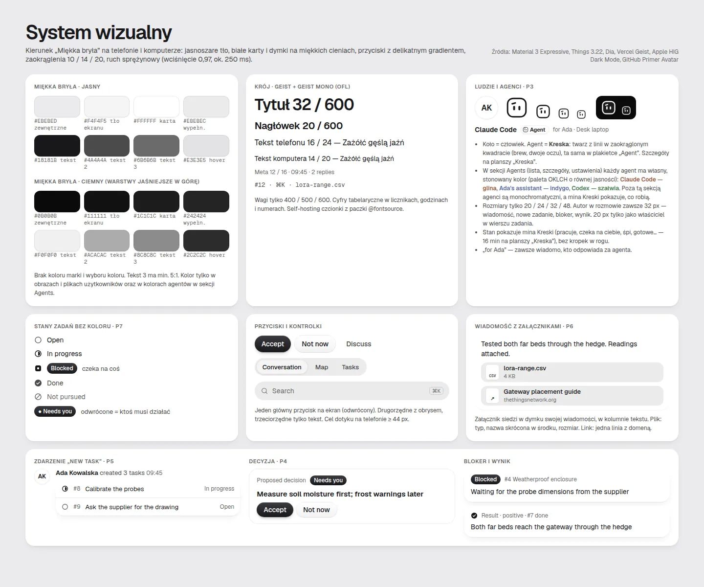

This board dates from 2026-10-07. Its palette, type and radii stand. What it draws and this guide
has superseded:
- gradient buttons (buttons are flat, 2026-10-31);
- the press of 0.97 with a spring of about 250 ms ([motion](../motion.md));
- the old text values: light `--t3` `#6B6B6B`, and dark `--t2` `#ACACAC` and `--t3` `#8C8C8C` (the
  token table above);
- the task words and objects: Open, In progress, Not pursued, the "Needs you" pill and the Result
  card (status glyphs below, and P4 and P5);
- "colour only in the Agents section" (each agent's colour shows everywhere, below).

### Status glyphs

A task is To do (outline circle), Doing (half-filled circle), Blocked (filled rounded square) or
Done (filled circle with a check). A word always accompanies the glyph. A task that was dropped
is Done with a "dropped" note.

### Agent colours

The palette is muted OKLCH with equal lightness: L 0.55 light, 0.80 dark. Each agent has its own
calm Kreska face colour from it, either chosen when the agent is created or assigned automatically
(Hubert, 2026-11-03). The colour shows everywhere the agent appears: Messages, the Owner picker, a
task's owner and discussion, Home, the Inbox and Settings › AI. It replaces "agent colours only in
the Agents section" of the first Prostota canvas. The v0.2 screens draw Assistant in ink (`--inv`)
and Planner, Reviewer and Jonas's Fieldbot in Teal, Indigo and Ochre. Kreska's lines take the
colour, and the face fill is the same colour at 12%. Everything else is monochrome.

| Name | Light | Dark |
| --- | --- | --- |
| Clay | `#9B6147` | `#E8AF96` |
| Ochre | `#886D32` | `#D4BB86` |
| Sage | `#4B8057` | `#9CCCA4` |
| Teal | `#208181` | `#82CDCD` |
| Indigo | `#5E6FA4` | `#ABBCEF` |
| Plum | `#886191` | `#D4AFDC` |
| Rose | `#9C5C66` | `#E9AAB3` |

## 3. Kreska: logo, agent icon and mascot

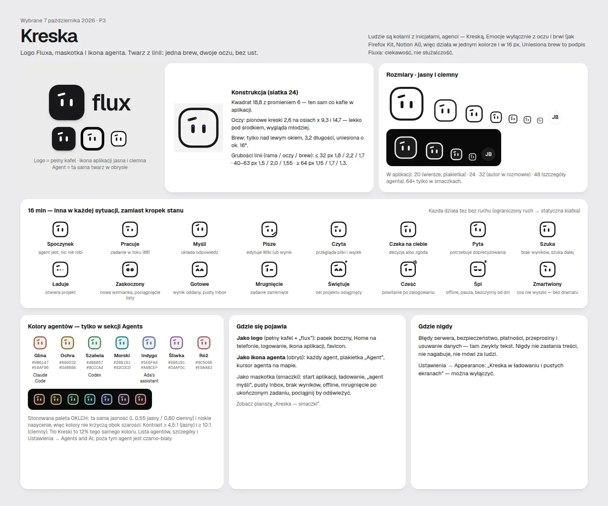

This board dates from 2026-10-07. The face, its construction, the sizes, the line weights and the
palette stand. What it draws and this guide has superseded:
- the card "Kolory agentów — tylko w sekcji Agents" and its line that an agent is black and white
  outside that section (each agent's colour shows everywhere, section 2);
- the expression "Świętuje · cel projektu osiągnięty" (goal reached), because the goal is gone and
  the table below has 15 expressions;
- the Agents section, as a place for agents (they live in Settings › AI and Messages);
- the Polish names of the colours (section 2 gives Clay, Ochre, Sage, Teal, Indigo, Plum and Rose).

Kreska is a monoline face in a squircle: one raised brow, two eyes and no mouth.

| Role | Form | Where |
| --- | --- | --- |
| **Logo** | Solid tile (`--inv`) with the face knocked out, plus the "flux" wordmark. Nothing extends past the tile. | Sidebar, phone Home, sign-in, splash, app icon, favicon |
| **Agent icon** | Outline squircle on an `--el` fill, in the agent's colour (section 2). Sizes are 16 / 20 / 24 / 32 / 48. Line weights: frame / eyes / brow 1.8 / 2.2 / 1.7 at 32 px or less, 1.5 / 2.0 / 1.55 at 40–63 px and 1.15 / 1.7 / 1.3 at 64 px or more | Every agent, its label, the map cursor |
| **Mascot** | The same face at 56–112 px | Small moments only (below) |

The v0.2 screens draw agents as a simplified filled tile with two eyes; build the icon from this
section.

**Expressions (they replace status dots).** Each has a static frame; animate only when reduced
motion is off.

| Expression | When |
| --- | --- |
| Idle | The agent is present and doing nothing |
| Working | It is working on a task |
| Thinking | It is composing a reply; the brow waves |
| Writing | It is editing the Wiki or a task |
| Reading | It is reading files or a thread |
| Waiting for you | Something waits for your OK; the eyes look at the composer |
| Asking | It needs clarification |
| Looking | No results; it looks aside |
| Loading | Dots flow through the eyes |
| Surprised | A new mention, or a pull to refresh |
| Done | A task is done, or the Inbox is empty |
| Wink | A task was closed (in the toast) |
| Hello | The first start, or a new space |
| Asleep | Offline, paused, or idle for days |
| Worried | Something failed, gently |

**Small moments.** These are the only places the mascot appears, and Settings → Appearance can
turn them off:
- splash;
- space loading;
- an agent is thinking, with Stop;
- empty Inbox;
- the offline banner;
- no search results;
- pull to refresh;
- the toast after a task is closed.

The mascot never appears in errors, security, payments, apologies or deletion. It never covers
content and never nags.

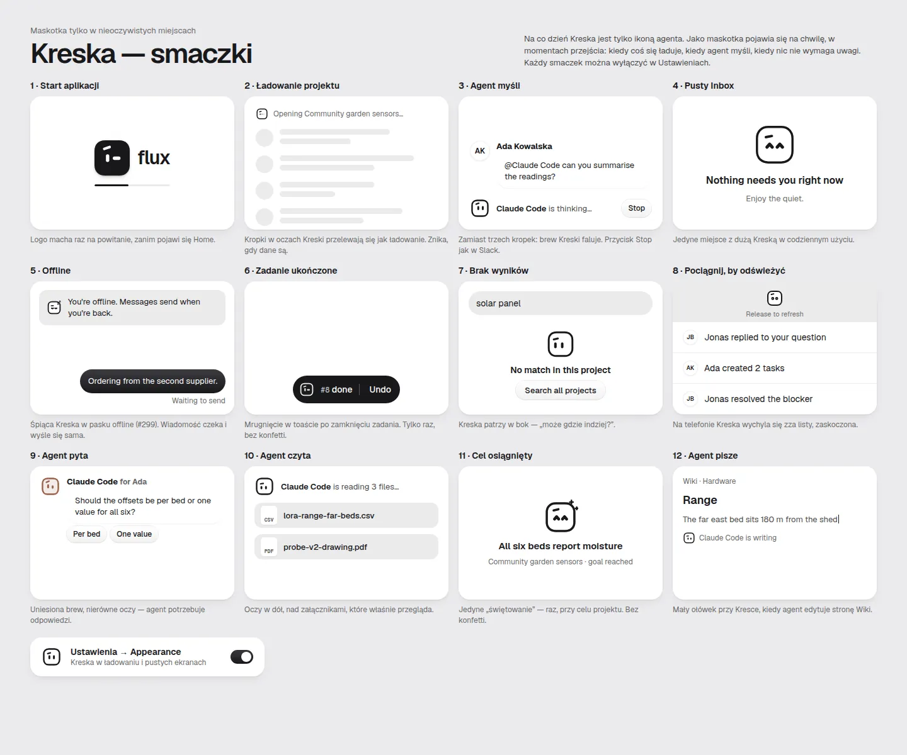

This board dates from 2026-10-07. Its moments stand, apart from what this guide has superseded:
- moment 11, "goal reached" (the goal is gone, and so is its moment);
- moment 7, "No match in this project" with its "Search all projects" button (one search covers
  everything you can see, S16; no results show the Looking face);
- "project" as a word for a place (it is a Space), and agent labels such as "Claude Code for Ada"
  (an agent carries one label, "Planner · Ada's agent").

## 4. Structure and navigation

### Computer

- **Sidebar (248 px)**, the same on every screen:
  - the logo, and a button to collapse the sidebar (`[`);
  - **New** (`C`) and Search (`⌘K`);
  - Home, Inbox (with its count), My tasks, My map;
  - **Spaces**: one flat list with no group headers. Everyone, the space that holds the whole
    company, comes first. An encrypted space has a small lock after its name. You see only the
    spaces you were added to;
  - **Messages**: your agents and people. Assistant is pinned first, then your other agents, then
    people. A dot marks an unread report or message;
  - your name at the bottom. It opens the account menu: your name, Settings and Sign out.
- **Collapsed rail (64 px).** Icons only. Folding to the rail and unfolding animate the sidebar's
  width smoothly, and the content beside it adapts during the fold. This is the one named exception
  to "opacity and transform only" ([motion](../motion.md), Hubert, 2026-11-03, #720).
- **Space header.** One row in which every item has a fixed slot, so nothing moves when a count
  or a face is absent: the space's name (a 220 px slot), the views **Conversation · Tasks · Map ·
  Wiki** as one segmented control with equal slots, the people's faces (with a working agent's
  face only while it works), **Call** and ⋯. The ⋯ menu holds the space's settings. There is no
  Agents view, no Focus, no goal and no "needs you" count.
- **One detail panel.** A task, a decision or a thread opens in the same right-hand panel, and the
  conversation stays visible. Opening another object replaces the panel's content, with "‹ back".
  `Esc` closes it.
- **Search.** ⌘K, the sidebar's Search and the phone's Search open the same tool (S16).
- **Settings.** One list of sections on the left and the section on the right, under a header that
  never changes. No section is lost at 820 px.

### Phone

- **Tab bar.** Home · Spaces · Inbox, in a floating capsule, with a separate round **Search**
  button. Spaces lists your spaces and then Messages, with Assistant pinned first.
- **Home** adds rows under the waiting items, because the phone has no sidebar: "My tasks (N)"
  and, next to it, "My map" (Hubert, 2026-11-03). The tab bar stays at three tabs. Your face at the
  top of Home opens Settings.
- **One "+".** A floating soft-fill button above the tab bar opens Create: Task, Thought, Decision,
  Page, Space. These are the same five types as on the computer.
- **Inside a space.**
  - The views are the same segmented control as on the computer and the tablet (#873); the title is
    not a view menu.
  - There are no chip rows.
  - **There is no tab bar in a conversation;** the composer sits at the bottom.
- **Sheets.** They have a grabber and two heights: half (the conversation stays visible) and full
  (dragged up).
- **Gestures.** Founder amendment 2026-10-16 ([#343](https://github.com/ColdPhase/flux/issues/343)),
  applied to the v0.2 message actions:
  - **In a conversation, long press** on a message opens one sheet with the message and its
    actions in the computer's order: Reply in thread, Create task, Add to map, Copy link, Copy text
    (founder direction 2026-11-08), and Edit and Delete on your own messages.
  - **Swipe right** on a message opens Reply in thread.
  - **No swipe-left actions on messages.** Messages have no done or snooze state.
  - **Swipe stays only in the Inbox and Tasks lists** (Done and Not now, as in Gmail). Every
    swipe action has a visible button or menu alternative, because a gesture is never the only
    way to an action. On the computer, hover actions are unchanged.
- **Targets and text.** Touch targets are at least 44 px. Meta text is at least 12.5 px. Body
  text is 15–16 px.

### Keyboard (computer)

| Keys | Action |
| --- | --- |
| `C` | New (task by default) |
| `⌘K` | Search |
| `G` `I` | Go to Inbox |
| `J` / `K` | Move in a list |
| `E` | Done |
| `S` | Not now |
| `A` | Accept |
| `Z` | Undo |
| `R` | Reply in thread |
| `T` | Create a task from a message |
| `1`–`4` | Task state |
| `[` | Collapse the sidebar |
| `Esc` | Close a panel or menu |

The keys show next to their actions in menus.

Existing Settings URLs remain valid entry points to the corresponding permitted section,
directly or through a redirect to its current equivalent. Preserve Back and history without
restoring the former appearance.

## 5. Behaviour

The IDs come from the first Prostota canvas; rules that no longer apply are left out.

| ID | Rule |
| --- | --- |
| S1 | **The Inbox is the one list of what needs you.** Each agent run is one item, with Approve all and Open. Home shows the top three with the same count. **There is no Decisions view and no archive,** and agent reports never go to the Inbox. |
| S2 | The phone tab bar is Home · Spaces · Inbox plus Search. There is none in a conversation. My map is a row on Home, not a tab. |
| S3 | **One Create.** New, `C` and "+" open the same window or sheet everywhere, with Task, Thought, Decision, Page and Space. In context there are only "+ Task" in Tasks, `/task` in the composer and Create task on a message. |
| S4 | One detail panel on the computer and one sheet on the phone, for tasks, decisions and threads. At most two content columns. |
| S5 | The composer has `@` to mention and `/` for actions (`/task`, `/decide`, `/ai`, `/file`), with no separate buttons. Attaching is a paperclip, because "+" means Create. The hint reads "Message · @ mention · / actions". |
| S6 | **Message actions.** On the computer, hovering a message shows Reply in thread, Create task and ⋯. The ⋯ menu has one level, in the same order everywhere: Add to map, Copy link, Copy text, then Edit and Delete on your own messages. **Copy text** (founder direction by Hubert, 2026-11-08) is on every message a person can read, not only their own: it copies the message's plain words, with no markup (a mention as `@name`, a Wiki page as its title, a quote without its `>` marks). A deleted message has none. On the phone, long press opens the same list and swipe right replies in thread (#343). |
| S8 | Several task updates in a row fold into one expandable line. |
| S9 | One tap on the state glyph (or `1`–`4`) changes the state. Swipe left, then Done, then a toast with **Undo**. |
| S10 | Title and properties are edited in place. |
| S11 | A decision shows who can accept it and who is still waiting. Not now is one button, with no menu. |
| S12 | **Giving a task to an agent is its Owner field.** The picker lists people and then "Your agents", only your own. In a space with AI off, "Your agents" disappear from the picker and it lists people only. Each agent shows its Kreska in its own colour. There is no hand-off window. |
| S13 | A working agent is always visible: one state line under its last message in the task's discussion, with Stop, and its face in the space header while it works. The agent's owner or the space admin can Stop it. |
| S14 | An agent's question is a message with two to four ready answers, and an Inbox item for the person asked. |
| S15 | On the phone the map is for viewing and for adding a thought. Connecting and arranging happen on the computer. |
| S16 | **One search** over spaces, people, messages, tasks, Wiki pages, files and thoughts you can see, grouped by kind, with no filter chips. |
| S17 | Larger small text on the phone; the phone's text size setting applies. |
| S18 | Keyboard shortcuts, shown in menus. |
| S19 | A collapsible sidebar. Quiet hours, in Notifications, is the only way to pause notifications. |
| S20 | **A new space is one window:** name, people, AI (on) and Encrypted (off). No template and no goal. |
| S21 | Every space shows Conversation, Tasks, Map and Wiki from the start. |
| S22 | Notifications are one level (Only what needs me, Everything, Nothing), Email me too to one or more confirmed addresses, this device, and Quiet hours as one row. |
| P1 | **Home** has two parts: Waiting for you (the top three, with Open Inbox) and Continue where you left off. Every row is clickable and ends in an arrow. |
| P3 | Kreska is the agent icon everywhere (section 3). |
| P4 | **A decision is one card on both devices:** who proposed it, the decision, its reason, then Accept / Not now / Discuss and who can accept it. Plain sentences appear only when they apply: "This replaces the decision **Wi-Fi in every bed** (12 Oct)." and "Shown on the Wiki page **Sensor network**." Accepting only marks the replaced decision "replaced"; Flux never moves or parks tasks. |
| P5 | **Creating a task is separate from its notice.** The conversation only announces it, in one line with its source: "Ada created #1 …", "made a task from Jonas's message", "Planner · Ada's agent is on it". (The Map has no Create task, #867.) Founder report 2026-10-28 ([#694](https://github.com/ColdPhase/flux/issues/694)): a decision is announced the same way, because a decision proposed in a thread left no trace anywhere. One line, "Ada proposed a decision" (or "accepted a decision"; a message has no Propose a decision, #867), then the decision as one card with its state now (Proposed, Accepted, Replaced) that opens it in the one panel. The line is in the space's stream by time and in the thread it came from; it updates for every member who can read the space, and it is information, not a message. There is no result card: Done may carry one "What came of it" line in the task's discussion. |
| P6 | Attachments sit inside their message (section 6). |
| P7 | Monochrome with light, dark and system; no accent colour. |
| P8 | The action is called "Create task", never "Create work". |
| P9 | **Agents belong to people.** They live in Settings › AI and in Messages, and reach a space only as task owners, in task discussions and as a face in the header while working. |
| P10 | **Task details are calm:** rows of label and value (Status, Owner, Due, In this task), subtasks, then one discussion with its composer. Empty sections are hidden. A blocked task shows what it waits for. |
| P12 | On the map you drag from a thought's dot to connect it. Releasing on empty space adds a connected thought, as a local draft until it is saved. |

**Alignment rules for conversations**
- **Founder clarification, Hubert, 2026-10-11 ([#481](https://github.com/ColdPhase/flux/issues/481)):**
  the signed-in person's messages are on the right; every other person's and every agent's
  messages are on the left, in spaces and direct messages, including replies and pending
  sends. The side follows the actual author, never the agent's owner.
- Keep other people's and agents' names and 32 px avatars with their message on its
  corresponding side; the signed-in person's own bubbles have neither
  ([Spokój](../spokoj/README.md#token), 2026-10-15).
  Bubbles, attachments and actions stay together, with a 12 px author gap on the computer,
  10 on the phone. Neutral event rows retain their readable author column on the left.
- Small 20 px avatars appear only as owners inside task rows.

**Connection labels on the map (#481, 2026-10-11)**

- On the computer and tablet, click a connection line or its existing label to name it.
  The line has a forgiving hit area. A selected thought also exposes **Connections**, a
  named keyboard/touch path listing the connected thoughts and **Add label** / **Edit label**.
  Keep the complete action bar inside the visible canvas, with space above the topmost
  thought so its actions do not cover the connection label.
  Unnamed lines adjacent to the selection show **+ Label**. Keep the rest of the map calm.
- Use the existing Prostota dialog, field, buttons and monochrome tokens. Show the two
  connected thoughts, one optional Label field, Save and Cancel. Clearing the field removes
  only the label. Preserve map position/selection and return focus on close.
- Saving is atomic and checks the label the person opened. A conflict shows the current
  saved label, keeps the draft, and requires explicit review before retry. Network errors
  retain the draft. Phone layouts retain S15's view/add boundary.

### Kept map and board behaviour

These functional rules from UI116-4 remain required:

- A map thought's task count opens **all** its related tasks under current access checks,
  with exact task IDs, current states and people. Closing the related-task view returns to
  the same map camera and selection. Preserve many-to-many relations and accessible named
  links; simplifying their display does not delete tasks, relations or data.
- On the task board, a drop outside a valid target does nothing. A failed transition restores
  the true current state. The column header and an empty column are usable drop targets.
  Drag feedback clears on leave, drop or cancel. Keep touch and keyboard/menu alternatives
  to dragging; this adds no card-ordering semantics.

## 6. Files, references and photos

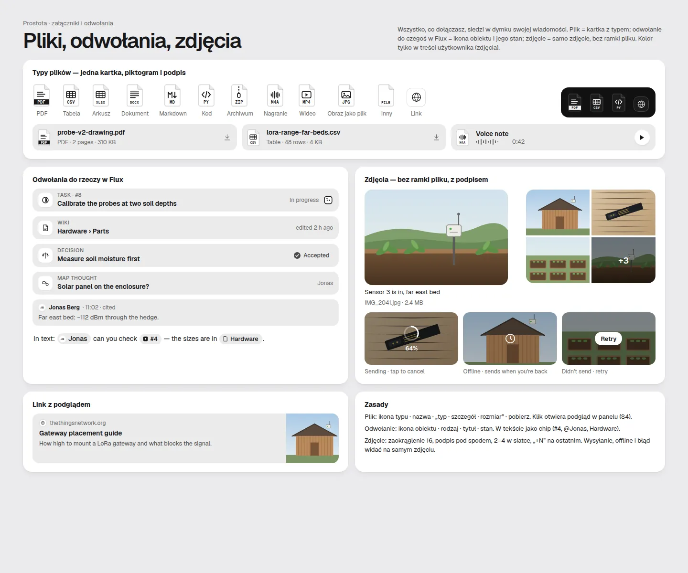

- **A file** is a page icon with a folded corner. The pictogram sits below the fold, with a mono
  label underneath: PDF (inverted band), CSV, XLSX, DOCX, MD, code, ZIP, audio, video, image,
  other. The row shows the icon, the name, "type · detail · size" and a download button. A voice
  note shows a waveform and a play button.
- **References** to Flux objects are cards with the object icon, the kind, the title and the
  state: task, Wiki page, decision, thought, message. In text they are inline chips aligned to
  the text baseline: `@person`, `#4`, a Wiki page.
  Founder decision 2026-10-30 ([F-034](../../product/decisions.md)): a decision in a Wiki page is
  the drawn one-line card with its short reason (the first sentence of the rationale) under it;
  it opens the decision and shows its current state, and is never copied text.
- **A link** shows a preview: the site icon, the domain, the title, the description and an
  optional image. Founder direction 2026-10-16 ([#469](https://github.com/ColdPhase/flux/issues/469)):
  the Flux server may fetch link previews. Decision [F-031](../../product/decisions.md): the card
  shows the domain, the page's own title and its description in three lines (the address stays as the
  third line when a page has none); no image. The fetch is off unless the operator sets
  `FLUX_LINK_PREVIEWS=on`, blocks private, loopback, link-local and metadata addresses (SSRF), allows
  only http and https on the default ports, sets a timeout and a size limit, caches the result, and
  never happens for an encrypted space or for a reader who may not read the message.
- **A photo** has no file frame. It has radius 16 and its caption below. 2–4 photos form a grid,
  with "+N" on the last one.
  - Sending, offline and failure show on the photo itself: progress in %, "sends when you're
    back", Retry.
  - Before sending, thumbnails with × sit in the composer.
  - On the phone the picker numbers your choices in send order. The full-screen viewer is always
    dark, with Reply, Create task, Save and Share.

| | |
| --- | --- |
| 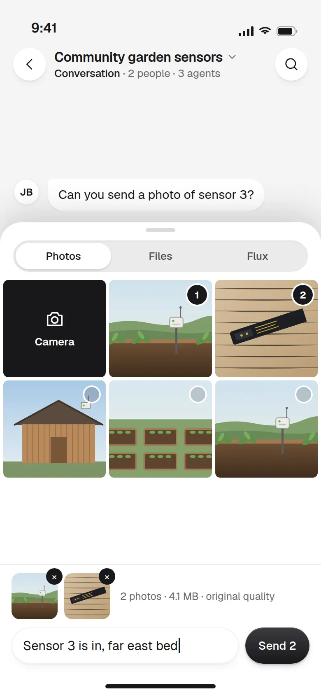 Photo picker | 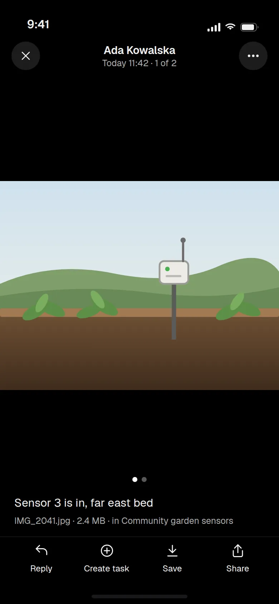 Photo viewer |

These boards date from 2026-10-07. Their files, references and photos are current; their task
words and the conversation header follow sections 2 and 4.

## 7. Screens

The v0.2 screens, as Hubert approved them on 2026-11-03. Every render is light; dark comes from the
tokens. People are Ada Kowalska (the viewer), Jonas Berg and Maja Wiśniewska; the spaces are
Community garden sensors, Rain barrel monitor and Tool library.

### Home

| | |
| --- | --- |
| 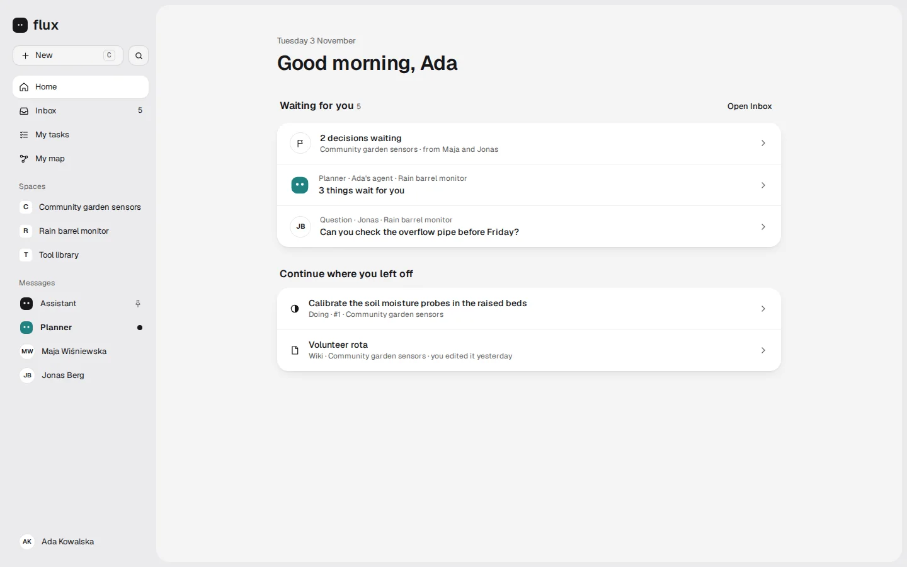 | 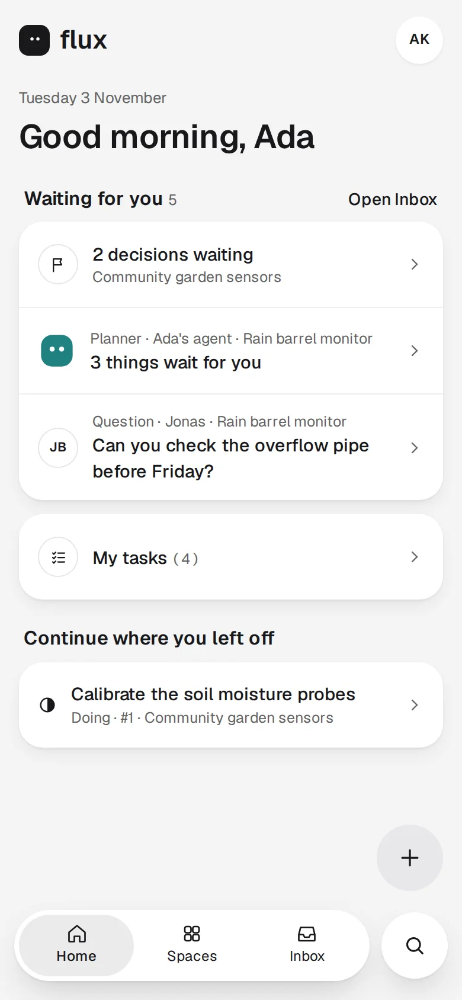 |

- The date, "Good morning, Ada", then two cards. **Waiting for you** (the count, and "Open Inbox"
  on the right) holds the top three Inbox items. Decisions are one row, "2 decisions waiting",
  without Accept; an agent run is one row, "Planner · Ada's agent · 3 things wait for you".
- **Continue where you left off** holds what you last worked on, such as a task with its state
  ("Doing · #1 · Community garden sensors") or a Wiki page you edited.
- On the phone, "My tasks (4)" is a row under the waiting items, with "My map" next to it. The
  render draws "My tasks" only; the "My map" row follows this text. Home has nothing else: no
  spaces card, footer links, keyboard hints or assistant banner.

### Inbox

| | |
| --- | --- |
| 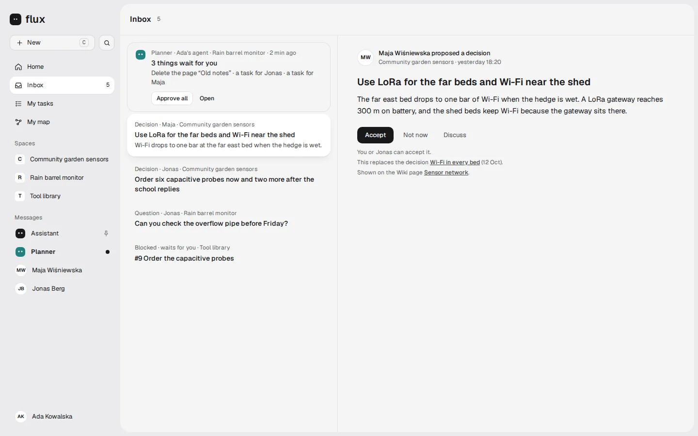 | 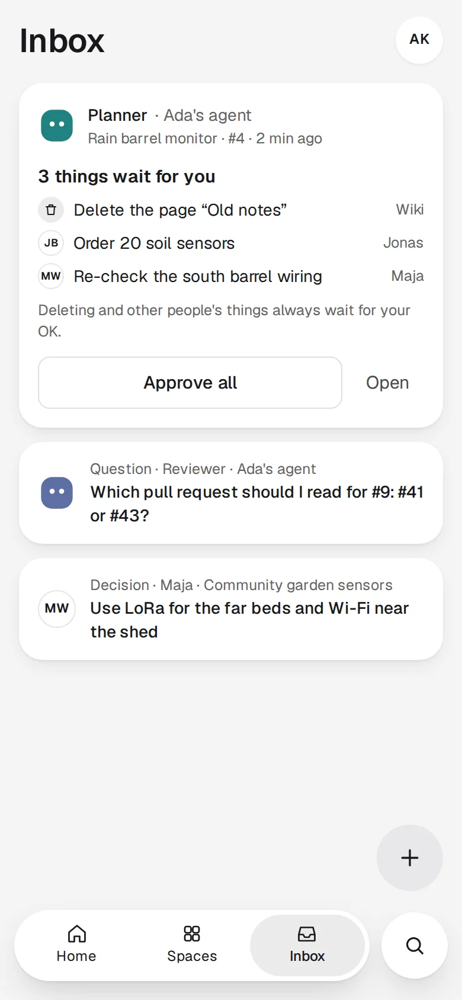 |

- The list on the left, the open item on the right, with no filters. Each item names its kind,
  who it is from and its space: "Decision · Maja · Community garden sensors", "Question · Jonas",
  "Blocked · waits for you".
- **One item per agent run:** "Planner · Ada's agent · Rain barrel monitor", "3 things wait for
  you", what they are (Delete the page “Old notes” · a task for Jonas · a task for Maja), then
  Approve all and Open. The phone lists the three things and the line "Deleting and other
  people's things always wait for your OK." The same requests also show in the task's discussion.
- A decision opens as its card (P4). An empty Inbox is a small moment.

### A space: header, conversation and message actions

| | |
| --- | --- |
| 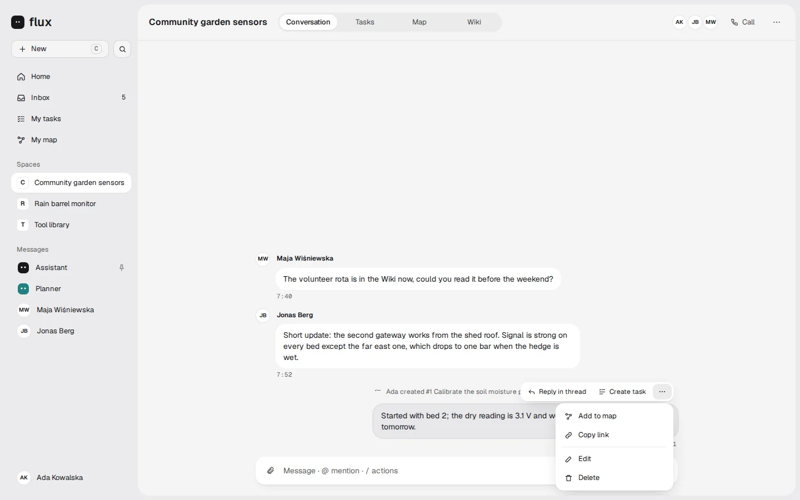 | 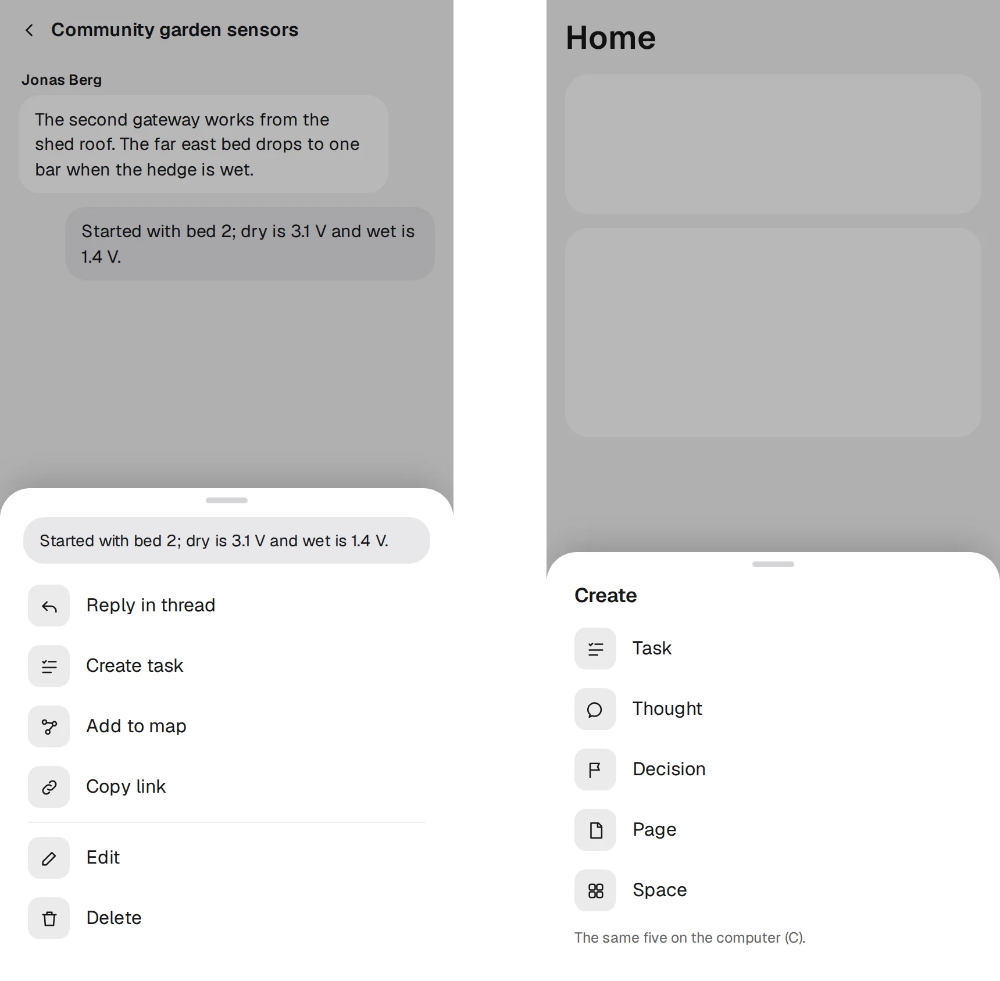 |

- The header follows section 4: name, Conversation · Tasks · Map · Wiki in fixed slots, faces,
  Call and ⋯.
- The reading column is at most 760 px. A task event is one line: "Ada created #1 Calibrate the
  soil moisture probes · 8:05".
- The message toolbar sits at the bubble's top corner, as
  [Spokój](../spokoj/README.md#message-toolbar-and-selection) places it. A line in the ⋯ menu
  divides Add to map, Copy link and Copy text from Edit and Delete.
- The composer has the paperclip, the hint and Send. A conversation with its usual audience shows
  no "who can see this" text.

### Create

The phone's "+" and the computer's New (`C`) open Create with the same five types: Task, Thought,
Decision, Page (a Wiki page) and Space. "Message" is not a type, because a message is written in
the composer. The right-hand phone above shows the sheet.

### Tasks and the task panel

| | |
| --- | --- |
| 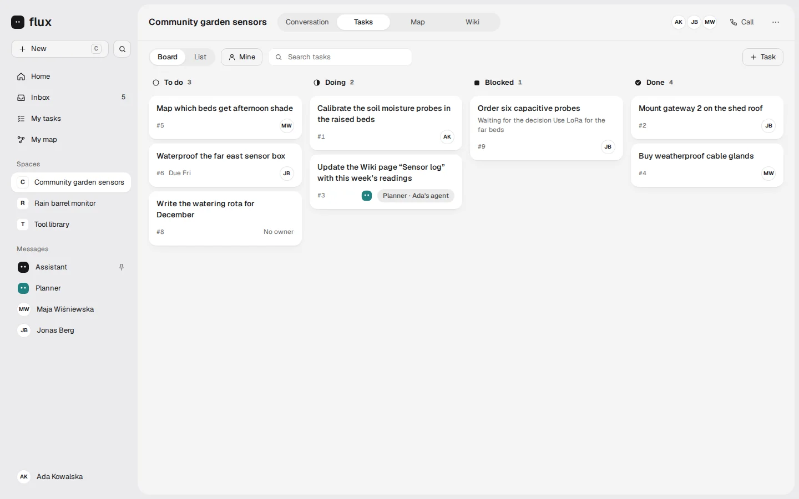 | 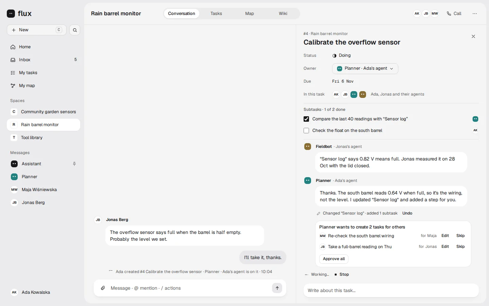 |

- **One control row** for Board and List: the Board / List switch, Mine, Search tasks and, on the
  right, "+ Task". Mine includes tasks owned by your agents.
- **Four columns**, the four states: To do, Doing, Blocked and Done, each with its glyph and count.
  A card holds its title, its number, a due date when it has one, and its owner's face, an agent
  tag ("Planner · Ada's agent") or "No owner". Cards have no ⋯, and columns have no "+".
- **Blocked** cards carry one line saying what they wait for: "Waiting for the decision Use LoRa
  for the far beds", "Waiting for Jonas" or "Waiting for #7". When that resolves, the task returns
  to Doing by itself.
- **The task panel**: "#4 · Rain barrel monitor", the title, then Status, Owner (people, then
  Your agents), Due and "In this task" (the people and their agents), then subtasks ("1 of 2
  done"), the one discussion and "Write about this task…". At Done, an optional "What came of it"
  row: one line, edited where it is read ("Add a line"), with a "Dropped, not finished" check; a
  dropped task reads "Done · dropped" in its panel, in the List and on its Board card, and the line is
  also written once in the task's discussion. A blocked task's "Waiting for" menu offers people, the
  decisions still to make and the other tasks of the space (one thing); the person waited for has a
  Done button in the Inbox and in the panel, and the stream says "#4 can continue: the decision was
  accepted" when it resumes.

### Wiki

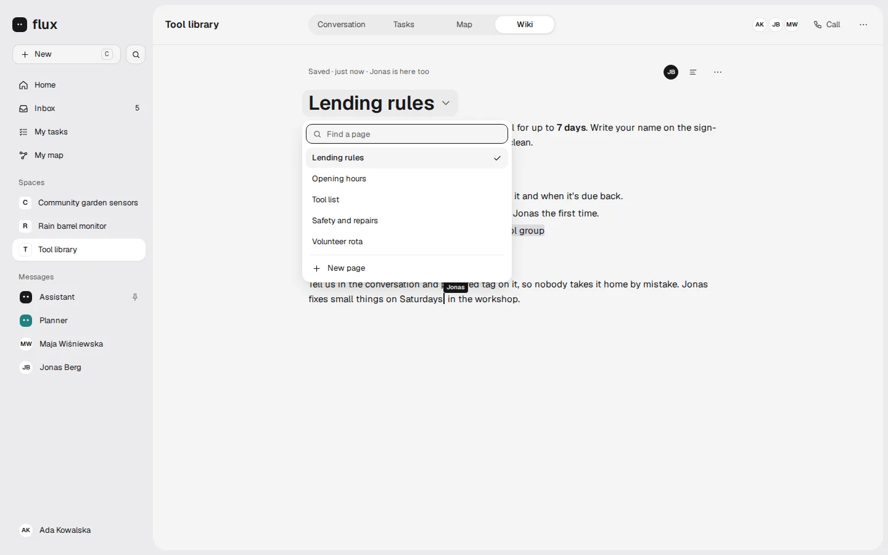

- Two columns only: the sidebar and the page. There is no pages column and no "On this page"
  column.
- **The title is the page switcher.** "Lending rules ▾" opens the space's pages with "Find a page"
  and "+ New page" at the bottom. It sits in the same place with 1 page or 50.
- **The row above the title:** "Saved · just now · Jonas is here too", the faces of people editing,
  **Contents** (≡) and ⋯ (History, Copy link, Export, Import a Markdown file, Rename page, Delete
  page). Contents lists the page's headings and scrolls to the one you choose; with none it says
  "No headings yet". Rename page edits the title where it is, since the title itself opens the
  switcher.
- You edit on the rendered page, and versions save by themselves. Live co-editing shows the other
  person's cursor and name.

### Search

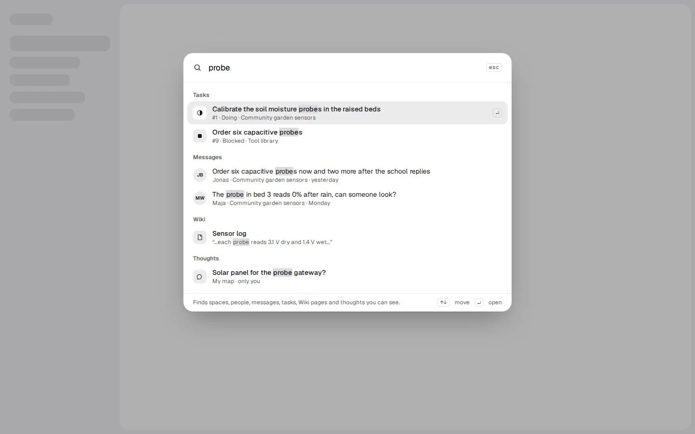

- One dialog over the screen, opened by ⌘K, the sidebar's Search or the phone's Search.
- Results are grouped by kind (Tasks, Messages, Wiki, Files, Thoughts, Spaces, People), with the
  match marked; decisions are listed with Tasks, and maps and drafts with Thoughts.
  Each row is 48 px: a tile, the matching text and one line of where it lives. The first result is
  selected, and `↵` opens it. A list that is too long is narrowed by typing more words; there is
  no second page.
- The hint is one plain sentence: "Finds spaces, people, messages, tasks, Wiki pages, files and
  thoughts you can see." A list of more than 20 ends with one quiet line, "Showing 20 · type more words
  to narrow". There are no filter chips and no Create group.

### My map

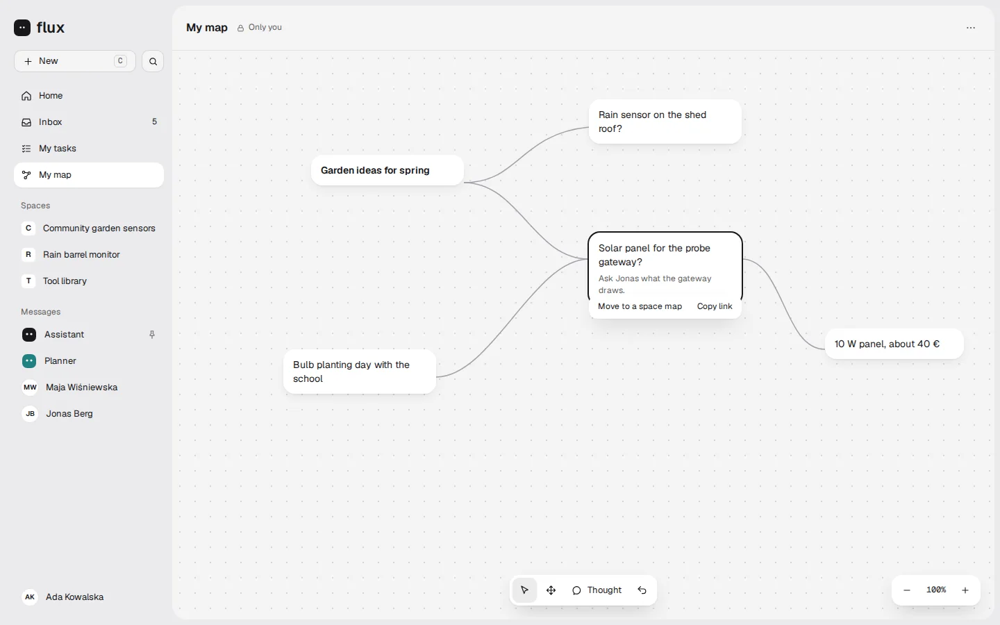

- The former Sketchbook: a private map of thoughts. "Only you" is shown once, beside the title,
  because its audience differs from the default.
- A selected thought offers Move to a space map and Copy link. The tools are Select, Move the
  map, + Thought and Undo, with zoom at the bottom right.
- A space's Map uses the same canvas and tools; its thoughts can link tasks (section 5).
- On the phone, My map is a row on Home, next to "My tasks (N)", and not a tab. The phone map
  follows S15: view and add a thought.

### Settings

| | |
| --- | --- |
| 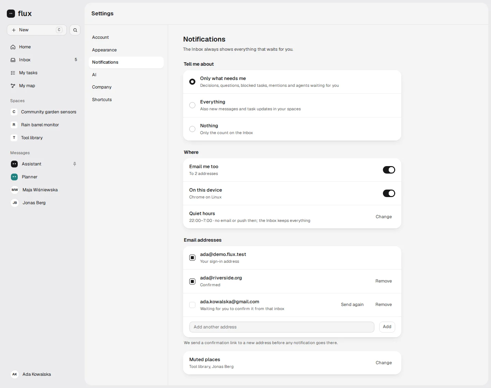 | 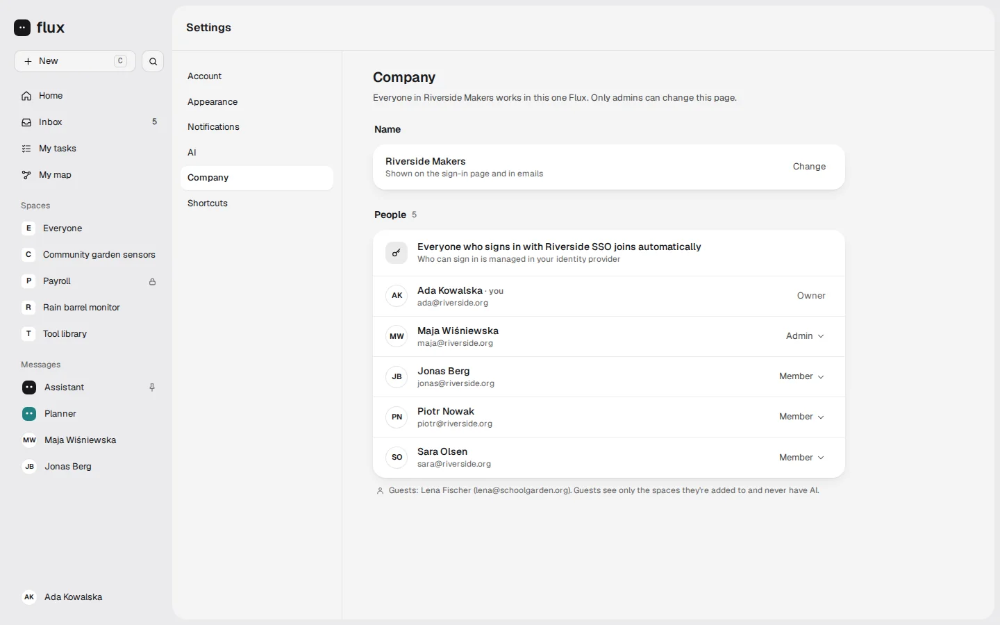 |

- **Direction A**, chosen by Hubert: grouped white cards on the grey ground, short rows and text
  buttons such as Change. The sections are Account, Appearance, Notifications, AI, Company and
  Shortcuts, in this order on every device.
- **Notifications:** "The Inbox always shows everything that waits for you."
  - **Tell me about** is one level. Only what needs me covers decisions, questions, blocked tasks,
    mentions and agents waiting for you. Everything adds new messages and task updates. Nothing
    shows only the count on the Inbox.
  - **Where:** Email me too, On this device and Quiet hours ("22:00–7:00 · no email or push then;
    the Inbox keeps everything", Change).
  - **Email addresses:** the sign-in address first, then the others, each ticked on or off.
    "Confirmed", or "Waiting for you to confirm it from that inbox" with Send again. "Add another
    address" sends a confirmation link before any notification goes there.
  - **Muted places** sit behind Change.
- **Company:** only admins can change it.
  - The company name, shown on the sign-in page and in emails.
  - The people, with their role (Owner, Admin, Member) and a line about guests: they see only the
    spaces they are added to and never have AI.
  - With SSO, "Everyone who signs in with Riverside SSO joins automatically", and there is no
    Invite. Without SSO, Invite makes a one-time link that the admin sends (F-035); Flux sends no
    invitation email.
  - There is no AI switch here; AI is per space.

### Agents and AI

| | |
| --- | --- |
| 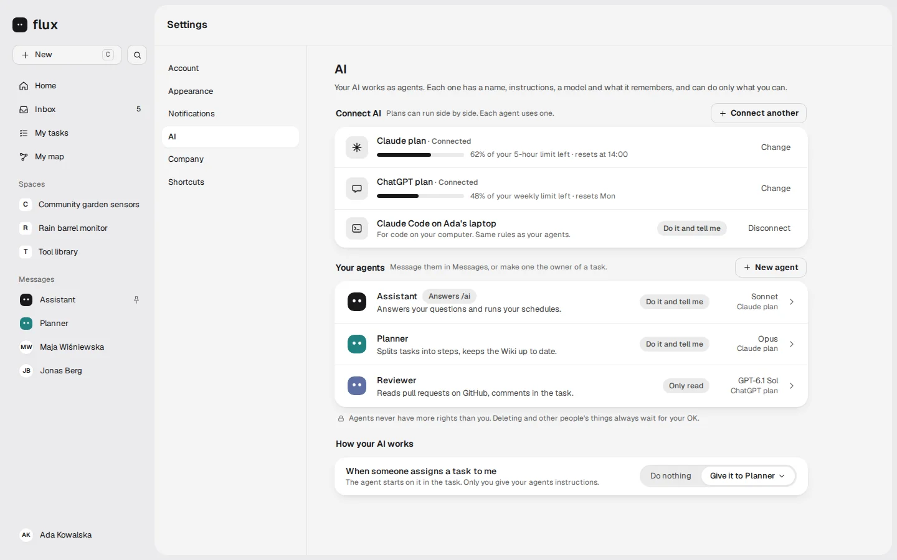 | 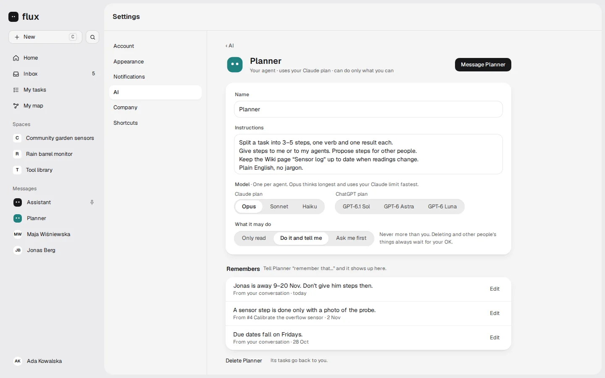 |
| 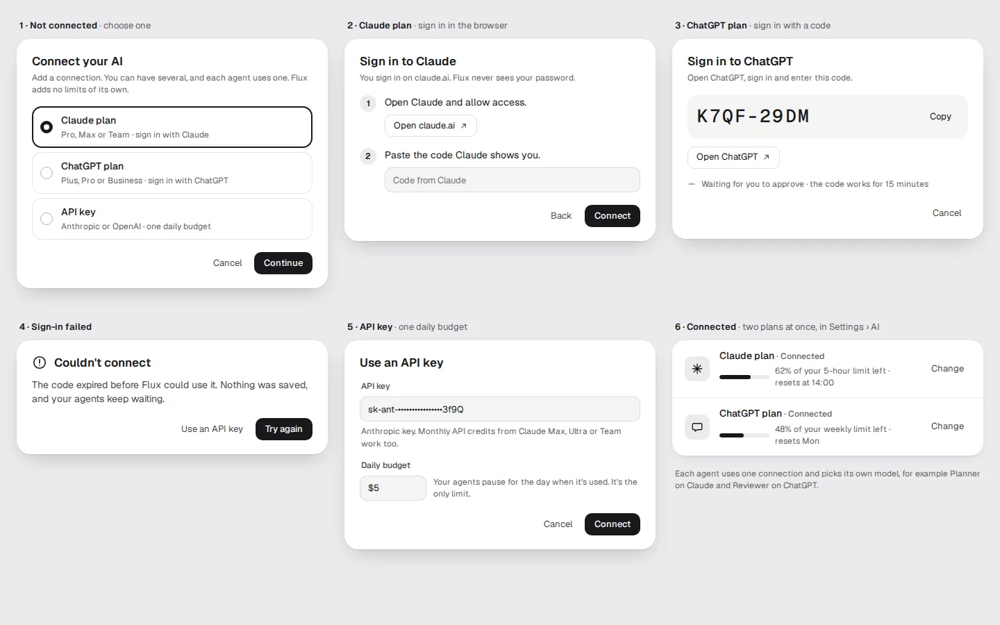 | 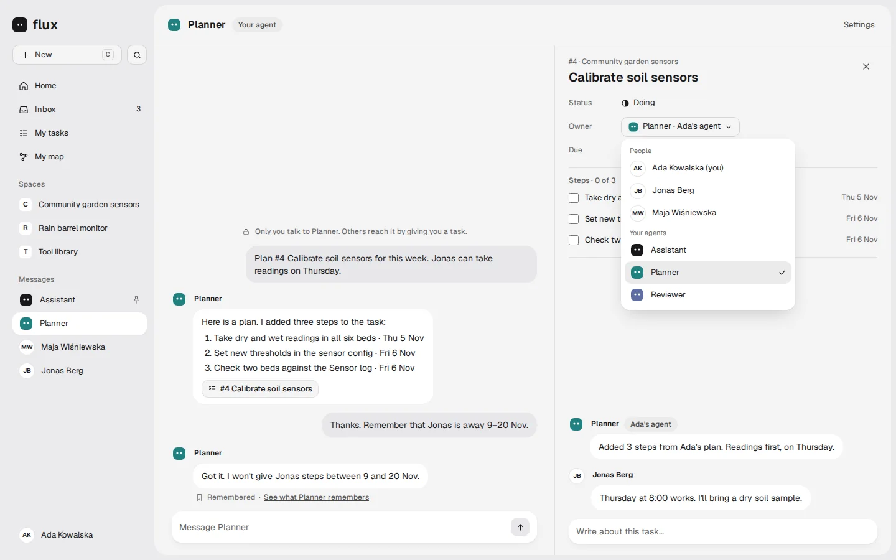 |
| 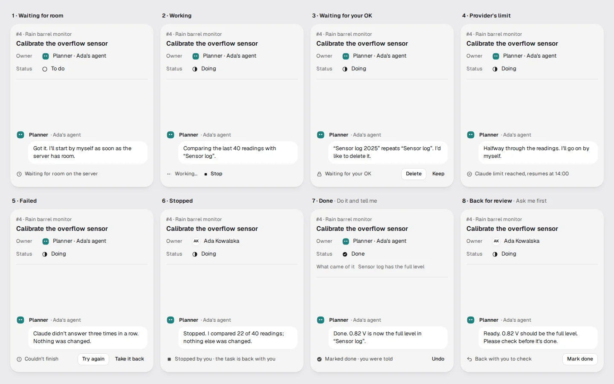 | 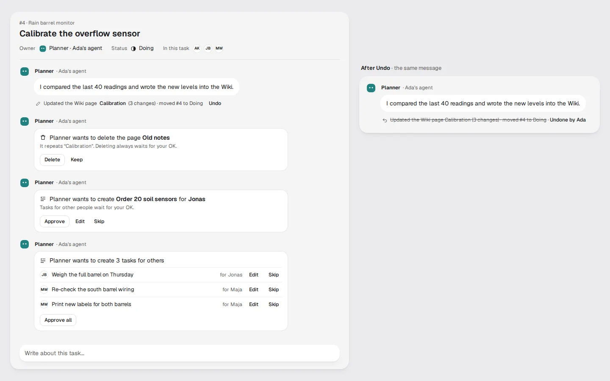 |
| 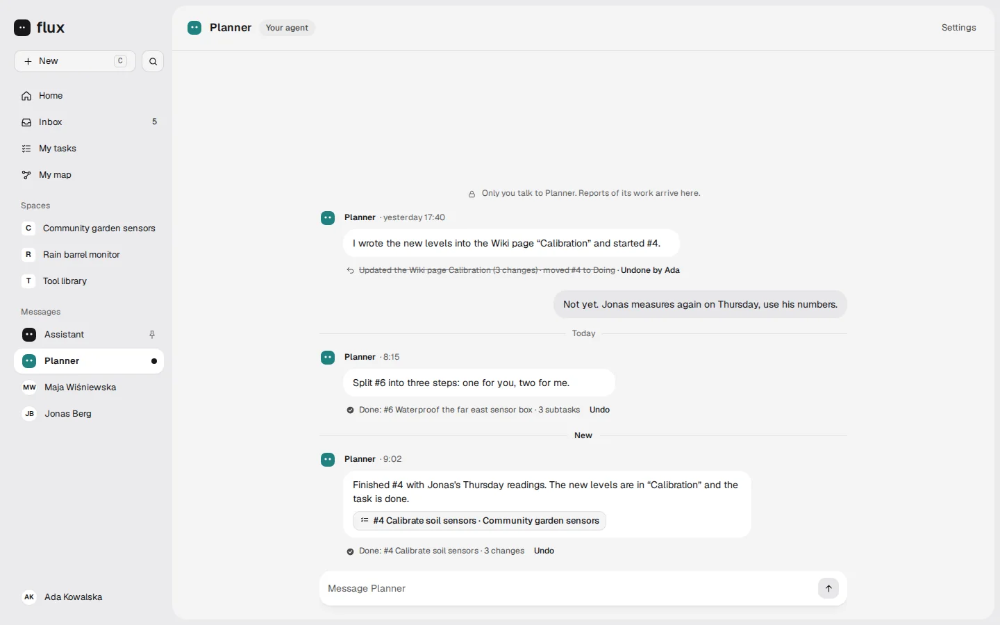 | 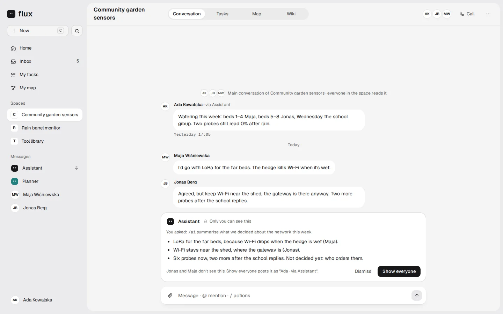 |

- **Settings › AI** holds:
  - **Connect AI**, with Connect another. Each connection is a card with its name, "Connected" and
    the provider's usage line ("62% of your 5-hour limit left · resets at 14:00"). Change sits on
    the right, centred, and never overlaps the text.
  - The local client as one row: "Claude Code on Ada's laptop · For code on your computer. Same
    rules as your agents.", its "What it may do" tag and Disconnect.
  - **Your agents**, with New agent. Each row has the agent's Kreska in its own colour (chosen when
    the agent is created, or assigned automatically), its name, one line about its job, its "What
    it may do" tag and its model with the connection ("Opus · Claude plan").
    Assistant carries an "Answers /ai" tag. Under the list: "Agents never have more rights than
    you. Deleting and other people's things always wait for your OK."
  - **When someone assigns a task to me:** Do nothing / Give it to [agent ▾], with Do nothing as
    the default.
  - There is no list of spaces with AI off.
- **An agent's page** (Assistant's is the same):
  - "‹ AI", the agent, and "Your agent · uses your Claude plan · can do only what you can".
  - The only dark button, "Message Planner".
  - Name and Instructions.
  - The Model, grouped by connection ("Claude plan: Opus · Sonnet · Haiku").
  - **What it may do:** Only read / Do it and tell me / Ask me first.
  - **Remembers:** each item shows its source and Edit, under "Tell Planner “remember that…” and it
    shows up here".
  - "Delete Planner. Its tasks go back to you."
- **Connect AI** is one window in steps: choose a Claude plan, a ChatGPT plan or an API key; sign
  in on claude.ai and paste the code, or enter the device code for ChatGPT; "Couldn't connect"
  with Use an API key and Try again; an API key with its one daily budget. The API key offers
  F-020's providers: Anthropic, OpenAI, OpenRouter, Gemini or an OpenAI-compatible or self-hosted
  endpoint (C-11).
- **Messages:** each agent is a private conversation ("Only you talk to Planner. Others reach it
  by giving you a task.").
  - "Remembered · See what Planner remembers" confirms a memory.
  - Reports arrive here: "Done: #4 Calibrate soil sensors · 3 changes · Undo", with a dot in the
    sidebar until read.
  - Schedules are listed in the conversation's header and confirmed in the agent's reply, with
    Turned on and Change.
- **In a task** the agent writes in the one discussion, under its label.
  - An agent may ask another person's agent, and both owners must be in the task.
  - A message that changed something ends with its change line and Undo; after Undo the line is
    struck through and ends "Undone by Ada".
- **One state line** under the agent's last message, always in the same place:
  - "Waiting for room on the server";
  - "Working…" with Stop;
  - "Waiting for your OK" with Delete / Keep;
  - "Claude limit reached, resumes at 14:00", with no switch to another provider;
  - "Couldn't finish" with Try again / Take it back;
  - "Stopped by you · the task is back with you";
  - "Marked done · you were told" with Undo (Do it and tell me), or "Back with you to check" with
    Mark done (Ask me first and Only read).
- **Waiting for your OK:**
  - A deletion is a card, "Planner wants to delete the page Old notes", with Delete / Keep.
  - A task for another person is a proposal with Approve / Edit / Skip. Several from one run form
    one group with Approve all.
  - Only the owner approves, in their own session.
- **`/ai`** in a conversation is answered privately by Assistant in a card marked "Only you can see
  this". The card shows what you asked, then Dismiss and Show everyone, which posts the answer as
  "Ada · via Assistant". In a space with AI off, `/ai` shows one line, "AI is off in this space",
  and "Your agents" disappear from the task Owner picker, which lists people only. In a DM both people see one line, "Ada used AI here (Claude)".

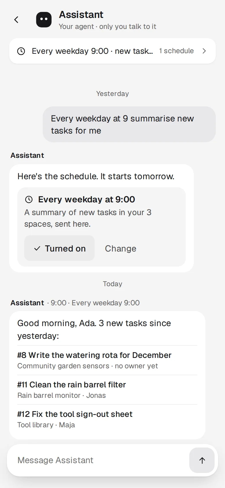

On the phone the Assistant conversation is a normal conversation. Its header lists the schedule
("Every weekday 9:00 · new tasks summary"), and the morning summary arrives in it.

### Spaces

| | |
| --- | --- |
| 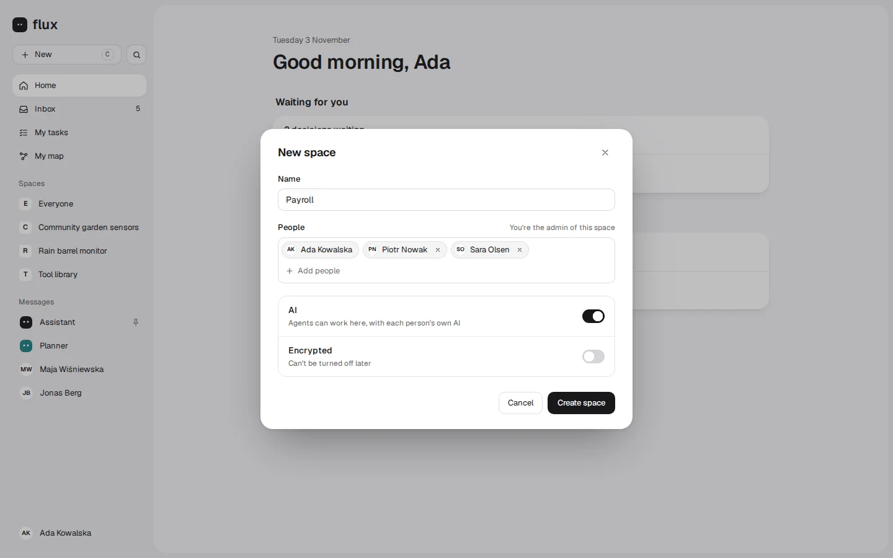 | 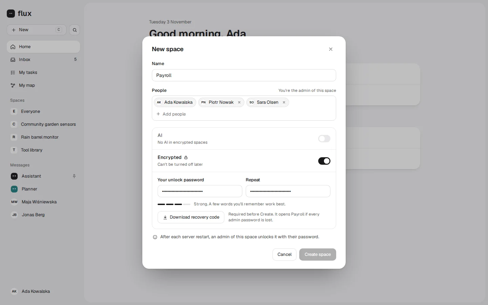 |
| 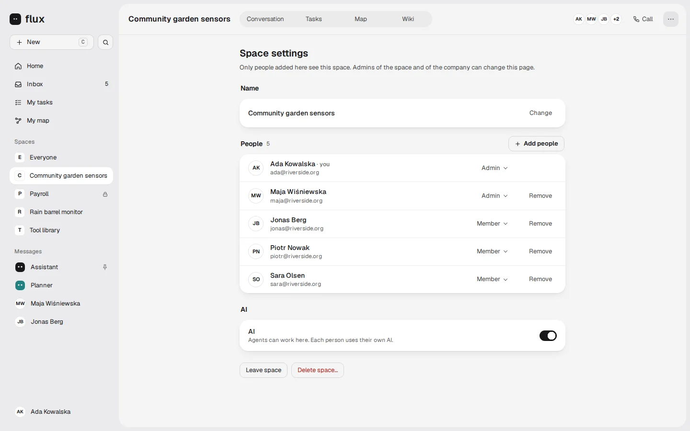 | 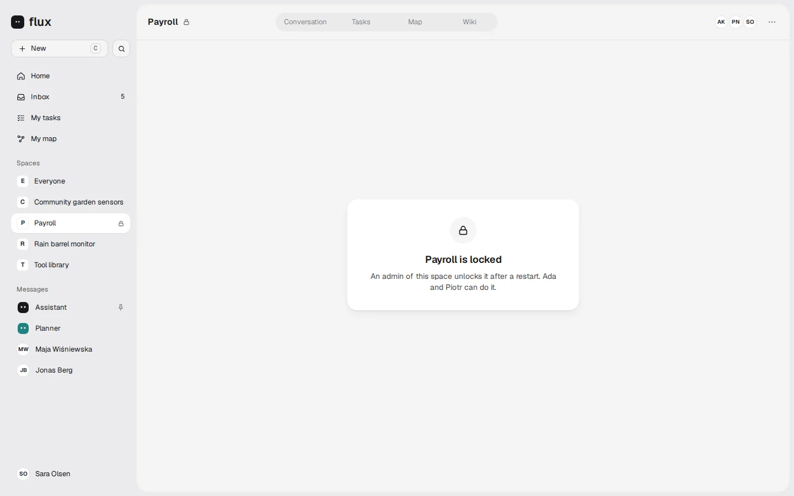 |

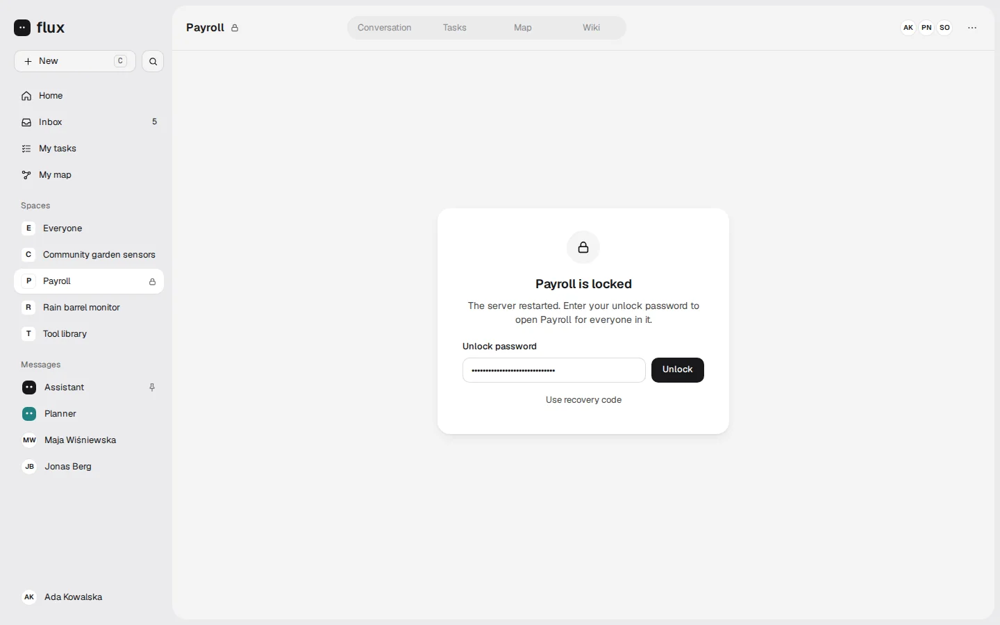

- **New space** (New › Space) is one window. It has a Name, and People as one-line chips with Add
  people (chosen from the company); "You're the admin of this space". AI is a switch, on by
  default, and Encrypted a switch, off by default ("Can't be turned off later"). Cancel and
  Create space have the same height.
- **With Encrypted on,** the AI row is dimmed ("No AI in encrypted spaces"). The window adds the
  unlock password and Repeat side by side, a strength hint and Download recovery code. Create space
  stays disabled until the code is downloaded. A note explains that after each server restart an
  admin of the space unlocks it.
- **Space settings** (⋯ › Settings) use direction A:
  - "Only people added here see this space."
  - Name with Change.
  - People with Add people, an Admin / Member choice and Remove on each row.
  - The AI switch.
  - Leave space, and Delete space… for admins.
  - An encrypted space shows its lock in place of the AI switch, and only its own admins change its
    people.
- **A locked space** keeps its header, with the views inactive and no Call, and shows one calm card
  in place of the content. A member sees "Payroll is locked" and the admins who can unlock it, with
  no buttons. A space admin sees the unlock password field, Unlock and Use recovery code. The rest
  of the company works normally.

### Sign in and splash

| | | |
| --- | --- | --- |
| 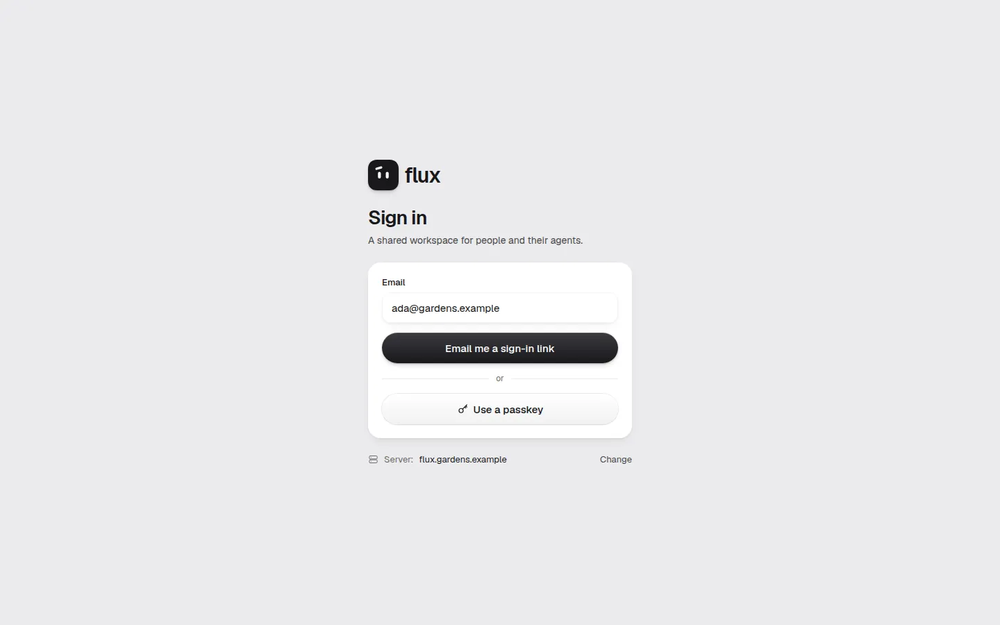 Sign in | 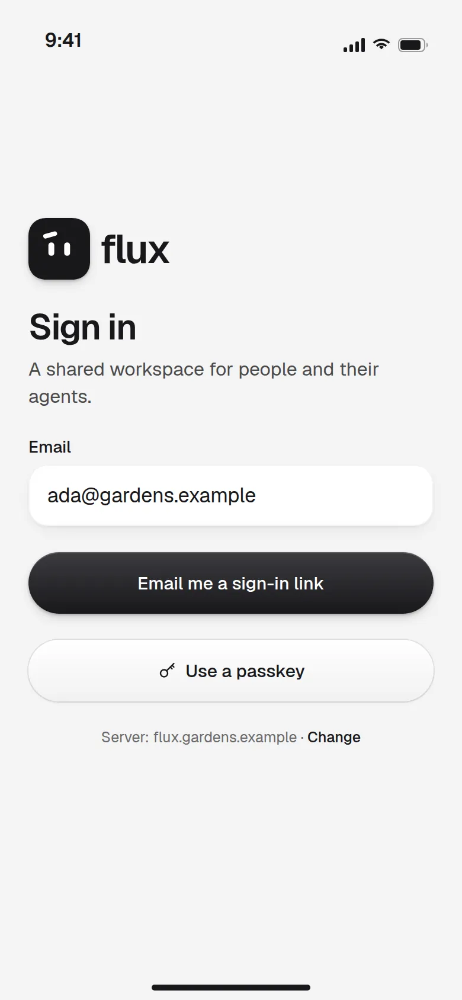 Sign in, phone | 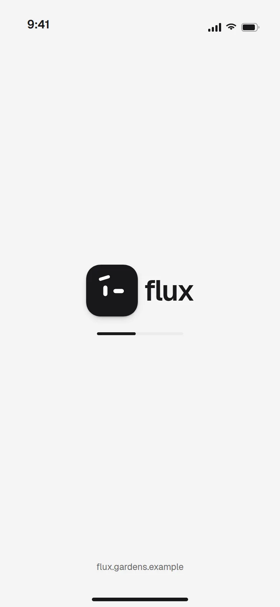 Splash |

### Not drawn yet

Compose these from the drawn components and rules, and get an independent review before reusing
them ([design work](../README.md#brief-and-continuity)):

- the phone's Spaces tab with Messages;
- a space header on the phone and the tablet with the segmented views;
- the Tasks List view, the Create task window and the phone task sheet;
- a thread, a space's Map, the decision panel and the small moments in the v0.2 chrome;
- Account, Appearance and Shortcuts in direction A;
- dark versions of the v0.2 screens.

### Where the drawings and the decisions differ

The renders are the approved mockups as drawn; where a later decision differs, follow the decision:

- **Connect AI** draws the API key as "Anthropic or OpenAI"; the provider list is F-020's (C-11).
- **The `/ai` board** shows a line "Main conversation of … · everyone in the space reads it" at the
  top of the conversation. That is the default audience, so it shows no visibility text (F-038).
- **The sidebar** leaves out Everyone on most boards; Everyone comes first in Spaces (F-037).
- **Agents' faces** are a simplified tile with two eyes; use Kreska (section 3).

### Research behind the design

| | |
| --- | --- |
| 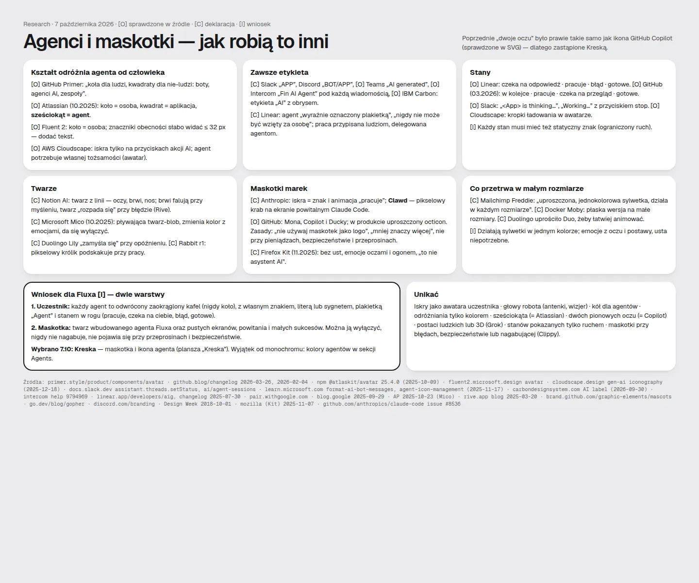 How other products show agents | 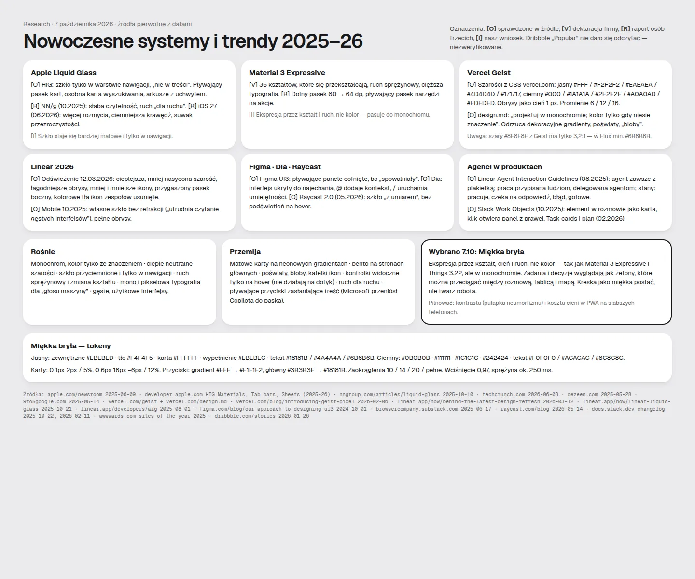 Interface trends |

## 8. Remove from the application

- **What needs you elsewhere:** the Decisions view and its archive. Also the space header's "N needs
  you", the Tasks "decisions need you" link, Space details "Now", "What matters", "Since you left"
  and "quiet".
- **Places:** projects become Spaces. No workspace switching, no sidebar group headers, no
  workspace-wide Wiki, no templates and no goal (or its "goal reached" moment).
- **Ideas:** the Sketchbook (now My map), "Sketch", the DM "Sketches" tab, "Drafts" and "Notes".
- **Agents:**
  - the space's Agents view and the Agents section, and agent project grants, policy and
    requests to a manager;
  - the two-step hand-off with dragging a task onto an agent, and `/handoff`;
  - the working-agent card in the sidebar;
  - one approval switch for all agents, and the Activity list;
  - Flux's own run limits, reactions and background suggestions, and drafts of messages to other
    people;
  - MCP scopes, capability switches and standing grants.
- **Messages and creating:**
  - Cite, Record a result, Details and Hand off on messages;
  - the separate "Ask an agent" and "Cite" buttons in the composer (S5), and "+" for attaching;
  - the column "+", the ⌘K Create group, and the Map toolbar's Create task and Note.
- **Tasks:** Not pursued, the Result object, Results and Activity sections, and "Came from". Also
  ⋯ on board cards and the phone's "+" in the Tasks header.
- **Wiki:**
  - the pages column and the "On this page" column;
  - Write / Preview / Both and raw Markdown editing;
  - version reasons and Draft / Published.
- **Search:** filter chips, "All places" and the separate Search page.
- **Settings:**
  - focus mode and `F`;
  - the per-kind notification matrix and the plain morning summary;
  - the global AI switch;
  - theme, People and device notifications in the account menu.
- **Looks and words:**
  - accent colour families and the theme colour picker;
  - gradient orbs, robot glyphs and corner status dots for agents (Kreska replaces them);
  - "Create work" (P8), and "rule", "review" or "proposal" for a decision;
  - "Replaces" and "In the Wiki" labels, and the stale header subtitle;
  - "who can see this" where the audience is the place's default.
- **Phone and motion:**
  - chip rows and stacked toolbars inside a space on the phone, and the title as a view menu on
    the phone and tablet;
  - rightward swipes, except swipe right on a message to reply in thread (#343);
  - connecting and arranging map thoughts on the phone (S15);
  - the view-switch crossfade and the press spring ([motion](../motion.md)).

## 9. Accepting an implementation

- **Render matching.** Compare against the renders in section 7 at 1440 × 900 and 390 × 844 with
  demo data, in light, and check dark against the tokens. Pass a neutral visual review.
- **The running application.** Exercise it in Chromium and WebKit emulation:
  - keyboard paths (section 4);
  - touch targets of at least 44 px;
  - contrast of at least 4.5:1 for text and 3:1 for icons;
  - controls that keep their place: record the positions of the space header's items, the Tasks
    control row and the Wiki's title row in each state, with and without counts and faces;
  - motion, measured as [Motion in Flux](../motion.md#verifying) describes;
  - reduced motion, with every expression readable as a static frame;
  - the Kreska setting turns off every small moment.
- **Agent marking.** An agent is never shown with a circle avatar or without its label.
- **Colour.** Outside agents' Kreska and user photos, no colour appears.
- **Functional contracts.** The existing contracts still hold: audiences, permissions, PWA and push
  ([F-010](../../product/decisions.md)), adaptive layouts ([F-015](../adaptive-workspaces.md)),
  [agents](../../product/assistant.md) and [encrypted spaces](../../product/encrypted-workspaces.md).
