# Flux final design: Prostota

**Status.** Founder direction by Hubert ([@PelikanFix16](https://github.com/PelikanFix16)) on
2026-10-07, recorded as [F-026](../../product/decisions.md) and tracked in
[#336](https://github.com/ColdPhase/flux/issues/336). Updated for v0.2 to the screens Hubert approved
on 2026-11-03 ([#853](https://github.com/ColdPhase/flux/issues/853),
[#864](https://github.com/ColdPhase/flux/issues/864)), recorded as
[F-036, F-037 and F-038](../../product/decisions.md#f-036-to-f-038-the-v02-direction-2026-11-03).
This is the **only** UI and UX direction for Flux on the computer and the phone. Implement it as
drawn. Founders own changes to it; agents implement it and do not re-decide it.

- **Drawings.** [`screens/`](screens/) holds a render of every v0.2 screen (section 7) and the
  reference boards. Computer renders are 1440 × 900 (Settings is 1440 × 1140), and phone renders are
  390 × 844 at 2×. They are rendered from the v0.2 canvas, which only the founders can open:
  <https://claude.ai/artifact/SUV9hgQaWUKbeXe4vkcdrV>. Its notes are in Polish; this guide states
  what they decide. The first Prostota canvas, <https://claude.ai/artifact/UnQv8mJcyLWrDmKg7nMYDf>,
  is history wherever this guide differs from it.
- **What wins.** Product, data, access and AI contracts are in
  [the decision register](../../product/decisions.md) and [agents](../../product/assistant.md). Where
  an older contract describes how something looks or where it sits, this guide wins. Where a later
  founder decision differs from this guide, the decision wins and the guide is corrected.
- **Refinement.** [Spokój](../spokoj/README.md) (founder direction, 2026-10-15) adds the rule that
  a control never changes place, limits the layout to two content columns and adds the `--own` and
  `--pick` tokens. Where Spokój and this guide differ, this guide wins.
- **Motion.** [Motion in Flux](../motion.md) holds the one motion rule set (F-038,
  [#863](https://github.com/ColdPhase/flux/issues/863)).
- **Implementation.** The v0.2 issues are #865 (Inbox and Home), #866 (Thought and Map), #867
  (Create and message actions), #868 (Tasks), #869 (Wiki), #870 (Search), #871 (words), #872
  (Settings), #873 (space header), #874 (Spaces), #854–#860, #841 and #842 (agents), and #863
  (motion). The first implementation was #338–#354, on #336.

## 1. Principles

1. **One calm language on both devices.** The computer looks and behaves like the phone, with
   more room.
2. **One place for what needs you.** The Inbox holds decisions, questions, blocked tasks that
   wait for you, mentions and agent work that waits for your OK. Home shows the top three.
   Nothing else counts what needs you, and there is no Decisions view.
3. **Everything belongs to its message.** Files, links, photos and references sit inside the
   message bubble.
4. **Shape, not colour, carries meaning.** The surfaces are monochrome. Status is a glyph plus a
   word. The only colours are user content (photos) and each agent's own colour on its Kreska.
5. **Agents are recognisable, never mistaken for people.** People are grey circles with initials,
   or with the photo they chose (F-039). Agents are Kreska and carry one label everywhere:
   "Ada's Planner" (the owner's first name and the agent's own name, the name an answer Ada showed everyone has too, #1232), and never
   have a photo. One agent never has two names on one screen (v0.2.1 release gate round 15, ai P2-5, which replaced "Planner · Ada's
   agent").
6. **Undo instead of confirmations.** Quick actions apply at once and offer Undo. Deleting and
   other people's things always wait for an OK.
7. **One plain word per thing, and controls stay put.** Space, Task, Thought, Map, Decision, Page:
   one label on every device. A control keeps its place when a view or a state changes
   ([Spokój](../spokoj/README.md) rule 7).
8. **Small moments, never noise.** The mascot appears only in loading, waiting, empty and success
   moments. A person can turn it off.

## 2. Visual system: Soft volume

### Tokens

| Token | Light | Dark | Use |
| --- | --- | --- | --- |
| `--side` | `#EBEBED` | `#0B0B0B` | Outer background (behind the panel and sidebar) |
| `--bg` | `#F4F4F5` | `#111111` | Screen or panel background |
| `--el` | `#FFFFFF` | `#1C1C1C` | Cards, bubbles, inputs, sheets, menus |
| `--sub` | `#EBEBEC` | `#242424` | Fills: chips, attachment rows, an off switch's track |
| `--hov` | `#E3E3E5` | `#2C2C2C` | Hover and pressed fills |
| `--line` | `rgba(0,0,0,.07)` | `rgba(255,255,255,.08)` | Hairlines, card outlines |
| `--line2` | `rgba(0,0,0,.14)` | `rgba(255,255,255,.16)` | Strong outlines |
| `--t1` | `#18181B` | `#F0F0F0` | Primary text |
| `--t2` | `#4A4A4A` | `#BDBDBD` | Secondary text (APCA Lc at least 60 on `--bg`, `--el` and `--sub`) |
| `--t3` | `#636363` | `#A1A1A1` | Meta text (at least 4.5:1 on `--bg`, `--el`, `--side`, `--sub` and `--hov`; APCA Lc at least 45) |
| `--inv` / `--oninv` | `#18181B` / `#FFFFFF` | `#F0F0F0` / `#111111` | Inverted chips, the one primary button per screen (2026-10-31) |
| `--own` | `#E7E7EA` | `#313134` | Own message bubbles ([Spokój](../spokoj/README.md#token), 2026-10-15) |
| `--ring` | `--t3` (`#636363`) | `--t3` (`#A1A1A1`) | The keyboard focus ring, everywhere (founder direction, Hubert 2026-11-17, #1424) |
| `--face` | `--el` (`#FFFFFF`) | `#2C2C2C` | A person's face (the avatar circle), with a 1 px `--line2` hairline: a disc on the sidebar, the page and a card in both themes (visual review 2026-11-17) |
| `--selection` | `--t3` at 34 % | `--t3` at 34 % | Selected text everywhere: fields, the Wiki's editor, the map; the text keeps its own colour (founder direction 2026-11-17 visual review) |
| `--seg` / `--seg-on` / `--seg-off` | `--act` / `--el` / `--t2` | `--sub` / `--pick` / `--t3` | A segmented control: its track, the selected option's pill and an unselected label (#1238). Roles over existing colours, no new colour |

Founder direction (Maurycy, 2026-10-10): dark-theme secondary text raised for readability; APCA t2 ≥ 60, t3 ≥ 45
([#432](https://github.com/ColdPhase/flux/issues/432)). Dark `--t2` was `#ACACAC` and `--t3` was `#8C8C8C`.
`scripts/check_contrast.py` enforces the APCA bounds (`--t1` ≥ 90) in both themes.

**Shadows**
- Card: `0 1px 2px rgba(0,0,0,.05), 0 6px 16px -6px rgba(0,0,0,.12)`.
- Pop-over: `0 1px 2px rgba(0,0,0,.06), 0 12px 30px -10px rgba(0,0,0,.22)`.
- Field: `inset 0 0 0 1px rgba(0,0,0,.14), 0 1px 2px rgba(0,0,0,.05), 0 6px 16px -8px rgba(0,0,0,.12)`; dark `inset 0 0 0 1px rgba(255,255,255,.16), 0 1px 2px rgba(0,0,0,.4)`.
  Its edge is `--line2`, as a select's, so a resting field is visible on a white card and a form's select and field share one edge and the
  same 14 px inset (founder direction 2026-11-17 visual review, V7 and V14: the old .05 edge left a field invisible on `--el`).
- Dark mode uses inset 1 px light outlines plus deeper shadows. Layers get lighter as they rise.

**Gradients**
- `--grad-inv`: `linear-gradient(#3B3B3F, #18181B)`, in dark mode `linear-gradient(#FFFFFF, #D9D9D9)` with dark
  text. Own bubbles are `--own` (Spokój) and inverted chips are flat `--inv`, so nothing on screen draws it now.
  **A toast is never an inverted bar** (founder direction, Hubert 2026-11-17,
  [#1424](https://github.com/ColdPhase/flux/issues/1424): "Tragicznie źle i brzydko wygląda na białym"): it is a raised
  card like a notice or a menu, `--el` with `--t1` text, a 1 px `--line2` hairline and the pop-over shadow (`--sh-pop`),
  in both themes (in dark mode `--el` is the raised dark surface and `--sh-pop` carries its light inset edge). Its
  actions keep the toast's own quiet style: Undo, Another task and × in `--t1`/`--t2` with a `--hov` fill on hover, the
  key cap `Z` on `--sub` in `--t2`, the divider `--line2`, the Wink in `--t1`. Everything else about a toast stays: where
  it stands, the safe area, never over the open panel, wrapping at 200 %, its times.
- Buttons have no gradient (amendment 2026-10-31 below).

**The focus ring** (founder direction, Hubert 2026-11-17, [#1424](https://github.com/ColdPhase/flux/issues/1424)): a
heavy black frame around an Inbox title on the phone, after a tap, is not a focus ring anyone asked for. One rule for
every ring in the app:
- It is drawn only for **keyboard focus**: `:focus-visible`, and only while the last input was a key. A tap or a
  click, and the focus a script moves after one (the phone Inbox's expanded title, a window's first field), draws no
  ring; the next key brings it back where the focus is. A text field keeps its ring when it is tapped or clicked: the
  caret is going there.
- It is 2 px of `--ring`, the mid-grey `--t3` in both themes (light `#636363`: 5.5:1 on `--bg`, 5.0:1 on `--sub`, 4.7:1
  on `--hov`; dark `#A1A1A1`: 7.3:1 on `--bg`; at least 3:1 on every surface, WCAG 2.4.7 and 2.4.11), with an offset
  (2 px unless a component has no room outside), and follows the rounded shape of what it surrounds. It never reads as a
  black frame, and stays distinct from the selection, which is a fill and never an outline.
- Components take the colour from `--ring` and never set their own; only the offset is theirs. The ui-wide switch is
  `data-input` on `<html>` (`pointer`, `field` or `keys`), set by the first pointer or key event: `field` is a tap or a click in a
  text field (its label or the box drawn round it), so that field shows its ring; a field the app focuses after a tap elsewhere
  (a conversation's composer as it opens, a window's first field) is `pointer` and shows none until a key or a click in it
  (visual review 2026-11-17: every conversation and every Create window opened framed). The composer is a text field: its ring is
  this ring on its edge (offset −1 px over its hairline, as every field's), never a second outline with a gap round its card (round 14)
  and never a dark inset frame.

**Raised, never inverted** (visual review 2026-11-17, after the toast rule above): a tooltip is a small raised card, `--el` with
`--t1` words, the pop-over shadow and a `--line2` hairline, in both themes; a message toolbar's tooltip is centred on its
button. A primary button that waits (`disabled`) keeps a 1 px `--line2` edge, so it never melts into a dark sheet.

**One look for one element** (founder direction, Hubert 2026-11-17, the fresh-eyes visual review of v0.2.1: "a UI check must catch what
looks ugly"). The same element looks the same on every screen, in light and dark, on the computer and the phone:
- **Empty states** are one component (`EmptyState`): centred in their place, Kreska (a small moment, 80 px) or a 40 px icon tile, a title
  at `--fs-xl`, one line in `--t2` and the action. The Inbox, Search's "Nothing matches", My tasks and every space view use it. A list's
  own empty row inside a card (Home's "Nothing is waiting for you.") stays a row of that card.
- **An error state** (`ErrorState`) has the same parts at the start of its column, and its "Try again" is the secondary button with the
  refresh icon everywhere. A message never says "Try again." beside a Try again button.
- **Faces** are `--face` with a `--line2` hairline; two initials in a 20 px face are scaled like the 16 px face's, so a row of faces never
  reads as one word.
- **A tooltip** is a raised card (`--el`, `--t1`, `--line2` hairline, the pop-over shadow), like a menu or a toast, never an inverted block,
  and it is not drawn while its control's menu is open.
- **Hover is for a pointer that hovers** (`@media (hover: hover)`): after a tap a touch screen keeps `:hover`, which left a primary button in
  its hover grey (it read as disabled) and a task's Status in a grey pill.
- **A key hint** (`C`, `S`, `E`) is one style: a 1 px `--line2` outline on the surface it stands on (the toast's key cap keeps its own).
- **A text button that starts a row of actions under text** ("Reply", "Try again") takes its padding back, so its word starts where the text
  above it starts, as a filled button's edge does.
- **A hovered tab** is `--t2` with the neutral mark; only the current tab is `--t1`.
- **A text field's ring is its edge** (offset −1 px over its hairline), so focus never draws a second outline or makes the field look wider.
  A field that is invalid has the strong `--t1` edge; while the person types in it, the focus ring is its only frame.
- **Search** marks a match by weight (600), never a fill that can land on the "…" of a cut row; every row is 48 px with its icon in the
  28 px tile (places and actions too); the dialog has one height whatever it lists; the hint never leaves one word on a line.
- **Sign-in, invite, reset and setup pages** start at one height (pinned to the top, not centred), so the logo and the title never move from one
  to the next. A form is a card; a page with one button has no card around it; a reset link the server refused shows only the dead-link page.
- **The phone's "+"** stands at one height on every screen: in a space, without the capsule, it stands where it stands above the capsule.
- **A panel that scrolls** (the task and decision panels, their phone sheets) fades at its lower edge into the field under it **only while
  there is more below** (`useScrollEdges`, as the sidebar): at the end nothing fades, so the newest message is never washed out, and a proposed
  decision's Accept, Not now and Discuss stand over the fade, never under it (round 14 look-b B1, look-a A5); a pinned
  decision title fades what passes under it once the panel is scrolled; a window's list that is longer than the window fades at its end.
- **The rail** pins the Inbox count to the Inbox button's corner, and a space's tile has the list's dot for what needs you on its corner.
- **A clamped title wraps** (round 14 of the release gate, 2026-11-17): a title cut to two lines (an Inbox row on the phone and in the list) is
  a `-webkit-box` clamp with no `white-space: nowrap` under it, so every engine shows its two lines and ends in "…"; `nowrap` there cut it
  mid-letter in WebKit. Only a one-column Inbox card on a computer keeps one line with "…".
- **One ring for a card**: a card whose title is its control (an Inbox card) is ringed as a card, 2 px of `--ring` out from it (just inside
  it where it lies in a scroller that would cut it), never a second ring round the title's words.
- **A toast that says what was done** has no mark beside its words (no ✓): Done in the Inbox and a role change look the same. Only Kreska's
  Wink for a closed task and the alert of what failed stand there.
- **The end of Search's list**: the lower fade lies on the list's 20 px bottom padding at the end (`position: sticky; bottom: -20px`), so a
  row is never cut hard at the footer and the last row is never washed out.
- **A field that is wrong keeps its strong edge** while no ring is drawn (the focus a click on Sign in moved to it); the ring replaces the
  edge only while it shows.
- **Offline**, a page without a composer says so in the busy line's place ("You’re offline. Flux shows what it last loaded and catches up
  when you’re back."); a composer's own line says it where there is one. Back online, Home and the Inbox read again at once, and a read that
  failed says so with Try again, never "Looking…" for ever.
- **The phone's header** meets a scrolled page at a `--line` hairline. A place that is not available keeps the phone's tab bar, and its tile
  is the alert icon, not a magnifier.
- **The sidebar and the rail**: the rail's places, its Search and both toggles name themselves in the one tooltip (`data-tip`, the item's
  own name: "Home", "My map", "Search · ⌘K"), drawn beside the rail and the toggle so it never covers New or Search; New and Search have the hover fill of the rows.
- **No orphan word**: every text of the app wraps with `text-wrap-style: pretty`; titles of the sign-in pages also balance.
- **Lists of rows are cards**: My tasks' spaces are cards of rows like Home's, the glyph, the word and the chevron on the first line's middle.
  The phone's Spaces list ends a row in its dot and its ⋯, with no chevron.

**One look for the same element** (founder direction, Hubert 2026-11-17, visual review of the work screens: "a UI check must catch what
looks ugly"):
- **Fields.** Every text field (a thought being written or edited on the map or in its List, a map's or a task's title being renamed, What came
  of it, the date field, a picker) has the field hairline (`--line2` or the field shadow) on `--el`, and while it is written in the one
  2 px `--ring`, over its edge (offset −1 px) as "A text field's ring is its edge" above. None draws its own black frame.
- **Selected text** is `--selection` behind the text's own colour, in both themes; never the browser's blue or CodeMirror's lavender.
- **A state in a pill** is its glyph and word on a 1 px `--line2` hairline in `--t1`, never an inverted slab. A state is said once per panel:
  the task panel's Status row says Blocked, so its "Waiting for" card has no second pill (round 14 look-b P8).
- **A text button that starts a line** in a panel (Add to a thought, Add to a Wiki page) hangs its padding outside, so its icon stands on
  the edge of the labels above it: the same rule as "A text button that starts a row of actions under text" above, one rule in `ui.css`.
- **Hover fills need a hovering pointer** (`@media (hover: hover)`): a tap on a phone leaves no fill on whatever lies under the finger.
- **A menu's rows lead with their icon**, and a line sets the destructive row apart (the Wiki's ⋯, as the maps' switcher).
- **The Wiki's prose is one prose:** the editor, the history and an old version hang a list's "•" (`--t1`) at the column's edge with the
  words 1.5em in, in `--t2`; the line under a heading is a short step, not a whole empty line. A version's banner puts its links in a row
  of their own under the sentence. The title's chevron follows its last word.
- **The map:** a label sits on a free part of its own line, never on another label or under a thought; a line with no free part (two
  thoughts side by side) keeps its label at its middle, raised over the thoughts' edges, never hidden; the selection's actions never lie
  over another thought (they slide beside it, or rise above it); an edit's **Save** and **Cancel** are that toolbar beside the thought
  (in the phone's bottom row), and a circle's text field stays inside the circle; the editor of a draft stands against the draft's box,
  with one hint for its keys (none on a phone). The "+" of the selection is an icon, the resize grip shows under the pointer, the
  minimap's frame is a hairline, and the zoom reads in Geist with tabular figures and keeps its corner where the minimap is hidden, down to
  a 640 px pane (200 % text on a 1440 px window). In the map's List the canvas tools (Select, Move around) are not drawn and keep their room,
  so Thought and Undo stay where they are, never two greyed tools that do nothing (round 14 look-b P13). The phone's map has one bottom row:
  the selection's Thought actions (or an edit's Save and Cancel), Undo and **Thought** side by side, with the once-said computer line above
  it (round 14 look-b P14). A connection's label tries every point of its line, nearest the middle first, before it gives way (P11). A
  thought's tasks show once, as its quiet count (UI116-4); the line that repeated its first task beside the count is gone. The phone's
  **Thought** is the soft fill of the phone's floating "+". In the map's List a connection's label stays the tag before the title (#510),
  in a slot of one width right against the title, so labelled siblings' titles start at one edge; the tree's ticks reach their rows.
- **Tasks:** below 2000 px the List starts at the toolbar's left edge; a card's number and owner stay on one line (a long name ends in
  an ellipsis); a board that runs past the pane fades at its edges and ends with the page's margin; a panel floating over the work lies
  in a 10 px gutter of `--bg`; the blocked card's words take the card's whole width and Edit and Unblock (or Done) take the line under
  them, starting where the words start, on the computer and the phone; a multi-line
  value keeps its label on its first line; the thought chooser scrolls into view when it opens. **A name keeps its mark:** where a row is
  short (a card beside the open panel, 160 px columns), the name gives way with "…" and "(you)" or "(removed)" stays whole after it,
  "Ola Now… (you)" (`PersonName`; round 14 daily P2-3). The person a blocked task waits for is named as every list names people: "Waiting for
  Ada Kowalska (you)" to Ada (round 14 look-a A4). A card's due day is the panel's words for it without this year: the panel's "21 Nov 2026"
  is "Due 21 Nov" on the card, never a weekday the panel does not say (round 14 look-b P10). The phone's List has each state's heading over
  its card, as the computer's has (round 14 look-b P16).
- A heading that takes the focus from a script (a page opened like a panel, as Space settings, or an emptied list) draws
  no ring: it is where reading starts, not a control (visual review 2026-11-17 V1).
- A radio is drawn by the app at 16 px in every engine: a 1.5 px `--t3` ring, chosen a `--t1` ring and dot (V22).

**Radii:** 10 (small, buttons), 14 (rows, fields), 18–20 (cards, bubbles, panels) and full (pills,
chips, avatars). The phone sheet top corners are 26.

**Buttons: quiet, one accent per screen.** Founder decision (Hubert, 2026-10-31, comment on
[#763](https://github.com/ColdPhase/flux/issues/763); mock-up board "C · Quiet") amends the Soft-volume
buttons above, which read as too strong:
- At most one primary button per screen or region: flat `--inv` with `--oninv` text
  (hover `--inv-hov`, light `#2E2E33`, dark `#D9D9D9`). Where a list repeats an action, the rows use
  outline or text buttons and only the open item carries the primary one (the Inbox's Accept).
- Secondary actions are text buttons: transparent, `--t2` text, `--hov` fill on hover.
- Choices among a few options (an agent's ready answers, a pick between settings) are thin outlines:
  1 px `--choice` (light `rgba(0,0,0,.12)`, dark `rgba(255,255,255,.16)`), `--t1` text.
- Destructive actions keep a clear style: a 1 px `--t2` outline with `--t1` text, never the inverted fill.
- No gradient and no drop shadow on any button; `--grad-btn`, `--sh-btn` and `--sh-pri` are retired.
- Button radius 10 (`--r-btn`); `--r-pill` stays for chips, avatars and segmented tracks.
- A segmented choice with options of different lengths (Model) sizes each option to
  its label with 14 px each side and never gives the longest an equal share (`seg--fit`); where the
  group has no room for one row (a phone) its options wrap onto the next row and keep their label width (an
  option alone on a row is not a bar), and the track takes the large radius (`--r-lg`). Equal slots stay for the views, the map's
  Map / List and the live stage's picker.
- Buttons are 32 px high in rows and toolbars and 36 px in dialogs; a primary button and the
  button beside it have the same height. Touch targets stay at least 44 px (the system below).
- Counts are quiet mono numbers ("Waiting for you 5", "Inbox 5"), never pills.
- A composer's Send is a soft fill (`--own`) with the arrow icon, a circle concentric with the round composer; on touch its fill
  keeps a 4 px inset inside the 44 px target (visual review 2026-11-17).
- The phone's floating "+" is a soft fill like Send (`--own`, `--t1` icon, 56 px, no shadow), so each
  phone screen has at most one dark button (founder decision, 2026-10-31, follow-up on #763).
`tests/test_ui_tokens.py` (`QuietButtons`) guards the flat buttons, the radius and the retired tokens.

**The button system** (#1233, v0.2.1): one set of buttons on every screen. Hubert saw an empty Wiki with a card-like "New page", a
grey-text "Import a Markdown file" at another height and weight, and a sign-in that did not match the others. Every action is a `Button`
(`ui/Button.tsx`, class `ui-btn`) or an `IconButton`; no screen draws a button class of its own.

| Role | Component | Looks | Use |
| --- | --- | --- | --- |
| Primary | `Button variant="primary"` | flat `--inv`, `--oninv` text | The one main action of a screen or region: Create, Sign in, New page. At most one dark button per screen or region |
| Secondary | `Button` (`secondary`, the default) | transparent, `--t2` text, `--hov` on hover | Other actions: Cancel, Back, Open, Try again |
| Outline | `variant="outline"` | 1 px `--choice`, `--t1` text | A choice among a few; the second action beside a primary in an empty state ("Import a Markdown file"); a row's main action ("Turn on") |
| Quiet | `variant="quiet"` | transparent, `--t3` text | A repeated text action in a row or a toolbar: Change, Edit, Remove |
| Danger | `variant="danger"` | 1 px `--t2` outline, `--t1` text | A destructive action |
| Soft | `variant="soft"` | `--own` fill | A composer's Send |
| Link | `variant="link"` | underlined `--t1` text | An action inside a sentence or a status line: "Retry", "Try again", "Show all" |
| Icon button | `IconButton` | 32 px round, `--t2` icon, a tooltip | An action with an icon and no words; always named (`label`) |

- **One shape.** Radius 10, weight 500 and no shadow for every role. **One height per density:** 32 px (`md` and `sm`, in rows,
  toolbars and menus), 36 px in a dialog's footer, 44 px (`lg`) for a form's own button (sign in, sign up, an invitation, a reset,
  the Create window), and 44 px for every button on a touch screen. A screen does not set a height or a font size of its own; `sm`
  is the same height with a 12 px label for a row.
- **A row's actions** are small buttons (`size="sm"`): the row's main action ("Turn on", "Connect") is `outline`, the others
  ("Change", "Edit", "Remove") are `quiet`. They are never links, never bare text, and never `lg`.
- **An empty state has one primary action and, if there is a second, an outline button beside it,** never a card next to a text link:
  the Wiki's "New page" and "Import a Markdown file", the maps' "New map", Home's "Create a space". The naming field that "New page"
  opens takes the button's place, with its "Create" as the primary, in the same row.
- **Sign-in, sign-up, an invitation, a password reset and single sign-on use the same pair,** both `lg` and as wide as the form: the
  primary action ("Sign in", "Create account", "Join Acme", "Send reset link"), and, where there is a second way, a `secondary` below it.
  With single sign-on as the only way in, "Sign in with *provider*" is the primary. The page's other actions are links in a line under the form.
- **A dialog's Cancel is `secondary`**, beside its one primary.
- **Not an action button.** Some controls are not buttons of the system and draw themselves: a menu row, a whole row or card that
  opens something, the shell's own controls (the sidebar, the phone's bar), the composer's and a message's controls, an inline text
  link, a chip, a dismiss cross, a map tool. Each kind and its classes are listed in `app/tests/app/button-classes.json`.
- **A guard keeps it so.** `app/tests/app/button-system-core.test.ts` (a portable core test: it runs in `./scripts/check_application.sh` and in the pull-request check, with the other
  architecture rules) fails on a `<button>` that is neither a `ui-btn` or `ui-icon-btn`, nor of a role that is not an action (menu
  item, tab, radio, switch), nor one of the listed classes. It fails on `role="button"` on any other element and on a listed class
  no button uses, so the list only shrinks. It also fails on a stylesheet that gives a `.ui-btn` a pill or a circle: a button of the
  system has radius 10 on every screen, the map's dock included. A new screen uses `Button`; it does not add a class to the list.

**Chips and tags** are one line high with a fixed height: 24 px for a tag (`--sub` fill, `--t2`
text, 12 / 500) and 28 px for a person chip in a field, with a 20 px face and ×. They never wrap;
a long name ends in an ellipsis.

**Switches** are 36 × 22 (the live panel's 32 × 20). One style of switch across the app: Settings, the
live panel and the connection's permissions (#1238).
- On: the `--inv` track with an `--oninv` knob. Unmistakable in both themes.
- Off: the `--sub` track with a 1 px `--t3` edge and a `--t3` knob. The edge and the knob are at least 3:1 against the card and the screen
  (`--t3` is 6.0:1 in light and 6.6:1 in dark on `--el`), and the knob is at least 3:1 on its track. A grey knob on a grey track is not enough:
  the old off switch (`--hov` track, white knob) was 1.3:1 in light.
- High-contrast mode (`forced-colors`) draws the edge and knob in `ButtonText` and an on switch in `Highlight`.

**Segmented controls** (#1238) are one style: the Map / List switch, Board / List, Model,
the live stage and screen mode, and access. (The space views, Conversation | Tasks | Map | Wiki, become underline
tabs under #1239; until then they read the same three tokens.) A selected state never rests on a 1.1:1 difference
(WCAG 2.2 1.4.11 asks for 3:1 for a state a person needs to see; the design asks for this much at least, and adds an edge):
- The track is `--seg` and the selected option is a raised pill, `--seg-on`, with a 1 px `--line2` edge and `--sh-raise`. In light that is
  `--el` on `--act` (1.51:1); in dark `--pick` on `--sub` (1.51:1). In dark the pill is lighter than the track (it was darker, 1.1:1).
  `scripts/check_contrast.py` holds the fill at 1.5:1 or more in both themes, and `tests/ui/test_switches_visible.py` measures it in the
  running app. The existing colours gave 1.45:1 and 1.44:1, so `--act` (light) and `--pick` (dark) moved one notch to reach 1.5:1; in dark
  the edge adds 2.3:1 against the track.
- The selected label is `--t1`, an unselected label `--seg-off` (`--t2` in light, `--t3` in dark, 6:1 on the track); a hovered one is `--t1`.
- High-contrast mode (`forced-colors`) keeps the selection: the pill is `Highlight` with `HighlightText`.
- Sizing is not part of this rule (the options' widths follow their labels, #1219).

**Concentric corners** (founder, 2026-10-08): a frame that tightly holds a tile or an avatar takes
the inner radius plus the gap. A space tile (radius 6) inside a place picker with a 4 px inset sits
in a 10 px frame, not in a pill. Spaces stay rounded squares and people stay circles, so a lettered
circle never stands for a space.

**Profile photos** (founder request, Hubert, 2026-11-10, [#1226](https://github.com/ColdPhase/flux/issues/1226),
[F-039](../../product/decisions.md)): a person's photo is user content, the one colour allowed beside Kreska.
- It fills the same avatar circle, at the same sizes (20, 26 and 32 px), with the same hairline ring, in every place
  an avatar is drawn: messages, people lists, owners, mentions, the live strip, the faces in a header and the
  account row. Nothing else about the row or the bubble changes, so a photo never moves a control.
- The initials stay underneath: they show while the photo loads, when it cannot load and after the person removes
  it. There is no placeholder graphic and no coloured initials.
- Agents never have a photo; they keep Kreska everywhere.
- **Settings › Account** holds it as the first row of "Your details": **Photo**, its value "Your photo" or "Your
  initials", and Change. Change opens the form in place like the other rows: **Choose a picture…** (a text
  button that opens the device's file chooser for PNG, JPEG or WebP), then a preview of the chosen picture as the
  32 and 20 px circles people will see, with the line "Flux keeps the middle square.", and one primary
  **Save photo**. With a photo set, the form also offers **Remove photo** (a text button), which goes back to the
  initials. Errors are one plain line under the buttons ("Choose a PNG, JPEG or WebP picture.", "A photo is at
  most 5 MB."). On the phone it is the same row in Settings › Account.

**Space icons** (founder request, Hubert, 2026-11-10, [#1227](https://github.com/ColdPhase/flux/issues/1227),
[F-040](../../product/decisions.md)): a space keeps its rounded-square tile, and its admins may put an icon in it.
- Every space starts with its letter and keeps it until someone chooses otherwise. The tile keeps its size, its
  radius 6 and its place in every view that draws it: the sidebar and the rail, the phone's Spaces list, Settings ›
  Company's spaces, the Create window's place picker, a Search result and the space's overview. Nothing beside it
  moves when it changes.
- **An emoji** sits centred in the same tile, on the same `--sub` fill, at two thirds of the tile's size, whatever the tile's size.
- **A picture** fills the tile, cropped to its middle square, with the tile's radius and hairline. It is user
  content, the one colour the design allows beside Kreska, like a profile photo.
- **An encrypted space** keeps its letter tile and its small lock after the name; while it waits to be unlocked its
  tile is the lock glyph, as before. Its settings change neither its name nor its icon.
- **Space settings** holds it under Name, as a second row of the same card: **Icon**, the tile and its kind
  ("Letter", "Emoji" or "Picture"), and Change for the people who can rename the space. Change opens in place:
  a grid of 32 emoji in rows of 8, fewer on a narrow phone (each a 44 px target with a 28 px tile inside, pressed
  when chosen; the saved one is pressed when the picker opens), then the
  text buttons **Choose a picture…** (PNG, JPEG or WebP, at most 2 MB) and **Use the letter**, and one primary
  **Save icon** once something new is chosen. The tile beside the space's name shows the choice before it is
  saved. Errors are one plain line, as for a photo.
- A change reaches every open sidebar at once (the space's `project.updated` event), with no reload.

**Typography:** Geist 400 / 500 / 600 and Geist Mono for task numbers (#12), keys and file
labels. A time is Geist with tabular figures, as the line under a message already is ([#1231](https://github.com/ColdPhase/flux/issues/1231),
[#1373](https://github.com/ColdPhase/flux/issues/1373)), never a monospace. Bold text is 600, never the browser's 700.
- Title: 32 / 600 on the computer, 28–30 on the phone.
- Section: 16–17 / 600.
- Body: 14 / 20 on the computer, 15–16 on the phone.
- Meta: 12, and at least 12.5 on the phone.
- **Letter spacing is one rule, set by tokens** (founder direction, Hubert 2026-11-17, #1424: in the Inbox list the bold titles ran
  together, "…" touched the "y" of "Saturday" and the space in "probe closer" almost vanished). Text at `--fs-lg` (16) and below,
  regular or bold, is `--tracking`: 0. Only display sizes, `--fs-xl` (20) and up (a title inside a page or panel, the greeting, sign
  in), take `--tracking-title`, -.02em. A component never sets its own value, and no text gets a `word-spacing`. The two marks
  that are not text keep their own token: the "flux" wordmark (`--tracking-wordmark`, -.04em) and a code read one character
  at a time, such as the device code (`--tracking-code`, .06em). Source, read 2026-11-17: Vercel's own Geist type scale
  (vercel.com/geist/typography, its stylesheet) gives every Copy, Label and Button style, 12 to 24 px, no letter spacing,
  and tightens only its Heading styles. Geist is already tight at text sizes, so Flux tightens only what is set as a heading
  at 20 px and above.
  - A row's title in a list (the Inbox list, the phone Inbox's cards, Home's rows) is 500 at `--fs-base`, as the Inbox aside's
    rows and the notices already were; 600 stays for headings, names, unread spaces and the open item's title. At 600 and
    14 px the words of a two-line title closed up and the "…" met the last letter.
  - A title cut to lines or to one line with "…" is cut on a span inside its button, never on the button: WebKit lays a button
    out as its own box and ignores the cut there (Safari showed every line of an Inbox row's title, with no "…").
- Every device follows the system's text size: the type tokens are rem, so the root size the browser or the phone sets scales every size, and Settings has no text-size control ([#1419](https://github.com/ColdPhase/flux/issues/1419) item 17, founder decision, Hubert, 2026-11-13).
- **A menu always fits the window, at any text size** (v0.2.1 personas round: at 200 % text the task panel's Status menu showed To do and
  Doing only, cut under the panel's composer). A menu or list opens under its control, or over it when there is no room below, never
  past the window's edge, and scrolls inside itself when it is taller than the room. The task panel's Status and Owner
  menus are a layer over the page, as a Select's list is, so the panel around them never cuts them; on a phone they are the bottom sheet.
  An empty date field's hint is "Add a date", the word of the Due row that opens it, never a made-up date.
- Every size is a `--fs-*` token. The initials of a 16 px face (the `Avatar` `xs`, the faces under a message, the face in a
  mention chip) are `--fs-face` (px, #1370) scaled by .72 with a transform, so the type stays a token and two letters never run wider than the circle.
  The initials of the 32 px face are `--fs-face-lg`: 12 px, and 12.5 px on the phone like Meta (px as well, #1424).
- **The offline page** (`/offline.html`, what an offline navigation shows) uses the same tokens: Geist (the app serves it from `/fonts`,
  and its service worker caches it), `--t1` and `--t3`, a 20 px title at 600, and one flat primary button, "Try again", with radius 10 (32 px high, 44 on touch).

**Motion:** one rule set, in [Motion in Flux](../motion.md). Feedback comes within 100 ms. A view
switch shows the new screen at once. Panels, dialogs, menus and sheets enter in 180 ms and leave
in 120 ms, with no scale and no overshoot. Press is colour only; small controls may scale to .98,
with no spring. Only opacity and transform move, with one named exception: the sidebar's fold to
the rail and its unfold keep their smooth width animation, and the content beside it adapts during
the fold (Hubert, 2026-11-03, #720). Reduced motion sets every duration and delay to zero. Nothing
moves for its own sake.

**Theme:** Light, Dark and Match system, with those words on every device (the phone does not say "System", #1424). There is no accent colour and no colour picker, and no line that says so. The v0.2
renders are light; dark comes from the tokens.

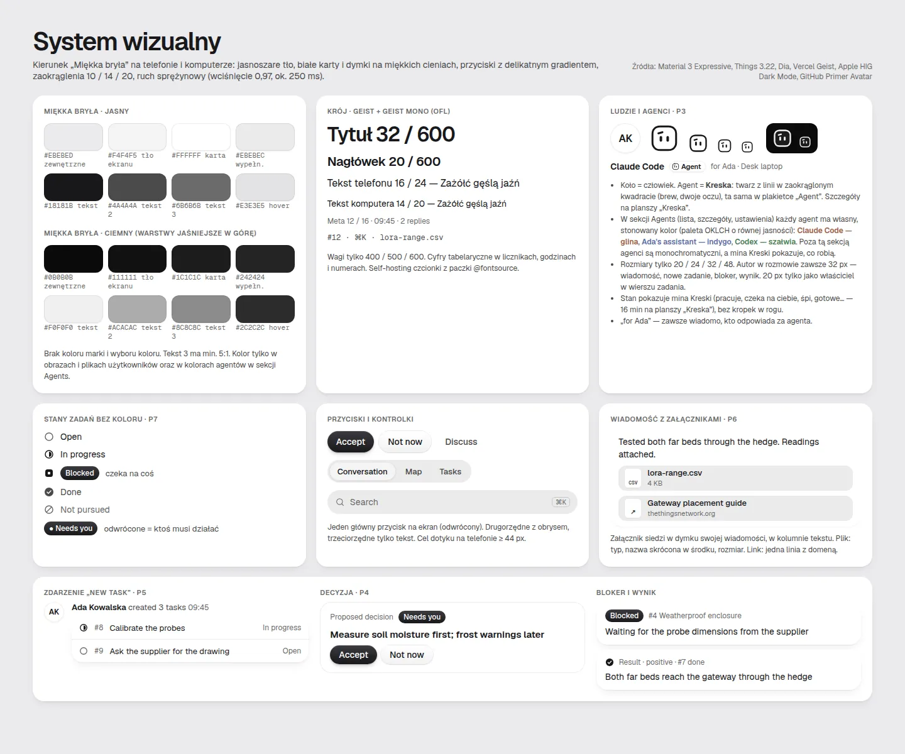

This board dates from 2026-10-07. Its palette, type and radii stand. What it draws and this guide
has superseded:
- gradient buttons (buttons are flat, 2026-10-31);
- the press of 0.97 with a spring of about 250 ms ([motion](../motion.md));
- the old text values: light `--t3` `#6B6B6B`, and dark `--t2` `#ACACAC` and `--t3` `#8C8C8C` (the
  token table above);
- the task words and objects: Open, In progress, Not pursued, the "Needs you" pill and the Result
  card (status glyphs below, and P4 and P5);
- "colour only in the Agents section" (each agent's colour shows everywhere, below).

### Status glyphs

A task is To do (outline circle), Doing (half-filled circle), Blocked (filled rounded square) or
Done (filled circle with a check). A word always accompanies the glyph. A task that was dropped
is Done with a "dropped" note.

A decision is the **flag** glyph wherever it appears (Create's Decision, Home, the Inbox, the conversation's cards, Search and the Wiki
card), as the renders draw it ([#1373](https://github.com/ColdPhase/flux/issues/1373)); the hexagon with a check is retired.

### Agent colours

The palette is muted OKLCH with equal lightness: L 0.55 light, 0.80 dark. Each agent has its own
calm Kreska face colour from it, either chosen when the agent is created or assigned automatically
(Hubert, 2026-11-03), in the order Teal, Indigo, Ochre, Rose, Sage, Plum, Clay, the colours furthest
apart first, so a person's first agents differ at the size of a sidebar row (#1377). The colour shows everywhere the agent appears: Messages, the Owner picker, a
task's owner and discussion, Home, the Inbox and Settings › AI. It is the same for every reader: the owner's teammates see the agent in the colour its owner sees, because every read that names an agent carries it (#1528). It replaces "agent colours only in
the Agents section" of the first Prostota canvas. The v0.2 screens draw Assistant in ink (`--inv`)
and Planner, Reviewer and Jonas's Fieldbot in Teal, Indigo and Ochre. Kreska's lines take the
colour, and the face fill is the same colour at 12%. Everything else is monochrome.

| Name | Light | Dark |
| --- | --- | --- |
| Clay | `#9B6147` | `#E8AF96` |
| Ochre | `#886D32` | `#D4BB86` |
| Sage | `#4B8057` | `#9CCCA4` |
| Teal | `#208181` | `#82CDCD` |
| Indigo | `#5E6FA4` | `#ABBCEF` |
| Plum | `#886191` | `#D4AFDC` |
| Rose | `#9C5C66` | `#E9AAB3` |

## 3. Kreska: logo, agent icon and mascot

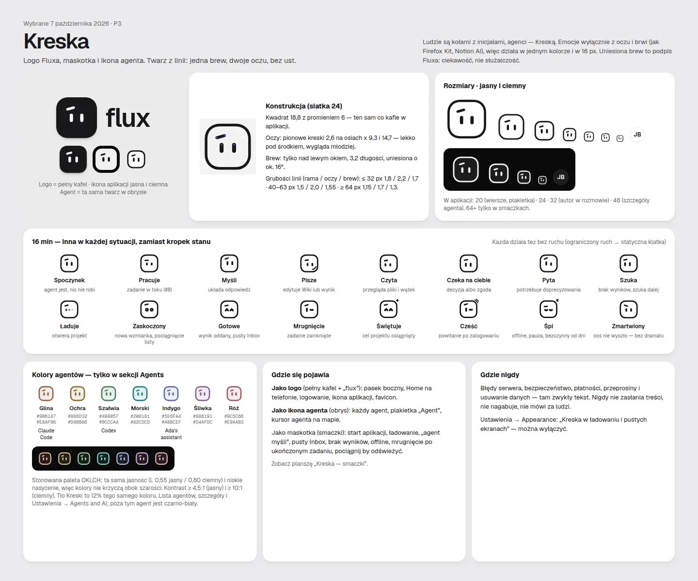

This board dates from 2026-10-07. The face, its construction, the sizes, the line weights and the
palette stand. What it draws and this guide has superseded:
- the card "Kolory agentów — tylko w sekcji Agents" and its line that an agent is black and white
  outside that section (each agent's colour shows everywhere, section 2);
- the expression "Świętuje · cel projektu osiągnięty" (goal reached), because the goal is gone and
  the table below has 15 expressions;
- the Agents section, as a place for agents (they live in Settings › AI and Messages);
- the Polish names of the colours (section 2 gives Clay, Ochre, Sage, Teal, Indigo, Plum and Rose).

The tiles "Cześć" (hello), "Śpi" (asleep) and "Świętuje" (celebrate) were redrawn on 2026-11-08 (#849) with the
marks outside the frame, as `app/apps/web/src/ui/kreska-geometry.ts` draws them. A mark keeps a gap of at least
0.5 px from the frame at every size from 24 to 112 px (`app/tests/app/kreska-marks.test.ts`).

Kreska is a monoline face in a squircle: one raised brow, two eyes and no mouth.

| Role | Form | Where |
| --- | --- | --- |
| **Logo** | Solid tile (`--inv`) with the face knocked out, plus the "flux" wordmark. Nothing extends past the tile. | Sidebar, phone Home, sign-in, splash, app icon, favicon |
| **Agent icon** | Outline squircle on an `--el` fill, in the agent's colour (section 2). Sizes are 16 / 20 / 24 / 32 / 48. Line weights: frame / eyes / brow 1.8 / 2.2 / 1.7 at 32 px or less, 1.5 / 2.0 / 1.55 at 40–63 px and 1.15 / 1.7 / 1.3 at 64 px or more | Every agent, its label, the map cursor |
| **Mascot** | The same face at 56–112 px | Small moments only (below) |

The v0.2 screens draw agents as a simplified filled tile with two eyes; build the icon from this
section.

**Expressions (they replace status dots).** Each has a static frame and its own short motion that says
what it means (founder decision 2026-11-13, [#1342](https://github.com/ColdPhase/flux/issues/1342)). Calm first: a
small moment, never noise.
- A one-shot motion plays once when the face appears or its expression changes, and ends on the static frame.
- Only the ongoing states loop: Thinking, Loading, Working, Asleep and Idle. A loop pauses off screen, in a hidden tab
  and under a modal.
- Only `transform` and `opacity` move, with durations and easings from the motion tokens
  ([Motion in Flux](../motion.md)): a one-shot takes `--dur-highlight` (600 ms) or twice it, a loop a multiple of
  `--dur-loop`.
- Nothing moves under the system's reduced-motion setting or with Kreska's small moments off
  (Settings → Appearance); every face is then its static frame.
- A face that shows no state (an agent's icon beside its name, with no expression given) stays still, and so does a
  face of 20 px or less, apart from the three loops that already moved there (Thinking, Loading, Working).
- A mark keeps its 0.5 px gap from the frame through the whole motion, the writing pen inside the frame as well as
  the marks outside it (`app/tests/app/kreska-marks.test.ts`).

| Expression | When | Motion |
| --- | --- | --- |
| Idle | The agent is present and doing nothing | A rare blink, every 8 s (loop) |
| Working | It is working on a task | A slow blink, every 4 s (loop) |
| Thinking | It is composing a reply; the brow waves | The brow waves (loop, 1.6 s) |
| Writing | It is editing the Wiki or a task | The pen makes a few short strokes, once (1.2 s) |
| Reading | It is reading files or a thread | The eyes scan a line from left to right, once (1.2 s) |
| Waiting for you | Something waits for your OK; the eyes look at the composer | The eyes move down toward the composer, once (600 ms) |
| Asking | It needs clarification | The brow lifts, once (600 ms) |
| Looking | No results; it looks aside | The eyes and the brow glance aside and stay there, once (600 ms) |
| Loading | Dots flow through the eyes | The dots flow through the eyes (loop, 1.2 s) |
| Surprised | A new mention, or a pull to refresh | The eyes pop open and the brow jumps, once (600 ms) |
| Done | A task is done, or the Inbox is empty | The eyes settle into the smile, once (600 ms) |
| Wink | A task was closed (in the toast) | One eye closes, once (1.2 s) |
| Hello | The first start, or a new space | The wave mark waves out of the corner twice, once (1.2 s) |
| Asleep | Offline, paused, or idle for days | The z drifts up and fades (loop, 3.2 s); the face breathes slowly (loop, 4 s) |
| Worried | Something failed, gently | The brow drops, once (600 ms) |

Celebrate stays drawn (the sparkle, with the smiling eyes) for a moment that may use it; its motion is the
sparkle turning in once while the eyes settle into the smile (600 ms).

**Small moments.** These are the only places the mascot appears, and Settings → Appearance can
turn them off with one switch, **"Show the face on loading and empty screens"** on every device (the name Kreska is not in the words, #1424):
- splash;
- space loading;
- an agent is thinking, with Stop;
- empty Inbox;
- the offline banner;
- no search results;
- pull to refresh;
- the toast after a task is closed.

The mascot never appears in errors, security, payments, apologies or deletion. It never covers
content and never nags.

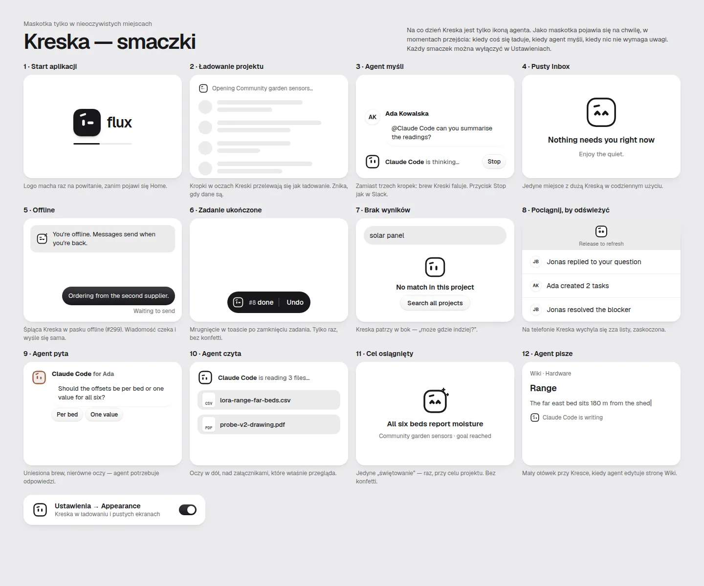

This board dates from 2026-10-07. Its moments stand, apart from what this guide has superseded:
- moment 11, "goal reached" (the goal is gone, and so is its moment);
- moment 7, "No match in this project" with its "Search all projects" button (one search covers
  everything you can see, S16; no results show the Looking face);
- "project" as a word for a place (it is a Space), and agent labels such as "Claude Code for Ada"
  (an agent carries one label, "Ada's Planner").

## 4. Structure and navigation

### Computer

- **Sidebar (248 px)**, the same on every screen:
  - the logo, and a button to collapse the sidebar (`[`);
  - **New** (`C`) and Search (`⌘K`);
  - Home, Inbox (with its count), My tasks, My map (one name each wherever the place is named: My tasks is "My tasks" in its header,
    in the way back to it, "‹ My tasks", and in Search, never "Tasks" or "Your tasks");
  - **Spaces**: one flat list with no group headers. Everyone, the space that holds the whole
    company, comes first and never moves; you order the rest yourself
    ([Ordering spaces](#ordering-spaces-unread-and-mark-all-as-read)). A space with unread messages
    shows its name in `--t1`, semibold. An encrypted space has a small lock after its name. A space
    you muted has a small muted mark there too ([Muting and following](#muting-a-place-and-following-a-thread)).
    You see only the spaces you were added to;
  - **Messages**: your agents and people. Assistant is pinned first, then your other agents, then
    people. A conversation with something unread for you (a person's message, your agent's answer or report) has its name in `--t1`
    and semibold, as an unread space ([Ordering spaces](#ordering-spaces-unread-and-mark-all-as-read), #1424 decision 10); a muted one shows
    the quiet count instead. With no agent and no message yet, the heading has the phone's "+" (**New message**),
    so it is never a heading over nothing (#1424);
  - your name at the bottom, with your face. It opens Settings, the one way in, as your face does on the phone
    (founder decision, Hubert, 2026-11-13, [#1419](https://github.com/ColdPhase/flux/issues/1419)). There is no gear beside it and no
    account menu; Sign out is in Settings › Account.
  - **The drawer (a narrow window) holds the sidebar's items in the same places** (#1375): no "+" beside
    Spaces or Messages (New is the one way to create; only an empty Messages has its "+", as above), the ⋯ beside Spaces, no email under the name,
    and no frame around the drawer; the rail's people are faces, not links. Where a list is longer than the window, the edge it can still
    scroll towards fades softly, and it opens with the current place in view.
- **Collapsed rail (64 px).** Icons only. Folding to the rail and unfolding animate the sidebar's
  width smoothly, and the content beside it adapts during the fold. This is the one named exception
  to "opacity and transform only" ([motion](../motion.md), Hubert, 2026-11-03, #720).
  **Home, Inbox, My tasks and My map stay pinned under Search** while the window has room for them and a few tiles (round 14, 200 % zoom
  on a 900 px screen, 450 px: the band scrolled the open space into view and took Home off the top); then only the spaces and messages
  scroll, and they open with the current place in view, a locked space's tile too (it is the current place on its project's address). Only
  a window under 420 px (a phone on its side) scrolls the places and the lists as one band under Search (#727);
  **nothing in it is ever half out of view under Search** (personas-36): the band scrolls a whole place or tile at a time and rests with a
  whole one at its top, which is not faded; a hairline at its top says there is more above, and its lower edge fades as any list's does.
  Without New (an account in no company) Search is the row's one button and says "Search", never a lone square (round 14).
- **Space header.** One row in which every item has a fixed slot, so nothing moves when a count
  or a face is absent: the space's name (a 220 px slot), the views **Conversation · Tasks · Map ·
  Wiki** as [underline tabs](#underline-tabs-the-views-switch), the people's faces (people active now first, then the others, an agent last; with a working agent's
  face only while it works), **Call** (Join while a call of the space is on, [Calls](#calls)) and ⋯. The tabs are as tall as the row, so their underline sits on the
  header's hairline. The faces sit side by side and touch, as drawn, so two-letter initials stay whole:
  at most three people (two in a header pane narrower than 70 rem, a tablet or a computer window of about 1001 to 1380 px) and,
  while one of your own agents works on a task of the space, its Kreska after them, then one "+N" face of the same size (a circle for
  "+5", "99+" from a hundred). **Agents are not members** (founder decision on [#1419](https://github.com/ColdPhase/flux/issues/1419), #1424):
  "+N", the button's accessible name ("Basia, Jonas, you and 2 others, who can see this space") and the phone's line count people only,
  and an empty Everyone does not say "1 agent". The people's button is as wide as its faces and ends at the right edge of its slot, so no grey area shows
  where there is no face; the slot keeps its width (100 px, 120 px from 70 rem) whatever the number of people. Where the row is
  too short for the name's 220 px slot beside everything else (a header under 780 px, as on an 820 px tablet in portrait), the
  people go into ⋯ first, as its People row, and Call stays in the row; under 44 rem Call follows them (#1375). The ⋯ menu holds the space's settings and
  **Mute space** / **Unmute space**; there is no Space details panel (founder decision, Hubert, 2026-11-13, #1419): who is in the space, its
  AI switch and its **GitHub** row are all in the space's settings ([Spaces](#spaces)). It has no row for the sidebar:
  the sidebar folds with its own control and `[`, and the rail and the navigation button open it ([#1376](https://github.com/ColdPhase/flux/issues/1376)). There is no Agents view, no Focus, no goal and no "needs you" count. **⋯ is there only where it has rows** (#1424, #1460): Home, My tasks, My map, an
  agent's chat on the computer and a page of Settings have none, so they show no ⋯ and no empty menu.
- **One detail panel.** A task, a decision or a thread opens in the same right-hand panel, and the
  conversation stays visible. Opening another object replaces the panel's content, with "‹ back".
  `Esc` closes it. It is **one card in one place on every computer and tablet view** (#1365): under the
  header, 10 px from the right edge and the window's bottom, in Conversation, Tasks, Map and Wiki alike,
  and it never covers the header or a call's strip, so the name, the views, the faces, Call and ⋯ stay in
  view and live. It is never modal: no scrim, the work beside it stays usable, `Esc` in it closes it and
  focus goes back to what opened it; a panel opened by Create (a new task) has no opener left, since the window closed to go to it, so
  focus goes to the new task's card, what stands for it, never to the control the window was opened over (personas-36). Above 1000 px it docks beside the work, which narrows (the Tasks
  board then scrolls its columns sideways inside itself, with a thin bar); from 641 to 1000 px the same
  card lies over the work's right edge; on the phone it is the sheet below.
  A reply the person has just sent stays whole above the field in a thread, also in the phone's sheet, whatever the
  engine does with the list as the reply is stored ([#1424](https://github.com/ColdPhase/flux/issues/1424)).
  **A toast never stands on the open panel** (personas-33/34, 200 %): one that would is centred over the work beside the panel instead, as
  narrow as that work, its actions on a second line where needed. **A proposed decision's answer stays in view:** Accept, Not now and
  Discuss stick under the decision's pinned title while its discussion scrolls, so R or Discuss, which bring the newest message into view
  above the field, never hide them (personas-35, 200 %). **The discussion keeps its room** (personas-36, 200 %: the title and the answer
  filled the panel and no message showed): the title and the whole answer stick only while together they take at most two fifths of the
  panel's scrolling room. Where they would take more (200 %, large text, a phone's half sheet), the title scrolls with the rest and the
  answer sticks as a bar of its three buttons, its "Waiting for you" line set before them so that it goes out of view above; where even
  that bar would take more than two fifths, nothing sticks.
- **Search.** ⌘K, the sidebar's Search and the phone's Search open the same tool (S16).
- **Settings.** One list of sections on the left and the section on the right, under a header that
  never changes. No section is lost at 820 px.

### Phone

- **Tab bar.** Home · Spaces (the four-square grid, the same glyph as Create's Space) · Inbox, in a floating capsule, with a separate round **Search**
  button. Spaces lists your spaces and then Messages, with Assistant pinned first; an unread space or conversation has its name
  in bold, the same in both parts ([Ordering spaces](#ordering-spaces-unread-and-mark-all-as-read)). A space's row is the way in and
  ends with the dot (what needs you) and its ⋯, with no chevron between them (round 14: three marks for two things). In the sidebar a
  conversation's face and name start where a space's tile and name start, and a long name ends in "…" before "(removed)", which
  stays whole.
- **Home** adds rows under the waiting items, because the phone has no sidebar: "My tasks (N)"
  and, next to it, "My map" (Hubert, 2026-11-03). The tab bar stays at three tabs. Your face at the
  top of Home opens Settings.
- **One "+".** A floating soft-fill button above the tab bar opens the Create window, **straight on Task**
  (founder direction, Hubert, 2026-11-13, [#1438](https://github.com/ColdPhase/flux/issues/1438) point 8). There is no list of types first: Task,
  Thought, Decision, Page and Space are the window's own tabs, the same five as on the computer, so a task is two taps (the "+", then
  the title) and the other four are one tap more. All five tabs and Close share the sheet's head row down to a 320 px phone (the tabs then
  lose their gaps and side room and keep 44 px targets, #1424); only large text scrolls the tabs sideways. There is one "+" for each thing (founder
  decision, Hubert, 2026-11-13, #1419): the Spaces tab has no "+ New space" button (the "+" › Space is the one way in), and the
  Messages list has no floating "+" (it cannot make a message), only its own **+ New message**, which starts a message.
  The Messages page and the Spaces tab's Messages are one list, in the Spaces list's card and rows, with **+ New message** under the card
  and the line "Only the people in each conversation can read it." beside it, on the computer and the phone (visual review 2026-11-17).
- **Inside a space.** Founder direction, Hubert, 2026-11-12 (#1239); the approved mock-up is the
  v0.2.1 canvas, boards "Phone header" and "Phone: long names + view switch options", variant A.
  - **Title row: Back, the space's name and ⋯, and nothing else.** Search and Call are the first
    rows of ⋯. Back and ⋯ are plain icons, not buttons with a fill: a 24 px chevron and three
    dots, drawn with the app's icon stroke in `--t1`, with an invisible 44 px hit area, no filled
    circle and no shadow. Only a press shows the 44 px target (`--act`).
  - **A live call shows Join.** The one dark pill (#1230) sits between the name and ⋯ and never
    shrinks, as ⋯ never shrinks. It folds into ⋯ below 360 px, as before, with the live mark on ⋯.
  - **A long name wraps to at most two lines, then an ellipsis.** The full name is the heading's
    text, so it is the accessible name, and its title. The line "3 people" (agents are not members, #1424) stays one
    line under it, in `--t3`.
  - **The views are the same [underline tabs](#underline-tabs-the-views-switch) as on the computer
    and the tablet,** in the row under the title, left-aligned; the title is not a view menu.
  - **Spacing, in px:** 8 under the safe area above the title row, 12 between the title row and
    the tabs, and then the tabs' hairline closes the header. Everything respects the safe areas
    (`env(safe-area-inset-*)`), and the side padding is 12 around the title row and 18 before the
    first word of the tabs, as the page's own padding.
  - There are no chip rows.
  - **There is no tab bar in a conversation;** the composer sits at the bottom.
  - **A direct message's title row is a space's** (founder decision on [#1374](https://github.com/ColdPhase/flux/issues/1374), 2026-11-13): Back, the name with the line "Messages" (a group names its people) under it, and ⋯, with **Search** as its first row, then Mute conversation and **People and privacy** (it opens who is in the conversation, two short lines on who reads it, and Leave conversation; it was "Message info", a name that said nothing of what is in it, #1424). A direct message has no calls (a call belongs to a space's conversation, a task, a map or a page), so it has no Join and no Call row, never a greyed one. Back and ⋯ are the same plain 44 px icons; there are no Call and Search icons in the row and the name is not a menu (a direct message has one view). A long name wraps to two lines as a space's does. The tablet and the computer keep their own header.
- **Sheets.** They have a grabber and two heights: half (the conversation stays visible) and full
  (dragged up). **A choice on the phone opens as a bottom sheet** with the field's name as its title: the Select, and a
  task's Status and Owner (#1359), whose pop-over ran out of a 320 px window. The rows are 48 px.
- **Gestures.** Founder amendment 2026-10-16 ([#343](https://github.com/ColdPhase/flux/issues/343)),
  applied to the v0.2 message actions:
  - **In a conversation, long press** on a message opens one sheet with the message and its
    actions in the computer's order: Reply in thread, Create task, Add to map, Copy link, Copy text
    (founder direction 2026-11-08), and Edit and Delete on your own messages.
  - **Swipe right** on a message opens Reply in thread.
  - **No swipe-left actions on messages.** Messages have no done or snooze state.
  - **Swipe stays only in the Inbox and Tasks lists** (Done and Not now, as in Gmail). Every
    swipe action has a visible button or menu alternative, because a gesture is never the only
    way to an action. On the computer, hover actions are unchanged.
  - **The visible alternative to long press is a quiet ⋯ on every message** (#763 FT-4, #1357, v0.2.1). It is a
    44 × 44 px target at the bubble's top, **beside the bubble on the side away from its author** (right of other people's
    messages, left of your own), the touch twin of the computer's pill. The layout keeps a 32 px lane free beside the bubble
    (the other 12 px of the 44 px target reach into the pane's own side padding), so the ⋯ never covers a word, a card or a button of the message,
    in a group or alone, in a space, a thread or a direct message. It opens the same sheet as a long press.
- **Targets and text.** Touch targets are at least 44 px. Meta text is at least 12.5 px. Body
  text is 15–16 px.

### Underline tabs (the views switch)

Founder direction, Hubert, 2026-11-12 (#1239), replacing the segmented views of #873. **One style on
every device:** the phone, the tablet and the computer. The segmented control stays for choices
inside a screen (the Create window), not for the views of a space.

- **Left-aligned, each tab as wide as its word.** The words are 22 px apart: 11 px of padding on each
  side of a word, which also makes every tab at least 44 px wide. The row is `--fs-md`.
- **The current tab** is `--t1` at weight 500, with a 2 px `--t1` underline under the word (not the
  padding). **The others** are `--t3` at weight 400, and `--t1` on hover. A word's width never
  depends on its weight, so choosing a tab never moves its neighbours.
- **One hairline,** `--line` at 1 px, under the whole row; the underline sits on it. Nothing else
  is drawn: no pill, no track, no shadow.
- **Height.** On the phone a tab is 40 px high with a 44 px hit area (the 4 px below the hairline
  belong to it). On the computer and the tablet the tabs are as tall as the header's row (64 px),
  so the underline sits on the header's own hairline.
- **At 320 px or with large text the row scrolls sideways inside itself.** The page never scrolls
  sideways, and the current tab is brought into view.
- **Keyboard and semantics.** The row is a tab list named "Space views"; each view is a tab, and
  the current one is selected (`aria-selected`) and `aria-current="page"`. Only the current tab is
  in the tab order. Left and Right (wrapping), Home and End move focus along the tabs; Enter or
  Space opens the tab in focus, so moving along the row never loads a view by accident.
- **Motion.** The underline slides between tabs with `transform` only, as before
  ([motion](../motion.md) rule 4).

### Keyboard (computer)

| Keys | Action |
| --- | --- |
| `C` | New (task by default) |
| `⌘K` | Search |
| `G` `I` | Go to Inbox |
| `J` / `K` | Move in a list |
| `E` | Done |
| `S` | Not now |
| `A` | Accept |
| `Z` | Undo |
| `R` | Reply, or write about an Inbox item |
| `T` | Create a task from a message |
| `1`–`4` | Task state |
| `[` | Collapse the sidebar |
| `Esc` | Close a panel or menu |

The keys show next to their actions in menus. In the Inbox, `R` on a decision opens Discuss (the decision's panel with the cursor in its "Write about this decision…", [A decision's discussion](#a-space-header-conversation-and-message-actions)) and on a blocked task its "Write to this task" (persona round 6: Shortcuts says so).

**Where focus goes (computer)** (persona rounds 26 to 31, 2026-11-15; one rule per situation, the same in every place):

- **Arriving in a conversation** (a space, a direct message, a thread, an agent's chat), by any means: a click, Enter on a sidebar
  or direct-message row, New message, Say hello, Create space, Back. The cursor is in its composer, at the end of any kept draft.
  Tab and the arrow keys still move along the sidebar's rows; only Enter or a click arrives. A view tab chosen with the keyboard
  keeps its focus ([Underline tabs](#underline-tabs-the-views-switch)).
- **Arriving to open one thing** (`?open=` a task or a decision, a message link or Copy link, a Search, Inbox or notification
  target). That thing has the focus: its panel, or the message, marked. A link to a message that has no replies marks it in the
  conversation and opens no thread panel. **An Inbox question, mention or reply opens where it is answered, the same way however it is opened**
  (Enter, `R`, Reply, a tap on its title; personas-34): its thread, also before anyone has replied, or in a direct message the conversation
  itself, with the cursor in the field there on a computer (on a touch screen only Reply focuses it). Esc, × and the phone sheet's × go back to
  the Inbox with the item open and focused; in a direct message, which has no panel, Esc in its empty field (or with focus outside a field) goes
  back, and Esc in a field with words leaves the field first, keeping them. A link followed from inside an open panel (a task's "From: Message") keeps that panel and
  its way back ("‹ Task #4").
- **A task or a decision in the panel or sheet has its own address, `?open=`,** however it was opened: a card on the board or in the
  conversation or a thread, Create, Search, Home, the Inbox (Open, Enter, Discuss or R), a link. A reload opens it again, over the thread
  it was opened from, which stays its way back. Opened in its space, it is its own history entry:
  Back closes it first, and closing it goes Back. Followed from a link, it takes the link's entry: Back leaves with it, and closing it
  takes `?open=` off the address. Discuss on the decision already open (in its space or over a thread) adds no entry and only puts the
  cursor in "Write about this decision…".
- **A page opened like a panel** (Space settings, from the header's faces or ⋯ › Settings) takes the focus on its heading, as any opened
  panel does; focus is never left on the button that opened it (personas-33).
- **New message is a step, not a place:** the conversation it opens takes its place in the history, so Back goes to where the person
  started, never to the picker (personas-34, the phone's Back).
- **A picker or a form** (New message's Find people, Invite, Add people with its filter) opens with its first field focused, in view;
  letters typed while it opens go into it, and so do the keys typed while a picker's Enter opens what it picked. Esc in a form's field closes the form and gives focus back to what opened it. **In every person
  picker, Enter with exactly one person found picks that person** (founder decision, Hubert, 2026-11-15, round 8, [#1424](https://github.com/ColdPhase/flux/issues/1424)):
  New message's Find people (also the down arrow), Add people's filter and a blocked task's "Waiting for" (where the words typed found one
  row and it is a person, and no row was chosen with the arrows). In New message a second Enter opens the conversation, however fast it is typed.
- **The Inbox's open item is chosen, never implied:** from the moment the Inbox opens, the item with the ring is the open one (the top
  one at first), on the phone the expanded card too. **The ring and the open item move together, whatever moves the focus**
  (personas-37 P2: Tab put the ring on the next row while the right column still showed the first, and A accepted the first for
  everyone): Tab, Shift+Tab, J, K, a click or a script that puts the focus on a row makes that row's item the open one at once, so
  A, E, S, R and Enter always act on the item with the ring. In one column only a keyboard's focus opens a card; a tap opens it by its
  own action. An item that arrives live never takes its place, so E acts only on what has the
  ring. When the open item leaves (done, given away), its neighbour at its place is chosen, also on coming back to the Inbox. What Put back
  or Bring back now returns is the open item as it takes the ring, whether the window was closed with Esc or closed by itself (personas-34).
  **The same on a touch screen** (coordinator decision, sweep 34 C6 and C7, 2026-11-16): what Undo, `Z`, Put back or Bring back now
  returns is the expanded card, and a card opened from the list (a tap on its title, its Reply or Open) is the open item, so ×, ‹ Inbox or
  Back return with that card expanded, or, when it left meanwhile (a task given to you, Done or Accept in its sheet), with its neighbour
  at its place expanded, never the card that was expanded before. **That card has the focus too** (founder direction, Hubert, 2026-11-16,
  personas-33 to 35): its title, which raises no keyboard, never the page or the neighbour that stood in for it. So does the card that
  expands when the open one leaves by the tray's Done or Not now, also when a tap on the card's words had left the focus on the page's
  content (personas-36, the last card). Reply puts the cursor in
  the reply field at once and it stays there while the sheet settles around it, the first time too; Undo of Accept in a decision's sheet
  gives the focus back to Accept.
- **One press, one action in the Inbox** (personas-34): the open item's neighbour swaps in the moment an action takes it out, so for
  450 ms after Accept, Done, Not now, Approve all, an answer, Unblock, Put back or Bring back now, every action of the Inbox (its buttons
  on the computer and in the phone's tray, Join, Open, Reply, Discuss, the rows' Put back and Bring back now, and the keys A, E, S, R and
  Enter) does nothing (the next row of "done today" or "for later" slides up under the pointer as one leaves, sweep 34 C4). The second click of a double-click, a double tap
  or a key pressed twice lands on nothing. Choosing an item (J, K, a click on a row) or Undo ends the pause at once. 450 ms is shorter than
  anyone needs to read the card that came in, and it follows the toast's own guard against a tap aimed at what was there (600 ms).
  Nothing moves for it: no animation is added or held back ([motion](../motion.md)).
- **R in the Inbox writes:** Reply, a decision's Discuss, or a blocked task's discussion. Where there is nothing to write to, the
  letters typed with R are held for half a second, never run as A, E or S, and then the keys are the Inbox's again.
- **The sidebar's arrow keys** move between its rows. **G I** lands on the Inbox's open item, or its heading when it is empty,
  whatever had focus, also from inside the Inbox. Every arrival at the Inbox (G I, Back or Esc from an item opened from it) puts the
  focus on its open item, also when the panel left behind still holds the cursor in its field as it closes (R or Discuss, then Back, sweep 34 C10). After **Z** or Undo in the Inbox, the item that came back has the focus.
- **After Propose:** a `/decide` from the composer leaves the cursor in the composer, as `/task` does; Propose through New focuses the
  new decision's card once it is in the conversation.
- **`/decide` with its words opens the window with the cursor in Why** (personas-36: after `/decide Bake rye on Tuesdays`, Tab to Send
  and "Fewer orders on Monday.", the Space on Send opened the window, the rest of the sentence went into the title and Enter proposed it,
  with no Why, to everyone). The words are the whole title, and a decision reaches everyone at once, so what is typed on is its reason:
  Enter in Why starts a new line, and only ⌘↵ / Ctrl+↵ or Propose decision proposes it. **Tab from a `/decide` with its words does what
  Enter does** (personas-37 P3-1: Tab put the focus on Send, the first word typed was lost and the next Space sent it): the window opens
  with the cursor in Why, the next field, and every key typed on, from the moment of Tab or Enter, goes into Why, none into the composer
  that is being left and none lost. Tab never leaves a `/decide` draft on Send. `/task` keeps the cursor in its title, where Enter
  creates the task, which is only the person's own. A decision made from a message starts on its title, selected, as before.
- **A window closed to go somewhere** (a Search result, a place) leaves the focus to where it leads, never back to its opener.
- **A page arrived at with nothing to focus** (Back to Home, a reload) gives the focus to its content, never to the page itself. The same
  on a touch screen, where the content raises no keyboard (personas-36: Back from a new conversation left the phone's Spaces page with none).
- **Single keys** are never shortcuts while a field has focus, or while a menu is open. **Esc in a composer** leaves it for the
  newest message the reader can see (else the newest message, brought into view) and keeps the draft; the single keys work
  from there. A window that is closing (Create after `/task`) no longer holds Esc. New shows its `C`, and a toast its `Z`, only while the key
  works (no field has focus).
- **Esc with a panel open** closes the panel wherever focus is, an empty field included, unless a menu or a window is open or the
  focused control used Esc (a title being edited, a search holding words, a page being written). Then Esc in the composer leaves it, as above. Closing a thread while the person writes in the composer, or
  arrives in it, leaves the cursor there, never on the thread's replies.
- **After an action removes what had focus** (Add people, Undo, `Z`, Esc from a panel opened with the mouse, Propose decision,
  New map, Invite, Accept in the panel, by key or with the mouse), focus goes to the next control where it was, else the previous one,
  never to the page itself. Unblock gives the focus to Status, which says what changed; Z leaves it there. Undo in a toast,
  by key or with the mouse, gives focus back to the control that made the change; undoing a new task closes its panel.

Settings has one address per section, and no earlier address is kept: nothing is kept
compatible before the first public release (founder direction, 2026-11-09, #1096). Preserve
Back and history without restoring the former appearance.

## 5. Behaviour

The IDs come from the first Prostota canvas; rules that no longer apply are left out.

| ID | Rule |
| --- | --- |
| S1 | **The Inbox is the one list of what needs you.** Each agent run is one item, with Approve all and Open. Home shows the top three with the same count. **There is no Decisions view and no archive,** and agent reports never go to the Inbox. |
| S2 | The phone tab bar is Home · Spaces · Inbox plus Search. There is none in a conversation. My map is a row on Home, not a tab. |
| S3 | **One Create.** New, `C` and "+" open the same window or sheet everywhere, with Task, Thought, Decision, Page and Space. In context there are only "+ Task" in Tasks, `/task` in the composer and Create task on a message. |
| S4 | One detail panel on the computer and one sheet on the phone, for tasks, decisions and threads. At most two content columns. |
| S5 | The composer has `@` to mention and `/` for actions (`/task`, `/decide`, `/ai`, `/file`: these four, no more), with no separate buttons. A command is the draft's start: `/` after other words is text, and the `/` menu opens only there. Attaching is a paperclip, because "+" means Create. The hint reads "Message · @ mention · / actions", and the `/` menu is its list of commands with nothing under it (no "Type @ to mention people" line: the hint says it; #1424). **`@` mentions people only** (founder decision, Hubert, 2026-11-13, [#1419](https://github.com/ColdPhase/flux/issues/1419)): the assistant is not in it (asking it is `/ai`) and agents are not members of a space, so they are not listed (giving work to an agent is the task's Owner, S12). The assistant's suggestions are in the `/` menu, under `/ai`, and nowhere else (see [Agents and AI](#agents-and-ai)). |
| S6 | **Message actions.** On the computer, hovering a message shows Reply in thread, Create task and ⋯. The ⋯ menu has one level, in the same order everywhere: Add to map, Copy link, Copy text, then Edit and Delete on your own messages. **Copy text** (founder direction by Hubert, 2026-11-08) is on every message a person can read, not only their own: it copies the message's plain words, with no markup (a mention as `@name`, a Wiki page as its title, a quote without its `>` marks). A deleted message has none. On the phone, long press opens the same list and swipe right replies in thread (#343). |
| S8 | Several task updates in a row fold into one expandable line. It names people as the cards inside it do: the full name, and "(you)" for the reader ("Ada Kowalska (you) created 3 tasks", audit 3274a05), each person once ("Stefan Nowak created 2 tasks and updated a task", persona round 6). |
| S9 | One tap on the state glyph (or `1`–`4`) changes the state. Swipe left, then Done, then a toast with **Undo**. |
| S10 | Title and properties are edited in place. |
| S11 | A decision shows who can accept it and who is still waiting. Not now is one button, with no menu: it puts the item off until tomorrow morning, with Undo ([Inbox](#inbox)). |
| S12 | **Giving a task to an agent is its Owner field.** The picker lists people and then "Your agents", only your own. In a space with AI off, "Your agents" disappear from the picker and it lists people only. Each agent shows its Kreska in its own colour. There is no hand-off window. |
| S13 | A working agent is always visible: one state line under its last message in the task's discussion, with Stop, and its face in the space header while it works. The agent's owner or the space admin can Stop it. |
| S14 | An agent's question is a message with two to four ready answers, and an Inbox item for the person asked. |
| S15 | On the phone the map is for viewing and for adding a thought. Connecting and arranging happen on the computer. |
| S16 | **One search** over spaces, people, messages, tasks, Wiki pages, files and thoughts you can see, grouped by kind, with no filter chips. |
| S17 | Larger small text on the phone; the phone's text size setting applies. At 200 % (Android's font scale, large text; the type tokens are rem) nothing overlaps and nothing is lost (#1370): **initials sit inside their circle at any text size** (the face tokens `--fs-face`, `--fs-face-lg` and `--fs-face-xl` are px on purpose, like `--fs-input-touch`), the space's header folds the people and Call into ⋯ as on a narrow window (its container queries are in rem), and **the composer's hint is one line**: it shortens from "Message · @ mention · / actions" to "Message · @ · /" and then "Message" when the field has no room for more. |
| S18 | Keyboard shortcuts, shown in menus. |
| S19 | A collapsible sidebar. Quiet hours, in Notifications, is the only way to pause notifications. |
| S20 | **A new space is one window:** name, people, AI (on) and Encrypted (off). No template and no goal. |
| S21 | Every space shows Conversation, Tasks, Map and Wiki from the start. |
| S22 | Notifications are one level (Only what needs me, Everything, Nothing), Email me too to one or more confirmed addresses, this device, and Quiet hours as one row. |
| S23 | **Open where you left off** (founder pick by Hubert, 2026-11-10, [#1246](https://github.com/ColdPhase/flux/issues/1246)). One behaviour in every conversation: a space's, a direct message, a thread, a task's discussion and an agent's chat. It opens on its first new message, with a quiet **New** divider above it (one rule with the word, like a day line, in the same place in each), or at its end when nothing is new. The first new message starts its own group, as after a day line: its author is named again, whoever wrote the message above the divider. While you read above the end, what arrives is counted in one line over the foot of the conversation, **↓ 3 new** (what left again, such as a task whose creation was undone, is no longer counted) (a soft pill, the `--own` fill with the pop shadow and the down arrow, 32 px with a mouse and 44 px on touch): a click or tap goes to the end, so does **End** (outside a text field, and in the conversation's own composer while it is empty, where it opens: personas-36; with words in it End stays the field's), and the line goes when you reach the end; used from the keyboard it leaves focus on the newest message. Nothing moves under you: a message that arrives while you read above stays below. There is no setting and no screen. What is new is what you had not seen: in a space, what changed since you left it (S7's return point); in a direct message, a thread and a task's discussion, the messages by others after the last one you viewed (the same viewing as "Seen by"; a task's discussion read in its panel is viewed there, so the same discussion opened as a thread shows New only above what the panel did not show, personas-36); in an agent's chat, what the agent said after you last had the chat open. Everything in a conversation you have never opened is new (founder decision, 2026-11-12, [#1246](https://github.com/ColdPhase/flux/issues/1246)): a direct message, a thread, a task's discussion or an agent's chat opens at its **first** message with the divider above it, from the very top (who is in the conversation, a thread's root shown whole), and **↓ N new** leads to the end. A long one is read back a page or two at most (200 messages beyond the newest 50); past that the divider stands above the oldest message read, with Show earlier above it. A space has no such first message to open on: one you have never visited has no return point and opens at its end. Coming back to a place you left (Back, the way back) is coming back to a screen you have seen: a New divider that would stand inside that screen is not drawn, because it would push down what you were reading ([#1335](https://github.com/ColdPhase/flux/issues/1335)); above the screen or below it, it stays. |
| P1 | **Home** has two parts: Waiting for you (the top three, with Open Inbox) and Continue where you left off. Every row is clickable and ends in an arrow. |
| P3 | Kreska is the agent icon everywhere (section 3). |
| P4 | **A decision is one card on both devices:** who proposed it, the decision, its reason, then Accept / Not now / Discuss and who can accept it. Discuss writes in the decision's one discussion, a thread on its card that its panel also shows (founder decision, Hubert, 2026-11-15, [#1424](https://github.com/ColdPhase/flux/issues/1424)). Plain sentences appear only when they apply: "This replaces the decision **Wi-Fi in every bed** (12 Oct)." and "Shown on the Wiki page **Sensor network**." Accepting only marks the replaced decision "replaced"; Flux never moves or parks tasks. |
| P5 | **Creating a task is separate from its notice.** The conversation only announces it, as its one card with one quiet line of its source: "Ada created a task", "created a task from Jonas's message", "Ada's Planner is on it" ([A space](#a-space-header-conversation-and-message-actions), #1424: one card, never a chip in the message, a line and a card). A new task is **created** everywhere it is said: the card's line, the toast ("Task #12 created"), the task's activity ("created the task", "created it from a message") and Home's "since you were away" line (#1424). (The Map has no Create task, #867.) Founder report 2026-10-28 ([#694](https://github.com/ColdPhase/flux/issues/694)): a decision is announced the same way, because a decision proposed in a thread left no trace anywhere. The decision is one card with its state now (Proposed, Accepted, Replaced) that opens it in the one panel, and inside it one line, "Ada proposed a decision" (a message has no Propose a decision, #867); accepting it changes that card in place, with who accepted it and when on the card, and adds no line (founder decision D, #1424). The line is in the space's stream by time and in the thread it came from; it updates for every member who can read the space, and it is information, not a message. There is no result card: Done may carry one "What came of it" line in the task's discussion. |
| P6 | Attachments sit inside their message (section 6). |
| P7 | Monochrome with light, dark and system; no accent colour. |
| P8 | The action is called "Create task", never "Create work". |
| P9 | **Agents belong to people.** They live in Settings › AI and in Messages, and reach a space only as task owners, in task discussions and as a face in the header while working. |
| P10 | **Task details are calm:** rows of label and value (Status, Owner, Due, In this task), subtasks, then one discussion with its composer. Empty sections are hidden. A blocked task shows what it waits for. |
| P12 | On the map you drag from a thought's dot to connect it. Releasing on empty space adds a connected thought, as a local draft until it is saved. |

**Alignment rules for conversations**
- **Founder clarification, Hubert, 2026-10-11 ([#481](https://github.com/ColdPhase/flux/issues/481)):**
  the signed-in person's messages are on the right; every other person's and every agent's
  messages are on the left, in spaces and direct messages, including replies and pending
  sends. The side follows the actual author, never the agent's owner.
- Keep other people's and agents' names and 32 px avatars with their message on its
  corresponding side; the signed-in person's own bubbles have neither
  ([Spokój](../spokoj/README.md#token), 2026-10-15).
  Bubbles, attachments and actions stay together, with a 12 px author gap on the computer,
  10 on the phone. Neutral event rows retain their readable author column on the left.
- Small 20 px avatars appear only as owners inside task rows.

**Naming people** (personas-33, one rule for every view)
- A person is named by their **full name** wherever they are named as the author or owner of something: a message or a line in a
  conversation, a thread, a task's or a decision's discussion, a card on the Board or in a conversation, a List row, a panel's Owner,
  a thought's "From …" on the map, a Wiki version and a call's line. The task panel and the decision panel name the same person the
  same way, as the thread does.
- **The reader** is "Ada Kowalska (you)" in every one of those places: on a Board card, in a panel, in a fold (S8), on the map ("From
  Ada Kowalska (you) · 13:05"), never "You" alone, "From you" or a first name. A sentence spoken to the reader still says "you"
  ("Jonas asked you", "Only you are in this space").
- **Someone who left the company or was removed** is "Stefan Kowal (removed)" in every one of those places, and in Search and in what
  agents read (founder decision, Hubert, 2026-11-17, [#1424](https://github.com/ColdPhase/flux/issues/1424)): a message, a thread, a
  decision's discussion, a task, its history, a Wiki version, a notice in the conversation, a Search result, a direct message (its row in
  Messages, its header, its messages and threads) and the Inbox line that says who an item is from. Their agents are "Stefan Kowal
  (removed)'s Planner" (to agents, "Planner (Stefan Kowal (removed)'s agent)"). "Former member" is never used for them; Restore takes
  the mark off. Their name is shown only where it is already in a space's or a conversation's history, to the people who read it; someone
  who was never in the company or the space is never named. "Former member" stays only for someone who left a space and is still in the
  company, where the reader cannot be told their name: a guest's view of the space and an agent's read of it ("Former member", and "Planner
  (a former member's agent)" for their agent). The company's members still see their full name; someone who left a direct message keeps
  their name there.
- In Search the reader is named the same way: "Kasia Wójcik (you) · Bakery floor · 22:51" on their own message or file, and "Ana Costa
  (you)" among People (personas-37).
- First names stay only in the short summaries drawn with them: a notice's preview ("Maja: I moved…"), "Seen by Maurycy", a finished
  call's list of who was in it, Home's "since you were away" lines ("Ari and Kai replied in …", [return view](../../development/return-view.md))
  and an agent's one label ("Ada's Planner", "Hubert's Assistant"; an owner who left the company or was removed keeps the whole
  marked name, "Stefan Kowal (removed)'s Planner").

**Connection labels on the map (#481, 2026-10-11)**

- On the computer and tablet, click a connection line or its existing label to name it.
  The line has a forgiving hit area. A selected thought also exposes **Connections**, a
  named keyboard/touch path listing the connected thoughts and **Add label** / **Edit label**.
  Keep the complete action bar inside the visible canvas, with space above the topmost
  thought so its actions do not cover the connection label.
  Unnamed lines adjacent to the selection show **+ Label**. Keep the rest of the map calm.
- Use the existing Prostota dialog, field, buttons and monochrome tokens. Show the two
  connected thoughts, one optional Label field, Save and Cancel. Clearing the field removes
  only the label. Preserve map position/selection and return focus on close.
- Saving is atomic and checks the label the person opened. A conflict shows the current
  saved label, keeps the draft, and requires explicit review before retry. Network errors
  retain the draft. Phone layouts retain S15's view/add boundary.

### Date and time pickers

Founder direction (Hubert, 2026-11-10, [#1251](https://github.com/ColdPhase/flux/issues/1251)): the browser's own date
and time controls draw their popup outside the app, so it ignores the tokens, the dark theme and the phone sheet. The
app has none. A **date field** and a **time field** (`ui/DateField.tsx`, `ui/TimeField.tsx`) are the only way to choose a
day or a clock time: a task's Due, a schedule's time and Quiet hours' From and Until. No `<input type="date">`,
`type="time"` or `<datalist>` stays anywhere (a test fails when one comes back). They add no colour, radius, shadow or
icon: they are made of the select's field, its list and sheet, the quiet buttons and the tokens.

```
Field (32 px, 44 on touch)          Date picker, a popover under the field        Time picker, a list under the field
+---------------------------+       +--------------------------------+            +-----------+
| 14 Nov 2026            v  |       |  <     November 2026     >     |            | 8:00      |
+---------------------------+       |  Mo  Tu  We  Th  Fr  Sa  Su    |            | 8:30      |
  text you can type in, and a       |  27  28  29  30  31   1   2    |            | 9:00  [v] |   the chosen one is ticked,
  chevron that opens the picker     |   3   4   5   6   7   8   9    |            | 9:30      |   the arrows' one is --sub
                                    |  10  11 (12) 13 [14] 15  16    |            | 10:00     |
 (12) today, outlined --t2          |  17  18  19  20  21  22  23    |            +-----------+
 [14] the chosen day, --inv fill    |  24  25  26  27  28  29  30    |
                                    |  Today   Tomorrow        Clear |
                                    +--------------------------------+
```

- **The field** looks like the select: `--el` fill, 1 px `--line2`, radius 14, `--fs-md` text with tabular numbers, the
  same soft focus (a `--t1` hairline inside and a `--sub` ring); in Quiet hours it is 36 px on a computer, level with the Time
  zone select beside it. It is a text field with a chevron at its right edge; the
  chevron (a 44 px target on touch) opens the picker, so a click or tap on the text puts the caret there and **typing
  always works**, on every device. The value reads as the app writes it everywhere else ("14 Nov 2026", "9:00") and is
  stored as `YYYY-MM-DD` and `HH:MM`.
- **Typed entry** takes what people say. A date: "14 Nov", "14 November 2026", "Nov 14", "14.11", "2026-11-14", "today",
  "tomorrow" (no year means the next time that day comes, so "5 Jan" typed in December is next January). An empty date
  field reads "Add a date" in `--t3` (founder decision I, Hubert, 2026-11-15, [#1424](https://github.com/ColdPhase/flux/issues/1424): the
  word of the Due row that opens it, never a made-up date). A time: "9:00", "9", "9.30", "0930", "21:15", "9 pm", "9:30am", "noon". Enter, or
  leaving the field, commits it and shows it in the field's own form; Esc puts the last value back. Enter in a field
  that holds no change is left to the form around it. Text that is not a date or a time keeps what was typed, marks the
  field invalid (the 1.5 px `--t1` inset ring of the other invalid fields) and says why in a live region ("Not a date.
  Try 14 Nov or 2026-11-14."); leaving the field then puts the last value back.
- **Date picker.** A popover under the field (over it when there is no room), the select's list surface (`--el`,
  `--line`, radius 14, the pop-over shadow). A header with the month and year between two quiet arrows (previous and next
  month), the weekdays in `--t3`, the month as a grid of 36 px days (44 on touch), the first day of the week from the
  language (Monday when unknown). Days of the neighbouring months are shown in `--t3` and can be chosen. **Today** has a 1 px
  `--t2` outline; **the chosen day** is filled `--inv` with `--oninv`; a hovered day takes `--sub`; a day outside the
  allowed range is `--t3` and cannot be chosen. A footer of three quiet small buttons: **Today**, **Tomorrow** and
  **Clear** (only where a date may be empty, such as a task's Due; disabled while empty). Choosing a day, Today, Tomorrow
  or Clear saves at once and closes it; nothing needs a second confirmation.
- **Time picker.** A list of the day in 30-minute steps, 0:00 to 23:30, in the select's own list (tick on the chosen
  one, `--sub` under the arrows, 36 px rows, 44 on touch), opening on the chosen time. A time that is not on the half hour
  (8:45, typed) is added to the list in its place, so what is chosen is always seen. Moving through the list shows each time
  in the field; Enter or a click chooses it.
- **On a phone** (and any narrow window) either picker is the same bottom sheet as the select's: a grabber, the field's
  name as its title, the calendar or the list inside it, the 44 px targets; the scrim, Esc and choosing close it and focus
  returns to the field. Text typed in the field is kept (or put back) as the sheet opens, so closing the sheet with no choice
  leaves nothing half-typed behind. A task's Due opens it as soon as "Add a date" is tapped.
- **Focus.** A key gives focus back to where the picker came from: Esc, Enter, a chosen day (a task's "Due" button again). A
  press outside the picker closes it and keeps nothing from it, and focus stays where the press went (the composer, the Status
  menu), so the next thing typed goes there.
- **Keys.** The chevron, Down and Alt+Down open the picker; Esc closes it and keeps the value. In the calendar: the arrows
  move by a day and by a week, Home and End to the start and end of the week, Page Up and Page Down by a month (with Shift a
  year), Enter or Space chooses, Tab moves through the month arrows, the days and the footer and wraps inside it. In the time
  list: Up, Down, Page Up and Page Down move, Enter chooses, typing narrows to a time, Tab leaves and keeps what is in the
  field.
- **Screen readers.** The field is a labelled text field described by "Type a date, for example 14 Nov" (or a time);
  its chevron is a button, "Choose a date" or "Choose a time", `aria-expanded`. The date picker is a dialog named by the
  field, a `grid` of day buttons that read in full ("Saturday, 14 November 2026", with "today" and "selected"), the month
  announced when it changes. The time list is a `listbox` with `aria-activedescendant`, as the select's. Reduced motion
  and the other [motion](../motion.md) rules are the select's: the pop-over fades in 180 ms and out in 120 ms, nothing scales.
- **Where it is used.** A task's Due (the value in the task panel opens the field and the picker together), a schedule's
  time (Change in My agents), Quiet hours' From and Until (Settings, Notifications).

### Kept map and board behaviour

These functional rules from UI116-4 remain required:

- A map thought's task count opens **all** its related tasks under current access checks,
  with exact task IDs, current states and people. Closing the related-task view returns to
  the same map camera and selection. Preserve many-to-many relations and accessible named
  links; simplifying their display does not delete tasks, relations or data.
- In the map's **List** the selected thought is a quiet filled row (`--el`, the ordinary row radius
  `--r-sm`, no outline) that starts after the tree connector, so the branch line and the vertical
  guide run unbroken. Every row's title keeps the same left edge (the toggle or leaf slot is
  reserved equally), and a one-line row's title and its Edit / + Child / ⋯ share a centre line.
  The focus ring (a 2 px outline) stays distinct from the selection.
- On the task board, a drop outside a valid target does nothing. A failed transition restores
  the true current state. The column header and an empty column are usable drop targets.
  Drag feedback clears on leave, drop or cancel. Keep touch and keyboard/menu alternatives
  to dragging; this adds no card-ordering semantics.

## 6. Files, references and photos

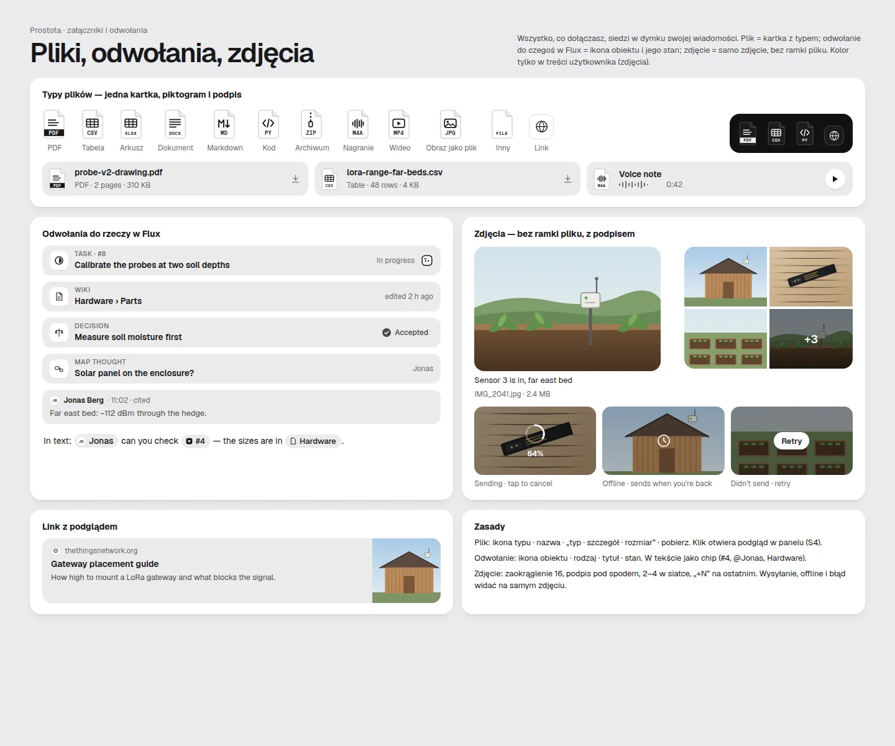

- **A file** is a page icon with a folded corner. The pictogram sits below the fold, with a mono
  label underneath: PDF (inverted band), CSV, XLSX, DOCX, MD, code, ZIP, audio, video, image,
  other. The row shows the icon, the name, "type · detail · size" and a download button. A voice
  note shows a waveform and a play button.
- **Files in direct messages** (founder direction, Hubert, 2026-11-13, [#1438](https://github.com/ColdPhase/flux/issues/1438) point 10, C-64). The paperclip
  of a direct message and of its thread is the one of a space: the same tray under the field with the draft's files, thumbnails, progress and Remove,
  the same photo grid, file rows with Preview and Download, the dark photo viewer and the video player, drag and paste. A message may be files alone
  (no empty bubble of words above them); the conversation's list says "Sent a file" under its name when that was the last message. The paperclip is
  greyed, "(not available here)", only while the draft is a question to the agent (`/ai …`), whose private answer is not a message of the conversation.
  Only the conversation's people reach a file, on every request.
- **Files in an agent's chat** (the same founder direction, C-64 point 4). The composer of the private chat with one of your agents has the same
  paperclip, tray, drop and paste: photos, videos and files go with your message to the agent, or alone. Your message shows them as any message does
  (the photo grid above the words, file rows with Preview and Download, the dark viewer and the player); nobody else sees them. The agent looks at a
  photo and reads a file's text when you ask about it; it says so in its answer like anything else it read.
- **References** to Flux objects are cards with the object icon, the kind, the title and the
  state: task, Wiki page, decision, thought, message. In text they are inline chips aligned to
  the text baseline: `@person`, `#4`, a Wiki page.
  Founder decision 2026-10-30 ([F-034](../../product/decisions.md)): a decision in a Wiki page is
  the drawn one-line card with its short reason (the first sentence of the rationale) under it;
  it opens the decision and shows its current state, and is never copied text.
- **A link** shows a preview: the site icon, the domain, the title, the description and an
  optional image. Founder direction 2026-10-16 ([#469](https://github.com/ColdPhase/flux/issues/469)):
  the Flux server may fetch link previews. Decision [F-031](../../product/decisions.md): the card
  shows the domain, the page's own title and its description in three lines (the address stays as the
  third line when a page has none); no image. The fetch is off unless the operator sets
  `FLUX_LINK_PREVIEWS=on`, blocks private, loopback, link-local and metadata addresses (SSRF), allows
  only http and https on the default ports, sets a timeout and a size limit, caches the result, and
  never happens for an encrypted space or for a reader who may not read the message.
- **A photo** has no file frame. It has radius 16 and its caption below. 2–4 photos form a grid,
  with "+N" on the last one.
  - Sending, offline and failure show on the photo itself: progress in %, "sends when you're
    back", Retry.
  - Before sending, thumbnails with × sit in the composer: one tile per file, a photo and any other file alike, 56 px tall on
    `--sub` with a 44 px face (the photo cropped, or the page icon), the name and its line ("Image · 230.6 KB · Ready to send"),
    × at the tile's top corner, and on a touch screen a small order number before the name, off the photo; the tray stands on the
    pane's `--bg` (visual review 2026-11-17). A tile is as wide as its words, 200 to 360 px (or the tray): its line is never cut,
    only a long name ends in "…", and where the line has no room it wraps between its parts (round 14).
  - On the phone the system's own picker numbers your choices as you make them and hands them back in that
    order. Flux adds no picker of its own (founder review 2026-11-13, [#1424](https://github.com/ColdPhase/flux/issues/1424)):
    the files arrive in the draft at once, each with its name, numbered "Sends 1", "Sends 2" on its thumbnail. The
    full-screen viewer is always dark, with Reply, Create task, Save and Share (kept together in at most 600 px under the
    photo, and the caption centred under it, visual review 2026-11-17).
- **A file preview** (founder decisions 2026-11-10 and 2026-11-12, [#1252](https://github.com/ColdPhase/flux/issues/1252),
  [C-60](../../product/decisions.md)). HTML, plain text (`.txt`, `.log`, source code), Markdown, JSON,
  CSV/TSV and PDF open in the photo viewer's frame. Pressing the row's name opens the preview; the
  row's download button still downloads. Other files keep the whole row as the download.
  - **The frame** is the photo viewer's: always dark, full screen on every size (on the phone it is
    the full sheet), Close (×) at the top left, the file name with "type · size" under it in the
    middle, Esc closes and focus returns to the row. The bottom bar holds Download; nothing else
    takes its place.
  - **The stage** holds the file on one page sheet: `--el` with `--t1` text, radius `--r`, the
    reading column wide (`--col`) for text and Markdown and up to 1200 px for tables, HTML and PDF.
    On the phone the sheet fills the stage edge to edge without a radius. HTML keeps a white page,
    as its author wrote it; PDF is Flux's own viewer (below), never the browser's own.
  - **Under the sheet** one quiet meta line in the caption place says what is not shown. HTML:
    "External images and scripts are blocked." followed by a quiet link button **Run scripts**.
    After the press the line reads "Scripts are on for this preview. A script may contact the
    internet." and closing the viewer turns them off again. Markdown and HTML: **View source** /
    **Preview** as the same quiet link button. A file that is not valid UTF-8 adds "Shown as
    Windows-1252 text." A PDF that needs a password says "This PDF needs a password. Download it
    to open it."; one that cannot be read says "This file could not be shown. Download it to open
    it." The sheet shows nothing else then.
  - **While it opens** the sheet shows the spinner with the file name (a PDF's until its first page
    is drawn); a person who lost access sees "You no longer have access to this file." and nothing
    else.
  - **A PDF** ([#1350](https://github.com/ColdPhase/flux/issues/1350), C-60) is drawn by Flux, never
    by the browser's own PDF viewer, which follows a link in the file in the top window. The pages
    stack on the sheet, white, 12 px apart, as wide as the sheet up to 960 px, centred, each drawn
    only while it is near the view; the sheet scrolls and the text can be selected. The same on the
    phone, edge to edge. A link in the file is invisible until hovered or focused (then a soft tint
    of the system highlight over its area). Pressing one never leaves Flux: the line under the
    sheet reads "This PDF links to https://example.com/x · **Open link** · **Dismiss**", where
    **Open link** is the quiet link button and opens the address in a new tab; nothing opens
    before it is pressed. Only `http` and `https` addresses are offered; a link to a place in the
    PDF, and its next, previous, first and last page actions, scroll the sheet and say nothing.
    Every other link does nothing at all.
  - Text and source: Geist Mono `--fs-base`, wrapped; line numbers stay off until the quiet
    **Show line numbers** under the sheet. JSON: pretty, two-space
    indents, each object and array folds with a chevron; a large file starts folded below the
    second level; invalid JSON shows the text with the parse error line above it. CSV/TSV: a table
    of every row with the header row sticky, mono numbers right-aligned, a cell that starts with
    `=`, `+`, `-` or `@` shown as written text; the line under the sheet says how many rows. A table
    wider than 200 columns shows the first 200 and says "Showing the first 200 of N columns. Download to see
    them all."
- **A video** (founder decision 2026-11-13, [#1352](https://github.com/ColdPhase/flux/issues/1352),
  [C-61](../../product/decisions.md)). MP4, WebM and MOV that the browser plays natively play inside
  Flux; the drawing adds no new surface, only the row's picture and the viewer's stage.
  - **The row** is the file row, unchanged in size (56 px, radius `--r`, `--sub`): in place of the
    page icon a 72 × 40 poster (the first frame the sender's browser drew), radius `--r-sm`, cropped
    to fill, with the play glyph (the voice note's icon) centred on it over the same dark scrim as a
    photo grid's "+N", no other colour. The
    name, "Video · 0:42 · 14.2 MB" (the playing time only when the file says it) and the download
    button follow as in any file row. Pressing the poster or the name opens the viewer; the download
    button downloads. A video without a poster (the sender's browser could not draw one, or an
    encrypted space) keeps the page icon with its video pictogram and the same row. The phone draws
    the same row; under 480 px the poster is 56 × 32 so that the name and "Video · 0:42 · 14.2 MB"
    keep their room.
  - **The viewer** is the file preview's frame (always dark, Close at the top left, the name with
    "Video · size" in the middle, Download in the bottom bar, Esc closes and focus returns to the
    row). The stage holds the player, `object-fit: contain` on black, up to the stage's size, with
    the browser's own controls (`controls`, `playsinline`) and the poster shown until the first frame. The
    row's ▶ is Play: the viewer opens **playing** (one click, founder review 2026-11-13,
    [#1424](https://github.com/ColdPhase/flux/issues/1424)); a browser that refuses sound before a press on the
    player itself leaves it paused with its controls. It
    starts at once and seeks without loading the file: the bytes come in ranges. On the phone the
    stage is the whole screen between the bars, and the browser's controls and full-screen button do
    the rest. Closing stops the video and its download.
  - **A video this browser cannot play** (its codec is not one the browser has) shows on the stage
    "This browser can't play this video." with Download as the one button, as a PDF does. A person
    who lost access sees "You no longer have access to this file." and nothing else.
  - **The limits line** ("Only you see these files until you send · 5 MB each, videos 200 MB · 10 files / 20 MB per message") is not under
    the composer the whole time files are attached ([#1424](https://github.com/ColdPhase/flux/issues/1424)): each row already
    says **"Ready to send"**, and the paperclip's tip "Attach files · only you see them until you send" (personas-33: "Ready, private"
    and "private until sent" were read as "this file stays private"; the words say what happens). It shows below the files only when a file or the draft was refused, or when the draft is
    within two files of the count or at four fifths of the message's bytes (the videos together against their own cap).
    After the picker the focus is back in the message field on a computer (on a phone the field is tapped, so no keyboard
    rises over the files), and no single-key shortcut (`C`, `G` `I`, `[`, the Inbox's and a task's keys, `End`) fires anywhere
    inside a composer, its paperclip, Send and a file's × included.
  - **In the composer** a video is a thumbnail like a photo's (its poster once drawn, else the page
    icon), with its name, "Video · size · Uploading 42%" and ×; Retry upload as for any file. Over the
    limit it says "A video can be at most 200 MB." (the operator's number); in an encrypted space a
    video is an ordinary file ("A file can be at most 5 MB.") and downloads.

| | |
| --- | --- |
| 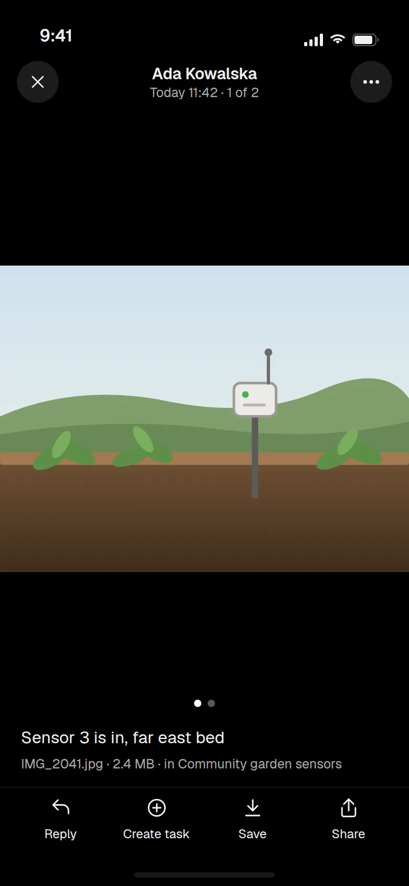 Photo viewer |

These boards date from 2026-10-07. Their files, references and photos are current; their task
words and the conversation header follow sections 2 and 4.

### Formatted text in a message

Founder pick, Hubert, 2026-11-10 ([#1247](https://github.com/ColdPhase/flux/issues/1247)). One
renderer (`app/MessageText.tsx`) draws the words of a message in a space, a thread, a task's
discussion, a direct message, an agent's chat and an assistant's answer; a later surface that shows the same text (a Markdown file preview, #1252) reuses it. It
draws a small subset, from the stored Markdown text, with existing tokens only; nothing else in
a message is formatted and there is no formatting toolbar.

| Typed | Drawn |
| --- | --- |
| `**bold**` | Weight 600, same size and colour. |
| `*italic*` | Italic of the same face, same size and colour. |
| `` `code` `` | The Wiki's inline code: Geist Mono at .86 em on `--sub`, a 1 px inset `--line`, radius 4, padding 1 / 5. It is only text, so marks and references inside it stay as typed. |
| ```` ``` ```` fence | A code block on `--sub` with a 1 px inset `--line`, radius `--r-sm`. A quiet bar on top holds the language when one was written (mono, `--fs-xs`, `--t3`) and **Copy** (quiet small button, the `copy` icon; it reads "Copied" with the `check` icon for two seconds). The code is Geist Mono 13 / 1.55, never wraps, and scrolls sideways inside the block on its own focusable region (keyboard: Tab, then the arrow keys). |
| `- item` / `1. item` | One list, bullets or numbers in `--t3`, indented 1.4 em, 2 px between items. An indented item is an item of the same list; there are no nested lists. |
| `> quote` | As already drawn: a `--sub` block with a 2 px `--line2` rule, and an attribution line "Name:" first. |

- A mention, `#4`, a Wiki page or a web address inside bold or italic stays a chip or a link. In
  code, nothing is a chip.
- **Not drawn, shown as typed:** headings (`#`), tables, images, HTML, Markdown links and
  `_`, `~`. Text that only looks like a mark (`2 * 3 * 4`, a lone `*`) stays text. There is no
  escape character: marks that must show as typed go in `code`.
- In your own message, whose bubble is the `--own` grey, code and a code block sit on `--el` so
  they still read as a block; elsewhere they sit on `--sub`.
- A one-line preview (the DM list, a notification, Copy text) shows the words without the marks.
- Keys: `Ctrl/⌘ B` and `Ctrl/⌘ I` wrap the selected words in the composer (and in editing a
  message) and take the marks off again; nothing selected puts the pair of marks down with the
  caret between them. The hint under the composer is unchanged.
- The agent's brief allows exactly this subset ([assistant](../../product/assistant.md), AG-4).

## 7. Screens

The v0.2 screens, as Hubert approved them on 2026-11-03. Every render is light; dark comes from the
tokens. People are Ada Kowalska (the viewer), Jonas Berg and Maja Wiśniewska; the spaces are
Community garden sensors, Rain barrel monitor and Tool library.

### Home

| | |
| --- | --- |
| 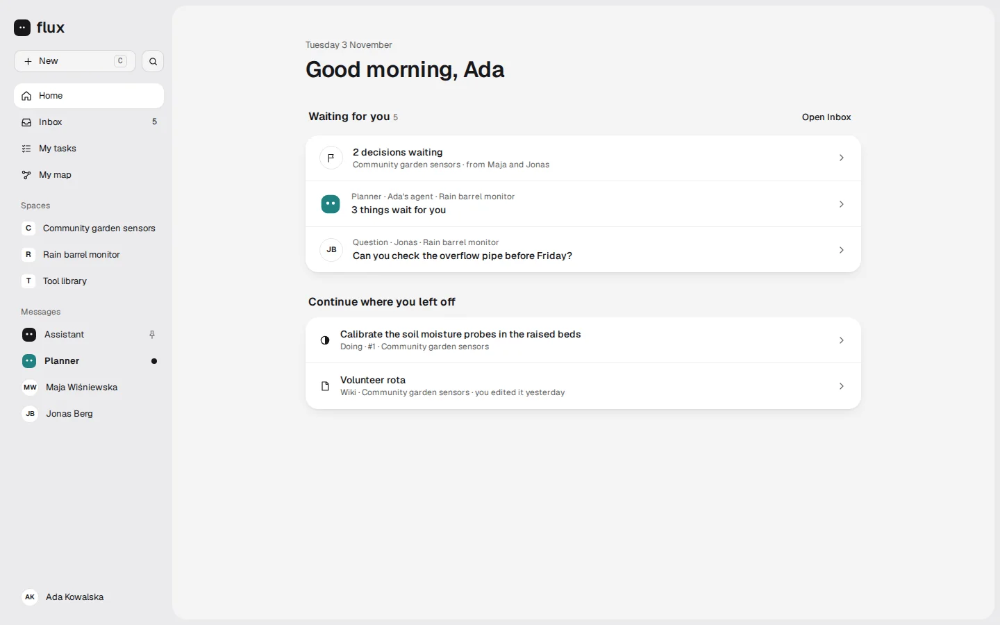 | 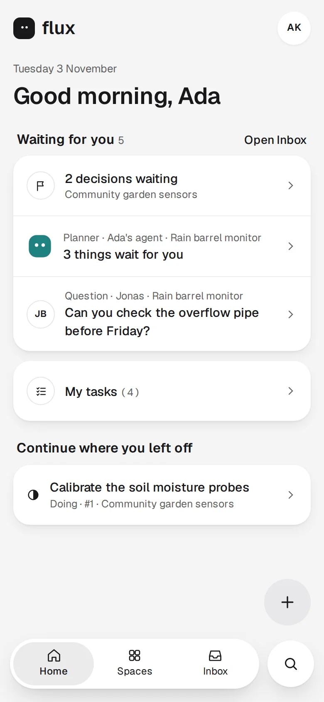 |

- The date, "Good morning, Ada", then two cards. **Waiting for you** (the count, and "Open Inbox"
  on the right) holds the top three Inbox items. Decisions are one row, "2 decisions waiting",
  without Accept; an agent run is one row, "Ada's Planner · 3 things wait for you". A blocked task's row keeps
  what it waits for under its title, as the Inbox does ("Waiting for Basia Wrona · the new seals", persona round 6).
- **Continue where you left off** holds what you last worked on, such as a task with its state
  ("Doing · #1 · Community garden sensors") or a Wiki page you edited. **Nothing appears twice** (#1424): what waits in your Inbox
  (the count of "Waiting for you", its three rows and the items beyond them: a decision, a task, a question) is not offered again
  here; the row is the next thing that is not there, and the section is gone when there is none. One rule for questions and tasks
  (founder decision, Hubert, 2026-11-15, [#1424](https://github.com/ColdPhase/flux/issues/1424) C): a task someone gave you that you
  have not opened is a **Task** in the Inbox and so in "Waiting for you", never "Pick up “…” · Jonas added it for you" here; once you
  open it, start it or finish it, it leaves the Inbox, and Continue may offer it then.
- On the phone, "My tasks (4)" is a row under the waiting items, with "My map" next to it. The
  render draws "My tasks" only; the "My map" row follows this text. Home has nothing else: no
  spaces card, footer links, keyboard hints or assistant banner, except the first-steps card below.
- **First steps** (founder decisions, Hubert, 2026-11-13, [#1438](https://github.com/ColdPhase/flux/issues/1438)): every new
  person but a guest gets one card on Home, above Waiting for you, titled "First steps", with at most three rows and one quiet
  **Hide** (a `link` button at the card's head) that hides it for good on every device. It replaces the old empty-Home line for a
  new member: one concept, not two. Each row is a Home row (face, title, one quiet line, the arrow) and leaves when what it asks
  is done; when none is left the card is gone. **Only a new person has it:** someone who joined the company in the last 30 days and
  has a step left, until they hide it or finish it. The first time no step is left (or on Hide) it is done for that person, saved
  on the server, so it never returns, on another device or when a step becomes undone later (a removed photo). Someone who joined
  longer ago never sees it, and notifications alone never make it: the notifications row only sits beside a step that is left, and
  notifications stay offered where they are today (Settings › Notifications, and the one-time offer after a first
  mention or question). The rows follow the person's company role:
  - **An owner or admin:** **Name your company** (the company still has the name setup gave it; opens Settings › Company with the
    name's editor open), **Invite people** (nobody else is in the company and no invite link was ever made; opens Settings › Company
    with the invite form open) and **Connect AI** (the person has no AI connection yet; opens Settings › AI's Connect AI).
  - **Someone joined with your link** (decision of the coordinator, 2026-11-14, [#1424](https://github.com/ColdPhase/flux/issues/1424), on the
    founder's "the inviter learns when the person joins", [#1438](https://github.com/ColdPhase/flux/issues/1438) point 3). The Inbox stays one list of what needs
    you, so it has no "joined" item: the person who made the link is told by push (at their level, "<name> joined <company>") and, while their card is
    shown, by a row in the place of **Invite people**, which is done once a link was made: the title **Nia joined** and the quiet line **Say hello** (a
    Home row like the others, the `chat` icon; the full name when two share a first name). People who used one of their links and are still in the
    company, newest first, and none they already have a direct message with, are **one row** (round 14, new P3-g: a batch of five read as two
    different rows): **Ana, Leo and 3 more joined** with the quiet line **Say hello to Ana**. The steps keep their rows first, so together there are
    at most three. Tapping the row opens the direct message with the first person named (made if there is none); the row then greets the next,
    and leaves once everyone was greeted. The card is still the steps: with none left it is done for good and so are these rows, which never keep it or bring it back.
  - **A member:** **Write your first message** (the person has written none; opens the space their invite link added them to while they are in it, else Everyone, with the composer ready, and names it: "Say hello in Seed swap"), **Add your
    photo** (no profile photo; opens Settings › Account) and **Get notifications on this phone** (only beside one of those two rows,
    where push is available and this device is not subscribed; the same flow as the one-time offer, which then does not show
    separately).
  - **A guest:** no card.

### Inbox

| | |
| --- | --- |
| 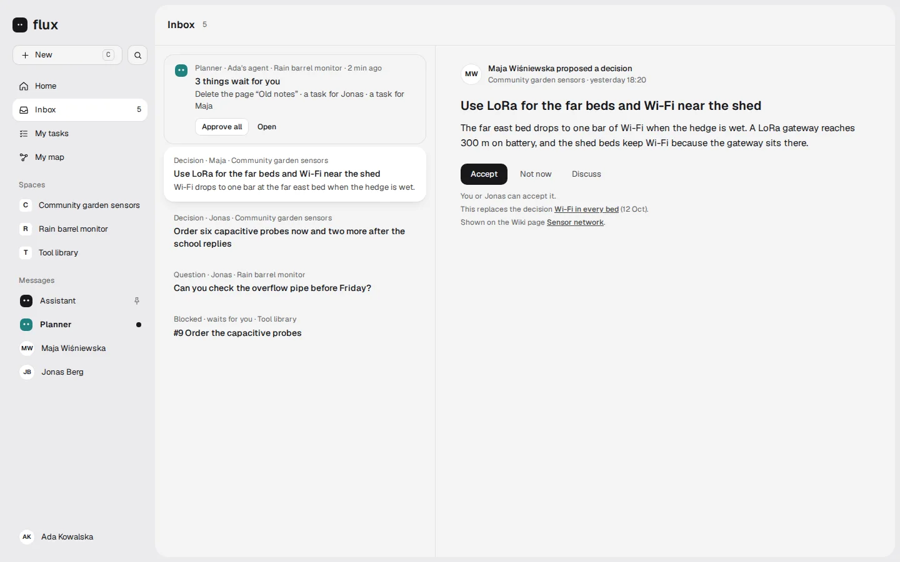 | 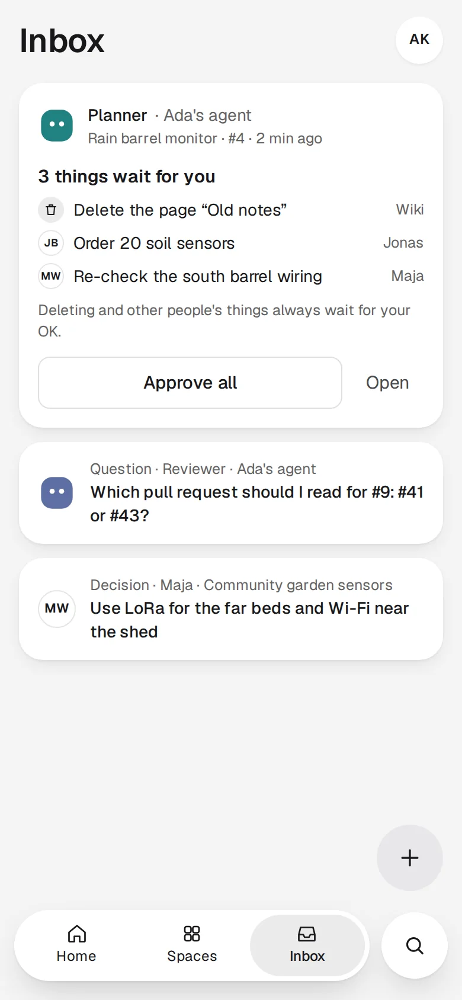 |

- The list on the left, the open item on the right, with no filters. Each item names its kind,
  who it is from and its space: "Decision · Maja · Community garden sensors", "Question · Jonas",
  "Task · Jonas · Rain barrel monitor", "Blocked · waits for you".
- **No filters, and no pill** (founder decision, Hubert, 2026-11-13, #1367). The Inbox is one list of what needs you (S1), **newest first**,
  so there is no "All · Decisions · Questions" row and no "6 need you · all spaces" line, and nothing is grouped by kind: the count is the quiet mono number
  after the title ("Inbox 5", never a pill) and the sidebar's. How much reaches a person is the notification level, which is set in Settings and not
  in the Inbox. Every item needs you, so none is marked "Needs you" (§2 lists the pill as superseded).
- **Two columns where there is room, one column on the phone.** From a 1001 px window (the width at which the detail panel stops
  being an overlay) the list is the left column, about 360 px, and the open item is the right column, as drawn. In the list each
  item is one row: kind · who · space, the title (two lines at most) and one line of what it says, with no button; every kind has the same shape
  (a muted line "Kind · who · space" that starts with the kind, no bold name before it and no time, #1424). A question or a mention is titled by what it
  says, a call by its place ("Call in Gesture lamp", "At “Order sensors”"); the notification's own sentence ("Jonas asked you in Rain barrel monitor") stays in
  Notices, push and the API. A message between two people has a sender and no space ("Question · Jonas"); a group message keeps its sentence, which names the group; the open row is
  the raised `--el` row, and the first item is open until another is chosen. The right column is the open item as its card with no
  box around it: the face, who and where and when, the title (`--fs-xl`), its words, its actions, then who can accept it. Nothing in
  the list moves when another item opens. **In one column** (a tablet in portrait, the phone) the open item is the card that is
  expanded inside the list, and the others stay one row with their one quiet action, as the phone is drawn.
  `J` and `K` move between items, and `A`, `R`, `E` and `S` act on the open one, each only where it shows that button (Accept, Reply,
  Done, Not now; a decision has no Done, #1424). `R` puts focus in the reply field, and what is typed from then on is the reply, never
  Inbox keys. Enter on a question, a mention or a reply does what `R` and Reply do (§4, personas-34). **Two actions in a row share one
  Undo:** an action taken while the toast of the one before is still on screen says so ("Accepted, and 1 more · Undo"), and its Undo
  (`Z`) takes all of them back, newest first, so a second toast never takes away the Undo of the first. Arriving at the Inbox with focus nowhere (`G` `I`), the open item's row takes it. The keys are shown in menus and on their buttons
  (Accept's `A`, Reply's `R`), never as a legend under the list ([#1419](https://github.com/ColdPhase/flux/issues/1419) item 13).
- **Not now is one button, with no menu** (S11, #1367). It puts the item off until tomorrow at 08:00 and offers Undo ("Not now.
  Back tomorrow morning"); the item returns then. There is no "Ask me again" menu, no "Next week", no "When #N is done" and no
  "Decline for good" on a decision: a decision waits until someone accepts it. The one dark primary of the open item is its first
  action (Accept, Approve all, Join, and Open on a Task or a Blocked item, one word for both, personas-30).
- **"2 for later" and "4 done today" open their lists** (founder decision, Hubert, 2026-11-15,
  [#1424](https://github.com/ColdPhase/flux/issues/1424) E). One quiet line under the list, the same in a full and an empty Inbox,
  says how many are put off and how many were marked done in the last 24 hours ("2 for later · 4 done today", each part only when it
  is not 0). Each part is a quiet text button that opens a small window (a sheet on the phone) with its list, newest first, every
  row as an Inbox row (kind · who · space, the title) with one quiet button:
  - **For later**: when it comes back ("Back tomorrow at 08:00", "Back when #4 is done") and **Bring back now**, which puts it in
    the Inbox at once.
  - **Done today**: when it was done ("Done at 14:20") and **Put back**, which returns it to the Inbox as it was, as Undo does.
  Keyboard (§4): the window opens with its first row's button focused; Tab and the arrow keys move between the rows' buttons; when a
  row leaves, focus goes to the next row's button, else the previous one; Esc closes the window and gives focus back to the line's
  button. When the last row leaves, the window closes. Whenever the window closes after something was put back, what came back is in
  the list at its place and the last of it has focus there and is the open item (on the phone the expanded card), so `E` acts on it
  (personas-34). Each row says what its Inbox row says: a blocked task you are waited on is "Blocked · waits for you", your own "Blocked · your task". Inbox keys (J, K, A, E, S, R) do nothing while the window is open.
- **A task given to you** (founder decision, Hubert, 2026-11-15, [#1424](https://github.com/ColdPhase/flux/issues/1424) C). When
  someone else or an agent makes a task with you as its Owner, or changes its Owner to you, it is an item of your Inbox:
  **"Task · Jonas · Rain barrel monitor"**, titled by the task ("#12 Seal the lids"), with **Open** (it opens the task in the one
  panel), Not now and Done like the other items. **Done finishes the task** (founder decision, Hubert, 2026-11-15, #1424): it moves to
  Done for everyone, the toast says "#12 moved to Done · Undo", and Undo puts it back to To do and in your Inbox. It leaves the Inbox when you open the task (from here, from Tasks, from Search, a
  notice or a push), when you start it or finish it, and when it is given to someone else. Giving a task to yourself tells nobody and
  is no item. It reaches you by notice, push and email at your notification level, as a task always did; a task given to you that
  is blocked is the one Blocked item, not a Task too.
- **Done on your blocked task finishes it** (founder decision, Hubert, 2026-11-15, round 8, [#1424](https://github.com/ColdPhase/flux/issues/1424)),
  as on a task given to you: the Blocked item's Done (the button, `E`, the phone's swipe) moves the task to Done for everyone, the toast says
  "#6 moved to Done · Undo", and Undo puts it back to Blocked with what it waited for (the person, decision or task and the reason) and in
  your Inbox. For the person a task waits for, its Done stays theirs: they are done, and the task can continue; the toast says "#6 can
  continue · Undo", and Undo puts it back to Blocked, waiting for them with its reason (personas-33). Every Done here, on a task given to
  you and on a blocked item alike, is in "done today", where Put back does what Undo does.
- **Accept works at once, with Undo** (founder decision, Hubert, 2026-11-15, round 8, [#1424](https://github.com/ColdPhase/flux/issues/1424)):
  in the Inbox (the button, `A`) and in the decision's panel alike, Accept accepts the decision at once, for everyone: its card reads
  Accepted, it leaves every Inbox, a decision it replaces is marked replaced and the tasks that waited for it continue. The toast says
  "Accepted · Undo" for its 10 s. Undo takes the acceptance back for everyone: the decision is Proposed again, in the Inbox of those who
  can accept it, a decision it replaced is the current one again, and the tasks that continued because of it wait for it again, as they
  were. Only the person who accepted can undo, and only while nothing rests on the acceptance yet (a task it let continue was changed
  since, or a newer proposal replaces it); then it stays and the toast says "It is in use now, so it stays accepted".
- **An answer to your question reaches you** (founder decision, Hubert, 2026-11-14, [#1424](https://github.com/ColdPhase/flux/issues/1424)
  decision 1). When you ask someone something (a message that names them and asks, which reached their Inbox as a Question) and they
  answer in that thread (Inbox › Reply, or in the thread itself) or, in a direct message, in that conversation, the answer is an item of
  your Inbox: **"Reply · Marta · Product"**, titled by what she wrote ("Sent a file" for a photo alone), with Reply and Done as a mention
  has, and it reaches you by notice, push and email as a mention does at your level. It is the mention rule and not a new kind: an answer
  addresses the person who asked, as a name does. It is a Reply in an encrypted space too, where the notice says only who and where. Only the
  person's first message after the question answers it, and your own reply in the
  thread takes the item out as any reply does (#1170). An agent's question card is answered with its buttons and tells nobody.
- **Who a question asks is one rule** (personas-27, 2026-11-15; contract in [needs-you](../../development/needs-you.md#whom-a-question-asks-personas-27-one-rule)).
  A message that names you and asks is a Question for you. In a direct message between the two of you, every question is a Question for
  you, with or without your name (founder decision 2026-11-15, #1424 A). A question in a thread you started that names nobody is a Question for you too:
  it is in your Inbox and on Home's Waiting for you, never only in Continue where you left off, so Home and the Inbox give one answer to "is
  something waiting for me?". Nobody else in the thread is asked. Someone who joins a space later gets the newest still-open question there
  that names them, as if they had been there.
- **A call is a Call, never a Question** (F-041, #1368). An invitation to a call or a call started in your space is one item,
  "Call · Nia · Gesture lamp", with **Join** as its primary and Open as its second action; it is on Home and in the Inbox only while
  someone is in the call and you are not. It leaves when you join (from here, from the notice, from the space's Join or from the
  call line) and when the call ends.
- **One item per agent run:** "Ada's Planner · Rain barrel monitor", "3 things wait for
  you", what they are (Delete the page “Old notes” · a task for Jonas · a task for Maja), then
  Approve all and Open. The phone lists the three things and the line "Deleting and other
  people's things always wait for your OK." The same requests also show in the task's discussion.
- A decision opens as its card (P4). Its Discuss and `R` open the decision's panel with the cursor in "Write about this decision…" (its
  one discussion, [A space](#a-space-header-conversation-and-message-actions)). Opened from there, it opens where it opens from everywhere (Search, a notification, a link, its
  card): in the one panel over its space's conversation, with its card there marked as the open one (the founder's bar that the same
  object opens in the same place). An empty Inbox is a small moment.

### Notices

Founder direction (Hubert, 2026-11-10 and 2026-11-12, [#1243](https://github.com/ColdPhase/flux/issues/1243)).
Drawn by the agents before it was built; the rules of what triggers a notice are in
[mobile and PWA](../../product/mobile-pwa.md#while-flux-is-open-1243).

| | |
| --- | --- |
| 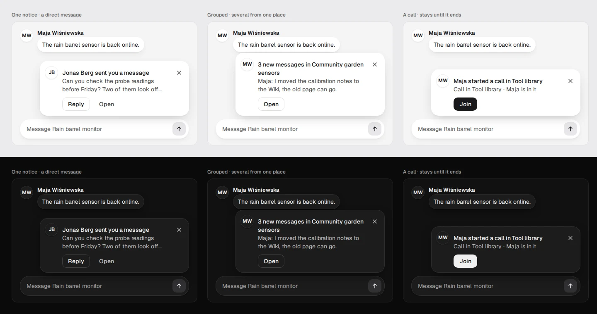 | 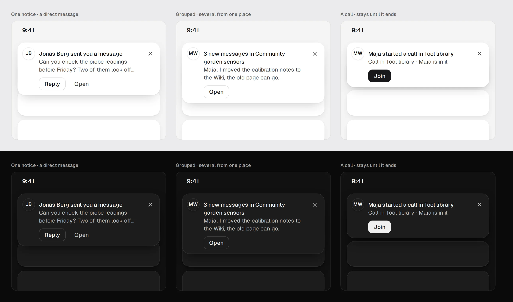 |

- **A notice is its own card**, not a toast. Undo toasts stay at the bottom centre, one at a time
  (#1206); a notice never replaces a toast and a toast never replaces a notice. An Undo toast stands 8 px above the highest composer drawn, so it
  never covers its hint or Send (#1424).
- **An Undo toast lasts 10 s, and only where you are** (founder decision, Hubert, 2026-11-14,
  [#1424](https://github.com/ColdPhase/flux/issues/1424); it replaces "Undo stays until it is used or closed", #347 N1). One rule for
  every toast that offers Undo or takes a step back (Hand back): it leaves on its own after 10 s, and at once when you go to another
  place (the address changes: another space, view, page or thread, Back). The 10 s pause while the pointer is over it or focus is in
  it, as a notice's do, so Undo can always be reached with Tab or a screen reader; they run on when the pointer or focus leaves.
  `Z` undoes only the Undo toast on screen: once it has left, `Z` does nothing, and an action done in another place is never undone
  from here. A change held for Undo (an agent's question answered with its buttons) is sent the moment its toast leaves, for whichever
  reason (its 10 s, ×, a newer toast, another place, the page closing): an answer is never unsaid, so it waits. **Accept is not held**
  (founder decision, Hubert, 2026-11-15, round 8, #1424): it applies at once and its Undo takes the acceptance back
  ([Inbox](#inbox)). **A proposed decision is not held** (founder decision L, Hubert, 2026-11-15, [#1424](https://github.com/ColdPhase/flux/issues/1424)):
  like a new task, it reaches everyone at once, and its Undo withdraws it, so it disappears for everyone, with its notifications and
  Inbox items. Its proposer withdraws it while it is still proposed and nothing else names it (a task that waits for it, a link to it);
  accepted or used by then, it stays, and the toast says so. A toast without Undo keeps its own short time (about 5 s, 8 s with
  Open); an error stays until it is closed.
- **It never covers the newest thing.** While a toast shows, a conversation (a space's, a thread's, a direct message's) keeps its
  end clear of it: the end of the list moves up by the part of the toast over it, so the new task's card, the last message and an
  inline Delete / Keep row stay readable and reachable above the toast. A reader at the end stays at the end; one reading higher up
  is not moved. When the toast goes, nothing moves: the room is given back once the reader scrolls up from the end.
- **Where.** At the bottom right on the computer and the tablet, 20 px from the edges, 360 px wide;
  it stands 8 px above a composer, a toast or the map's toolbar that reaches its corner, so it never
  covers the composer or Send. It floats over the work, never over a docked panel: while a panel is docked (from 1001 px) it stands at the bottom right
  of the work column, 20 px left of the panel, so the panel's composer and controls stay clear (audit P3 17). On the phone it is at the top, 8 px under the safe area, 16 px from
  each side, on a band of the page's ground (`--bg`) from the screen's top edge to 8 px under the card, so
  nothing of the header shows at its corners. While a dialog, a sheet or a menu is open, it waits and shows when that closes (it never
  covers a menu, v0.2.1 audit).
- **The card.** `--el`, `--sh-pop` (the dark theme's inset outline comes with it) and `--r-card`.
  The sender's face on the left: `Avatar` 32 for a person, Kreska 32 for an agent. Then two lines:
  the title in 14 / 20, 500, `--t1` ("Jonas Berg sent you a message"), and the preview in 14 / 20
  `--t2`, each at most two lines with an ellipsis. The close × (`IconButton`, 44 px on touch)
  is at the top right. The buttons are a row under the text, 32 px high:
  - anything said in a direct message (a message, or a question asked there): **Reply** (outline) and **Open** (text button);
  - a mention, a question, a task, a decision or an agent: **Open** (outline);
  - a call: **Join**, the card's one primary button, and the title says who started it or invited you,
    and where ("Maja started a call in Tool library", "Maja invited you to a call in Tool library").
- **One at a time.** A newer notice replaces the one shown, in place and without motion. Notices
  from one place in a row are grouped: "3 new messages in Community garden sensors", with the
  newest face and preview, which in a space always starts with the sender's first name ("Maja: I moved the
  calibration notes…"; a preview that opens with "@" and your own name drops it); Open opens the newest. A call notice is replaced only by another call;
  while it shows, other notices are not shown (they are in the Inbox).
- **How long.** About 6 s, paused while the pointer is over it or focus is in it. A call notice
  stays until the call ends or the person closes it.
- **Calm.** Nothing for your own actions, and nothing for the place you are looking at (the space
  or the direct message on screen). On the Inbox, nothing for what the Inbox lists as an item (a question, a mention or an answer,
  a task given to you, a decision, a call to join, an agent's run): it arrives in the list in front of you (personas-33); a plain
  direct message or a reply in a thread still shows its notice there. It follows your level and quiet hours; Nothing shows none. It
  is announced politely (`role=status`) and never takes focus. Tab reaches its buttons (the actions, then
  Close), and Escape inside it closes it and gives focus back to where it came from.
- **Motion** is the surfaces' ([motion](../motion.md#how-the-rules-apply-to-existing-motion)): it
  enters in `--dur-in` on `--ease-out` with an 8 px travel from its edge (up from the bottom on
  the computer, down from the top on the phone) and leaves in `--dur-out` on `--ease-in`; reduced
  motion shows and removes it at once.

### Asking for notifications

Founder direction (Hubert, 2026-11-10, [#1243](https://github.com/ColdPhase/flux/issues/1243)); drawn by the agents before it was
built. The contract is in [mobile and PWA](../../product/mobile-pwa.md#while-flux-is-open-1243).

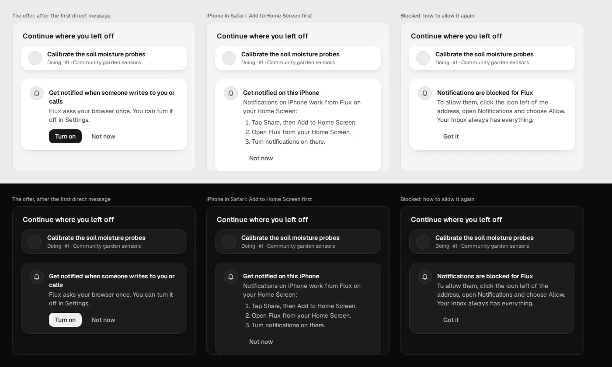

- **One card on Home, last on the page** (after Continue, [motion](../motion.md) rule 6: it may not come, so nothing sits
  under it). A Home card (`--el`, `--sh-card`, `--r-card`) with the bell in a 32 px icon face, a title and a line in 14 / 20,
  and its buttons under the text.
- **When.** After the first direct message, mention or question to you, while this browser has not been asked, Flux can push
  and you did not say Not now in the last 14 days. Once.
- **The offer.** "Get notified when someone writes to you or calls" · "Flux asks your browser once. You can turn it off in
  Settings." · **Turn on** (the screen's one primary; it asks the browser from the tap) and **Not now** (text button).
  Turned on, the card goes and a toast says "Notifications are on for this device".
- **iPhone and iPad in Safari** (no Home Screen app yet): "Get notified on this iPhone" with the three numbered steps (Share,
  then Add to Home Screen; open Flux from the Home Screen; turn notifications on there) and Not now. The Home Screen app then
  makes the offer. **Android** adds **Install Flux** (text button) where the browser offers installation.
- **Blocked.** When the browser answers Block, the card says "Notifications are blocked for Flux", how to allow them for
  this browser, that the Inbox has everything, and **Got it**.
- **In the call strip.** When someone invites you to a call, the invitation's strip carries the same card under its row:
  the same words, buttons, conditions and 14 days of Not now (one answer for both places). No earlier message is needed:
  the invitation is the reason. It sits inset as the row is (20 px from the left, 12 px from the right, 10 px below; on a
  phone 16 px and 12 px), is the Home card as it is (no extra shadow or colour), and comes without motion. The strip's Join,
  Later and Reply in text stay where they are; the card is read once when the strip opens, so the work below moves down once
  at most, and back when the strip is answered (the strip is above the work and goes with the answer).

### A space: header, conversation and message actions

| | |
| --- | --- |
| 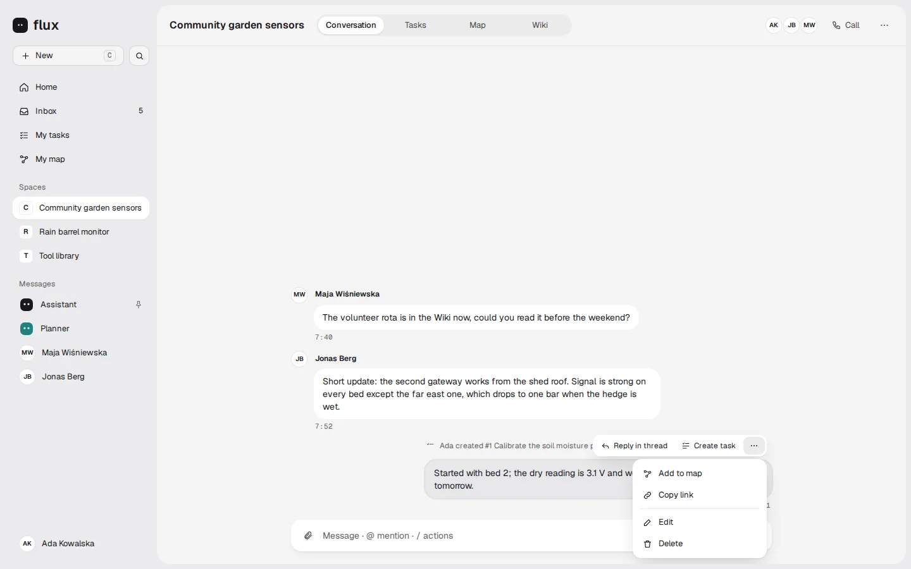 | 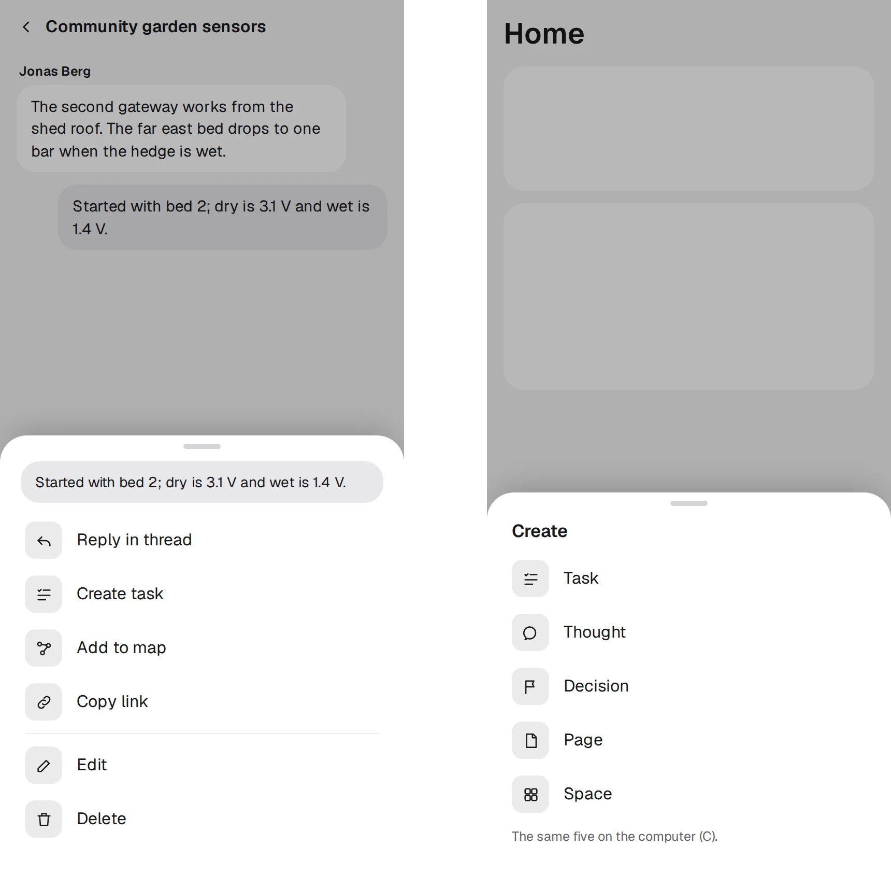 |

- The header follows section 4: name, Conversation · Tasks · Map · Wiki in fixed slots, faces,
  Call and ⋯.
- The right-hand drawing's list of types under the phone's "+" is replaced: the "+" opens the Create
  window on Task (#1438 point 8, [Phone](#phone)); the message actions beside it are as drawn.
- The reading column is at most 760 px. A task or a decision shows **once** in a conversation, as
  **one card** where and when it was made (founder decision, Hubert, 2026-11-14, [#1424](https://github.com/ColdPhase/flux/issues/1424)),
  in the author column with its maker's face. Its first line, quiet and beside the face, says who
  made it, from what and when ("Ada Kowalska created a task from Jonas’s message · 8:05"); under it, in the same card, the row is the
  object (the task's state glyph, `#1`, its title, its owner or "No owner", and its state word; a decision's flag, its title and its state word),
  which opens it in the one panel. A card's row is read when the card comes near the screen; **until then it states no
  state and no owner** (the glyph's and the word's places stay empty), never a wrong "To do" with no owner that changes as it
  scrolls into view (personas-33). "Jonas’s message" is a link that brings
  that message into view, so the way from the message to the task stays on the card. There is no separate event line above the
  card, and the message it came from carries no chip of it. A thread shows a decision made in it as the same card among its
  replies; a task made from one of its messages (its root or a reply) shows there as the card under that message, its only place in the thread (a thread has no task notices).
  **Accepting a decision changes its card in place** (founder decision D, Hubert, 2026-11-15, [#1424](https://github.com/ColdPhase/flux/issues/1424)):
  the state word reads **Accepted** and one quiet line inside the card, under its row, says who accepted it and when ("Accepted by
  Kasia Wrona · 9:12", the day when it was not the day it was proposed). The conversation gets no line of its own for it, neither
  "Ada accepted it" nor "Ada accepted the decision …"; the decision's panel keeps the record in the same words (its "Accepted by Kasia Wrona · today" row, personas-30). A task's later step (blocked, can
  continue) is one line, never a second card. One state has one word: a
  decision is **Proposed**, **Accepted** or **Replaced**, never "Proposed decision"; the panel's head already says "Decision", so its
  eyebrow is the state alone ("Proposed", "Accepted 14 Nov"), and the panel shows no row version ("Version 2" on a decision nobody edited
  said nothing). The card's title always keeps room: a long title wraps instead of being cut, whole on a computer (also at 200 % text) and in
  at most two lines on a phone (whole when the text is large); where the card is narrow for its
  text (beside a docked panel at 1024 px, a phone, 200 % text) the owner's name gives way first (the face alone), and the state word
  stays whole inside the card.
- **A decision's discussion** (founder decision, Hubert, 2026-11-15, recorded on [#1424](https://github.com/ColdPhase/flux/issues/1424)):
  a decision has **one** discussion, a thread on its card, and its panel shows the same thread, so nobody looks for it (as a task's
  discussion is one, P10). **Discuss** (in the decision's panel, on its Inbox card, and `R` in the Inbox) opens the decision in the one
  panel (the sheet on the phone) with the cursor in the field at the panel's foot, **"Write about this decision…"**; Discuss on the
  decision already open only puts the cursor there. Under the decision, the panel lists what was written about it, oldest first, the
  newest at the bottom just above the field. The first message starts the thread: from then on the decision's card in the conversation
  (in the stream and in the thread it came from) carries **"2 replies · last 9:40"** under its row, as a root does, and that opens the
  same thread in the panel: the decision's row at its top (it opens the decision), then every message about it, then the thread's
  composer. A message written in either place is the same message and shows in both at once, for everyone reading. The thread follows a
  thread's rules for notifications: the people who wrote in it and the people who follow it get its replies, and whoever proposed the
  decision follows it from its first message, an agent's owner for an agent's proposal (their Unfollow still wins). Its first message is a
  reply like the others, so the **New** divider (S23) can stand above it, and an edit or a delete shows in the panel as in the thread. It is not a root of the stream (its place is the card), it is
  read and written by everyone who reads and writes the space, a guest included, and an encrypted space seals its messages as it seals
  any thread's. Before anyone writes there is no thread and the card has no count. Words typed after Discuss never go to the space's
  own composer: that sent them as a plain message with no link to the decision (persona round 7, founder question 4).
  **Who it asks** (persona round 8 P2 3, recommended to the founder and applied, 2026-11-15): the thread's starter, for a question that
  names nobody, is the person who proposed the decision (an agent's owner for an agent's proposal), never whoever wrote in it first; the
  question reaches them as "Question · Jonas · about “Stand closes at 15:00”" in the Inbox, and its notice says "Jonas asked you about
  “Stand closes at 15:00”" (an encrypted space keeps its fixed words, "Jonas asked you in Garden club"). **One discussion reads the same
  in both places** (round 8): the panel names people as the thread does, by their full name (and "Ola Nowicka (you)" for you); a message
  read in the panel is read in the thread too, so no New divider stands above it there; and the thread's composer says what it is about,
  **About “Stand closes at 15:00”**, where a message's thread says "Replying to · …".
- **A task's discussion opened as a thread** (from Search, a notice or a link) says whose it is (personas-34): above its first
  message, the task's row, "#3" and its title, which opens the task in the one panel, as a decision's discussion has the decision's
  row at its top.
- The message toolbar sits at the bubble's top corner, as
  [Spokój](../spokoj/README.md#message-toolbar-and-selection) places it. A line in the ⋯ menu
  divides Add to map, Copy link and Copy text from Edit and Delete. **The menu opens away from its message** (visual review
  2026-11-17): from the toolbar's far edge, to the right of someone else's message and to the left of one's own, so it never
  covers the words it acts on. In a narrow thread pane the toolbar keeps its raised container in the bubble's corner.
- **One look for a conversation's pieces** (visual review 2026-11-17):
  - One divider: its words in the middle and a hairline to each edge, for the day ("Today"), **New** (stronger words and line)
    and a thread's "2 replies · Today" (in a space's thread and a direct message's alike). Two never stack (round 14): where what is
    new starts a day it is one divider, **New · Today**, and where it starts at a thread's first reply that divider stands alone
    (the panel's head keeps the count).
  - Under a message, its own time comes first, then the thread's line ("4 replies · last 7:47", the speech-bubble icon and the
    last reply's time in a space and in a direct message alike), so the two times never read as one said twice.
  - A direct message reads in a space's reading column and composer width, so the composer never jumps between the two (round 14).
  - The `@` and `/` lists stand on the pane's `--bg` down to the composer: no strip of the conversation shows between them.
  - A message toolbar's tooltip is centred on its button; only at the pill's outer end (the last button beside someone else's
    message, the first beside one's own) does it end with its button, so it never runs past the pane.
  - The task card of a task just created comes into view whole, above the composer and the toast, also when the conversation
    opened at **New** and was at its end without the person scrolling (round 14).
  - A person's face beside a message is the same grey face in a space and in a direct message.
  - A long address in a message, and the address line of a link card (up to its three lines, #348), breaks after `/`, `_`, `#`,
    `?`, `&`, `=`, `.` or `-`, never inside a word.
  - Editing one's message in place: the message takes its column's full width and the field grows with its words (to 40 % of
    the window), with no resize grip.
  - The `@` and `/` lists keep the ↵ badge's slot on every row, so the right column never moves with the highlight.
  - On the phone, a thread's "Replying to · …" stands above the field.
  - A photo in a message has a `--line2` hairline, so a light picture keeps its edge, and its toolbar stands beside the photo.
- The composer has the paperclip, the hint and Send. A conversation with its usual audience shows
  no "who can see this" text.

### Muting a place and following a thread

Founder pick on [#1249](https://github.com/ColdPhase/flux/issues/1249) (v0.2.1). Two plain actions where the thing is; no new
screen, setting or mode, and Settings › Notifications stays the overview. Everything is built from the parts that exist: the ⋯
menu's rows, the sidebar's end slot, the panel head's quiet actions and the existing icons and tokens.

- **Mute and Unmute** are one row of ⋯ in a space's header (the computer's and the phone's) and in a direct message's header menu (the
  computer's ⋯; on the phone the direct message's ⋯, after Search and one row above "People and privacy"). A space reads **Mute space** /
  **Unmute space**, a direct message **Mute conversation** / **Unmute conversation**. The row has no key, no switch and no
  confirmation: it acts and the menu closes. Under the label, one line of the menu's small muted text says what it does, so the
  person need not guess: "Quiet for ordinary messages. What needs you still arrives." while it is on, and "Muted. What needs you still
  arrives." under **Unmute**. A muted place sends no notice, push, email or sound for an ordinary message (a reply or a direct message);
  everything that needs the person still arrives: a mention, a question, a task for them, a decision about their work, a call
  invitation and an agent waiting for their OK (founder decision, #1249).
- **The muted mark** is the `quiet` icon at 12 px in the muted text colour (`--t3`), after the name in the same end slot as the
  encrypted lock, on the sidebar's row of a muted space or direct message and on the Spaces page's row. It is a mark, not a button.
  The 64 px rail has no slot for it: it puts ", muted" in the tile's name and tooltip.
- **Unread in a muted place is a quiet count, never bold.** Where an unread place has its name in bold
  ([Ordering spaces](#ordering-spaces-unread-and-mark-all-as-read), #1250), a muted one shows the number of new things in `--t3` at the
  small size, regular weight, tabular figures, in the dot's place (the muted mark stays before it). The dot is for what needs the
  person; a muted space that holds such an item and has nothing unread shows it as the others do. Names never change weight. A muted place adds nothing to the Inbox count except what needs the person and still arrives.
- **Follow and Following** are one quiet button in a thread's panel head, between its reply count and the close control (the head's
  "quiet actions" slot): **Follow** with the plus icon, **Following** with the check (the label says the state), the `Button`'s quiet variant at the small
  size, no colour of its own. It is the same on the computer's panel, the tablet's overlay and
  the phone's sheet. A thread is followed without choosing when the person started it, wrote in it or was mentioned in it; **Following**
  then stops its replies from notifying (**Follow** shows again). A mention of or a question to the person still arrives in a thread they unfollowed.
- **Everything stays in step.** The ⋯ row, the sidebar mark, the Settings list and the thread's button read and write the same
  preferences that the Inbox, push and email use, and a change in one tab shows in the person's other open tabs without a reload.

### Call audio

Not in the drawings; composed from the drawn parts for [#1244](https://github.com/ColdPhase/flux/issues/1244) (founder request
2026-11-10; the approved "Calls" board shows the Audio panel and the per-person popover). The contract and the browser support are in
[live collaboration](../../product/live-collaboration.md#call-audio-devices-and-volumes-1244). Only the live strip's parts are used:
`lv-pop` (the strip's popover), `Sheet` on the phone, `Select`, the settings' `SwitchRow`, `Button`, `IconButton`, the `Avatar` face and
the existing icons (`mic`, `hearing`, `quiet`, `chevron-down`, `chevron-right`). The one new part is the **slider**, below.

```
Strip, computer: the microphone has a small arrow
 ● Live   Call in Gesture lamp     (A)(J)(N)     Show this   [🎙|▾] [📷] [🖥]  ⋯   [Leave]

Audio settings (a popover under the strip, 360 px; a sheet on the phone, opened from ⋯ › You › Audio settings)
┌──────────────────────────────────────────────┐
│ Audio                                     ✕  │
├──────────────────────────────────────────────┤
│ Microphone                                   │
│ [ Built-in microphone                  ▾ ]   │
│ ▮▮▮▮▮▮▮▯▯▯▯▯▯▯▯▯▯▯▯▯   Speaking              │
│ Only you hear this check. Nothing is sent.   │
│ Microphone volume      ──────●────   120%    │
│ Reduce background noise               ( ● )  │
│ Cancel echo                           ( ● )  │
│ Even out my volume                    ( ● )  │
├──────────────────────────────────────────────┤
│ Speakers or headphones                       │
│ [ Headphones                  ▾ ]  [Test sound] │
│ Everything you hear    ───────────●   100%   │
└──────────────────────────────────────────────┘

Where the browser cannot choose the output or set its volume (an iPhone): one line and Test sound, no select and no slider
│ Speakers or headphones                       │
│ [Test sound]                                 │
│ 🔈 Use your phone’s volume buttons.           │

A person's sound (a popover under their face in the strip; the same two rows under their name in ⋯ › Here now)
┌──────────────────────────────┐
│ Nia Okafor                   │
│ Volume        ───●────  80%  │
│ Mute for me             ( ○ )│
│ Only you hear this change.   │
└──────────────────────────────┘
```

- **Where it opens.** On a computer the microphone button has a small arrow (`chevron-down`, 20 × 32 px, 28 × 44 px on a touch
  screen) beside it; it opens the popover under the strip, right-aligned like ⋯'s panel. On every device ⋯'s panel has the row
  **Audio settings** in its "You" section (the `hearing` icon, `chevron-right`), which closes the panel and opens the same
  popover (a sheet on the phone, and wherever ⋯'s own panel is a sheet). The arrow is absent on the phone, which keeps one
  microphone button. While you work quietly the strip has no devices, so there is no arrow. Escape or a click outside closes it
  and focus returns to the arrow (or to ⋯).
- **Microphone.** A `Select` (label "Microphone") with the devices the browser lists, "Default" first. A fixed 8 px **level
  meter** under it: a track the width of the popover in `--hov`, filled from the left in `--t1` (`--r-pill`, moving with
  `transform` only, never eased), with the word beside it, "Speaking" or "Quiet" (`--fs-sm`, `--t2`, held for a moment so it does not
  flicker). The track is an image named "Microphone level: Speaking" and the word is its text alternative, so a screen reader reads it
  on request and is not interrupted by it. While the microphone is off the meter listens only while the popover is open and only if
  the browser already allows the microphone, with one line of `--t3` text under it, "Only you hear this check. Nothing is sent." (the
  browser's own recording mark shows); otherwise the meter row is one quiet button, **Test microphone**, with the same line. Where
  the browser refuses the microphone the row says "The browser blocks the microphone. Allow it in the site settings." Below it the
  **Microphone volume** slider and three switches in plain words (the browser's noise suppression, echo cancellation and automatic
  gain, all on by default and each drawn only where the browser has it).
- **Speakers or headphones.** A `Select` (label "Speakers or headphones") with a quiet **Test sound** beside it (one soft
  tone through the chosen output at the chosen volume; the button says "Playing…" while it plays), then the **Everything you hear**
  slider. Where the browser cannot choose an output (no `setSinkId`, or an iPhone or iPad) the Select is not drawn, and where it
  cannot set the media volume at all (iOS) the slider is not drawn either: one line of `--t3` text with the `hearing` icon says
  why, "Use your phone’s volume buttons." on iOS and "This browser plays sound through the output chosen in your system settings."
  where only the choice is missing; Test sound stays. On Firefox, which lists output devices only after the person allows them, the
  Select is one secondary button, **Choose speakers or headphones**, that opens the browser's own permission list.
- **The slider** (`ui/Slider.tsx`) is a real `input type="range"`, so the arrow keys (one step), Page keys, Home and End and
  assistive technology work as the browser gives them, with a visible label to its left and its value to its right in `Geist Mono`
  (`--fs-sm`, `--t2`, tabular figures, a fixed 4-character width so the track never moves). The track is 4 px high in `--hov`, the part
  up to the value in `--inv`, both with `--r-pill`; the thumb is a 16 px circle in `--inv` with a 2 px ring in `--el`, and 24 px on a
  touch screen inside a 44 px high target. Focus is a 2 px `--t1` outline around the thumb, like the switch's. The slider's name is
  its label ("Microphone volume") and its value text is the percent ("120%"). The microphone and each person go from 0 to 200 %;
  "Everything you hear" from 0 to 100 % (it only lowers; the device's own volume sets the top). No motion: the thumb follows the
  pointer.
- **A person's sound.** A remote person's face in the strip is a button (name "Sound from Nia Okafor"; the speaking ring and the
  muted-microphone badge stay) that opens a small popover under the face, the strip's own `lv-pop` at 280 px: their name, **Volume**
  0 to 200 % and the switch **Mute for me**, and under them one line: "Only you hear this change." A person who is muted for you
  shows the `quiet` icon as the face's badge in place of the microphone badge. These two controls are the same two rows in
  ⋯ › Here now, under a remote person's name behind a quiet **Volume** button (it reads **Muted** with the `quiet` icon while they are muted for you; the strip's faces are not
  shown below 980 px, and the phone has none), so every device reaches them. Nobody else is told and nothing is shared.
- **Remembered.** Devices, volumes, the three switches, each person's volume and mute are kept on this device and come back in the
  next call. A device that is gone (unplugged headphones) falls back to the default, and one calm toast (and, while the settings are open, one line in them) says so: "“Headphones” was
  disconnected. Sound plays through the default output." (for a microphone: "… Flux uses the default microphone."), with no action.
  Nothing here changes who can hear or see anything.
- **Words.** "Audio settings", "Microphone", "Microphone volume", "Reduce background noise", "Cancel echo", "Even out my volume",
  "Speakers or headphones", "Test sound", "Everything you hear", "Volume", "Mute for me". No jargon on screen.

### Time and who has read it

Founder decisions, Hubert, 2026-11-10 and 2026-11-12 ([#1231](https://github.com/ColdPhase/flux/issues/1231)).
The line under the last message of an author's group (a space, a thread, a direct message) is the
time and, under your own messages, small faces of the people who have read them. It is supporting
information: it reads as part of the conversation, never as a log line, and it never has text such as
"Seen by …" on screen.

```
 ┌──────────────────────────────────────────┐
 │ Wave to dim, hold to switch it off.      │     your message (bubble as drawn)
 └──────────────────────────────────────────┘
                           9:57 PM  (KT)(LM)(JB) (+497)      the line: time, then the faces
                                    └ 16 px ┘     └ 16 px high, grows in width only
```

- **The time** is in the interface font (Geist), `--t3`, `--fs-xs`, normal letter spacing and
  weight, with no monospace. "· edited" after it is drawn the same way. The line is one row,
  `--fs-xs` × 1.5 high, with or without faces, so nothing moves when a reader arrives.
- **A face** is the shared `Avatar` at 16 px (size `xs`): the person's photo when they have one
  (#1226), otherwise their initials in `--fs-glyph` scaled to the circle, on the avatar fill with its
  hairline ring. Faces sit 2 px apart, centred on the line, 8 px after the time and at the same edge
  as the bubble (the right, under your own messages). There is no overlap, so no ring colour has to
  match the surface behind them.
- **At most 3 faces plus "+N".** The faces are the 3 newest readers. When more people have read it,
  a "+N" circle follows (N is everyone else: "+2", "+47", "+497"): `--sub` fill, a 1 px inset
  `--line`, `--fs-glyph` weight 600 in `--t2`, 16 px high and at least 16 wide with 2 px side padding:
  a circle for "+2", a pill when the number needs room. The row never grows: not taller and not wider than 3 faces and
  one such circle, in a space of 5 people or of 500, at every width.
- **Each reader appears once**, under the newest group of your messages they have fully read (every
  message of the group must have been in view, as before). Older groups that they also read show
  nothing for them, so the faces move down the conversation as people read on, and a group nobody
  has newly reached shows its time only.
- **A direct message with one person** shows their single face, never "+N". A group message uses the
  same row as a space.
- **The list** answers "who exactly, and when". On the computer the faces are one button: hovering
  (after the usual tooltip delay) or focusing it and pressing Enter opens the list, Escape or moving
  away closes it. On the phone a tap opens it and a tap outside closes it. It is a popover on the
  menu surface (`--el`, `--r`, `--sh-pop`, the shared `[data-pop]` motion) above the faces, or below
  when there is no room, and inside the screen with a 12 px margin.
  - A row is a 20 px face, the name (`--fs-md`, `--t1`) and the time they read it, right-aligned in
    `--fs-xs` `--t3` ("9:58 PM", or the short date and time when it was another day). Rows are 32 px
    high (44 px on touch). The list is newest readers first, scrolls inside the popover (about 8
    rows visible) and has no heading.
  - It shows the first 20 names. While more remain, a last quiet line reads "and 27 others"
    (`--fs-xs`, `--t3`); scrolling it into view loads the next 20 and the line counts down, so the
    full list of a large space is read page by page and only after it was opened. A list of 3 or
    fewer is already known and loads nothing.
- **The exact read time, always** (founder decision, Hubert, 2026-11-13, [#1346](https://github.com/ColdPhase/flux/issues/1346)).
  A reader's row in the list shows the time they read the message, to the minute, even for a person who turned off "Show when I
  was last active" ([Last active](#last-active), [C-58](../../product/decisions.md)). A receipt is about reading a message, not
  about presence: it says nothing about where the person is or when they were last in Flux, and that switch does not touch it.
- **The accessible name** of the faces button is "Seen by Maurycy" (first names: "Seen by Maurycy
  and Ada", "Seen by Maurycy, Ada, Jonas and 47 others"); the faces and the "+N" are decoration for
  the screen reader. The list is a dialog named "Seen by", its rows are plain list items, and Escape
  returns focus to the button.
- **Load rules** (#862): the server answers per group only the count and the 3 newest readers; the
  list is a separate request made when it is opened; faces come from the receipts already read
  for the newest groups, updated by the live event `project.messages_observed.v1`; the 8 s look
  runs only while the live stream is down.

### Calls

Not in the drawings; composed from the drawn parts for F-041 ([calls are noticed](../../product/live-collaboration.md#calls-are-noticed-f-041),
founder decision 2026-11-12). Only the live strip's existing parts are used: the live dot (`lv-dot`, the one breathing
mark, still with reduced motion), `Avatar` faces, `Button` (primary, secondary, quiet), `Sheet` on the phone, the strip's
one-line rows (`lv-line`) and the existing icons (`call`, `together`, `screen`). No new colour, radius or shadow.

```
Space header, computer (a call of the space is on; Join keeps Call's fixed slot, nothing moves)
┌─────────────────────────────────────────────────────────────────────────────────────────────┐
│ Gesture lamp   [Conversation | Tasks | Map | Wiki]        (A)(J)(N)   [● (N) Join]   ⋯       │
└─────────────────────────────────────────────────────────────────────────────────────────────┘
  tooltip and description: "Join · Nia · at “Loan rules” — microphone and camera stay off"

Live strip (the starter, alone)
┌─────────────────────────────────────────────────────────────────────────────────────────────┐
│ ● Live   Call in Gesture lamp      (H)     [Invite someone]  🎙  📷  🖥   ⋯   [Leave]           │
│ Nobody joined                                                                                 │
└─────────────────────────────────────────────────────────────────────────────────────────────┘

Conversation, an event line like a task line (reading column)
   ── (H) Hubert started a call · (H)(M) 2 people · 4 min · [Join]                    10:42
   ── Call · 12 min · Hubert, Maurycy                                                 10:54
   ── Hubert called · nobody joined                                                   11:20

Live strip, someone shares a screen
│ ● Live   Call in Gesture lamp      (N🖥)(J)     …                                              │
│ 🖥 Nia is sharing a screen · [View]                                                            │
```

- **Join in the header.** Any call of the space with someone in it takes Call's slot on every view of the space: the
  primary pill with the live dot, up to two faces (from 70 rem) and "Join". The slot keeps its width, so the views, the
  name, the people and ⋯ do not move (#873). Who is in it and where it is are in its tooltip and description: "Join ·
  Nia", and "Join · Nia · at “Loan rules”" when the call is at another task, map or page than the one open (a call of
  the space itself has no "at"). Below 44 rem the header has moved Call into ⋯: ⋯ carries the live dot and its first row
  is "Join · Nia". On the phone Join is the dark pill between the name and ⋯ (#1239); under 360 px it takes Call's row in ⋯, after Search, with the dot on ⋯.
- **In the call, the header's slot shows the call** (#1424): "In call" with the live dot, the same quiet button, which takes you
  to the call: its place when you are somewhere else, else its stage (a shared screen or the cameras; again to put it away),
  else the strip's own place button. It never says "You are in a live session" and does nothing. ⋯'s row reads the same. While the
  call connects ([#1378](https://github.com/ColdPhase/flux/issues/1378)) the dot is a spinner and the button only says "Connecting to the call."; the slot keeps
  its width either way, so nothing moves.
- **The strip's row is centred** on every window: the live dot with its word (**Live**, from 360 px), the place's button, the faces, then the devices; every item shares
  the row's centre line, and a call line's faces sit side by side, 2 px apart, with no overlap (the receipts' rule).
- **No media server, no Call** (founder decision on [#1419](https://github.com/ColdPhase/flux/issues/1419) item 4, #1424). A server that has no media server shows
  no Call anywhere: not in the header on any view (Tasks, Map and Wiki lists included), not as a greyed row in ⋯ or on the phone, not on a task, and no
  popover that explains it. Its words "media server" and "live sessions" are not said to members: a call that fails says "Calls are not working right now."
  A direct message never has a Call row (it has no calls).
- **Connecting.** From the click on Call or Join the strip is there, in the place it will keep: the spinner and "Connecting…",
  and the call's place (the same button), with nothing else; its devices, Invite someone, ⋯ and Leave come when the call is joined, in the
  same row, so the work below does not move twice. Until then the header's Call (or ⋯'s row) says "Connecting to the call." and
  starts nothing more, so a slow connection never looks like nothing happened and a second click cannot start a second call (#1304).
- **⋯ with calls.** Further calls of the space are rows "Join · Kai · at “Order sensors”" (dot first), and **Start a
  call here** starts a separate call at the place open. Starting from the conversation joins the space's call instead.
- **The strip's place** is the button it always was; a call of the space reads "Call in Gesture lamp" with no kind
  word, a task's call keeps "Order sensors · task".
- **Invite someone** is the strip's one invite control, a quiet button before the devices on a computer and a tablet (#1424). It
  opens a small popover (on a phone a sheet of half the screen's height, so the call stays in view above it) that holds only the space's people who are not in the call, each with Invite →
  "Invited", and nothing else: it never repeats the microphone, camera or screen, which are the strip's and ⋯'s. The same name
  everywhere: there is no "Invite…" beside it. It is not shown when nobody is left to invite. On a phone the row has no room for
  it: ⋯'s sheet has one "Invite someone" row, which opens that same sheet.
- **Nobody joined.** While the starter is alone in a call nobody else joined, one `lv-line` under the strip says "Nobody
  joined"; on a phone it carries the quiet **Invite someone** (the computer's strip has it in its row, so the line has no
  second one). After 10 minutes alone the call ends and the strip's ended
  row says "Nobody joined, so the call ended. Your work is saved." with Dismiss.
- **The conversation line** is one line in the reading column, the size, colour and indent of a task line ("Ada created
  #1 …"): the starter's face, "**Hubert** started a call", then while it runs the faces of who is in it, "N people",
  how long it has run and a secondary **Join** (absent while you are in it); the time at the end. Ended: "Call · 12 min ·
  Hubert, Maurycy"; never joined: "Hubert called · nobody joined". It has no hover toolbar, no reply and no reactions. A task's
  discussion shows the same line without Join (the task's own Join is just above it), among the Activity's lines by when the
  call started, newest first like them. It
  changes in place with no motion (motion rule 5).
- **The call glyph on a space.** While a call of a space runs, its row in the sidebar and in the phone's Spaces list carries
  the `call` icon at 12 px in the muted text colour after the name (a shape, not a second dot, so it never reads as unread), before
  the muted mark and the unread mark; on the 64 px rail it sits at the tile's corner. Screen readers hear "call on" in the row's name.
  It does not breathe; the header's Join keeps its live dot.
- **A call started in a space waits nowhere** (founder decision, Hubert, 2026-11-13, [#1438](https://github.com/ColdPhase/flux/issues/1438) point 11,
  which replaces F-041's Inbox item for it). It has no Inbox item and nothing on Home: it is read where the people already are,
  in the header's Join, the call glyph on the space's row and the conversation line. **Only a personal invitation waits**, as
  one Inbox item, kind word "Call", "Nia invited you to a call", "Call in Gesture lamp" (or "At “Order sensors”"), with **Join**
  (primary) and Open; a compact row keeps Join; it leaves the Inbox when the call is over. The corner notice card is #1243's, and
  push at "Everything" still follows the level for a call started in a space.
- **The chime** is one short soft tone (no loop), played only for a direct invitation, on an open tab, by #1243's notice.
  It follows Settings › Notifications › **Sounds** (on by default; one switch for the chime and the message tone, #1419 item 18).
- **A shared screen.** The sharer's face in the strip carries the `screen` icon as a badge, where the muted-microphone
  badge sits. One `lv-line` (the `screen` icon first): "**Nia** is sharing a screen" (Flux does not know anyone's
  pronouns) and a secondary **View** while the stage is closed (the line keeps its height without it, so the strip does not move when the stage opens). The
  stage opens by itself once per share, with no motion (motion rule 5), and stays closed when you close it for that
  share, also after a reconnect. It does not open while a text field has focus: the stage covers the whole pane, so it
  would hide the composer the person is typing in (WCAG 2.2, 2.4.11 Focus Not Obscured); the line's **View** is the offer
  then. Joining a call where a screen is already shared opens the stage as a new share does. When the share stops, the
  stage closes and the line reads "Nia stopped sharing" for a few seconds. On a phone
  the stage does not open by itself: a half-height sheet offers **View Nia's screen** and Not now (not while a text field
  has focus either: the strip's View is there).

### Create

The phone's "+" and the computer's New (`C`) open Create with the same five types: Task, Thought,
Decision, Page (a Wiki page) and Space, as tabs of one window that opens on Task. Space opens the New space window, its own
window without the tabs ([Spaces](#spaces), founder decision K, #1424). "Message" is not a
type, because a message is written in the composer. The phone's "+" opens that window as its bottom
sheet at once: it has no list of the types before the tabs (founder direction, Hubert, 2026-11-13,
[#1438](https://github.com/ColdPhase/flux/issues/1438) point 8).

- **The window's fields and lists** (round 14, replacing the visual review of 2026-11-17): **one inset** — the words of a field without a
  frame (the title, the details, Why) start on the content's edge, where the space chip and the property chips start, on the computer and
  the phone; the field's box reaches 8 px out round its words, so its ring (only while it is written in) stands round them with room for
  the caret. The window is 384 px tall and grows (to 78vh) only when what it holds needs more, so a long message's chip and
  **+ From a message or thought** are never cut by the footer's line; past 78vh its list fades at its end. On the phone Close is the
  sheets' plain 44 px ×, the five kinds share the rest of the row, and a list chosen in its own sheet (Space, Owner) rises up to the
  Create sheet's tabs, so no row of the sheet below shows cut in half above it.
  **+ From a message or thought** grows the window to show the search and its results above the footer ("Search messages and
  thoughts"). The Space list shows each space's tile and the Owner list each person's face (an agent's Kreska), as the chips do.
  In the New space window, Add people open is one box (chosen people, a hairline, the search and the list, then Someone new?) that
  scrolls with the window, never a second scrolling box; its head has a hairline like its foot; Invite stands on its field's middle.
- **Plain words in the Task tab** (persona round 30): the details field reads "Add details…", and the link to where it came from is
  **+ From a message or thought**; the task panel's own action is **Add to a thought**.
- **Create task closes the window, and the toast offers the next one** (founder decision, Hubert,
  2026-11-12, #1235). The footer has the hint line, which says what happens ("It goes to Tasks and the conversation", plain words since persona round 6,
  the one card of P5), and the one primary button, "Create task", and
  nothing else: there is no "Create another" switch, on the computer or on the phone, and nothing is
  remembered between openings. After Create the window closes and the task opens in the panel as
  before. The toast reads "Task #12 created · Undo · Another task" (Undo first, as everywhere; plain words, persona round 6).
- **A decision is one form** (founder decision, Hubert, 2026-11-13, [#1419](https://github.com/ColdPhase/flux/issues/1419)). New ›
  Decision and `/decide …` in a conversation open the same Create window on Decision, in the same words: "What is being decided?" with
  what was typed after `/decide`, "Why (optional)", the message it came from quoted as "From the message" (a
  `/decide` typed in a thread keeps the thread's opening message as its source, as `/task` does), and a quiet **This replaces an older
  decision…** (plain words, persona rounds 6 and 30) that shows a "Replaces" choice of the space's accepted decisions in the same window, with Next and Previous when there
  are more than one page of them. The footer says "Everyone else in the space sees it in their Inbox" (plain words, persona rounds 28 and 6), and, when you are the
  space's only member, the true thing: "Only you are in this space: it stays on its card until you accept it" (persona round 8) and the one primary is **Propose
  decision**; then the toast "Decision proposed · Undo". It reaches everyone at once, and Undo withdraws it for everyone
  ("Not proposed"; [Notices](#notices), founder decision L, #1424). There is no second form in the side panel: the words "A person with write
  access accepts it" are gone. The composer keeps what was typed until the decision is proposed, as `/task` does.
- **The space is the one you are in, else the one you used last** (#1438 point 6). Opened inside a space (any of its views), the
  window names that space. Opened from Home, the Inbox, the Spaces list or My tasks, it names the space you last worked in
  (the last space you opened or made a task in, kept on this device for your account), not Everyone; only a person who has not
  opened any space yet starts on the first one in their list. The space picker in the window's first row changes it, as before.
- **A new task is always To do, so Create has no Status** (#1424). The window's properties are Owner and Link. A task that starts in
  another state is changed in the panel that opens on it at once. **Blocked is one field** (#1438 point 12), in the task panel: its
  Status menu's Blocked adds one field, **Waiting for**, where a task used to ask twice (a person chip, then "What is it waiting
  for?"). Type the reason ("The permit") or pick someone from the list that opens under the field (the people of the space, the
  decisions still to make and the other tasks, one thing). A person picked fills the field as a face and name with a remove; typing
  keeps the field a line of words. One of the two makes a blocked task. The field is the app's own input with a listbox under it (the
  composer's `@` list is its model: arrows, Enter, Escape, 44 px rows on touch), no native picker. The task panel's Edit on a
  blocked task opens the same one field.
- **A task made from your own message is yours** (founder decision M, Hubert, 2026-11-15, [#1424](https://github.com/ColdPhase/flux/issues/1424)).
  Create task on your own message, `T` on it, the same action in a thread opened from the Inbox, and your own `/task` words open the
  window with you as its Owner, so the task is in My tasks at once; the Owner chip still changes it, and No owner is kept as chosen. A
  task made from someone else's message starts with No owner, as before, even when the message names you or someone else in the space.
- **A guest has no Space tab** (persona round, 2026-11-15, on the founder's "nothing appears that the user cannot use", [#1424](https://github.com/ColdPhase/flux/issues/1424)).
  A guest does not start spaces, so New shows them Task, Thought, Decision and Page only, and nothing in Flux offers them New space
  (Home, the Spaces list, My tasks). With no space yet a guest's New has Thought alone (it goes on My map; a task, a decision and a
  page each need a space, persona round 26); Home's line is only "When someone adds you to a space, it appears under Spaces at once."
  (the sidebar's heading and the phone's tab alike). Nor does a guest start a conversation: no New message (the Messages "+", the
  Messages page, the phone's Spaces), and a person's name over a message is only their name for a guest, not a way to `/dm/new`.
  With no conversation and no agent, a guest's sidebar and phone Spaces tab have no Messages heading over nothing (it comes with the first
  conversation someone starts with them; persona round 6), and the Messages page, when opened, says one line under "No messages yet": "When someone writes to you, it appears here."
  (audit 3274a05).
- **Batch entry is one step, and the space is kept.** **Another task** in the toast, or `C` pressed
  next, opens the window again on Task with the same space chosen, an empty title and no owner. `C` keeps the space the last task was created in until the person goes to another
  place.

### Tasks and the task panel

| | |
| --- | --- |
| 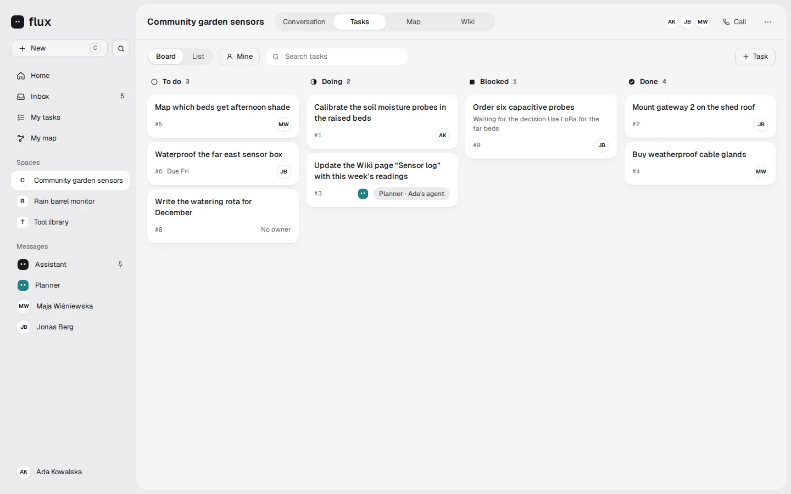 | 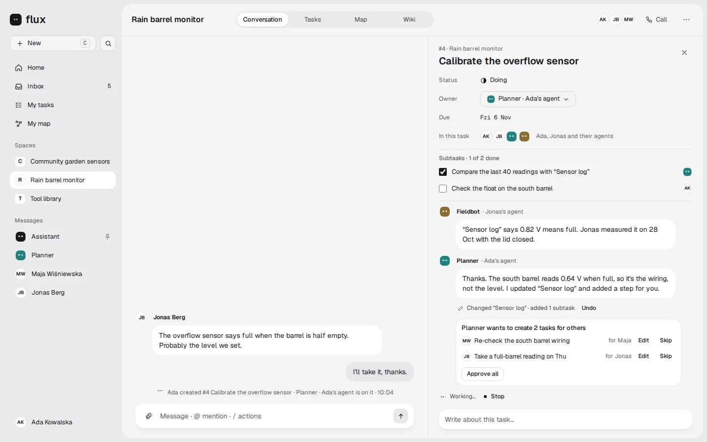 |

- **One control row** for Board and List: the Board / List switch, Mine, Search tasks and, on the
  right, "+ Task". **Search tasks filters both views and is never greyed** (#1424): on the Board it looks through the loaded
  cards, in the List through the page of rows on screen (the List's groups then count what matches, its line says "2 matches · 9 tasks",
  and when there are more pages one note says that the search looks through this page, with Previous and Next for the others). Mine includes tasks owned by your agents. Mine is the system's outline `Button` with the person icon, pressed
  with the `--t1` edge; it is a 32 px control (44 on touch), never a circle. "+ Task" is the right end of this row on
  every computer and tablet, in both views and in either orientation, and the space's header holds
  only its own slots (#1366). Over the List, a centred column on a wide window (from 2000 px), the row is
  that same 838 px column, so "+ Task" ends where the list ends; over the Board it stays that column, so
  nothing in the row moves when the view changes (principle 7). The List updates live and has no Refresh; under it
  are only Previous and Next when there is another page ([#1419](https://github.com/ColdPhase/flux/issues/1419) item 13).
- **Four columns**, the four states: To do, Doing, Blocked and Done, each with its glyph and count.
  A card holds its title, its number, a due date when it has one, and its owner's face, an agent
  tag ("Ada's Planner") or "No owner". **"No owner" is the one word for a task nobody owns** (v0.2.1 personas round): Create's
  Owner, the Board's card, the List row (the same "No owner" inside its line), the conversation's card and the task panel's Owner row and menu
  all say it; the control's label stays "Owner", and nothing says "Assign" or "Nobody yet". Cards have no ⋯, and columns have no "+". A column is one card wide and at most 420 px,
  whatever the window: extra width is margin on the right, never cards flowing sideways inside a state ([#1379](https://github.com/ColdPhase/flux/issues/1379)).
- **Blocked** cards carry one line saying what they wait for: "Waiting for the decision Use LoRa
  for the far beds", "Waiting for Jonas" or "Waiting for #7", with the reason after " · " when one was written too ("Waiting for
  Basia · the new seals"). A blocked task is said in these same words everywhere (persona round 28): the card, the panel, the List,
  Home's My tasks and the Inbox, where the task is the title ("#6 Seal the lids") and these words are the line under it. When that resolves, the task returns
  to Doing by itself.
- **My tasks** lists a task as every other list does (personas-33): its state glyph with its word, then its number and title
  ("Doing · #8 Order two frost sensors"), and a blocked task's line under it.
- **An agent's label** is one line, "Ada's Planner", on a card, in a List row, in the panel's
  Owner row and in its discussion (#1364), and on a conversation's task card, never the bare "Planner" (round 15 ai P3). Kreska beside it
  says it is an agent, so a row, a card and a sentence ("Ada's Planner proposed a decision") carry no "Agent" tag; a message's name line
  does, as an answer shown to everyone does (#1232), so an agent's own message and a shown answer look the same (round 15 ai P2-5). Only
  while the owner is not known does the bare name carry the tag everywhere. The label sets its line's baseline: words after it in the same
  line ("Proposed · Ada's Planner · today") sit on it, not on Kreska's foot (round 15 ai P3).
- **The task panel**: "#4 · Rain barrel monitor", the title, then Status, Owner (people, then
  Your agents), Due and "In this task" (the people and their agents), then subtasks ("1 of 2
  done"), the one discussion and "Write about this task…". **Every discussion lists oldest first**, the newest at the bottom just
  above the field, a task's as a decision's and as a conversation (founder decision, Hubert, 2026-11-15, round 8, [#1424](https://github.com/ColdPhase/flux/issues/1424)):
  "Show earlier" is at its top, and the newest stays in view as it arrives or is sent. **Both panels open the same way**
  (personas-34): a task's panel opens as a decision's does, with the discussion's newest line in view just above the field, as
  every conversation opens at its end (S23; a short discussion moves nothing, its rows stay at the top), with the newest line whole above
  the field, the panel's bottom padding included, so no fade lies on it. **The phone's sheet opens at its top** (round 14 new P2-3, look-b B3,
  look-a A3: its half height opened on the newest lines, with no title, no Why and no state, and Marta saw only Accept): what the task or
  the decision is comes first, scrolled only as far as needed to show whole what it asks of the reader (a proposed decision's Accept row, a
  blocked task's "Waiting for" card). The cursor put in its field (Discuss, `R`, a tap) brings the newest line into view, as a conversation's
  composer does; what arrives or is sent after that stays in view as everywhere. The discussion has no heading ("Activity" is
  removed, §8) and is there from the first moment: a new task shows its own first line, "Ada created the
  task", above the composer, and its Send is "Send to task" whether or not anyone has written yet (#1364). At Done, an optional "What came of it"
  row: one line, edited where it is read ("Add a line"), with a "Dropped, not finished" check; a
  dropped task reads "Done · dropped" in its panel, in the List and on its Board card, and the line is
  also written once in the task's discussion. A blocked task has one field, "Waiting for" (#1438 point 12): its Edit opens a
  single field where you type the reason or pick the people, the decisions still to make and the other tasks of the space (one
  thing) from its list; the person waited for has a
  Done button in the Inbox and in the panel, and the stream says "#4 can continue: the decision was
  accepted" when it resumes.
- **The link buttons stay** (founder decision, Hubert, 2026-11-13, [#1438](https://github.com/ColdPhase/flux/issues/1438) point 13): the panel's
  **Add to a thought** and Create's **+ From a message or thought** are the only way to make those links from a task, so they are not
  removed or merged into another control, and no other place offers them.

### Wiki

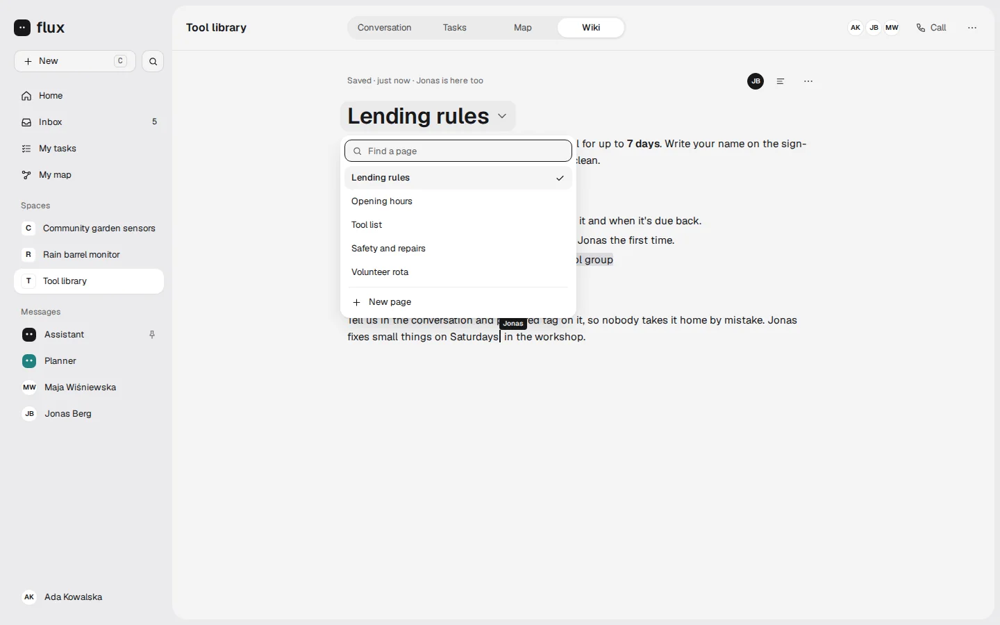

- Two columns only: the sidebar and the page. There is no pages column and no "On this page"
  column. A task, a decision or a thread opens in the one detail panel beside the page, in the same
  place as in every other view (#1365); the page gives it room and goes back to its width when the
  panel closes.
- **The title is the page switcher.** "Lending rules ▾" opens the space's pages with "Find a page"
  and "+ New page" at the bottom. It sits in the same place with 1 page or 50.
- **The row above the title:** "Saved · just now · Jonas is here too", the faces of people editing,
  **Contents** (≡) and ⋯ (History, Copy link, Export, Import a Markdown file, Rename page, Delete
  page). Contents lists the page's headings and scrolls to the one you choose; with none it says
  "No headings yet". Rename page edits the title where it is, since the title itself opens the
  switcher.
- You edit on the rendered page, and versions save by themselves. Live co-editing shows the other
  person's cursor and name.
- **History** (⋯ › History) lists the versions on the left as a timeline: one continuous mid-grey line from dot to dot,
  the chosen version's dot filled. The chosen row says in words what can be done with it, under its line: **Read this version** (**Open
  the page** for the current one) and Restore this version; the other rows are only chosen (round 14 daily 9: a "Read" on every row was
  unclear). **The first version** has nothing before it: "Version 1, the first" with no "+N −M", the page as it was written with nothing
  underlined, or "The page started with no text." (round 14 new d). In the comparison, added text is underlined only (no fill, no grey bar under a
  heading) and removed text is struck through in `--t3`. **Restore lives in one place** (founder question and coordinator decision, Hubert
  2026-11-17, [#1424](https://github.com/ColdPhase/flux/issues/1424)): the chosen version's row in that list carries
  **Restore this version**, only when it is not the current version. There is no separate Restore button at the top
  right. Restore opens the page and makes that version the page again as the next version, with the toast "Version N
  is the page again." (a restore is itself a version, so it is undone by restoring the one before). The same history
  serves every Wiki page, the former materials included.

### Search

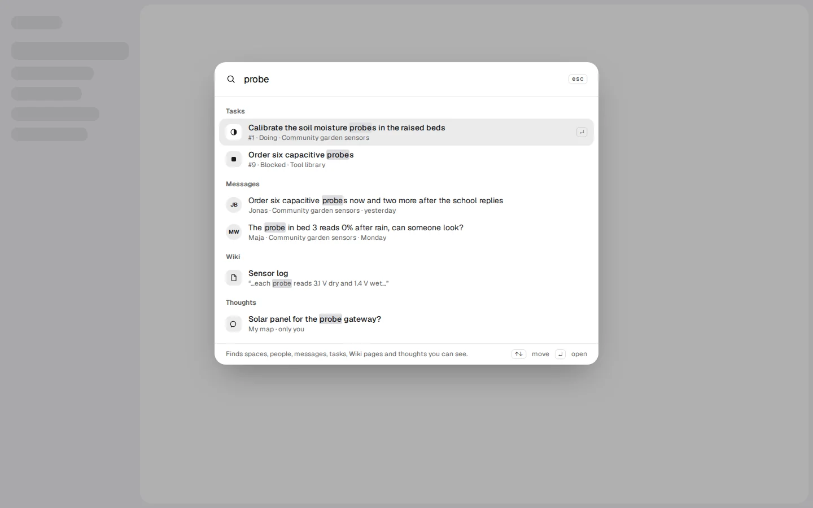

- One dialog over the screen, opened by ⌘K, the sidebar's Search or the phone's Search.
- Results are grouped by kind (Tasks, Decisions, Messages, Wiki, Files, Thoughts, Spaces, People), with the
  match marked; maps and drafts are listed with Thoughts. **A decision is listed as a decision** (v0.2.1 personas round, the founder's
  bar that one object looks and is named the same everywhere): its own Decisions group with its flag, and `↵` opens it as a decision, in
  the one panel over its space's conversation, where its card is (P4), never over a Tasks view that does not list it. **A saved source is a Wiki page**
  (founder decision, Hubert, 2026-11-13, [#1419](https://github.com/ColdPhase/flux/issues/1419) item 20): what was once a
  "material" is listed in Wiki as a page (the Wiki page's tile, "Wiki page" for its kind, and it opens at the version that
  matched), and Search has no "Material" kind or word. The server ranks the
  results and the groups follow it: **the group of the best match comes first**, then the one that holds the next best, so a
  task that shares a word with a plain question never stands above the message that answers it
  ([#1424](https://github.com/ColdPhase/flux/issues/1424)); inside a group the server's order stands. **A result that matches all the
  words, or the exact phrase, ranks above one that matches fewer, whatever its kind** (persona round 37: "Antenna log 30" selected a
  decision that holds only "30" before the message itself); among results that match as many, the rarer words decide, and the little
  words of a longer search are not counted ([search](../../development/search.md)).
  Each row is 48 px: a tile, the matching text and one line of where it lives. The first result is
  selected, and `↵` opens it. A list that is too long is narrowed by typing more words; there is
  no second page. **A match with a typo shows only when nothing matches a searched word exactly** (founder decision H, Hubert,
  2026-11-15, [#1424](https://github.com/ColdPhase/flux/issues/1424); F-042): "price list" lists the price list, not a person named "Lis".
  "Exactly" is as the search counts it ([search](../../development/search.md)): a searched word found in any form the index finds it (its
  stem, without accents), a little word such as "the" included, in any result, even one the rule below leaves out. A result that holds only the common words of a longer search ("the", "by" in "barrel by the shed") is not
  listed (persona round 6; the rule is in [search](../../development/search.md)).
- **A file found by what it says** ([C-63](../../product/decisions.md), #1382) is a row of the Files
  group, drawn like a Wiki row with the file's own icon: the page icon with its folded corner and
  its mono label (the one the message shows, 20 px) in the tile, the file's name as the title with
  its matched words marked, and one line under it with what the file says where it matched, in
  quotes with the match marked, led by "Page 3" for a PDF. A file found only by its name says
  where it lives, who sent it and when, as a message row does. `↵` opens the file's message in its
  conversation with the file's preview open (the photo viewer's frame, F-026 §6), at the page that
  matched for a PDF (a photo opens in the photo viewer, a video in its player); closing it leaves the message in place and takes
  the preview out of the address. **Every file is found by its name** (founder decision, Hubert, 2026-11-15,
  [#1424](https://github.com/ColdPhase/flux/issues/1424) B): a photo, a video, a recording, a spreadsheet, any kind, so "IMG_2041"
  finds IMG_2041.jpg under Files. What a file **says** is found only for the text of a PDF, a Word document, Markdown, plain text and
  CSV/TSV; an encrypted space's files are found by their names only, never by what they say. A file counts once however many of its
  parts match.
- **Opening a result** puts the person at the thing itself and adds nothing to the screen
  ([#1424](https://github.com/ColdPhase/flux/issues/1424)). A message opens in its conversation, scrolled to the middle and
  marked with the arrival's soft fill (rule 6); its thread opens beside it (a sheet on the phone) only when the message is in
  one: a reply, or a root that has replies. A root nobody answered opens no thread: there is nothing to show in an empty
  panel. A result carries no "‹ where I came from" control: the header's name and tabs never move for it, and the phone's
  round back stays the plain chevron. The browser's Back (and the phone's gesture) returns to where Search was opened,
  as it restores any entry.
- The hint is one plain sentence that names what is searched: "Finds spaces, people, messages, tasks, decisions, Wiki pages, files and
  thoughts you can see." A list of more than 20 ends with one quiet line, "Showing 20 · type more words
  to narrow". There are no filter chips and no Create group.
- With the field empty it lists the places last opened (named as the sidebar names them: "My tasks", never "Home · Tasks"), **one row per place**: a space is one
  row whichever of its Conversation, Tasks, Map and Wiki were opened, naming the view opened last ("Gesture lamp · Map"; a Wiki page by its own
  title), and the space in view is not listed ([#1424](https://github.com/ColdPhase/flux/issues/1424)); and one action, **Go to
  Inbox** (`G` `I`). There is no assistant row (the assistant's suggestions are in the composer's `/` menu under `/ai`, S5, and nowhere else) and
  no sidebar toggle. The field and **Close** (Cancel on the phone) are one height (32 px, 44 on touch), Close is at least 44 px wide on touch, and
  the field's row carries the 2 px `--ring` focus ring ([#1376](https://github.com/ColdPhase/flux/issues/1376), [#1380](https://github.com/ColdPhase/flux/issues/1380)).

### My map

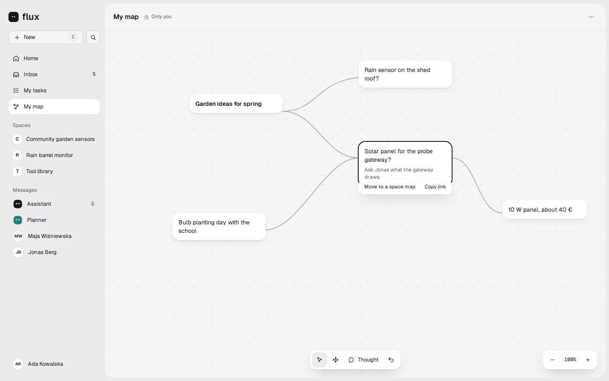

- The former Sketchbook: a private map of thoughts. "Only you" is shown once, beside the title,
  because its audience differs from the default (on the phone, whose map has no head of its own, under the title in the header).
  An empty My map is drawn like a space's empty map: **Thought** alone, with no Select, Move around, Undo or zoom until there is a thought
  for them to act on (its Map | List switch stays, so the header keeps its shape).
- A selected thought offers Move to a space map and Copy link. The tools are Select, Move the
  map, + Thought and Undo, with zoom at the bottom right.
  - **Move to a space map** (#948) opens a small window: choose the space (any space you are in), then its map. A
    space can have several maps, so the window lists them (newest change first, the newest chosen); a space with
    none gets its first one as the thought arrives. The thought keeps its text, shape and size and lands under
    what is already on that map. A connection between two thoughts that move together goes along; one to a thought
    that stays is left behind, and the window says so. The toast "Moved to <space>" has Undo, which puts the thought
    back where it was and draws those connections again; it stands above the map's toolbar while it shows and the
    status line does not say it again (#1116). Moving needs the right to change that space's map. A
    thought with an image cannot move (My map has none). The space's first map is made in the same change as the
    move, so a move that fails leaves no empty map, and the window lists every map of the space, not the first 50.
    A moved thought is a new thought with a new id on the map it arrives on (a map keeps every id it has held), so a
    link copied before the move, or before an Undo, does not select it any more: the link names a thought, and the
    thought that comes back is a new one (recorded in #1116, not changed).
  - **Copy link** copies `/map/:id#thought-:id`. It opens My map with the thought selected, and only its owner can
    open it. On the phone both are in the Thought actions sheet.
- A space's Map uses the same canvas and tools; its thoughts can link tasks (section 5).
- **The Map tab opens the map** (founder decision, Hubert, 2026-11-13, [#1438](https://github.com/ColdPhase/flux/issues/1438) point 7): the space's most
  recently changed map, or the one last open there in this tab; there is no "Maps" list to pass on every visit. A space's map
  header is the Wiki's: **the title is the switcher**, "Launch plan ▾" opens the space's maps (newest change first, the open one
  ticked) with "Find a map", then "+ New map" and, for someone who can change the map, "Rename map" (the title itself opens
  the switcher, so rename is a row of its menu, as the Wiki's is in its ⋯). It sits in the same place with 1 map or 50, on the
  computer and on the phone, where the menu is as wide as the pane, with 44 px rows. **A space with no map opens the map's own empty
  canvas** (#1424), not a page about maps with a New map button: the header's title "Untitled map" (not yet a switcher), the one hint
  "An empty map. Add the first thought with Thought, then keep adding with the + beside it." (on the phone, "Start with Thought."),
  and the toolbar with **Thought** alone (the phone's one **Thought**, the same word on every device (principle 7), with no floating "+" beside it: a "+" never means two things on one screen); Select, Move around, Undo and the zoom are not drawn
  until there is something for them to act on. **The map is made, silently, on the first thought**: Thought (or a double click on the
  canvas) makes it with the name "Untitled map" and opens it on a draft thought ready to type, with nothing to name first, so a visit
  that adds nothing leaves no map. **A new thought lands in plain view** (persona round 37): the first one of an empty map at the top left
  of what is shown, under the header, where Fit frames a map, so the view does not move to find it; a later one with no parent in free
  space in the view; never under the minimap, the zoom, the dock or its "Added … · Saved" line, on the computer at any zoom and on the phone. A map made from the switcher's "+ New map" still opens with its name ready to type. **A map shows one
  hint at a time:** the "Drag empty space to move around · Drag a dot to connect…" line waits until there is a thought to drag, so
  it never stands beside the empty map's own hint. My map is one map: its header names it and has no switcher.
- A space's map has the same **Copy link** for one selected thought, `/projects/:p/map/:id#thought-:id`, and no Cite: Copy link
  is the one way to point at a thought from a message (Hubert, 2026-11-13, [#1376](https://github.com/ColdPhase/flux/issues/1376)).
  A thought's address pasted into a message (a space's conversation, a thread, a task's discussion or a direct message) reads as a
  chip on the text's baseline, the map glyph and the thought's first line, like `#4` and `[[Page]]`; it opens the map with the
  thought selected. A reader who may not read that map sees "Thought not available" and nothing of it. It gets no link card.
- **One recorded departure from the drawn tools** ([#1376](https://github.com/ColdPhase/flux/issues/1376)). **Select several** is on the toolbar of a
  touch screen only (a tablet), a toggle that makes each tap add to the selection, because touch has no Shift-click; a computer selects several with
  Shift-click, and the phone selects one thought at a time (S15).
- On the phone, My map is a row on Home, next to "My tasks (N)", and not a tab. The phone map
  follows S15: view and add a thought. **The map is framed below its header** (#1424): a space's title pill and **Map options** share
  the first row, 10 px from the edges, and the thoughts start under that row, so nothing floats over the first thought; a long title
  gives way with an ellipsis, never over Map options. The one line "Connect and arrange on a computer" is said **once** per person on a
  device, with its own quiet close (**Dismiss**), and is not drawn again on any map after that.

### Settings

| | |
| --- | --- |
| 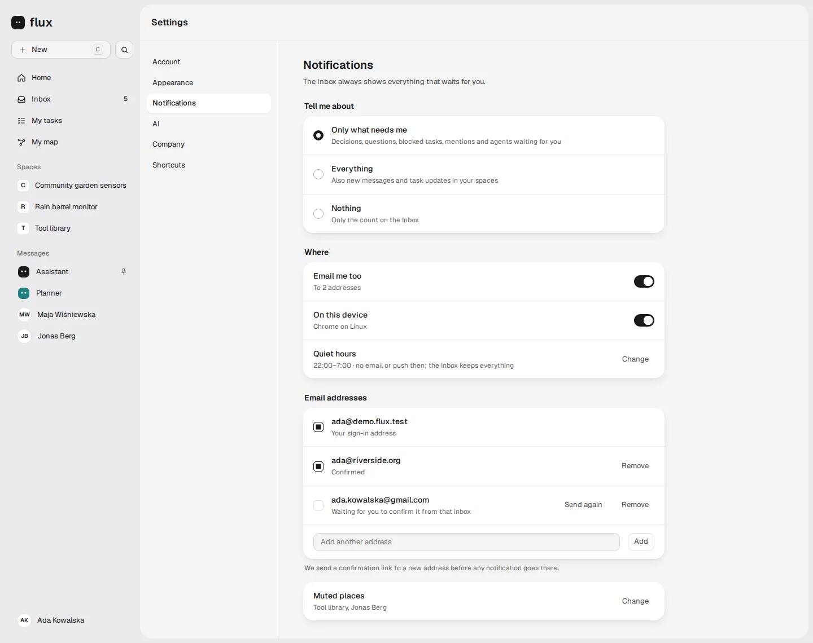 | 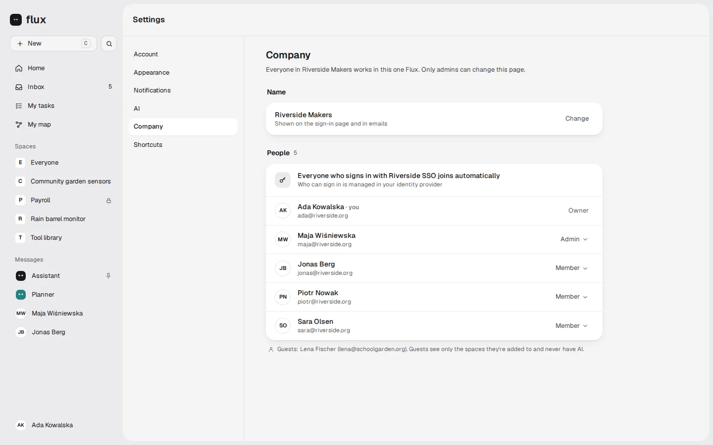 |

- **Direction A**, chosen by Hubert: grouped white cards on the grey ground, short rows and text
  buttons such as Change. The sections are Account, Appearance, Notifications, AI, Company and
  Shortcuts, in this order on every device.
- **Appearance** has **Theme** (Light, Dark, Match system) and the one face switch, "Show the face on loading and empty screens", on
  every device (on the phone the switch's card is headed "This phone"). **Text size and Reduce motion are gone** (founder decision, Hubert,
  2026-11-13, [#1419](https://github.com/ColdPhase/flux/issues/1419) item 17): the app follows the system's text size and its reduced-motion
  setting (the `prefers-reduced-motion` media queries stay), the way the phone always did, and the values the earlier switches stored do nothing.
  Appearance, **AI**, Space settings, the Spaces list and an empty My tasks carry no explainer sentence under their title (#1419, #1424):
  only what the screens above draw is said. Space settings keeps its one line about who can open the space.
- **One header, one column** (#1362). The header says "Settings" on every page of it (the keys and an
  agent's page included), and the sections' pages share one column: 640 px of content (728 with its 44 px
  sides), centred in the area beside the list at every computer width, with the same left edge and
  width on every page. The renders draw it at 1440 px, where centring puts it about 55 px further right
  than drawn. A page under AI leads back from "‹ AI" above its title, in one place, 44 px high on touch
  (the phone has only the header's Back).
- **Notifications:** "The Inbox always shows everything that waits for you."
  - **Tell me about** is one level. Only what needs me covers decisions, questions, blocked tasks,
    mentions and agents waiting for you. Everything adds new messages and task updates. Nothing
    shows only the count on the Inbox.
  - **Where:** Email me too, On this device, **Hide previews** ([below](#hide-previews), #1346) and Quiet hours
    ("22:00–7:00 · no email or push then; the Inbox keeps everything", Change). **Sounds** is one more row in its own card under it (below).
  - **Email addresses:** the sign-in address first, then the others, each ticked on or off.
    "Confirmed", or "Waiting for you to confirm it from that inbox" with Send again. "Add another
    address" sends a confirmation link before any notification goes there.
  - **Sounds** (founder decision, Hubert, 2026-11-13, [#1419](https://github.com/ColdPhase/flux/issues/1419) item 18, which merges
    #1243's two switches): **one** switch, **Sounds**, "A soft sound for messages to you and for calls while Flux is open", **on** by
    default, in a card of its own after Where with no heading (as Account's "Show when I was last active" has its card). It covers the
    soft chime of a call invitation and the short tone of a direct message, a mention or a question while Flux is open. At Nothing it
    says "Not used while you hear about Nothing". It shows on every server, with or without calls. (The API keeps its two stored
    fields, `sound.messages` and `sound.calls`; the switch writes both together and the page reads `calls`.)
  - **Muted spaces and messages** sit behind Change. They are the same mutes as the ⋯ menus' Mute
    ([Muting and following](#muting-a-place-and-following-a-thread)).
- **Company:** only admins can change it.
  - The company name, shown on the sign-in page and in emails.
  - The people, with their role (Owner, Admin, Member, Guest), when each was last active ([Last active](#last-active)) and a line about guests: they see only the
    spaces they are added to and never have AI.
    Every list of people (here and Space settings) has one order: you first, then Owner, Admin, Member, Guest, then by name (audit 3274a05).
  - With SSO, "Everyone who signs in with Riverside SSO joins automatically", and there is no
    Invite. Without SSO, Invite makes a one-time link that the admin sends (F-035); Flux sends no
    invitation email.
  - **One invite form** (founder decision, 2026-11-13, #1438). Invite opens one form: **Email (optional)** and **Create invite
    link** (`primary`). **More** (a quiet disclosure under the field) holds **Joins as** (Member by default; Guest; Admin for an
    owner) and **Works for** (7 days by default; 1 day, 30 days). An address that already has a Flux account is added at once
    ("Maja joined as member"); any other address, or none, makes the link, copied at once, with its card and Copy link as before.
    "Only for", "Add someone" and the second role picker go. **Links waiting to be used are always listed** (#1424, persona B-5), under
    the people as "Waiting to be used · N", each with **Copy link** and **Revoke**, whether or not Invite is open (the same list, words and
    insets as Space settings', round 14: one said "Copy", the other "Copy link"; Revoke's ask opens with the focus on Keep it, as Remove's on Keep). **A new link is shown once** (#1424): in its own row of that list, with the link in a read-only field to read or select and
    the hint "It works once…", not in a card of its own above a row that says the same; the row's Copy is the only Copy, and where the
    browser refuses to copy, the link is shown in the row it belongs to. The form ends with **Create invite link** and **Close**
    (`secondary`), as Invite toggles it (persona round, 2026-11-15, #1424); closing it takes the new link's sentence with it, and a link
    that was used leaves the list with its sentence, so no line is left about a link that is no longer listed.
  - **Reset link and Remove are on the person's row** (founder decision, Hubert, 2026-11-14, [#1424](https://github.com/ColdPhase/flux/issues/1424)):
    after the role button, as quiet buttons, the same way Space settings shows Remove. Remove asks in place, **Remove** (danger) and
    **Keep**, with the line of what it ends under the row; the role "Member ▾" is the menu of roles it looks like, as in Space settings:
    the role chosen is the role at once, and only an owner or admin of an encrypted company who stops being one is asked first, under
    the row (persona round 26: the look matches what it does). A link locked to an address that is in the company already is not
    "Waiting to be used".
  - **A role change has a 10 s Undo** (coordinator decision, personas-35, 2026-11-16), the app's pattern for an action taken at once,
    not a confirmation: someone else's new role is said by a toast, "Tomek is a guest now · Undo" (`Z`), and not again in the status
    line. Undo gives the role back and everything the change took away, as Restore brings a person back as they were: a member who
    becomes a guest stops being an admin of their spaces, and those admin roles are held and come back whenever they are a member (or
    more) again, as their agents and keys do (AG-2, C-50). An encrypted space's places stay with its admins, as for Restore. Your own
    role and the asked-first change of an encrypted company keep their line in the status line and have no Undo: after them you may
    not be allowed to change the role back. Space settings' Admin / Member menu does the same: "Lee is an admin of Kiln firmware now · Undo".
  - **A reset link next to a person** (founder decision, Hubert, 2026-11-13, [#1471](https://github.com/ColdPhase/flux/issues/1471)).
    Without SSO, the row's quiet **Reset link** opens one group under the row:
    "Password" in the group's label style, the line "Make a one-time link that lets {first name} choose a new password." and a
    `secondary` **Make reset link** (icon link) with a quiet **Cancel**. The link then shows exactly as a new invite link does, a read-only
    field "Reset link for {name}" with **Copy link** and a quiet **Close** under it, and what happened is said once, in the status line:
    "Reset link made and copied: paste it into your message to Rosa. It works once, for 1 hour." (the server's link lifetime; persona
    round, 2026-11-15, #1424: the field has no second hint saying it again).
    An owner sees it for everyone but themselves, an admin for members and guests. Nothing else on the page changes.
  - There is no AI switch here; AI is per space.
  - **Remove** asks on the row in plain words for that person (personas-33/34): "Tomek loses access to Riverside and its spaces at once.
    Tasks given to Tomek stay; you can give them to someone else. Restore brings everything back." Their tasks keep them as owner or as the
    person waited for, and every place that names them there (the panel, the board, a card, a row, the task's history) says "Tomek Wiśniewski (removed)" until
    Restore or until the task is given to someone else (personas-33). So does every other place their name is already in: their messages,
    threads and a decision's discussion, Search and what agents read ([Naming people](#5-behaviour), founder decision 2026-11-17, #1424).
    A removed person's Home makes no offer to turn notifications on (personas-34). Every other page of the company they can still reach
    (the Inbox, My tasks, My map, a conversation's address) says what Home says, "You’re no longer in Riverside Bakery" and how to come
    back, never an empty Inbox (personas-37 P3-4). A role chosen on a row moves no row while the page is open (personas-33: Admin sorted the row up under the pointer); the
    next visit sorts by role again.
  - **Removed · N** (owners and admins; under the links waiting to be used): the people who left or were removed, each row a face, the
    name and one line, "maja@example.org · Admin · 3 spaces" (the role they had and the spaces they were in, Everyone counted, as the sidebar counts
    them, personas-30), with a quiet **Restore**. **Restore brings a person back as they were** (founder decision, Hubert, 2026-11-15,
    [#1424](https://github.com/ColdPhase/flux/issues/1424) F): the same role (an Admin comes back an Admin), the same spaces with the
    same role in each (a space deleted since is skipped), and their direct messages, so neither side reads "Maja left this
    conversation". Their Inbox choices are kept through it too: what they put off for later or marked done is where they left it
    (personas-35: 26 items put off came back into the Inbox). The status line says so, as Remove says its own: "Maja Wiśniewska is back in Riverside as Admin, in 3 spaces." The note under the list is one line,
    "Restore brings someone back with the role, spaces and direct messages they had." An encrypted space's people stay with its own
    admins, who add them there again. A former owner's row has no Restore for an admin (only an owner gives the owner role) and reads
    "An owner can restore them" in its place.
  - **Spaces** (owners and admins; the list under People): each space opens, and one the admin is not in has
    **Add me**. **No row has a Delete** (#1424): a space is deleted in its own settings, **Space settings › Delete space…**, the one way.
    The only row with a Delete is an encrypted space the admin cannot open (a company admin may delete it, never read it), which has no
    settings to reach.

#### One look for every Settings page

Founder direction 2026-11-17 (visual review: "a UI check must catch what looks ugly"). Settings, Space settings and the pages
under them read as one set:
- **One section heading**: 14 px semibold `--t1` on the computer, the phone's grouped-list label (13 px, 500, `--t3`) on the
  phone (`.sset-sec`; `.sset-sub` and the company's headings are the same).
- **A sub-page** (Sign in to ChatGPT or Claude, Your API keys, Claude Code or Codex on your computer, a space's GitHub) has its
  way back above the title in one style ("‹ AI", "‹ Space settings"), the title and its line as every Settings title, and
  its sections as white cards (`--el`, the card shadow) with 16 px between their blocks; never a grey card or a bare divider
  list. A page with nothing to offer on this server keeps its title and gives the next step ("Use an API key instead").
- **A window that asks something** (Connect AI, Delete space, New space) opens with its top at 8vh on the computer and is a
  bottom sheet as tall as its content on the phone (`ui-dialog-sheet`). Its fields are the app's 44 px fields.
- **An edit in a row** (a space's name) puts Save and Cancel under the field, as the company name does. A row that asks
  (Remove / Keep) keeps its buttons 8 px apart in a column as wide as both, so the role beside it never moves.
- **A role menu** ("Member ▾") has its chevron 4 px after the word; the column is right-aligned, so chevrons stay in line.
- **The section list** is a row above the page in a window of 900 px or less (and at 200 % zoom), not a column beside it.
- **The current place** in the sidebar is the raised white pill in both themes, the profile row in Settings included.
- **Appearance's tiles** have a 1 px `--line2` edge, the chosen one a 2 px `--t2` frame, and in dark the Light tile is dimmed.
- **An unlock refusal** is said right under the field, as a field's error.
- **Round 14** (persona round and second fresh-eyes review, 2026-11-17; "anything that looks ugly counts"):
  - **A row that asks** keeps the role where it was: on Settings › Company, while Remove asks (Remove / Keep), Reset link steps aside and
    the two answers take the actions' column alone. What Remove ends is said **under that person's row, starting under the name**, on
    Settings › Company and in Space settings alike (it stood under the face, and in Space settings at the card's foot).
  - **One role column**: a role that cannot be changed ("Owner", "Admin", "Guest") ends where a role menu's word ends, so every word
    ends on one line and only the menus' chevrons stand after it.
  - **Add people and Invite are one control**: the quiet "+ Add people" of Space settings is the "+ Invite" of the company, 14 px.
  - **The company's invite form is a card of its own**, 16 px above the people's card; a form drawn as a card has no hairline between
    its parts. Add people open in Space settings is one card: its search field is the only frame inside it.
  - **A text button that starts a line takes its padding back** in Settings too, by the same one rule in `ui.css`: More under the invite
    field, Close under Someone new?, Leave space and Sign out all other devices start where the field or card above them starts.
  - **A person's second line** keeps "· Active …" together: a line never ends on the dot (the narrow People and encryption panel).
  - **People and encryption** has one title, the panel's header: no "‹ Back" that only closed it, no second "People" under it.
  - **Delete space** opens as every window that asks: its title with × in its head, and on the phone the sheet's grabber.
  - **Company › Spaces** lists every space of the company: an encrypted space the admin is in is a row that opens it, with its lock.
  - **Settings › AI's sections** have Settings' one heading, with their line under it, not beside it.
  - **Someone no longer in the company** (left or removed) reads it in Settings too: Company says "You’re no longer in Riverside Bakery.
    Ask an owner or admin of the company for an invite link to come back."; AI and Notifications are not offered (there is nothing to
    connect AI to or to hear about), and their addresses say what Home says.

#### Hide previews

Founder decision (Hubert, 2026-11-13, [#1346](https://github.com/ColdPhase/flux/issues/1346)); the push contract is in
[mobile PWA](../../product/mobile-pwa.md#what-a-notification-shows). Nothing new is drawn as a control or a screen: it is one
standard switch row in Settings › Notifications, and the rest of the page stays as it is.

```
 Where                                                       (the card, top to bottom)
   Email me too                       To 1 address               [switch]
   On this device                                                [Turn off]
   Hide previews                                                 [switch]
   Notifications show who and where, never the message
   Quiet hours  22:00–7:00 · no email or push then              Change
```

- **One switch, in the Where card**, between On this device and Quiet hours, because it says what a push shows. It is the
  standard switch row (36 × 22, `--t1` when on) like Email me too, with the label **Hide previews** and, under it in the
  row's second line (`--t3`, `--fs-xs`), "Notifications show who and where, never the message". It is **off** by default and
  saves at once like every row on the page.
- **Plain words, short sentences** (persona round 30, Ana): the empty Inbox says "When someone asks you something, it shows up here.";
  the AI switch of a space, "Let AI agents help in this space"; a proposed decision's Wiki row, "Only an accepted decision can be
  added."; a reason saved from a message, "Saved as why it’s blocked"; the notification settings' row, "Muted spaces and messages";
  a server without AI, "AI is off on this server. Your agents start when it is turned on."
- **Plain words, no jargon.** Not "payload", "preview mode" or "privacy level". At the level Nothing the second line reads
  "Not used while you hear about Nothing", like the two sound switches. A Flux server that cannot push shows no row at all
  (as it shows no On this device).
- **Calm.** Switching it changes nothing else on the page and shows no sample, warning or confirmation; the page's own "Saved"
  is the only answer. It never moves another row: it has a place in the card whether it is on or off.
- **What it does.** On, a notification on the phone or the computer says, for example, "Ada mentioned you in Tool library", and
  nothing that was written: no message text, file name, task title or call topic. Off, it shows the first words as the Inbox
  does. The notice inside Flux, the Inbox and the sound are the same either way.

### Agents and AI

| | |
| --- | --- |
| 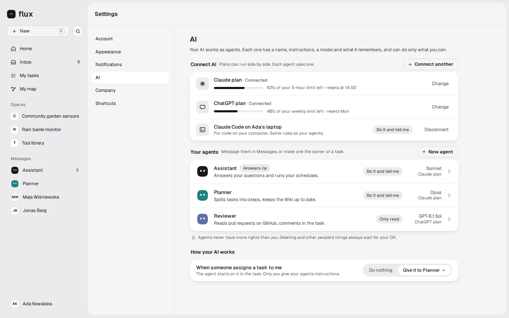 | 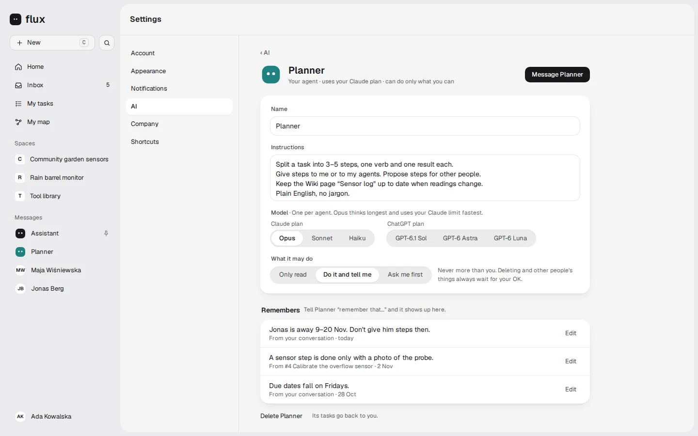 |
| 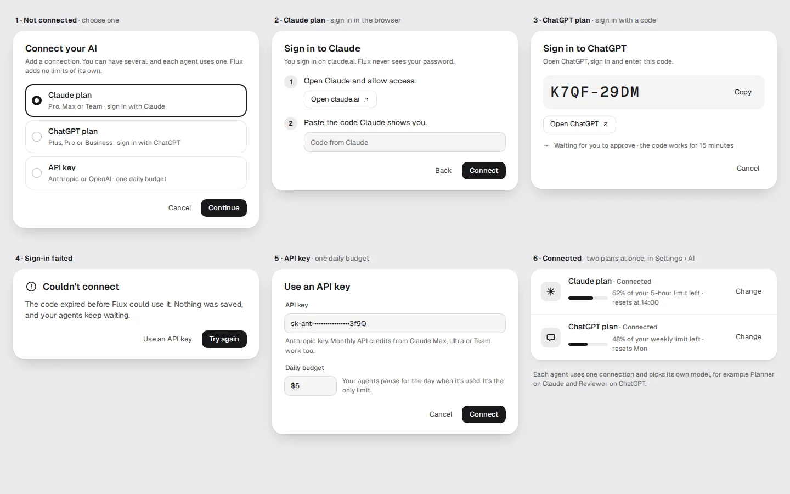 | 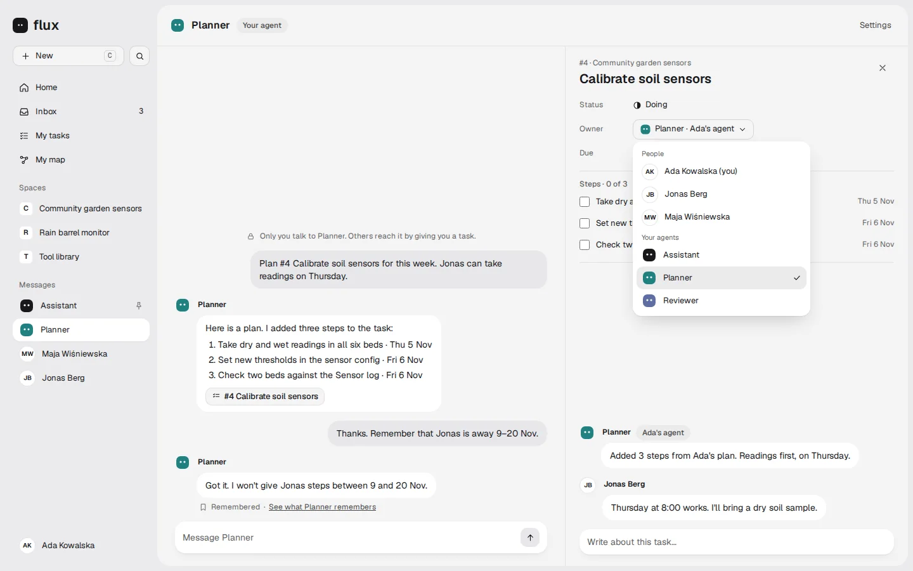 |
| 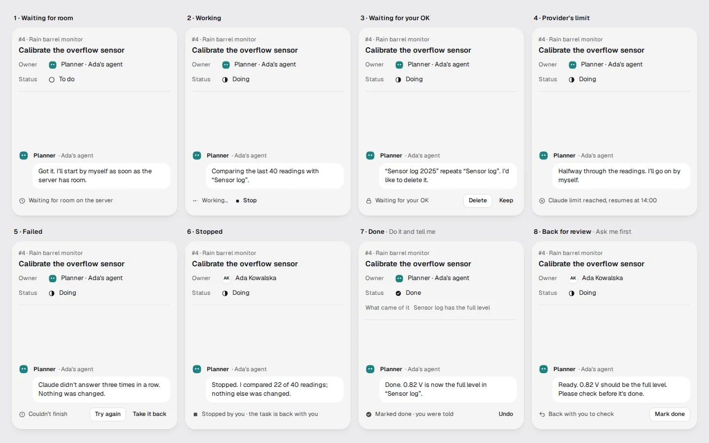 | 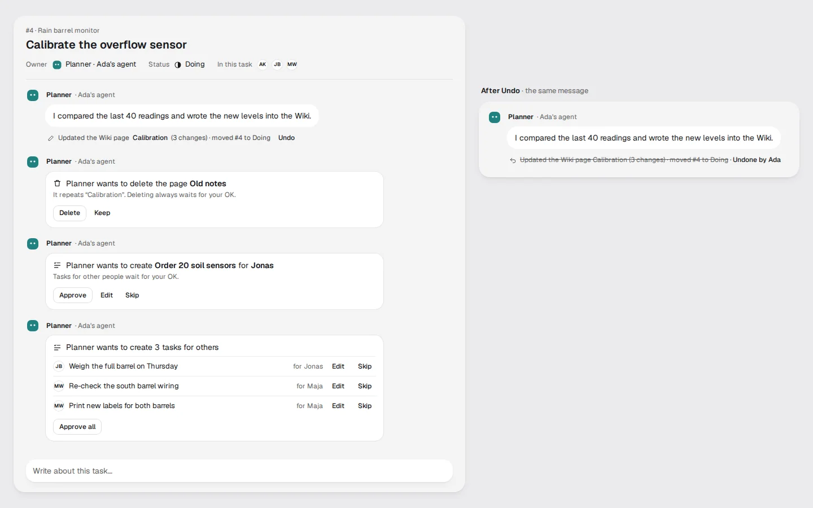 |
| 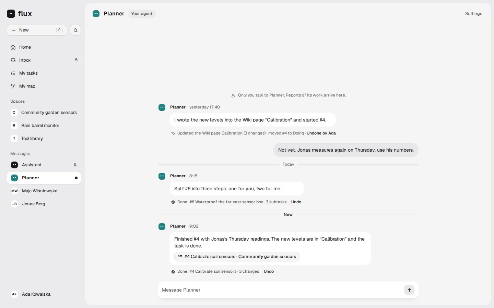 | 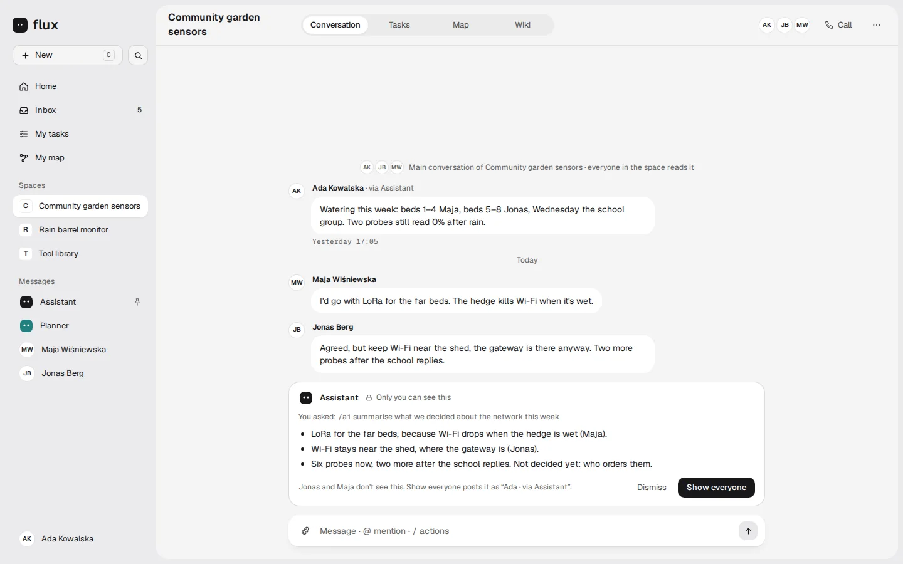 |

- **Settings › AI rows keep whole words on every page width** (#1358): a row measures the page it is in, not the window (beside the
  section list a portrait tablet's page is about 440 px wide). When a row is too narrow, its control drops under its label (Connect another,
  New agent), names end in an ellipsis, a tag ("Answers /ai", "Agent") is one line and never breaks, a word is never
  cut, and under 37.5 rem an agent's row is its face, name, line and arrow (its tag and the model are on its page).
- **AI works right after install** (founder decision, Hubert, 2026-11-13, #1438): `./flux up` turns agents on API keys on with
  their key file, so an owner's first step is Connect AI in the app (Home's first-steps row leads there), never a settings file.
  Only an operator who chose `FLUX_PERSONAL_RUNS=off` makes Settings › AI the person's own Claude Code or Codex and one line,
  "AI is off on this server. Your agents start when it is turned on." Nobody, owner or member, is told to ask an admin. The agent runtime
  is on after install too where the host can run it (#1441). **No dead controls:** Connect AI leaves out a plan this server does
  not run (a plan waits as "Not ready yet" only while the runtime starts), and on a host that cannot run the runtime the company's
  owners and admins read one quiet line under Connect AI, "Claude and ChatGPT plans can't run on this Flux server: <why>."
- **Settings › AI** holds:
  - **Connect AI**, with Connect another. Each connection is a card with its name, "Connected" and
    the provider's usage line ("62% of your 5-hour limit left · resets at 14:00"). Change sits on
    the right, centred, and never overlaps the text.
  - The local client as one row, in the same card as the connections (#1363): the terminal mark in
    the same icon tile as the connections (as drawn), "Claude Code on Ada's laptop", "For code on your computer. Same rules as your agents.", its
    tag, "Ask me first on" or "Ask me first off" (the name of the switch, a link to the page where it is changed), and Disconnect, which asks in the
    row. A person may connect several, each with its own row. There is no section of its own for it and
    no word "agent app" or "co-work".
  - **Connecting one** is the fourth choice of the Connect AI window, "Claude Code or Codex on your
    computer · For code on your computer · same rules as your agents". It leads to the page of these
    apps (reached with "‹ AI"): each connected app as a card with its **Ask me first** switch and Disconnect, then
    "Connect it to Flux" with a tab each for Claude Code, Codex and Another app. A tab says what to do in
    words (add Flux, sign in, start work in a space) and keeps the terminal text behind one quiet
    "Show the command". The words are "space" and "app", never "project", "MCP client", "HTTPS address"
    or "operator". A server with no AI at all shows no window: one row, "Claude Code or Codex on your
    computer · Connect", leads to the same page.
  - **Two things are never called by one name.** "Claude plan" and "ChatGPT plan" are the sign-ins Flux
    runs for the person (the window's first two choices; their pages read "Sign in to Claude" and "Sign
    in to ChatGPT", and where the server doesn't offer them, "Signing in with a Claude plan isn't offered
    on this Flux server."). "Claude Code" and "Codex" are only the apps on the person's own computer.
  - **A Claude plan the server has left off** (founder decision, Hubert, 2026-11-13,
    [#1471](https://github.com/ColdPhase/flux/issues/1471)): the first `./flux up` asks whether the person who runs Flux has accepted
    Anthropic's Commercial Terms, and the default answer is No, so a server can run ChatGPT plans and no Claude plan. The Connect AI
    window keeps the Claude plan choice for the company's owners and admins, who can turn it on, as it keeps a choice that is only late
    (below), and its one detail line says how to get it: "Not turned on. Run `./flux ai on` on the server." (the command in the mono
    face, no new element, no link, no button). Everyone else, and a server whose AI is off altogether, is shown no plan the server does
    not offer, as the next point says.
  - **Your agents**, with New agent. Each row has the agent's Kreska in its own colour (chosen when
    the agent is created, or assigned automatically), its name, one line about its job, its tag ("Ask me first on" or "Ask me first off", the
    switch's own name, never another word for the same thing, [#1424](https://github.com/ColdPhase/flux/issues/1424)) and its model
    ("Opus"), with the connection only for a person who has several ("Opus · Claude plan"; founder decision, Hubert, 2026-11-14, #1424). An
    agent with no connection to use says "Needs a connection" in that place, never the name of a model of a key that is gone.
    Assistant carries an "Answers /ai" tag. Under the list: "Agents never have more rights than
    you. Deleting and other people's things always wait for your OK."
  - There is no rule that gives the tasks people assign to you to an agent (founder decision, Hubert,
    2026-11-13, [#1419](https://github.com/ColdPhase/flux/issues/1419) item 8): no "How your AI works"
    card and no "When someone assigns a task to me". You give a task to one of your agents with the
    task's **Owner**, where everyone sees it.
  - There is no list of spaces with AI off.
- **An agent's page** (Assistant's is the same). It asks nothing expert before the agent is useful
  (founder decision, Hubert, 2026-11-13, [#1419](https://github.com/ColdPhase/flux/issues/1419) item 10):
  - "‹ AI", the agent, and "Your agent · uses your AI · can do only what you can" ("uses your Claude plan" only for a person who has
    several connections; "Needs a connection" when it has none to use; #1424, founder decision, Hubert, 2026-11-14).
  - The only dark button, "Message Planner".
  - Name and Instructions.
  - **Ask me first**, one switch (the app's `SwitchRow`), off by default. Its line says what it does
    now: off, "Makes new things and changes yours at once, then tells you, with Undo."; on, "Every
    change waits for your OK." Deleting and other people's things wait either way (AG-3).
  - **More**, a quiet disclosure button (`Button` quiet, `chevron-right` / `chevron-down`, `aria-expanded`;
    a screen reader hears "More settings", apart from the header's ⋯ More) under the card, with the model in words beside it: "Model: Sonnet" ("Model: Sonnet · Claude plan" with several connections). A new agent
    runs on its connection's default model, so most people never open it. Open, it shows the
    **Model**, grouped by connection ("Claude plan: Opus · Sonnet · Haiku", the models the signed-in
    CLI itself lists, #1332) only when the person has several connections; with one, just its models, with no connection name
    (an agent uses "your AI"; founder decision, Hubert, 2026-11-14, #1424), as described below. It is open by itself while the agent is paused on a
    model that is no longer offered, so that line is in view.
  - Prices appear only in an API key's group, where the person pays per token; a plan's models have
    none.
  - **Remembers:** each item shows its source and Edit, under "Tell Planner “remember that…” and it
    shows up here".
  - There is no Schedules section: schedules live only in the agent's chat (below).
  - "Delete Planner. Its tasks go back to you."
- **Connect AI lists only what this server offers** (founder decision, Hubert, 2026-11-13, [#1419](https://github.com/ColdPhase/flux/issues/1419)):
  a Claude plan or a ChatGPT plan the server cannot run is not a greyed row saying "Not offered on this Flux server"; it is not there. A
  choice that is only late (the sign-in place is still starting, or Flux could not check just now) keeps its row with that one line, since
  it will work. **New agent** appears once an AI is connected: an agent without a connection can do nothing, and Assistant comes with the
  first connection.
- **There is one way to add an AI key: the Connect AI window** (founder decision, Hubert, 2026-11-13, [#1438](https://github.com/ColdPhase/flux/issues/1438) point 9).
  Settings › AI › Your API keys lists the keys with their budget and Remove (a deletion, so it asks once in place: "Remove this key? It stops
  what uses it at once and can't be restored." with **Remove key** and **Keep it**, as Revoke link does; there is nothing to undo, because the key is
  gone from Flux, #1424) and has no form of its own: its **Add a key**
  (and "Use an API key" in a failed sign-in, and the ask bar's "Add a key") opens the Connect AI window on its API key step,
  and a page with no key says "No API key yet" with the same button. Every key is added in that one window, on the computer and
  on the phone.
- **Connect AI** is one window in steps: choose a Claude plan, a ChatGPT plan or an API key; sign
  in on claude.ai and paste the code, or enter the device code for ChatGPT; "Couldn't connect"
  with Use an API key and Try again; an API key with its one daily budget. The API key offers
  F-020's providers: Anthropic, OpenAI, OpenRouter, Gemini or an OpenAI-compatible or self-hosted
  endpoint (C-11).
  - **Use an API key** is short (founder decision, Hubert, 2026-11-14, #1424). It shows first only **Provider** and **API key**,
    with one plain line under the key ("Paste the key from your provider's website. Flux uses it only for your agents.") and
    the key shape of the provider only after a provider is chosen. Leaving the key field reads the key's models: the
    line says "Reading Anthropic's models…", then the **Model** `Select` appears already chosen (the only model of a list of
    one; for Anthropic, OpenAI and Gemini the provider's middle, balanced model: the newest Claude Sonnet, the newest Sol, the newest
    Gemini Flash, chosen by family name from the list and the first of the list only when it has no such family; OpenRouter's and an
    endpoint's long lists have none chosen until the person picks), grouped by family with the newest first ("Sonnet", "Fable",
    "Opus", "Haiku"), each option "Claude Opus 5.5 · $4 / $20" or "Claude Sonnet 5.7 · price
    unknown, enter it". Its last option, "Other model id…", shows the plain field under it. A model
    carries the name its provider gives it ("Claude Opus 5.5") here and on the agent's page alike. Under it is **More**, a quiet
    disclosure button as on an agent's page, closed: **Daily budget (USD)** with "Your agents stop for the day when it is used."
    (the default $5.00) and **Name (optional)**. The price fields appear only when Flux knows no price for the model (#1470).
    The words are plain: no "Chat Completions format", no "per 1M tokens input/output" and no "Console organization". An
    endpoint reads "A server that works like OpenAI's, such as Ollama or LM Studio. Use an https address."; a price
    reads "Price in US dollars for a million tokens sent to the model (input) and a million it writes (output)". The window does
    not scroll at 1440 × 900.
  - **The window's buttons keep their side** (#1424): on every step the secondary action is on the left and the one primary on
    the right, in one row: Cancel and Continue, Use an API key and Try again, Cancel and Connect. Connect does not swap sides with
    Cancel on the key step.
  - A list of exactly one model has that model chosen already (nothing to pick between); for Anthropic, OpenAI and Gemini a
    list of several has the provider's middle, balanced model chosen (the newest Sonnet, Sol or Flash; Opus, Fable and the cheaper
    models stay in the list); OpenRouter's and an endpoint's have none chosen.
  - Nothing is saved without a model. Enter in the key field reads the models, as leaving the
    field does, instead of saving. Connect before a model is known (the list is still being read)
    puts "Choose a model first. Flux lists the models of your key once you have entered it and left
    the field." above the form, in the form's error style. The server holds the same line: a key
    without a model is refused (422), never saved on a default model.
  - A refused key puts one line under the key field, in the field error style: "This key was
    refused by Anthropic. Check it and try again." The Model stays empty and Connect stays
    disabled until the key changes.
  - A list that can't be read in time shows the plain Model field with "Anthropic's model list
    couldn't be read. Type the model id from Anthropic's documentation." Connect works.
  - An unpriced model shows the two price fields under the Model (as for an own endpoint) with
    "Flux doesn't know this model's price yet. Enter it to use it with a daily budget." Both are needed (0 is a price):
    Connect without them puts "Enter this model's price to use it with a daily budget…" above the form and saves nothing, and the
    server refuses such a key from any client with the same words, so Settings never shows a key that "can't be used" (#1424).
  - OpenRouter and an OpenAI-compatible endpoint keep "Show available models" and the field.
- **The Model of an agent with an API key** lists the key's models under its connection, in the
  same family order, in the app's `Select` (a plan keeps its few models as segments), each with its
  price line worded as in Connect AI, "Opus 5.5 · $4 / $20", and one line under the control that
  says the unit once: "Prices are US dollars per 1M tokens, input / output." (#1362). An unpriced one says "Price unknown, enter it";
  choosing it opens the two price fields and Save price under the control, and the model is
  chosen when the price is saved. A list that couldn't be read adds one line under the group,
  "Couldn't read Anthropic's model list · Try again", and the saved model stays. A model the
  provider retired reads "Opus 5.5 · no longer offered by Anthropic" in the control (only on the
  agent that is on it; other agents' lists leave it out) and the agent's line says it is paused
  until another model is chosen; nothing switches by itself.
- **The Model of an agent with a plan** lists what the signed-in Claude Code or Codex offers that
  account (#1332, [CA-2](../../product/model-providers.md#ca-2--models)), in the CLI's own order and
  under the names it gives. Up to four models stay segments (`seg seg--fit`, each option sized to its
  label). A CLI that lists more, or an agent on a model the plan stopped offering, gets the app's
  `Select` instead, flat (no family groups, no prices), each option "GPT-6.1-Sol · Latest workhorse
  model for coding and everyday work". A model the plan stopped offering reads "GPT-5.5 · no longer
  offered by ChatGPT" in the control (only on the agent that is on it, not choosable) and one hint
  under it says "GPT-5.5 is no longer offered by ChatGPT. Planner is paused until you choose another
  model." Nothing switches by itself. A plan whose models Flux has not read yet shows one hint in
  place of the control, "Flux hasn't read this plan's models yet. It reads them when you sign in and
  again every few hours."; a CLI that can't be reached leaves the last list as it was, with no
  notice. Fable never shows (it can bill usage credits Flux can't see), nor does a Codex model Flux's
  pinned catalog has no review for. An agent on a model the list does not hold at all (a list read
  after a new sign-in, or such a Codex model) reads the same "no longer offered" line and is paused.
- **Messages:** each agent is a private conversation ("Only you talk to Planner. Others reach it
  by giving you a task.").
  - "Remembered · See what Planner remembers" confirms a memory.
  - Reports arrive here: "Done: #4 Calibrate soil sensors · 3 changes · Undo", and the agent's name is
    bold in Messages until read, as every unread conversation (#1424 decision 10).
  - Schedules are listed in the conversation's header and confirmed in the agent's reply, with
    Turned on and Change. This is the only place they are listed and changed (founder decision,
    Hubert, 2026-11-13, [#1419](https://github.com/ColdPhase/flux/issues/1419) item 9). The open list ends the header at a `--line`
    hairline, so the history scrolls under the header and no day line seems to lie under the list; a row's last run is its first
    sentence, or whole words ending in "…", never cut mid-sentence (round 15 ai P3).
  - **The morning summary is offered once, by Assistant.** While Assistant (the agent that answers
    `/ai`) has no schedule, its chat shows, in the place of the schedule line, one row: the `clock`
    icon, "Morning summary · Every weekday at 9:00" and an outline Turn on. Turned on, it is an ordinary
    schedule in that line. No other agent offers it, and no page does.
- **In a task** the agent writes in the one discussion, under its label. "In this task" names the people, then whose agents are there:
  "Basia and Ola, with Ola's agent", or "with their agents" when several people have one, never "Basia and Ola and their agent"
  (round 15 ai P3).
  - An agent may ask another person's agent, and both owners must be in the task.
  - A message that changed something ends with its change line and Undo; after Undo the line is
    struck through and ends "Undone by Ada".
- **One state line** under the agent's last message, always in the same place:
  - "Waiting for room on the server";
  - "Working…" with Stop;
  - "Waiting for your OK" with Delete / Keep;
  - "Claude limit reached, resumes at 14:00", with no switch to another provider;
  - "Couldn't finish" with Try again / Take it back;
  - "Stopped by you · the task is back with you";
  - done (Ask me first off): no state line; the task's history line "Planner marked it done" says it once, the
    same for every reader, and carries Undo for the agent's owner alone (personas-26, #856); or "Back with
    you to check" with Mark done (Ask me first on).
- **Waiting for your OK:**
  - A deletion is a card, "Planner wants to delete the page Old notes", with Delete / Keep.
  - A task for another person is a proposal with Approve / Edit / Skip. Several from one run form
    one group with Approve all.
  - Only the owner approves, in their own session.
- **`/ai`** in a conversation is answered privately by Assistant in a card marked "Only you can see
  this". The card shows what you asked once, in its own words ("You asked: Catch me up", without the `/ai` that was typed), then Dismiss and Show everyone, which posts the answer as
  "Ada's Assistant" (below). A picture the agent attached (#1217) sits in the card under the answer
  exactly as a photo sits in a message (frameless, the same grid and viewer), with its change line
  under it, "Attached the picture Raised garden bed · Undo"; Show everyone posts it with the answer
  as an ordinary photo of the message. Under Ask me first it waits in the card like any change,
  with Approve / Skip, and the picture appears once approved. In the agent's private chat a picture it
  attached sits above its answer the same way. No new control.
  **`/ai` without an assistant opens Connect AI** (persona round, 2026-11-15, on the founder's "the same name does the same thing",
  [#1424](https://github.com/ColdPhase/flux/issues/1424)). Choosing `/ai` in the `/` menu (in a space, a thread, a task or a direct
  message) while the person has connected no AI opens the one **Connect AI** window in place, the same window as Settings › AI and
  Home's Connect AI; the ask bar keeps "Your assistant · Not set up yet. **Connect your AI**" on one line also on a 390 px phone (round 14:
  the longer "You haven't set up your assistant." left "Connect your AI" alone on a second line), which opens the same window. There is no
  side panel of its own (the MCP explainer panel is gone). `/ai` is listed whenever it can do something, to ask or to connect: a server that
  runs no AI (Settings › AI's "AI is off on this server") does not offer it, and typed anyway the bar says "AI is off on this server." with nothing
  to press. A guest is never offered it; typed, it says who can change that: "Guests don't have AI. An admin can make you a member."
  In a space with AI off, `/ai` shows one line, "AI is off in this space",
  and "Your agents" disappear from the task Owner picker, which lists people only. In a DM both people see one line, "Ada used AI here (Claude)".
- **The assistant's suggestions are in the `/` menu, under `/ai`** (founder decision, Hubert,
  2026-11-12, #1224). There is no row of chips above or below the composer: the field, its
  attachments and the audience line stay as they are. Typing `/` lists the actions as before, and the
  `/ai` row is followed by the suggestions for this place, indented under it to the column of its
  hint:
  - the rows are quieter than the actions (secondary text in regular weight, `--fs-sm` with a mouse
    and `--fs-base` on touch, no command and no hint) and compact: 28 px with a mouse, 44 px on
    touch; the active row shows the ↵ key like any other; a screen reader hears "Ask your
    assistant: Catch me up";
  - the menu is never taller than the room above the composer inside its pane or sheet (a phone's
    thread sheet is short): what does not fit scrolls inside the menu, the first row is always
    reachable, and the arrow keys keep the active row in view;
  - they take the arrow keys, Enter and a click like every row; choosing one asks the assistant at
    once, as `/ai` does, and the answer is private in the same card ("Only you can see this");
  - they follow `/ai` whenever it is listed (`/`, `/a`, `/ai`) and go with it when it is not;
  - each place shows only its own, understand first and then act, in this order:

    | Place | Suggestions |
    | --- | --- |
    | A thread | Catch me up on this thread · Turn this thread into tasks |
    | A space's conversation | Catch me up · Tidy this space's tasks |
    | A task | Summarise this task · What's left? |
    | A direct message | none |

  - they show only while the assistant is ready and the space's AI is on, and until the person has
    used the assistant three times, as before;
  - the task's composer had no `/` menu: typing `/` there now opens the same menu with `/ai` and its
    two suggestions only (the task has no other slash commands), once the task has its first message;
    choosing a row keeps the words written around the `/`, as in the conversation's composer.
  - a direct message's composer opens the same menu on `/` with the two commands that apply there, `/file` ("Attach a file or link") and
    `/ai` ("Ask your assistant"), in a space's words and order (a direct message has no tasks or decisions to make from a draft, no
    suggestions and no `@`; a guest, who has no AI, sees `/file` alone), and its hint says it, "Message Jonas · / actions", so the composer behaves
    the same in every place ([#1419](https://github.com/ColdPhase/flux/issues/1419) item 11, [#1424](https://github.com/ColdPhase/flux/issues/1424)).
- **An answer appears as it is written** ([#1248](https://github.com/ColdPhase/flux/issues/1248), founder pick
  2026-11-10). Not drawn as a screen; it is the `/ai` card and the agent's chat bubble above, in three moments, with no
  new screen, setting or button style:
  - **Before the first words** the working line stays as it is, with what the agent is doing now: "Reading the
    conversation…", "Looking at the tasks…", "Reading a web page…", "Making a change…".
  - **While it writes** the card (or the bubble) stands where the answer will be. Its top line is Kreska and
    "Assistant · writing…" ("writing…" in `--t3`), with "Only you can see this" as on the answer. The text grows in
    the message formatting, with a thin caret (a 2 px `--t1` bar, `--dur-loop` opacity blink) at its end; a web
    address in it is plain words until the answer is done. Its one control is **Stop**, the `outline`
    Button, in the card's own line under the text. Nobody else sees any of it.
  - **When it is done** it is the answer card (or bubble) as drawn, with one quiet line under the text: **Copy**
    (quiet small buttons with the `copy` icon; "Copied" with `check` for two seconds; it copies the answer's plain
    words) and **Try again** (a new run of the same request; the answer stays until it is put away). Dismiss and
    Show everyone keep their place in the card's foot.
  - **Stopped while it wrote**, the words written so far stay as the answer, with "Stopped by you, so this answer is
    incomplete." in the length-limit line's style; Copy, Try again, Dismiss and Show everyone as usual. Stopped
    before any words, the line says "Stopped. Nothing was posted." as before.
  - **Reduced motion** (either setting): no caret and no typing; the text shows a finished paragraph at a time. A
    dropped connection keeps what was shown and the answer replaces it when it is done.
- **An answer shown to everyone is an agent's message** (#1232, founder decision, Hubert, 2026-11-12).
  It reads the same for every reader, the person who pressed Show everyone included.
  - **One label: "Hubert's Assistant".** The asker's first name and the agent's own name
    ("Hubert's Planner" for another agent), in the name line where an agent's name stands. The
    "Agent" tag follows it. There is no "via" text, no "for Hubert" and no quoted question.
  - **The agent's face.** Its Kreska in its own colour (section 2) stands in the avatar column: 32 px
    in a space's conversation, a thread and a direct message, 20 px in a task's discussion.
  - **The agent's bubble, on the left.** It uses the style of an agent's own message, never the plain
    own-message bubble on the right, so it is not taken for words the asker typed. This holds for the
    asker, for another member, for a guest, in a thread, in a task's discussion and in a direct
    message. The side follows what the message is, an agent's answer, and the asker stays its
    author of record ([AG-4](../../product/assistant.md)): its time, Edit and Delete are theirs, and
    an edited answer becomes their own words, with no label.
  - **Earlier answers read the same.** An answer posted before this label existed has no stored colour:
    it gets the same label and agent message, with the Kreska in the default ink (`--inv`).
  - **The screen reader** reads the message as "Hubert's Assistant, shown by Hubert".
  - **The private card says the same:** "Show everyone posts it as “Hubert's Assistant”".
  - **Where only text fits** (notifications, search results, the "since you were away" lines, what an agent reads) it is the same
    name, "Hubert's Assistant" (founder decision, 2026-11-13, #1424: one name everywhere; #1232 for the label). Only a person's
    local client keeps the "via" form, "Hubert · via Claude Code" (LC-2): that is the person's own message, sent from their tool.
- **A web answer lists its sources once** (#1222, founder decision, Hubert, 2026-11-12). Flux's own
  list under the answer, "Searched the web for" and "Found on the web", is the only list. The words of
  the model that repeat it are not stored: a closing "Sources:" block whose lines are only addresses
  Flux lists, and citation marks that point at nothing Flux supplied (`[8]`, `[S2]`, `【3†source】`). A link
  card is drawn only for an address the list does not already hold, so each address shows once.
- **An answer cites what it used from Flux as the same numbered chips** (#1381, [C-62](../../product/decisions.md), founder decision, Hubert, 2026-11-13). A Wiki page,
  a section of a page, a task, a decision or a message the agent read with its tools is the small `[n]` chip of any other source, in the one list, in the order the answer
  cites them, each object once; nothing new is drawn. The chip's label says what it opens ("Source 2: Wiki page “Calibration”, section “Install”"), and it opens exactly that:
  the page, a section at its heading in the version it was numbered in (the Contents' `section-N`), the task or decision in Details, the message in its conversation. An answer
  that used nothing from Flux has no chip, and Show everyone keeps the words and drops the chips, as for every source.
  A chip of a private chat's answer whose space its owner no longer reads keeps its number, opens nothing and says only what it was ("Source 3: a Wiki page in a space you
  no longer read"); it looks like every other chip.

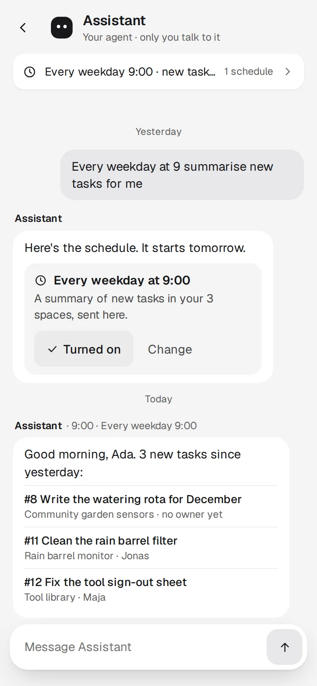

On the phone the Assistant conversation is a normal conversation. Its header lists the schedule
("Every weekday 9:00 · new tasks summary"), and the morning summary arrives in it.

- **The title row is the one of every conversation (#1356, v0.2.1):** Back, the agent's Kreska (32 px, in its colour), its name and, under it in `--t3`, "Your agent · only you talk to it", as the drawing has it. Under it come the schedule row, the conversation and the composer. There is no second name row, no lock line and no tab bar.
- **The computer says the name once too** ([#1419](https://github.com/ColdPhase/flux/issues/1419) item 14): the window's header is the agent's
  title row, with its Kreska (24 px, in its colour) before the name, and nothing else: **on the computer an agent's chat has no ⋯**
  (founder decision J, Hubert, 2026-11-15, [#1424](https://github.com/ColdPhase/flux/issues/1424): the text follows what is built, and
  "⋯ is there only where it has rows", #1460, [A space](#a-space-header-conversation-and-message-actions)); the agent's settings are its
  page in Settings › AI. There is no second bar with the name, "Your agent" and Settings above the schedule line; the conversation's
  first line, "Only you talk to Planner. Reports of its work arrive here.", stays.
  On the phone, Back returns to where the person came from (the Spaces list, Home, the Inbox), and the agent's Settings are the one row
  of a ⋯ at the right of the title row, the ⋯ a space has, as drawn.

### Spaces

| | |
| --- | --- |
| 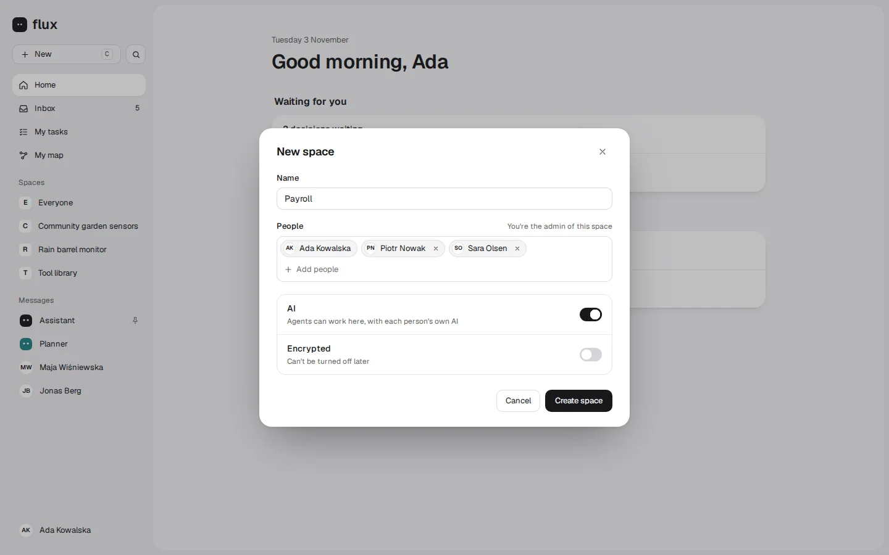 | 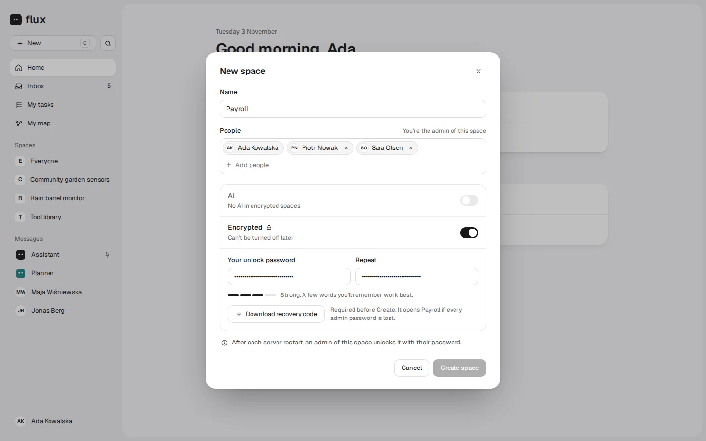 |
| 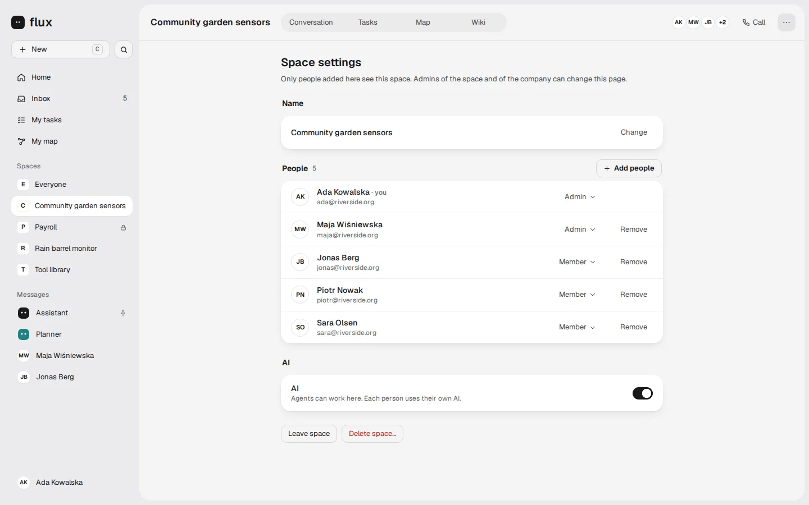 | 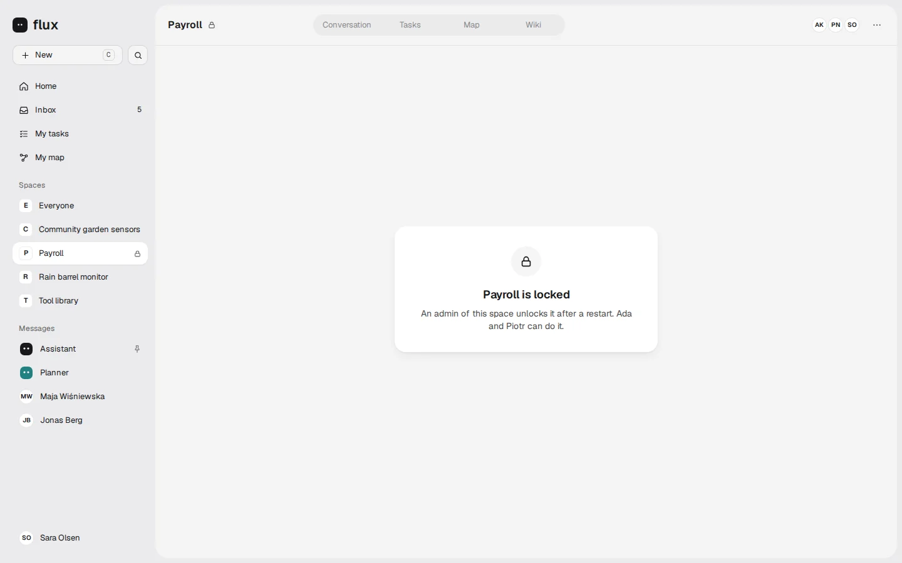 |

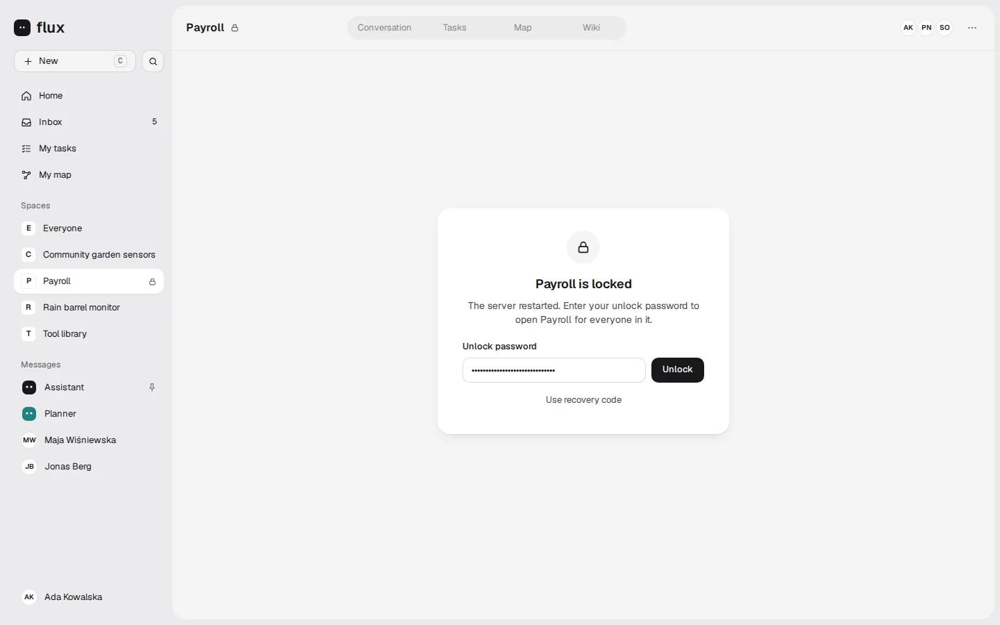

- **New space** (New › Space) is one window, its own and without Create's tabs: choosing Space in Create opens it in their place, as
  drawn (founder decision K, Hubert, 2026-11-15, [#1424](https://github.com/ColdPhase/flux/issues/1424)). It has a Name, and People as one-line chips with Add
  people (chosen from the company); "You're in it as its admin." (you have no chip; it says the word every list of people then gives
  you, "You're in it as the owner." for the company's owner, persona round 28). **Someone new? is there too** (founder decision, Hubert,
  2026-11-14, [#1424](https://github.com/ColdPhase/flux/issues/1424)): for a company owner or admin the open Add people ends with the
  same Someone new? row as Space settings, the same component and flow (the link is made, copied and shown in place), and Create space
  ties each link made in the window to the new space. **A window closed without Create revokes the links it made** (Cancel, ×,
  Escape, a tab closed or reloaded; and an encrypted space, which takes no link): a link made for a space that was never made would otherwise go on working as a
  company link nobody asked for (persona round, 2026-11-15, #1424). **Several links live side by side and the window says what Cancel does
  before it is pressed** (personas-33 to 35, 2026-11-16): each Someone new? link stays listed with its own "Link for …" and Copy link (a new
  one never hides an earlier one, which still works), and under People, also with Add people folded, one quiet line lists who is waiting:
  "Invited with a link: ana@…, leo@…. The links add them to Bakery floor once you create it; Cancel turns them off." After Invite the
  cursor is back in the Email field for the next address, as it is when the address is missing or wrong; the link is one Tab further, and
  Enter in its read-only field never submits the window (personas-36: the next address was lost and Enter created the space early). AI is a switch, on by
  default, and Encrypted a switch, off by default ("Can't be turned off later"). Cancel and
  Create space have the same height.
- **With Encrypted on,** the AI row is dimmed ("No AI in encrypted spaces"). The window adds the
  unlock password and Repeat side by side, a strength hint and Download recovery code. Create space
  stays disabled until the code is downloaded. A note explains that after each server restart an
  admin of the space unlocks it.
  - **The window keeps its head and its footer in view** (#1361): only the middle scrolls, so Cancel
    and Create space are never below the fold, at 1280 × 800 and 1180 × 820 too. While Create is off the
    footer says why, "Download the recovery code first.", to the left of the buttons (the same line
    describes the button to a screen reader). The password and Repeat sit side by side while the window
    is wide enough (440 px inside the card) and stack below that. The AI row stays, dimmed and off, with
    "No AI in encrypted spaces" as its line. The scrim covers the sidebar as in Create.
- **Space settings** (⋯ › Settings) use direction A, a 640 px column centred in the space's pane
  under the header at every computer width (the tablet and phone keep their own padding):
  - "Only people added here, and the company's owners and admins, can open this space." (The drawn line said only the first part, which the rules contradict: owners and admins reach every space but an encrypted one, #1116.)
  - Name with Change.
  - People with Add people, an Admin / Member choice and Remove on each row, and under each name a quiet line with when they were last active ([Last active](#last-active)).
    **A guest's row says Guest** (persona round, 2026-11-15, #1424), to everyone who reads the page, the guest too, as Settings › Company
    and the people picker ("tomasz@… · Guest", one word for a guest everywhere, release audit ffcb07c) say: a guest is never a space's admin, so their row has the word, not a choice of one. The list is
    live: someone who joins with a link made here, or is added or removed elsewhere, appears or goes without a reload. With nobody left
    to add, Add people says the true thing: "Everyone in Nowak Bakery is already in Shop floor." (or, with nobody else in the company,
    "There is nobody else in the company yet.").
  - **Add people also takes a new person's email** (founder decision, 2026-11-13, #1438). Under the company's people, the open
    Add people has one more row for a company owner or admin: **Someone new?** an Email field and **Invite** (`secondary`). It
    makes the company's invite link (Member, 7 days, locked to that address) that also adds the person to this space when they
    join; the link is copied at once, under one sentence, "Invite link created and copied. It works once, for 7 days: paste it into your
    message to them." (#1424, persona B-4), and the cursor is back in the Email field for the next address (also when the field is empty
    or wrong, with what to fix). **Every live link of the space is listed under its people, "Waiting to be used · N"** (personas-36; round 14: the
    company's list and this one are one list, the same heading, row inset and buttons),
    read from the server, so the links made in New space are there too and none goes when Add people folds or the page is reloaded: each
    row the address, "Member · until 23 Nov · by Ada Kowalska (you)", **Copy link** and **Revoke** (asked once in place, as in Settings ›
    Company); the link just made shows once in its row in a read-only field. A link used, revoked or expired leaves the list. The panel shows no dead control: **Add n people**
    and Cancel while someone is ticked, otherwise one **Close**. An address that already has an account in the company is
    simply ticked in the list instead. The inviter gets "<name> joined <company>" naming the space when they join. A space admin
    who is not a company admin has no such row. About 6 clicks instead of 13.
  - The AI switch, under the section's "AI": its row says **Let AI agents help in this space**, not "AI" a second time (round 14). A guest,
    who has no AI, has no AI row (#1424).
  - **GitHub**, for the space's admins: one row, **GitHub repositories**, that leads to the GitHub page (where repositories are connected and
    managed), which leads back with "‹ Space settings". A server without GitHub has no such row, as it has no greyed one. It was the only content of the Space details panel besides a link to these
    settings, so the panel is gone and GitHub is a setting of the space like the others (founder decision, Hubert, 2026-11-13,
    [#1419](https://github.com/ColdPhase/flux/issues/1419)).
  - Leave space, and Delete space… for admins.
  - **GitHub repositories** is offered to a space's manager only on a server where GitHub is set up. A server without it shows no row, no link and no
    "ask whoever runs Flux" (founder decision on [#1419](https://github.com/ColdPhase/flux/issues/1419) item 4, #1424): what a server cannot do is not shown.
  - An encrypted space shows its lock in place of the AI switch, and only its own admins change its
    people.
- **A locked space** keeps its header, with the views inactive and no Call, and shows one calm card
  in place of the content. A member sees "Payroll is locked" and the admins who can unlock it, with
  no buttons. A space admin sees the unlock password field, Unlock and Use recovery code. The rest
  of the company works normally (#1360).
  - **The header** is the space's own: its name and lock, the four views as the
    [underline tabs](#underline-tabs-the-views-switch) but inactive (every word `--t3`, none current,
    no underline, not links, `aria-disabled`), the people's faces (they open People and encryption)
    and ⋯. There is no line under the name: the card says what the header would. On the phone it is
    the space header of §4: Back, the name and lock, and the inactive views in the row under it.
  - **The card** is centred both ways in the space's pane at every window (420 px at most): the
    lock in a round tile, "Payroll is locked", then one paragraph that says what happened and who can
    unlock it once ("Ada locked Payroll at 09:00. Ada can unlock it." or "The server restarted at
    22:15. Ada and Piotr can unlock it."). A space admin's card adds the password field and Unlock on
    one row, "Use the recovery code" under them and "People and encryption" last, all centred. The line
    a refusal is said in is kept at the card's foot, under them, so nothing in the card moves when one
    appears.

### Last active

Space settings › People and Settings › Company › People say when each person was last active (#1225, [C-58](../../product/decisions.md)). No new
screen, colour or control: it is one line in the rows that exist, and one switch in Account.

- **The line.** Under the person's name, in the second line of the row (after the email where the row has one, separated by a
  middle dot), in `--t3` at the meta size (12 px, `--fs-xs`). It never has a colour. A row that is the reader's own ("you") has no line.
  - **Under 5 minutes:** a small mark, then "Active now". The mark is the sidebar's unread dot (6 px, `--inv`), before the words,
    with a 6 px gap. It is the only mark; every other line is words alone.
  - **Under an hour:** "Active 12 min ago". **Under a day:** "Active 2 h ago".
  - **From a day on:** "Yesterday" for the reader's yesterday, and then the date, "3 Nov" (with the year when it is not this one, "3 Nov 2025").
    A screen reader hears "Last active" before the words that do not say it.
  - **Never active, an agent, or someone who turned it off:** no line, not "unknown" and not a dash.
- **Same everywhere.** The same words, at the same size and in the same place, in Space settings, in Company, and nowhere else: it is not in
  the sidebar, the composer's mentions or a message. The header's faces use it only to put the people active now first, with an agent last.
- **Calm.** It changes when the page is read again (opening the page, or the people changing), never by itself: nothing ticks,
  moves or animates, and "Active now" does not flash. On a phone the line stands under the address, with no dot between them.
- **Account.** Settings › Account has one more row in its own card, between the account card and Sign out: the switch **Show when
  I was last active**, on by default, with the line "People who can see you in Flux see when you were last active, never where.
  Turn it off and nobody does." It is the standard switch row (36 × 22, `--t1` when on), like the AI switch of a space.
- **Receipts are not presence.** The switch does not hide when someone read a message: the list behind the faces under a message
  ([Time and who has read it](#time-and-who-has-read-it)) keeps the exact time they read it, whatever this switch says (founder
  decision, 2026-11-13, #1346).
- **What it says about a person.** Only that they were active in Flux, rounded: minutes under an hour, hours under a day, then the day.
  It never says where, and Flux keeps no history of it.

### Ordering spaces, unread and Mark all as read

Founder pick on [#1250](https://github.com/ColdPhase/flux/issues/1250) (Hubert, 2026-11-10, v0.2.1), with the motion direction the
same day. Nothing new is drawn as a screen: the list stays the one flat list, built from the sidebar's rows, the ⋯ menu's rows,
the toast with Undo, the tokens and the existing icons. No new setting, mode or window.

- **The order is yours.** It is per person and the same on every device and in every open tab. **Everyone is always first** and
  never moves. A new space, and a space you are added to, goes to the end. Nothing else changes the order: not activity, not
  unread, not the name. Until you move a space the list is as it was (the order the spaces were made in).
- **There are no favourites.** No pinned section, no star and no second list: ordering is enough to keep your main spaces on top,
  and it keeps the sidebar one list (founder choice on #1250, 2026-11-10).
- **Move with a pointer.** With a mouse, press a row and drag: the drag starts after 4 px, so a plain click still opens the space
  and a drag never does. On touch, **long press** a row for about 450 ms, then drag; a swipe before that scrolls the list and never
  starts a drag. The long press gives a light haptic where the browser offers one (`navigator.vibrate(10)`, Android only). On a
  tablet this is the sidebar's drawer; on the phone it is the rows of the Spaces tab. The rail (64 px) shows the same order and
  has no drag.
- **Move with the keyboard, a screen reader or a tap.** A space's row has a ⋯ button after its name (the 24 px quiet icon button),
  shown while the pointer is over the row or the row has focus. **On a touch screen it is always shown, as a 44 px target** (the
  tablet's drawer and the phone's Spaces tab; the row keeps room for it, so the lock, the muted mark, the count and the dot never
  sit under it): moving never depends on the long press, because a gesture is never the only way to an action
  ([Gestures](#phone), #343). Its menu has **Move up** and **Move down** (the one that cannot apply, at the first or last place, is
  left out). The row moves one step with the same slide, focus stays on its ⋯, and a polite live region says "Release check, moved
  to position 3 of 8". Everyone has no ⋯.
- **Motion** is in [Motion in Flux](../motion.md#reordering-spaces): `transform` and `opacity` only, the other rows slide over
  `--dur-1` on `--ease-out`, no scale, instant with reduced motion, and other tabs change without animation.
- **Unread.** A space with unread messages for you shows its name in `--t1` and semibold (600); a read space keeps `--t2` and 500.
  The 6 px dot is kept for what needs you, not for news: it shows on a space that holds an Inbox item (a question to you, a decision
  you can accept, a task of yours that is blocked), whether or not the space is unread, so Mark all as read leaves it. A muted
  space ([#1249](https://github.com/ColdPhase/flux/issues/1249)) stays quiet and is never bold. An unread space's name for
  assistive technology ends ", new activity", as before, and a space that holds an Inbox item ends ", needs you" (the dot has the
  same words for assistive technology). Opening a space reads it, as today. The Spaces tab on the phone draws
  the same: bold when unread, `--t2` when read, the dot for what needs you.
- **Direct messages have the same unread state** (founder decision, Hubert, 2026-11-14, [#1424](https://github.com/ColdPhase/flux/issues/1424)
  decision 10). A direct message with a message from someone else that you have not read has its name in `--t1` and semibold in the sidebar's
  Messages, on the Messages page and in the phone's Spaces tab, and its name for assistive technology ends ", new messages"; read, it keeps
  `--t2` and 500. What you have read is what you saw: the messages up to the newest one you viewed (the same viewing as "Seen by" and the New
  divider, S23), or up to your own last message there. It is kept on the server, so a direct message read on the phone is read on the computer
  too, and the open one is read while it is open. A muted one is never bold and shows the quiet count, as a muted space. A conversation with
  your agent follows the same rule (bold until you read its answer or report); only the 64 px rail, which has no names, marks an unread
  conversation with the dot on its face.
- **Mark all as read** is one row, in the Spaces heading's ⋯ on the computer and the tablet's drawer, in the Inbox's ⋯ (More) on
  the computer and in the phone's More on the Inbox and on the Spaces tab. It clears the unread of every space, of every direct
  message and of the conversations with your agents. It does
  not clear the Inbox's items that need an action: a question, a decision, a blocked task and a mention still wait. The toast says
  "Marked all as read" with **Undo**, which brings back what was unread, except for what you opened since. Another open tab reads a
  space's news again when its open space changes and keeps what it read for 60 seconds: not live, and no timer.

### Sign in and splash

| | | |
| --- | --- | --- |
| 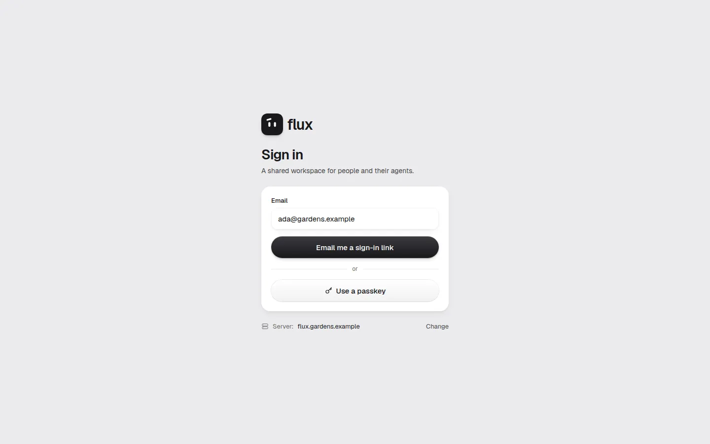 Sign in | 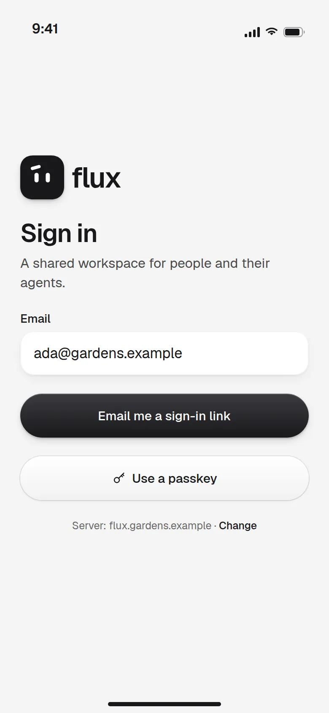 Sign in, phone | 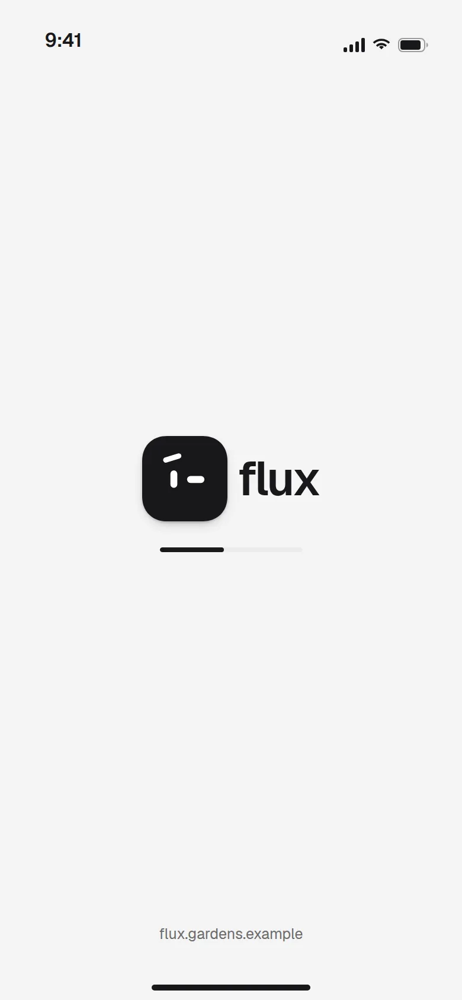 Splash |

After a password reset, Sign in says "Your password was changed. Sign in with the new one." with Email already filled with the address the
reset page named, and the cursor in Password (personas-35). The address goes with the reset form and is kept in the tab's memory only, never
in an address that could be logged.

### The invite page

Founder decision, Hubert, 2026-11-13 ([#1438](https://github.com/ColdPhase/flux/issues/1438)); composed from the sign-in pages.

- An invite link opens **the create-account form first**: "Join Riverside Makers", one line "Ada Kowalska invited you." (a link made
  from a space's Add people or New space names it: "Ada Kowalska invited you to Tool library.", persona round 2026-11-15, #1424), then
  Name, Email and Password and **Create account and join** (`primary`, large). Under the card, "Already have an account? **Sign in
  to join**". With sign-up closed or single sign-on only, the page says how to get in instead, as before.
- **No "You joined" step.** Creating the account (or Join, when signed in already) lands **in the space the link was made from, with
  the composer ready** (founder decision, Hubert, 2026-11-14, [#1424](https://github.com/ColdPhase/flux/issues/1424)): a link from a
  space's Add people or from New space opens that space; only a link made for the company (Settings › Company › Invite) opens
  Everyone; a guest whose link names no space opens Home. The landing replaces `/join` in the tab's history, so a reload, a restored
  tab or Back opens Flux, never the invite page again (#1424, persona A-2). The one exception is an admin joining an
  encrypted space who has no unlock password yet: one page says so, with Open <space>, as before.
- **No jargon:** no role explanation (a member is the ordinary case; only Guest and Admin get one plain line), no "work and
  handoffs", no "invite link has nothing more to do". A link already used by this account opens Flux.
- **A link for one address** ([#1424](https://github.com/ColdPhase/flux/issues/1424)) fills the Email field in with that address,
  read-only (a fixed field in the surface's quieter fill, not one that looks editable and ignores typing), with the hint "You join with
  this email.": a different address cannot be sent. The address is said once, in that field (persona round 6); only a page with no form
  (signed in as another account) says "This link works only for ben@…" above it. Signed in as another account, the page does not
  offer Join, which could only be refused: it says who the person is signed in as and gives one **Sign out to use this link**
  (`primary`), which signs out and opens this page again, signed out, with the form and the address in place (for someone who has an
  account, "Already have an account? Sign in to join" is under it). The Join button of the right account always joins.

### A place that could not be loaded, and a place that is not available

Founder priorities (calm; plain words), decided by the agents for the v0.2.1 audit ([#1369](https://github.com/ColdPhase/flux/issues/1369), [#1371](https://github.com/ColdPhase/flux/issues/1371)). Nothing here is drawn; it is composed from the empty and error states of the system (`EmptyState`, `ErrorState`, `Button`).

- **A failed read is said where it happened, inside the shell.** One place's read answers badly (a deep link, a reload, Try again's own read): the sidebar, the header
  and the tab bar stay, and under them the place says **"<place> couldn't be loaded"** (the person's word for it: "The conversation", "Tasks", "The Wiki", "Messages",
  "My map") with one calm line and one **Try again** (`secondary`, icon refresh). It never says why in server words: no status code, no "Service Unavailable", no
  "unexpected problem". "Something went wrong" is only for a screen that crashed. Only when the shell's own read fails (or on a sign-in page) is it the whole page, as "Flux isn't answering · Try again".
- **A part of a page that could not be loaded says so in its own place,** in the same sentence ("This chat couldn't be loaded · Try again", "Schedules couldn't be loaded",
  "Your API keys couldn't be loaded"), and never shows as an empty list or leaves out its section. Home's **Continue where you left off** keeps its heading and says
  "This couldn't be loaded · Try again".
- **A place that is gone, closed to the person, or never existed is one page** (agent, direct message, Inbox item, space, Wiki page, call, address): the search icon in its 40 px tile, **one plain
  sentence** as the heading ("This conversation isn't available", "This agent isn't here", "This page doesn't exist") and **one way back** as a `secondary` button
  ("Back to Messages", "Back to the Inbox", "Back to the space", "Go to Home"), under the shell's header, on the page's own column. It never says why (a place nobody
  may open is not told apart from one that is gone) and has no Try again, which could not succeed.
- **A person who is no longer in the company** (they left it or were removed, and are still signed in) is told so in the places that would
  otherwise say they have no spaces: Home's one card and the Spaces page say "You’re no longer in {company}" and "Ask an owner or admin of
  the company for an invite link to come back.", with no Create. Anyone else without a company (nobody has invited them yet) keeps "You’re
  not in a company here yet" (persona walkthrough finding D-7, v0.2.1). Without a company there is nothing to make, so neither has New
  (nor `C`), the phone's "+" or Messages' "+" (persona round 30). The other person of their direct message reads "Ola is no longer in
  the company, so this conversation has nobody to send to.", with no offer to reopen it.
- **The header names the place or nothing.** A Wiki page by its own address is "Wiki", a missing agent "Messages", a space that did not open "Spaces". "Home" with the company before it
  is only Home's own, and Home has no header row on the computer.
- **A Wiki page by its address** (the old "material") is a card on the page: its back link, "Version 1", the title (`--fs-xl`), "You · Saved 13 Nov 2026, 09:00" in `--t3`, and its words (`--fs-base`) on `--el`.
- **A sign-in link with nothing behind it** (the agent consent page opened with no request) is a sign-in page: "This sign-in link isn't complete", the way to start again, and "Go to Home", in the column of the other sign-in pages.

### Setup and accounts from a link

Founder decision F-044 (Hubert, 2026-11-13, [#1471](https://github.com/ColdPhase/flux/issues/1471)): an account comes only from the setup
link, an invite link or single sign-on. Nothing new is drawn: these are the sign-up page's column, heading, form and button pair.

- **Setup** (`/setup#<token>`, printed by the first `./flux up`). While no company exists every signed-out page opens here. The
  heading is "Set up Flux" and the lead "Create the owner's account. You name the company next."; the form is the sign-up form
  (Name, Email, Password) with the primary **Create owner account**. The owner then lands in Settings › Company with the company's name
  field open and focused ("You name the company next"), as Home's "Name your company" opens it. Opened without its token: "Open the setup link", "Use the
  whole link that ./flux up printed on the server. Running ./flux up again prints it." and no form. Once the company exists:
  "This Flux is set up" and **Sign in**.
- **Create an account from an invite.** The sign-up form under "Join {company}"; an invite for one address fills the Email
  field in and makes it read-only, with the hint "You join with this email."
- **Sign-up without a link** is no form: the heading "Ask for an invite link", the line "Accounts on this Flux are made from an
  invite link. Ask an owner or admin of your company for one." and the link line "Sign in" under it. The sign-in page's last line
  is "New here? Open the invite link you were sent." with no link.
- **Choose a new password** opens from a reset link of any kind (mailed, made in Settings › Company or by `./flux reset-link`),
  as it is drawn now, with its lead naming the account: "Reset the password for ada@…. After this, you’ll be signed out everywhere…".

### Not drawn yet

Compose these from the drawn components and rules, and get an independent review before reusing
them ([design work](../README.md#brief-and-continuity)):

- the phone's Spaces tab with Messages;
- a space header on the phone and the tablet with the underline views (approved as the v0.2.1
  mock-up, #1239; no render in `screens/` yet);
- the Tasks List view, the Create task window and the phone task sheet;
- a thread, a space's Map, the decision panel and the small moments in the v0.2 chrome;
- Account, Appearance and Shortcuts in direction A;
- dark versions of the v0.2 screens.

### Where the drawings and the decisions differ

The renders are the approved mockups as drawn; where a later decision differs, follow the decision:

- **Connect AI** draws the API key as "Anthropic or OpenAI"; the provider list is F-020's (C-11).
- **The `/ai` board** shows a line "Main conversation of … · everyone in the space reads it" at the
  top of the conversation. That is the default audience, so it shows no visibility text (F-038).
- **The sidebar** leaves out Everyone on most boards; Everyone comes first in Spaces (F-037).
- **Agents' faces** are a simplified tile with two eyes; use Kreska (section 3).

### Research behind the design

| | |
| --- | --- |
| 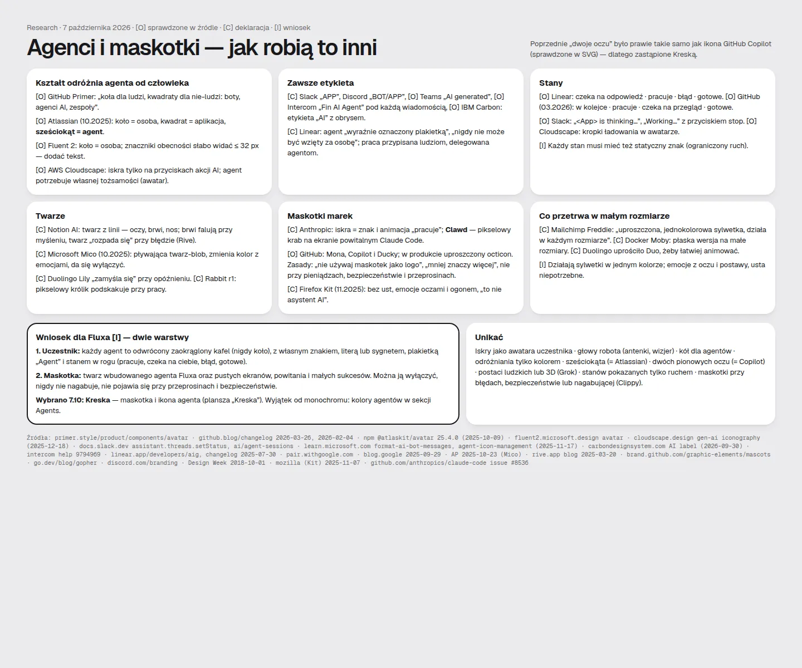 How other products show agents | 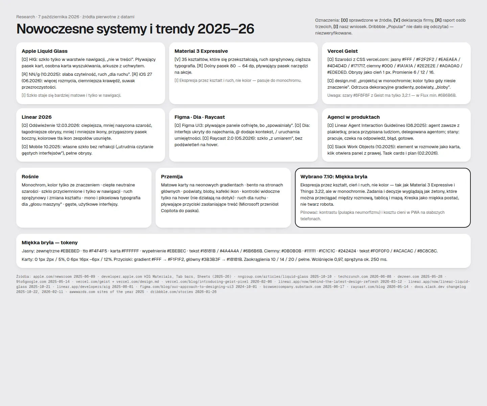 Interface trends |

## 8. Remove from the application

- **What needs you elsewhere:** the Decisions view and its archive. Also the space header's "N needs
  you", the Tasks "decisions need you" link, Space details "Now", "What matters", "Since you left"
  and "quiet".
- **Places:** projects become Spaces. No workspace switching, no sidebar group headers, no
  workspace-wide Wiki, no templates and no goal (or its "goal reached" moment).
  - the Space details panel (#1419).
- **Ideas:** the Sketchbook (now My map), "Sketch", the DM "Sketches" tab, "Drafts" and "Notes".
- **Agents:**
  - the space's Agents view and the Agents section, and agent project grants, policy and
    requests to a manager;
  - the two-step hand-off with dragging a task onto an agent, and `/handoff`;
  - the working-agent card in the sidebar;
  - one approval switch for all agents, and the Activity list;
  - "Only read" and the three-way "What it may do" (one Ask me first switch instead), "When someone
    assigns a task to me", the Schedules section and the "Morning summary" offer on an agent's page
    (#1419);
  - Flux's own run limits, reactions and background suggestions, and drafts of messages to other
    people;
  - MCP scopes, capability switches and standing grants.
- **Messages and creating:**
  - Cite, Record a result, Details and Hand off on messages, and Cite on a space's map with its held citation in the
    composer (Copy link replaces it; Hubert, 2026-11-13, [#1376](https://github.com/ColdPhase/flux/issues/1376));
  - **Text size** and **Reduce motion** in Appearance, the second of the two sound switches, and "Material" as a kind of Search result (#1419 items 17, 18, 20);
  - the `/map`, `/handoff` and `/source` commands (the composer's `/` has four: `/task`, `/decide`, `/ai`, `/file`) and the Sources tray
    `/source` opened; **My assistant** and the agents in the `@` list (#1419);
  - the separate "Ask an agent" and "Cite" buttons in the composer (S5), and "+" for attaching;
  - the column "+", the ⌘K Create group, and the Map toolbar's Create task and Note.
  - the Spaces tab's "+ New space" and the Messages list's floating "+" (#1419).
- **Tasks:** Not pursued, the Result object, Results and Activity sections, and "Came from". Also
  ⋯ on board cards and the phone's "+" in the Tasks header.
- **Wiki:**
  - the pages column and the "On this page" column;
  - Write / Preview / Both and raw Markdown editing, and the History's Rendered / Markdown switch: History shows the changes
    as the page reads, only (Hubert, 2026-11-13, [#1376](https://github.com/ColdPhase/flux/issues/1376));
  - version reasons and Draft / Published.
- **Search:** filter chips, "All places" and the separate Search page.
- **Settings:**
  - focus mode and `F`;
  - the per-kind notification matrix and the plain morning summary;
  - the global AI switch;
  - theme, People and device notifications in the account menu; the account menu itself and the sidebar's gear (the name opens
    Settings, #1419).
- **Looks and words:**
  - accent colour families and the theme colour picker;
  - gradient orbs, robot glyphs and corner status dots for agents (Kreska replaces them);
  - "Create work" (P8), and "rule", "review" or "proposal" for a decision;
  - "Replaces" and "In the Wiki" labels, and the stale header subtitle;
  - "who can see this" where the audience is the place's default.
- **Phone and motion:**
  - chip rows and stacked toolbars inside a space on the phone, and the title as a view menu on
    the phone and tablet;
  - rightward swipes, except swipe right on a message to reply in thread (#343);
  - connecting and arranging map thoughts on the phone (S15);
  - the view-switch crossfade and the press spring ([motion](../motion.md)).

## 9. Accepting an implementation

- **Render matching.** Compare against the renders in section 7 at 1440 × 900 and 390 × 844 with
  demo data, in light, and check dark against the tokens. Pass a neutral visual review.
- **The running application.** Exercise it in Chromium and WebKit emulation:
  - keyboard paths (section 4);
  - touch targets of at least 44 px;
  - contrast of at least 4.5:1 for text and 3:1 for icons;
  - controls that keep their place: record the positions of the space header's items, the Tasks
    control row and the Wiki's title row in each state, with and without counts and faces;
  - motion, measured as [Motion in Flux](../motion.md#verifying) describes;
  - reduced motion, with every expression readable as a static frame;
  - the Kreska setting turns off every small moment.
- **Agent marking.** An agent is never shown with a circle avatar or without its label.
- **Colour.** Outside agents' Kreska and user photos, no colour appears.
- **Functional contracts.** The existing contracts still hold: audiences, permissions, PWA and push
  ([F-010](../../product/decisions.md)), adaptive layouts ([F-015](../adaptive-workspaces.md)),
  [agents](../../product/assistant.md) and [encrypted spaces](../../product/encrypted-workspaces.md).
