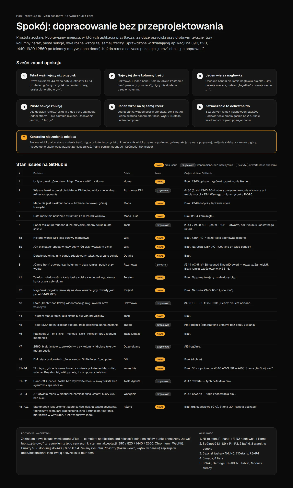

# Spokój: calm and consistent polish of Prostota

**Status.** Founder direction by Hubert ([@PelikanFix16](https://github.com/PelikanFix16)) on
2026-10-15. It refines the final design [Prostota](../final/README.md) (F-026). Prostota stays
the only direction; this page adds rules and drawings where the shipped application
overwhelms people or where the same function moves between views. Where this page and an
older Prostota drawing differ, this page wins.

- **Interactive board.** <https://claude.ai/artifact/3vLEMhiX3zg6b72c45Qhxq> (pages 0–10,
  "teraz" = now, "po poprawce" = after). Renders of every board are in [`boards/`](boards/).
- **Evidence.** Measured in the running application at main `86c43c75` (demo data, dark
  theme, Chromium in Docker) on 390 × 844, 820 × 1180, 1440 × 900, 1920 × 1080 and
  2560 × 1440. Control positions were recorded per accessible name in 24 states per
  viewport and compared between states.

## Rules

1. **Text matters more than buttons.** Buttons are 32 px (44 px on touch) with 13–14 px
   labels. One primary action per surface; the rest is quiet text or lives in "⋯".
2. **At most two content columns.** The conversation plus one panel. Opening another object
   from the panel replaces the panel's content, with "‹ back"; it never adds a third column.
3. **One header row.** Opening a panel never wraps the project header. When room runs out,
   people and "Together" move into "⋯"; the views stay.
4. **Empty sections disappear.** Empty "Decisions", "In docs", single-page pagination and
   zero counters are not shown. Adding lives in "⋯" or "+".
5. **One pattern for one thing.** One message bubble in projects, direct messages and
   threads; one panel shell for tasks, threads and project details; one composer.
6. **Selection is a soft fill.** No white rings or vertical bars. A highlighted source fades
   after 2 s. Message actions appear on hover (computer) or long press (phone); swipe right replies in thread (founder amendment 2026-10-16, [#343](https://github.com/ColdPhase/flux/issues/343)).
7. **A control never changes place.** Switching a view or a state changes the content, never
   the position of a control. The view switcher is always on the left, the primary action
   always on the right, the sidebar toggle always in the top row. Unavailable actions are
   dimmed instead of removed so nothing else shifts.

### Message toolbar and selection

Founder direction by Hubert on 2026-10-17 ([#591](https://github.com/ColdPhase/flux/issues/591),
[#594](https://github.com/ColdPhase/flux/issues/594)). They apply rules 5 to 7 to the shared
message actions and to choosing messages in a private conversation.

- **One toolbar at a time.** On a computer the toolbar (reply in thread, create task, "⋯") belongs to
  the message under the pointer or, for a keyboard, to the one with `:focus-visible`. A click leaves
  none behind; a hand-over from one message to the next never shows two (it fades in and goes at
  once); an open menu keeps its own toolbar and no other shows. The pointer wins over a focused
  message.
- **Nothing sticks out.** The pill sits beside the bubble at its top corner, on the side away from
  the author. The layout reserves its room (108 px and a 6 px gap) in every bubble column, in
  streams and threads, so no pane scrolls sideways and the pill never covers a bubble, a name, a time
  or another toolbar. No feed hides its horizontal overflow; a swipe on a phone clips only while the
  finger drags. In a thread narrower than 400 px (a docked panel on a small laptop) there is no room
  beside a bubble: the same three actions, with 24 px buttons, sit in the bubble's top corner, over no
  text (in the author row for a message that has one), and bubbles keep their width.
- **Choosing messages is a mode, not a re-layout.** Every message keeps its place (other people's on
  the left, mine on the right edge of the same column). The check takes the column of the face, on
  the bubble's first line, with its 44 px touch target on a phone. A picked row's soft fill is its
  box grown by 8 px on every side, painted behind the text, in `--pick`, a tint apart from the page, other
  people's bubbles and `--own`, so a chosen own bubble keeps its edge in both themes. The bar's content shares the
  conversation's column edges, and swapping it with the composer keeps the message being read where
  it is. Reduced motion is static.

Return to origin ([#592](https://github.com/ColdPhase/flux/issues/592), founder direction 2026-10-17): a page opened from a
reference shows one quiet "‹ origin" control first in its header row (in place of the phone's back), the same on every
destination. Going back restores the page, thread or panel, reading position and draft. Inside the one panel the
panel's own "‹ back" (rule 2) stays the only step back. The [contract](../../development/return-to-origin.md) records
where it sits and how the place is kept.

### Reference cards under a message

Agent decision, 2026-10-28 ([#665](https://github.com/ColdPhase/flux/issues/665), [PR #680](https://github.com/ColdPhase/flux/pull/680)),
within "implement as drawn": it reads boards A08 and A09 together with the Prostota
[attachments board](../final/README.md#6-files-references-and-photos) and the earlier #501 rule that a title is one line with an
ellipsis and the state stays visible.

- **Wide conversation, the drawn card.** A computer with no panel open shows the attachments board's card: the kind
  over the title on the left (number first for a task), the state at the right edge, centred across both lines, in full
  ("In progress · Jonas Berg", "Current rule · accepted 27 Oct", "Negative result · Ada Kowalska").
- **One row where the conversation is not at its full width.** A08 (the conversation beside an open panel, and the thread
  in it) and A09 (phone) draw icon, number, title with an ellipsis and the state at the right edge, no kind line. That form
  applies to every thread panel and sheet, to the conversation while a panel is docked or over it (at any screen width: the
  reading column is 760 px at most, so a panel can only be told by being there), and to a conversation narrower than
  760 px. Measured feed widths: 390 phone, 628 at 700, 748 tablet 820, 754 at 1440 with the panel, against 768 at 1024,
  1184 at 1440 and more with no panel.
- **The state is status only in the one-row card.** The boards draw "In progress", "Blocked", "accepted Oct 2" and never a
  person. So the one-row state keeps the word that names the state and drops what only adds a name: a task's owner, a result's
  author, the "Current rule · " or "Earlier rule · " lead and "would replace the current rule" (shown in the panel). The
  decision's own title takes A08's title position. The wide card keeps its full line, as the attachments board and the
  application drew it before. The text of the dropped parts stays in the page.
- **The title keeps a line.** At least 15ch (about 18 characters) of title stay beside the state; when they do not fit, the
  state drops under the title at the right edge. It is never cut, and the title never wraps letter by letter (#501).

### Phone Wiki: the header and the page menu

Agent decision of 2026-10-27 under the [delegated authority](../../product/autonomy.md), recorded for
[#507](https://github.com/ColdPhase/flux/issues/507) ([#500](https://github.com/ColdPhase/flux/issues/500) audit gap 3, PR
[#682](https://github.com/ColdPhase/flux/pull/682)). It reconciles the Prostota phone Wiki drawing with board C02.

- **Header.** On the phone the Wiki's header is the one board C02 draws for every project view: Back, the title as the
  view menu, Together, Search. A Wiki page adds nothing to it and Together never gives its place to another control
  (rule 7). The title keeps its width, as in every other view.
- **Page menu.** The "More" menu of a Wiki page (History, Share, Download, New page, Import .md, Together, Details) is the
  round "…" that [`phone-wiki.webp`](../final/screens/phone-wiki.webp) draws in the header, which C02 now gives to
  Together and Search. It sits at the end of the Wiki's page-chip row, outside the `Wiki pages` navigation (that list
  holds pages only), level with the chips, with a 44 px target on a coarse pointer. It does not scroll away: the chip row
  is the sticky top of the Wiki, so the menu stays in reach while the page is read, where the header menu was.
- **Chip row.** The Wiki's row of page chips is the drawn exception to [Prostota §4 and §8](../final/README.md) ("no
  chip rows" inside a project on the phone): `phone-wiki.webp` draws it under the header, and the menu above joins it.
  Every other project view stays without one.
- **Computer and tablet.** Unchanged: a Wiki narrower than 500 px beside a docked panel keeps its menu in the project
  header, where Together moves into it by rule 3.

### Wiki edit state in the two editors

Decision of 2026-10-27 ([#683](https://github.com/ColdPhase/flux/issues/683), applying the [Wiki contract](../../development/live-editing-proposal.md#wiki-contract--durable-shared-work-explicit-immutable-versions)
to [#511](https://github.com/ColdPhase/flux/issues/511) AC-4 and AC-5; first written in [PR #689](https://github.com/ColdPhase/flux/pull/689)).
Board C02 draws the state of the private editor, "Editing version 2 · saves as 3". Where live editing is on (the default since
[#613](https://github.com/ColdPhase/flux/issues/613)) an existing page opens the shared editor, where typing is visible to
everyone with access and only Save version keeps a version. It has no per-person version to count from ("a live working body
is never relabelled as one of those versions"), so the same slot of the same bar says "Shared working copy · last saved
version 2". Only the words change: the slot, Back, the icons and Save version keep their places in read, edit and history
(rule 7), as the audit board requires. The drawn text stays for the private editor, which a new page, a restored version and a
run with live editing off use. A test of the state asserts the text of the lane it runs in
(`test_wiki_panes`, "Shared working copy · last saved version 2" if live else "Editing version 2 · saves as 3").

### Token

| Token | Light | Dark | Use |
| --- | --- | --- | --- |
| `--own` | `#E7E7EA` | `#313134` | The signed-in person's message bubble (replaces `--inv` for own bubbles) |
| `--pick` | `#DCDCE0` | `#3D3D42` | The fill of a chosen message row (#594), apart from `--own` |

Other people's and agents' bubbles stay `--el` with a `--line` outline. Own bubbles have no
avatar and no name; time and "Seen by" sit under the last bubble of a run.

### Layout per screen

| Screen | Layout |
| --- | --- |
| Phone 390 | One thing at a time. Task, thread and details are a sheet (half / full). A thread opened from a task replaces the sheet's content. |
| Tablet 820 | Sidebar collapsed to the 64 px rail. The panel (380 px) slides over the conversation, which stays visible. Project title is the view menu. |
| Computer 1440 | Sidebar 248 + conversation + panel 420, one header row above both. |
| Large 1920–2560 | Conversation at most 760 px, panel 420 px (480 px until the [2026-10-31 amendment](https://github.com/ColdPhase/flux/issues/763#issuecomment-6549771863)); the work panel at most 1600 px, centred; extra width is margin. Never a third column. |

## Boards

| Area | Now | After |
| --- | --- | --- |
| 1 Home | [now](boards/B01-home-teraz.webp) | [after](boards/A01-home-po.webp) |
| 2 Message bubbles | [now](boards/B02-banki-teraz.webp) | [after](boards/A02-banki-po.webp) |
| 3 Map canvas | [now](boards/B03-mapa-teraz.webp) | [after](boards/A03-mapa-po.webp) |
| 4 Map list | [now](boards/B04-lista-teraz.webp) | [after](boards/A04-lista-po.webp) |
| 5 Task panel | [now](boards/B05-task-teraz.webp) | [computer](boards/A05-task-po.webp) · [phone](boards/A05p-task-telefon.webp) |
| 6 Wiki | [now](boards/B06-wiki-teraz.webp) | [history](boards/A06-wiki-historia-po.webp) · [outline](boards/A06n-wiki-spis-po.webp) |
| 7 Project details | [now](boards/B07-details-teraz.webp) | [after](boards/A07-details-po.webp) |
| 8 Thread from a task | [now](boards/B08-watek-teraz.webp) | [after](boards/A08-watek-po.webp) · [layout per screen](boards/A08s-ekrany.webp) |
| Phone conversation | [now](boards/B09-telefon-teraz.webp) | [after](boards/A09-telefon-po.webp) |
| 9 Consistency | [audit](boards/C01-spojnosc-audyt.webp) | [anchors](boards/C02-kotwice-po.webp) |
| 10 Rest of the app | [now](boards/D01-reszta-teraz.webp) | [hand-off](boards/E01-handoff-po.webp) · [Create and ⌘K](boards/E02-create-palette-po.webp) · [Sketchbook](boards/E03-sketchbook-po.webp) · [Settings](boards/E04-settings-po.webp) · [Settings phone](boards/E04p-settings-telefon.webp) · [Search](boards/E05-search-po.webp) · [empty Inbox](boards/E06-inbox-pusty-po.webp) |

Project details (board 7) also show one quiet line with the project's goal under the name and
people when the project has one. People who can write get a "⋯" beside the name with the goal
actions ([F-028](../../product/project-goals.md), founder direction 2026-10-16, #520). Otherwise a
project without a goal looks exactly as drawn.

The orange numbered badges and dashed lines on the boards are review annotations, not
product UI. Board copy explaining each change is in Polish; the application copy in the drawings is the
English product copy.

## Accepting an implementation

Compare against the "after" boards at 390 × 844, 820 × 1180, 1440 × 900 and 2560 × 1440 in
light and dark, in Chromium and WebKit emulation. For rule 7, record control positions per
accessible name before and after each state change named in the task and show that they do
not move. Screenshots alone do not prove interaction or accessibility.
