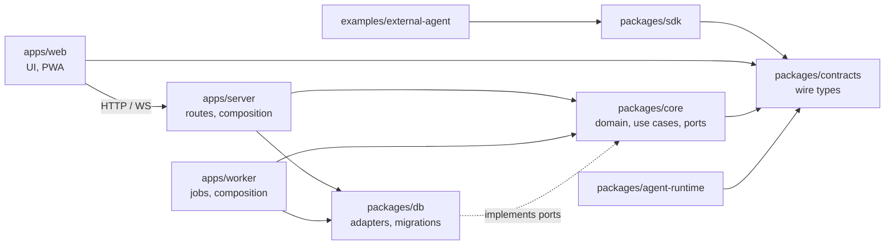

# Architecture and dependency rules (issue #46)

This page describes how the Flux monorepo is layered today, which way dependencies
may point, and where new code and tests belong. The stack and package boundaries
were accepted in the [architecture proposal](../product/application-architecture.md);
this page turns them into rules that a test enforces. Access rules are detailed in
[access policy](access-policy.md); the environment is described in
[containers](containers.md).

The application workspace is `app/`; source and test paths below are repository-relative.
The scanner uses paths relative to that workspace, so package keys and the debt
allowlist retain their meaning after the move. `docker/` contains deployment inputs.

## Layers

| Path | Package | Role | May depend on |
| --- | --- | --- | --- |
| `app/packages/contracts` | `@flux/contracts` (Apache-2.0) | Public wire types and event versions for HTTP/WebSocket clients. | Nothing external. |
| `app/packages/sdk` | `@flux/sdk` (Apache-2.0) | TypeScript client of the public API. | `@flux/contracts` only. |
| `app/packages/core` | `@flux/core` | Domain rules, authorization, use cases and the ports they need. | `@flux/contracts` and Node built-ins. No Drizzle, `@flux/db`, `pg`, pg-boss, Fastify, web-push or React. |
| `app/packages/db` | `@flux/db` | Schema, reviewed SQL migrations and persistence adapters that implement core ports. | `@flux/contracts`, `@flux/core`, Drizzle, `pg`. |
| `app/packages/agent-runtime` | `@flux/agent-runtime` | Optional model/provider adapter. | Not `@flux/db`, Drizzle, `pg`, pg-boss, Fastify, the apps or React; it receives a work brief and permitted capabilities. |
| `app/packages/runtime-protocol` | `@flux/runtime-protocol` | The `runtime` transport's internal protocol ([F-022 AIM-3](../product/ai-modes.md#aim-3--the-runtime-transport)): the supervisor's closed request set, its answer frames, the bounded stream reader, the manager's API and client. | Node built-ins only, so the slot image carries nothing else. |
| `app/apps/runtime` | `@flux/runtime` | The runtime's own processes: the slot supervisor (with the sign-in console's terminal), `runtime-manager`, `runtime-egress`, `runtime-install`, the TEST ONLY fake CLIs and the opt-in flag contract check. | `@flux/runtime-protocol`, Node built-ins and `node-pty` (Node has no pseudo-terminal of its own; F-022 T4) only: no database, queue, HTTP framework, domain package or other app. |
| `app/apps/keyring` | `@flux/keyring` | The keyring of encrypted workspaces ([F-030](../product/encrypted-workspaces.md)): one random boot key in RAM, sealing and opening workspace keys for the API and worker over the internal `keyring` network. | Node built-ins only, so nothing else runs in it. |
| `app/apps/server` | `@flux/server` | Composition root of the API: Fastify routes, identity, push and static PWA assets. Maps HTTP to core use cases. | Any package except `@flux/worker`, `@flux/web` and React. |
| `app/apps/worker` | `@flux/worker` | Composition root of background jobs (pg-boss handlers, Web Push delivery). | Any package except `@flux/server`, `@flux/web`, Fastify and React. |
| `app/apps/web` | `@flux/web` | Browser application and PWA. Talks to the server only through HTTP/WebSocket contracts. | `src/` only `@flux/contracts` and the browser libraries it declares (an allow-list, #93). Build tooling (`vite.config.ts`, `build/`, `scripts/`) is separate from `src/`. |
| `app/examples/external-agent` | Apache-2.0 example | An agent outside Flux using the public API. | `@flux/sdk`, `@flux/contracts`, Node built-ins. |
| `app/tooling` | app workspace | Migration and operations entry points; Dockerfiles/Compose are separate under `docker/`. | Any package except the apps and UI. |

Arrows point from the depending module to its dependency. Dependencies point inward:
the domain does not know which database, queue, transport or UI uses it. The apps
are the only places that choose concrete adapters and wire them together.

## Rules

- **Imports follow the table.** Import another workspace package by its name
  (`@flux/core`), never by a relative path out of the package or a deep path
  (`@flux/db/src/...`). A package's `dependencies` must obey the same rules.
- **License boundary.** `contracts`, `sdk` and `app/examples/external-agent` are
  Apache-2.0 and never import AGPL application packages ([licensing](../product/licensing.md)).
- **Ports belong to core.** When a use case needs persistence, a queue or a
  delivery channel, core declares a small interface and the app passes an adapter
  (see `app/packages/core/src/push/ports.ts`, `app/packages/core/src/access/ports.ts`,
  `app/packages/core/src/access/repositories.ts` and `app/apps/server/src/push/adapters.ts`).
  Introduce a port only when a real use case needs it.
- **One authorization path.** Access decisions come only from `authorize`, `assertAuthorized`
  and `authorizeEvent` in `app/packages/core/src/access/policy.ts`: pure decisions over the facts
  the `AccessReader` port (`access/ports.ts`) returns. The port has one implementation,
  `app/packages/db/src/repositories/access.ts`, which reads those facts, takes the locks, and
  builds the list condition `visibleFilter` for the same rules. Core use cases call the decisions
  through a reader the app passes in (`accessReader(tx)`, or the `access` member of `accessPorts`). Routes, jobs, adapters and the UI never
  query collaborative tables for a caller directly and never add a second policy module or a
  second reader. See [access policy](access-policy.md#one-choke-point).
- **Typed errors.** Core signals expected failures with the `DomainError`
  subclasses in `app/packages/core/src/access/errors.ts` (stable `code`, HTTP-neutral
  `status`). Entry points map them to their transport; they do not parse messages.
- **No global mutable state.** Configuration, database handles, queues and clocks
  are created in a composition root and passed in. Modules do not keep mutable
  singletons or caches that make tests or multiple workers interfere.
- **Focused modules.** An `index.ts` is a bounded public entry point or bootstrap.
  Put a new capability in its own folder (`core/src/<capability>/`,
  `server/src/<capability>/`, `db/src/repositories/<capability>.ts`) instead of
  growing an existing index or a multi-capability file.
- **One select.** Product UI under `app/apps/web/src` uses the design system's `Select` (`ui/Select.tsx`, with
  `Option` and `OptionGroup`), never a native `<select>`: the system's list ignores the tokens, the dark theme
  and the phone sheet ([#695](https://github.com/ColdPhase/flux/issues/695), [app shell](../design/app-shell/README.md)).
- **Web feature folders and one transport.** `app/apps/web/src` is organised by capability: `app/` is the
  shell (layout, sidebar, rail, the shell loader `app/data.ts`), `ui/` the design system's primitives, `api/`
  the transport, and every other folder one capability (`conversations/`, `materials/`, `drafts/`, `captures/`,
  `project/`, `work/`, `docs/`, `sketch/`, …) with its own `api.ts` beside its model and views
  ([#93](https://github.com/ColdPhase/flux/issues/93), [#94](https://github.com/ColdPhase/flux/issues/94)). Every
  request goes through `api/client.ts` (`request` for JSON, `send` for a raw response such as a file) with a path
  helper from `@flux/contracts`; no other module calls `fetch` or writes an `/api/` path. The service worker
  `pwa/sw.js` is plain JavaScript, so its two API paths are literals that a test keeps equal to the contracts.
- **Transactions stay in one place.** Writes that must be atomic (domain row,
  event, outbox, job) run in one transaction owned by the use case or by an
  adapter method designed for it, not split across callers.

## Tests

| Kind | Location | Runs in |
| --- | --- | --- |
| Application, API, persistence and core tests | `app/tests/app/<capability>.test.ts` | `test` service of `./scripts/check_application.sh` |
| Shared test helpers and mocks | `app/tests/app/support/` | imported by the above |
| Browser checks (PWA, service worker) | `app/tests/app/e2e/*.e2e.ts` | `e2e` service |
| Checks against a restarted or reconfigured stack | `app/tests/app/*.ts` / `*.check.ts` called by the script | `check_application.sh` |
| Browser journeys in the web app (Playwright, Python) | `app/tests/ui/test_*.py` | `./scripts/check_ui.sh` |
| The normal (non-test) deployment: fixture rollback header ignored, worker processes, restart keeps data | `scripts/check_runtime.sh` | `./scripts/check_runtime.sh` |
| The agent runtime with fake CLIs through `./flux` (isolation, release, backup, restore, purge, reset) | `scripts/check_agent_runtime.sh`, `scripts/agent-runtime/` | `./scripts/check_agent_runtime.sh` |
| Repository and agent tooling | `tests/test_*.py` | `python3 -m unittest discover -s tests -p 'test_*.py'` |

Pure core use cases can be tested with in-memory port implementations
(`app/tests/app/push-core.test.ts`; the access decisions and their lock order over an in-memory
`AccessReader` in `app/tests/app/access-decisions.test.ts`, and the workspace, member, grant, agent and draft
use cases, with their statement order, transactions and the handle each port is bound to, over in-memory
repositories in `app/tests/app/access-use-cases.test.ts`); behavior that depends on SQL, locks or the queue is
tested against the Compose PostgreSQL (the draft audience and grant rules and the 23505/23503 results of a grant
write, through the real repositories, in `app/tests/app/access-sharing-rules.test.ts`).

## Automated check

`app/tests/app/architecture.test.ts` runs in the Docker test suite. It scans every source
file under `app/apps/`, `app/packages/`, `app/examples/` and `app/tooling/` and every workspace
`package.json`, assigns each to a layer defined in
[`app/tests/app/support/architecture.ts`](../../app/tests/app/support/architecture.ts) and
fails when:

- a file imports a package its layer does not allow, a relative import leaves its
  workspace package, or an import reaches into another package's `src`/`dist`;
- a package declares a runtime dependency its layer does not allow;
- a violation is found that is not listed in
  [`app/tests/app/architecture-allowlist.json`](../../app/tests/app/architecture-allowlist.json),
  or an allowlist entry no longer matches a violation (remove it when fixed);
- `app/packages/core/src/push/**` reaches an adapter library through any relative import;
- anything under `app/packages/core/src/access/` or `events.ts` does (the access decisions and use
  cases stay behind ports, including through helpers, #90, #91), or any file there other than `policy.ts`
  passes 200 lines;
- any module under `app/packages/core/src/` reaches `@flux/db`, Drizzle, `pg`, pg-boss, Fastify or web-push,
  core's `package.json` declares a persistence dependency, or the allowlist has a `packages/core/` entry (#92);
- a `.ts` or `.tsx` file under `app/apps/web/src` contains a native `<select>` (comments ignored, #695);
- a `.ts` or `.tsx` file under `app/apps/web/src` other than `api/client.ts` calls `fetch` or writes an `/api/` path,
  or the web layer's allow-list names a library that `app/apps/web/package.json` does not declare (#93);
- a file under `app/apps/web/src/conversations/` or `materials/` passes 150 lines, or one of their `.tsx` views imports an API
  module or calls `request`, `send` or `fetch` (#94).
  `app/tests/app/pwa.test.ts` checks that every API path in `pwa/sw.js` is a contract path.

The allowlist can only shrink. Do not add entries for new code; change the code or,
if a layer rule itself is wrong, update this page and the rule in the same reviewed PR.

## Resolved debt

The first application slices put SQL next to domain logic in core; [#46](https://github.com/ColdPhase/flux/issues/46)
tracked each import on the allowlist, which is now empty. The entries below record how each was paid.

Resolved from the allowlist: core owns its transaction port in `app/packages/core/src/types.ts` ([#92](https://github.com/ColdPhase/flux/issues/92)).
`Executor` is an opaque connection or open transaction that core only hands to the port factories the app passes in
(`accessPorts`, `eventRepository`, the draft summary ports, the idempotency store), and `Database` is a handle that opens a
transaction on it (`transaction(work)`, nested as a savepoint on an open transaction). Port factories are declared as methods,
so the `@flux/db` adapters, which take Drizzle handles, implement them unchanged; `runIdempotent` is generic in the handle its
transaction yields, so the command and replay check the server passes keep their Drizzle type. The Drizzle-derived handle
types (`DatabaseHandle`, `Database`, `Executor`, `Transaction`) moved to `@flux/db` (`src/handles.ts`), and the apps and tests
import them from there. `@flux/core`'s `package.json` depends on `@flux/contracts` only; `@flux/db`, `drizzle-orm` and pg-boss
are gone from it. No statement, lock or transaction boundary changed: core opens the same transactions on the same handles.
A new core module that needs persistence declares a port and takes these types; it never imports `@flux/db` or Drizzle.

The growing `app/packages/db/src/schema.ts` stays one module for now; split it by capability when a change needs it.

Resolved outside the allowlist: identity no longer queries session rows itself. The
session list/revoke queries live in `app/packages/db/src/repositories/sessions.ts` behind
the `SessionStore` port in `app/apps/server/src/identity/routes.ts`, identity takes a
`@flux/db` `DbExecutor` instead of core's `Database`, and only `identity/auth.ts` wires
Drizzle, for Better Auth's adapter ([#81](https://github.com/ColdPhase/flux/issues/81)).

Resolved outside the allowlist: `app/apps/worker/src/index.ts` is the worker's composition root
only (environment, pool, pg-boss, signals). Each job registers itself from
`app/apps/worker/src/jobs/` or its feature folder, like `registerPushWorker`; the sample job's
queries live in `app/packages/db/src/repositories/sample.ts`, and the VAPID JWT cache is an
authorizer the composition root creates and passes in, not module state
([#82](https://github.com/ColdPhase/flux/issues/82)).

Resolved from the allowlist: `app/packages/core/src/idempotency.ts` keeps key parsing, request
hashing, the expiry decision, the reuse error and replay authorization; key storage (the
transaction-scoped advisory lock, lookup, save for 2xx only and expired-key cleanup) sits behind
its `IdempotencyStore` port with the adapter `app/packages/db/src/repositories/idempotency.ts`
([#86](https://github.com/ColdPhase/flux/issues/86)).

Resolved from the allowlist: `app/packages/core/src/jobs/draft-summary.ts` keeps the word
count, the summary shape and the orchestration (the locked read check before the request's
insert and enqueue, the recheck with locks inside the commit transaction). Result rows sit
behind its `DraftResultRepository` port (`app/packages/db/src/repositories/draft-results.ts`),
and the job is sent through the shared core `JobQueue` port, whose pg-boss adapter
(`pgBossQueue` in `app/apps/server/src/push/adapters.ts`) enqueues in the caller's transaction
([#87](https://github.com/ColdPhase/flux/issues/87)).

Resolved from the allowlist: `app/packages/core/src/index.ts` only exports. The integration-fixture
sample command lives in `app/apps/server/src/fixture/` over the `@flux/db` sample repository, with
typed errors, and exists only when `FLUX_FIXTURE_TOKEN` is set (with failure injection, so do the
test-only stream and search routes and, since #287, OAuth client registration over the `@flux/db`
fixture client repository). The API's composition root is `app/apps/server/src/app.ts`
(`buildApp(config)` from `config.ts`, read once); `index.ts` only builds and listens, and the health
check is `health/routes.ts` ([#88](https://github.com/ColdPhase/flux/issues/88)).

Resolved outside the allowlist: the access routes are one module per capability in
`app/apps/server/src/access/` (workspaces, projects and grants, agents, drafts, draft summaries)
over a shared context, each under about 120 lines. Header helpers and schema fragments are in
`app/apps/server/src/http/{headers,schemas}.ts`, and `http/errors.ts` maps domain errors and a
missing session once, on the API's root: access, push, stream and identity answer a missing session
with the same `UNAUTHENTICATED` body ([#85](https://github.com/ColdPhase/flux/issues/85)); identity's
401 was Fastify's default body before. Route plugins that tests register alone call `useDomainErrors`,
the same mapper; agent connection, conversation and proactive comparison still set their own handlers,
which drop a domain error's details (follow-up with #36).

Resolved from the allowlist: `app/packages/core/src/events.ts` keeps `principalKey`, the audience
loop over an `EventAuthorizer` and the final-write ordering (every audience resolved before the
first insert takes the sequence lock). Storage is the `EventRepository` port (`candidates`,
`insert`), implemented by `app/packages/db/src/repositories/events.ts`. Callers pass
`policyEventPorts(tx, eventRepository(tx))`; the server and worker build it with their
`events.ts` helper ([#89](https://github.com/ColdPhase/flux/issues/89)).

Resolved from the allowlist: `app/packages/core/src/access/policy.ts` keeps the actions, `LEVEL`, `isManager`, `accessName`,
`eventResource`, `enforce` and the decisions (`evaluateWorkspace`, `evaluateProject`, `evaluateDraft`, `evaluateAgent`,
`evaluateSketch`, `evaluateDm`, `evaluateAssistantRun`, `authorize`, `assertAuthorized`, `authorizeEvent`,
`visibleWorkspaceOf`, `requireWorkspaceAi`, `dmClosedFor`) over the `AccessReader` port in `access/ports.ts`. Each port method is
one statement of the former policy, so the evaluators still call them in the documented lock order (the membership/agent rows
`FOR SHARE` with the AI policy row first for an agent, the draft `FOR UPDATE`, the project and the principal's grants
`FOR SHARE` ordered by id, the sketch `FOR NO KEY UPDATE`, the DM row before its participants). The implementation is
`app/packages/db/src/repositories/access.ts`: `accessReader(db)`, the actor's standing (`loadActor`, `workspaceAi`), the
`*Sql` builders with the `LEAST` cap for person-owned agents, and `visibleFilter`, which the server adapters now import from
`@flux/db`. Evaluations are generic in the row type, so a caller holding that adapter still gets whole table rows
(`domain.ts`, unchanged except for the reader argument, until #91 split it). `policySketchAccess`, `policyDmAccess`, `policySourceReader`,
`policyPersonalRunAccess` and `policyEventPorts` take a reader, as do the draft summary use cases through their ports
([#90](https://github.com/ColdPhase/flux/issues/90)).

Resolved from the allowlist: `app/packages/core/src/access/domain.ts` is gone. Its use cases are one module per capability under
`app/packages/core/src/access/`, each under 200 lines: `workspaces.ts` (create, list, read), `members.ts` (list, add, change a role,
remove or leave, with the F-030 key-row lock and the unlock-password rule), `workspace-ai.ts` (the F-029 flip and the turn-off sweep),
`projects.ts` (create, add a view, list, read, the audience), `grants.ts` (list, set, revoke), `agents.ts` and `drafts.ts`, with the
validators and `parsePage` in `validation.ts` and the shared event ports and owner rule in `common.ts`. They run over the ports in
`access/repositories.ts` (`WorkspaceRepository`, `ProjectRepository`, `AgentRepository`, `DraftRepository`, and the F-029/F-030 row
sets `WorkspaceAiSweepRows` and `WorkspaceEncryptionRows`) and the record types in `access/records.ts`; core presents the records as the
API's shapes. The adapters are `app/packages/db/src/repositories/{workspaces,projects,agents,drafts}.ts`, bundled as `accessPorts`
(`repositories/access-ports.ts`), which a caller passes right after the database handle:
`addMember(principal, workspaceId, command, db, accessPorts)`. Every statement moved unchanged and a repository method is one statement (two that always ran together are one method:
the workspace and its first owner, a page and its count), so the lock order of each use case stays where its code reads it: the workspace row `FOR NO KEY UPDATE` (the AI policy row and, for a sealed
workspace, the key row before it; `addMember` starts at the workspace row), the project row `FOR NO KEY UPDATE` before a grant change, member, grant and draft rows
`FOR UPDATE`, the actor and project access rows through `evaluate*` with `lock`, the expected-version check after authorization, the
event last, and one savepoint transaction per mutation. PostgreSQL's 23505 and 23503 on a grant write are returned by the adapter as a typed
result (`GRANT_CONFLICT`, `GRANTEE_REMOVED`) and `ConflictError` is raised in core. `drizzle-orm` left core's `package.json` with #92 ([#91](https://github.com/ColdPhase/flux/issues/91)).

Resolved outside the allowlist: the web app has one transport and feature folders. `api/client.ts` is the only module that calls
`fetch` (push, sign-out, the export bundle, file bytes, the handoff packet and the reachability probe use its `send`); every API
path comes from a `@flux/contracts` helper; the web layer's rule is an allow-list. `conversation-api.ts` is split by resource into
`project/api.ts`, `conversations/api.ts`, `materials/api.ts` and `drafts/api.ts`; the browser draft store, private notes and project
creation moved to `drafts/`, `captures/` and `project/`; the project conversation's loader, feed model, thread reply and sources
(`materials/useProjectMaterials.ts`, `MaterialTray.tsx`, whose form now keeps its text in the shared draft store) have their own
modules. The pane itself is split into hooks that read and act (`paneCore.ts`, `useThreadReplies.ts` with the live refresh of #733,
`useThreadReading.ts`, `useThreadPlace.ts`, `useComposerDrafts.ts`, `useComposerMenu.ts`, `useComposerSend.ts`, `useAssistantAsk.ts`,
`useAskBar.ts`) and views that only render (`ThreadFeed.tsx`, `ThreadAnswers.tsx`, `ThreadReply.tsx`, `PaneComposer.tsx`); the
architecture test keeps every file of `conversations/` and `materials/` within 150 lines and their views free of API calls
([#93](https://github.com/ColdPhase/flux/issues/93), [#94](https://github.com/ColdPhase/flux/issues/94)).
