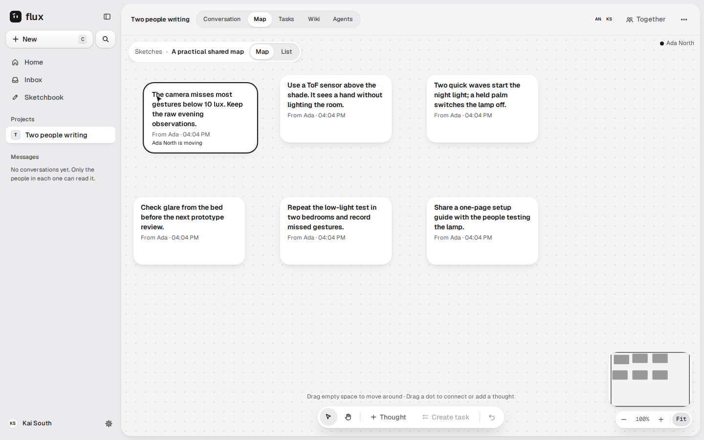
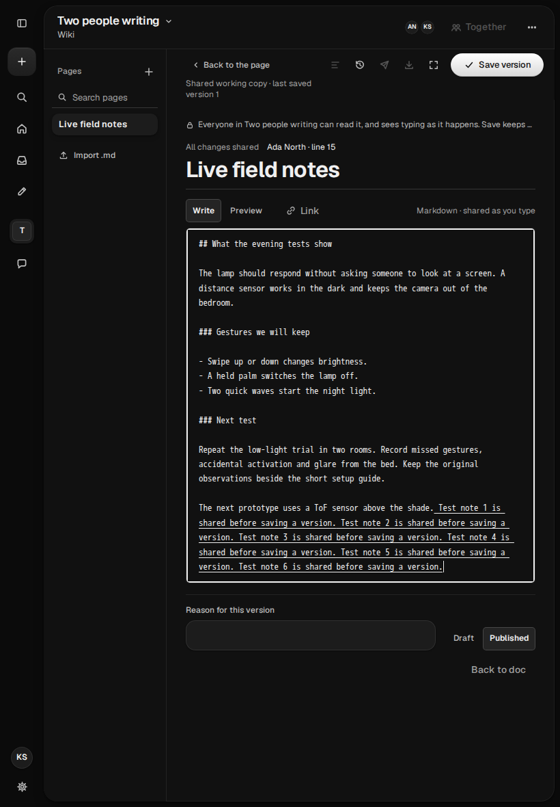
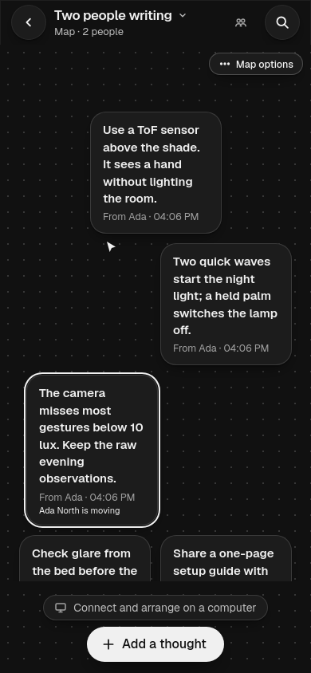
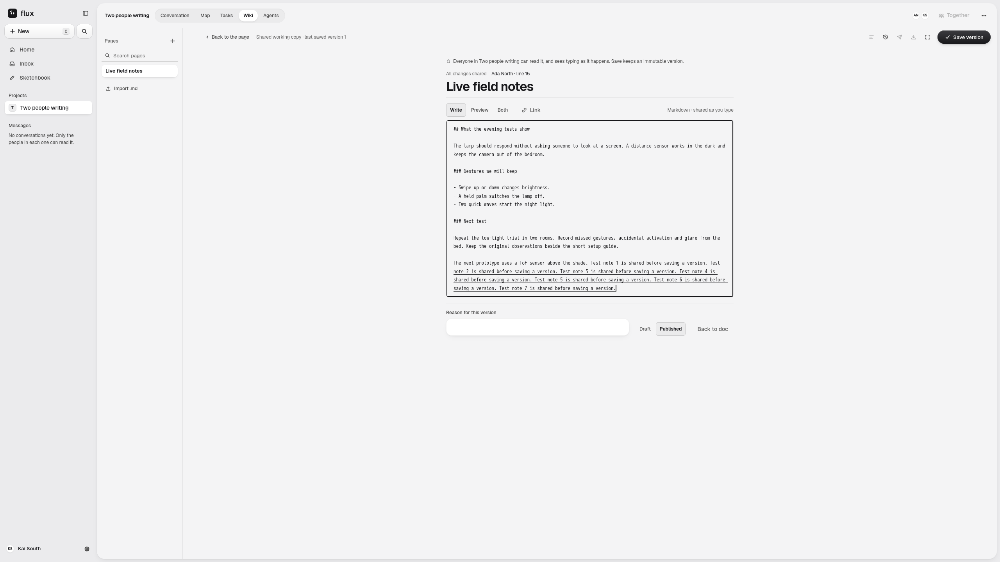

# Whole-issue independent acceptance: #228 / PR #613

**Technical verdict: PASS**, candidate
`c66eefc73e004aca2f10c0e0445ec7a7d0b84163`, 2026-10-18. One comprehensive
independent review and one final delta check are complete. All three P2 findings
are closed; no P1/P2 remains. Normal eligible Code Owner approval and protected
merge remain required. This is not release-wide acceptance or an early closure.

The [first review](first-consolidated-review.md) independently inspected source,
all 32 original renders and all 94 retained timing artifacts. The [final review](final-delta-report.md)
accepts AC-1–AC-5/Gates 1–4 using compatible retained evidence and the composed
runtime below. Published [first review](https://github.com/ColdPhase/flux/pull/613#pullrequestreview-5563760873)
and [final delta](https://github.com/ColdPhase/flux/pull/613#pullrequestreview-5563813850)
are independent-agent evidence published through the author's identity, not
eligible GitHub approvals.

| Engine | Maintained methods | Review helpers | Result | Test time |
| --- | ---: | ---: | --- | ---: |
| Chromium 151.0.7922.34 |9 |2 |11/11 PASS, zero skips/errors |58.520s |
| WebKit 26.5 |9 |2 |11/11 PASS, zero skips/errors |75.008s |

Both ordinary production-on Docker builds/type checks/lint pass, with nine
existing warnings. Final checks exercise genuine delayed/duplicate/reordered
frames and expired activity, native placement, pre-drop movement, scoped presence
lifetime/revocation, Wiki typing/cursor/selection/immutable Save, private recovery
and own Undo. Actual computed design tokens, docking and canvas-edge checks pass.
All32 fresh renders were inspected: four CSS viewports, two palettes, two engines.

The [complete nine-cohort measurement](../2026-10-18-access-latency/README.md)
retains all 2160 rows, zero input/sample/socket errors, COMPLETE 3222-record queue,
all 26 final gauges zero and actual clean producer exit. The
[founder's specific 213.167416 ms exception](https://github.com/ColdPhase/flux/issues/228#issuecomment-6251802241)
accepts this small overrun; the 200 ms target, original raw FAIL and source pins
remain. The later 214.850179 ms single-cohort record remains incomplete resource
evidence. No fresh latency/profile or application-only speedup is claimed. The
private combined observer is not integrated; the canonical driver is unchanged.

[Results](results.json), [source binding](source-binding.json), [all render
metadata/hashes](screenshots.json), [cleanup](all-cleanup.json) and the
[72-file external manifest](artifact-manifest.json) preserve exact observations.
External root: `/home/hubert/flux-evidence/613-final-c66eefc7`; manifest SHA256
`60d07ca46ef91c55b475ad3da2150fd7b5e222fb72e542382d18a51353739161`.
Exact commands, terminals and actual running CID/image/allowlisted configurations
are retained under `chromium/` and `webkit/`. Capture-only source `0eaed8d0` changes
only the private helper; application/packages/Docker/scripts match the candidate.
The interrupted pre-runtime helper build and initial empty Chromium inventory
remain external; the corrected actual inventory is used for acceptance. All
three owned projects are cleaned; user demo 8081/Qwen 8080 are preserved.

Four unmodified representative renders follow; [source hashes](representative-renders.json).
Screenshots alone do not certify interaction, latency, accessibility or physical devices.

