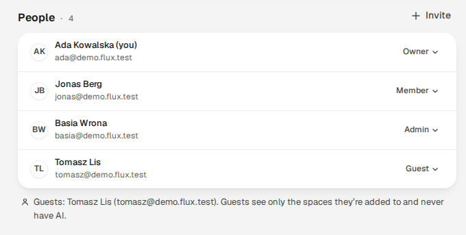
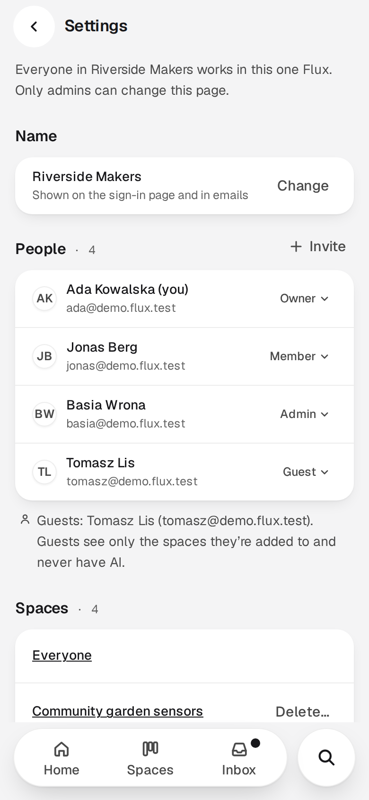
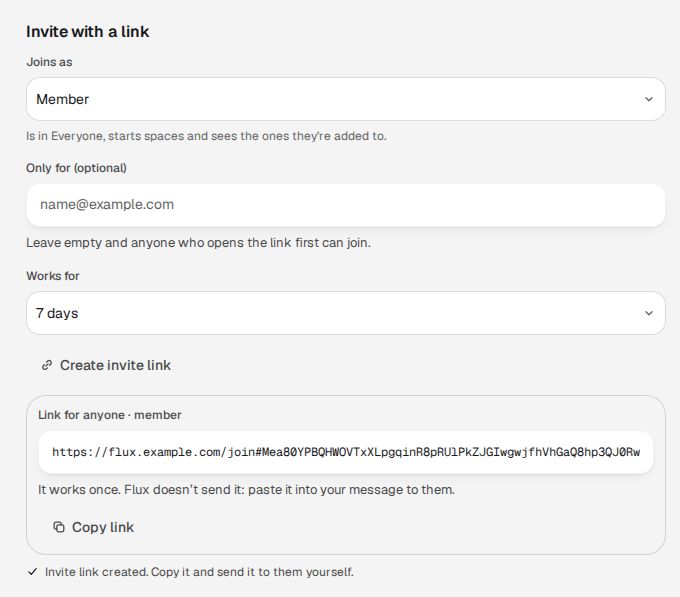
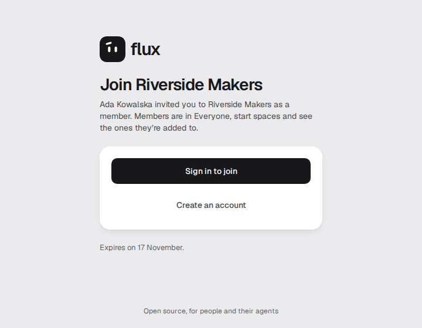
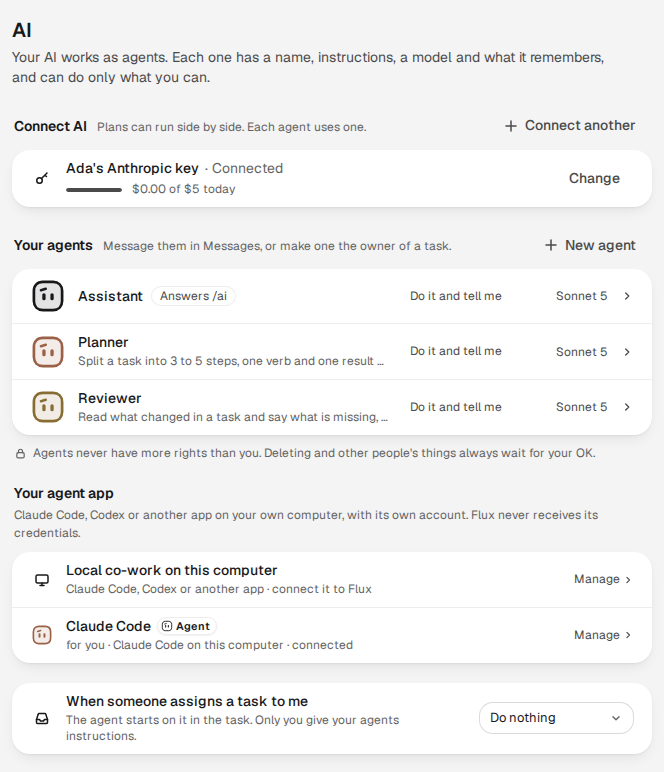

# Administration in the app

The operator runs the server; the people who use Flux run their own company and its spaces. There is no
server-wide administrator account: everything on this page is done in the app by the company's **owners**
and **admins** and by each space's own admins, and the [settings file](configuration.md) is the operator's
only lever over the whole instance. This page describes Flux v0.2: one Flux is one company, with spaces.

## The company and its spaces

One Flux is one company. The first account sets it up and owns it, with the default space **Everyone**,
which holds the whole company. Everything else people do together happens in **spaces**: a space can be a
department, a team or a project. You see only the spaces you were added to, and the sidebar lists exactly
those. **New › Space** is one window: a name, the people (chosen from the company), an AI switch that starts
on, and **Create space**. You are the new space's admin.

## People and roles

**Settings › Company** holds the company's name and its people.

| Role | Can |
| --- | --- |
| **Owner** | Everything an admin can do, and add or remove owners. |
| **Admin** | Add and remove people, change roles, change every space and delete any space except Everyone. |
| **Member** | Be in Everyone, start spaces and see the ones they are added to. |
| **Guest** | See only the spaces they are added to, and never have AI. |

Owners and admins add someone who already has an account with **Add someone** (by their email
address), change a role, or remove a person. Anyone can **Leave** the company, except its last owner.
Removing someone takes effect on their very next request; their own agents stop with them.
**Settings › Company** lists people who left or were removed, with **Restore**: they sign in as usual
and are in Everyone again, and other spaces are added by hand. Below that it lists every space, so
an owner or admin can add themselves to one or delete it; their sidebar, search and Inbox hold only the
spaces they belong to.

  <picture>
    <source media="(prefers-color-scheme: dark)" srcset="../assets/screens/people-computer-dark.webp">
    
  </picture>
  <picture>
    <source media="(prefers-color-scheme: dark)" srcset="../assets/screens/people-phone-dark.webp">
    
  </picture>

Settings › Company on a 1440&nbsp;px computer and a 390&nbsp;px phone, in the light and the dark theme your browser asks for.

Each space has its own settings (**⋯ › Settings** in its header): its name, its people, the AI switch,
**Leave space** and, for its admins, **Delete space…**. A space has two roles, **Member** and **Admin**.
Its creator is an admin and can make others admins. Deleting asks first, names the space and erases
everything in it, including its conversations, tasks, Wiki pages and maps. Everyone cannot be deleted
or left. The full rules are in the [access policy](../development/access-policy.md#rules).

## Invite links

For someone who has no account yet, a company owner or admin chooses **Invite with a link** in
**Settings › Company**. A link joins the company, and the person is then added to spaces from each
space's people. With [single sign-on](single-sign-on.md) there are no links: everyone the provider
lets in joins on their first sign-in.

- **Joins as**: member or guest, or admin when the creator is an owner. Never owner.
- **Only for (optional)**: an email address. Empty means whoever opens the link first.
- **Works for**: 1, 7 or 30 days.

Flux copies the link; it sends no email itself, so send it yourself. The link works once. Pending
links are listed in the same place, where any owner or admin can copy or revoke them. The person
signs in or creates an account under the instance's sign-up rule: an invite never opens sign-up that
`FLUX_SIGNUP` or [single sign-on](single-sign-on.md) has closed. Changing `FLUX_AUTH_SECRET` voids
every pending link.

  
  

Creating the link in Settings › Company, and the page it opens for the person who receives it.

## AI in a space

Each space has an **AI** switch in its settings, on by default. Its admins, and the company's owners and
admins, turn it off or on for that space. There is no switch for the whole Flux:

- **Off**: no agent, no `/ai` and no connected MCP client reads or acts in the space, including each
  member's own. `/ai` answers "AI is off in this space" and the Owner picker lists people only. Work
  an agent had started stops before its next change. People keep working as before.
- **On again**: agents and connected clients can work there again with the access they had.
  Nothing that was stopped starts again by itself.

A guest never has AI, and an encrypted space never has AI and shows no switch. The settings that
decide whether AI can run at all on this server are the operator's ([AI providers](configuration.md#ai-providers),
the [agent runtime](agent-runtime.md)); the space switch can only narrow them. The contract is
[AI in a space](../product/assistant.md#ag-10--ai-in-a-space).

## Encrypted spaces

Anyone in the company who is not a guest can make a space **Encrypted** in the New space window (the
switch is off by default and cannot be turned off later). Its content is encrypted on the server, AI
is always off there, and after every server restart the space waits until one of its admins enters
their own unlock password; its members see "Locked, waiting for an admin", and the rest of the
company works as usual. The person making it chooses an unlock password and downloads a recovery
code before Create. Only the space's admins and the recovery code hold the keys. A company owner or
admin sees the space listed in **Settings → Company** and can delete it, but cannot open it and has no
Add me for it. If every password and the recovery code are lost, nobody can recover the space, the
operator included. What the operator does is in [operating encrypted spaces](encrypted-spaces.md).

## Agents and connections

In v0.2 everything that works for a person with AI is an **agent**, and each person connects AI once.
**Settings › AI** is where each person (not a guest) does it, and there is nothing for an admin to set up per person:

- **Connect AI.** A person adds an API key (Anthropic, OpenAI, OpenRouter, Gemini or an OpenAI-compatible
  endpoint) and, when the operator has switched the [agent runtime](agent-runtime.md) on, signs in with their
  own Claude plan (Claude Code) or ChatGPT plan (Codex). They can hold several at once. Each shows one usage
  line. Flux sets no limits of its own: a plan at its limit pauses the agent until the reset, and an API key has the
  one daily budget its owner sets. Nothing switches to another connection by itself. Connections belong to one person and
  are never shared with the company.
- **Agents.** A person gets **Assistant** when they connect AI, can add more (a Planner, a Reviewer), and gives each its
  own instructions, model (from any of their connections) and memory. Each agent is a private chat in Messages. `/ai` in
  any conversation asks the Assistant, and only the asker sees the answer until they choose **Show everyone**. A person
  can give a task to one of their own agents in its Owner field, and can tell an agent to do something on a schedule
  ("every weekday at 9, summarise what changed"). Only the owner prompts, configures or pays for an agent.
- **An agent has exactly its owner's rights.** There are no agent grants and no access requests: it reads and changes what its
  owner can, right now, only in spaces where AI is on, and it loses access the moment its owner does. A company owner's or admin's
  agents see only the spaces that person was added to. Each agent has one switch, **Ask me first**: off (the
  default) it does the work and tells its owner, with Undo; on, every change waits for the owner's OK. Deleting anything and changing other people's things always wait for the owner's OK,
  which only the owner can give, in their own signed-in session. Every change has an **Undo** on the agent's message.
- **Local clients.** A person connects their own Claude Code, Codex or another MCP client to Flux with the commands on the
  connect page (**Settings › AI › Connect AI › Connect another › Claude Code or Codex on your computer**, then **Show the command**) and one click on **Allow**. It acts with the person's
  rights, has the same **Ask me first** switch, and **Disconnect** ends it at once. Nobody can make a connection on someone
  else's behalf. [Connect your own agent](../../README.md#connect-your-own-agent) walks through it, and the
  [integration guide](../integrations/README.md) is for people who build clients.
- **The web.** A server agent searches the web and reads public pages as much as a question needs, and lists every address it
  used. This is on by default and the operator can turn it off with `FLUX_WEB_READS=off`
  ([why you might](hardening.md)).

  

Settings › AI of one person: a connection, their agents and their own Claude Code, connected.

What the operator decides, in the [settings file](configuration.md#ai-providers): `FLUX_PERSONAL_RUNS` and a key file for
agents on API keys, the [agent runtime](agent-runtime.md) for Claude and ChatGPT plans, and `FLUX_WEB_READS`. Until one of the two ways is on,
Settings › AI says "Off on this Flux server · ask your admin to turn it on". The full model is in
[agents: everything is an agent](../product/assistant.md).

## Personal settings

Each person manages their own **Account** (name, email, password and signed-in sessions, which they
can end), **Appearance** (light, dark or system; text size), **Notifications** (what reaches the
Inbox, push and email, quiet hours) and **Keyboard shortcuts**. On a computer,
Settings opens from your name at the bottom left → **All settings**.

## What only the operator can do

| Task | How |
| --- | --- |
| Who may create accounts | `FLUX_SIGNUP`, [single sign-on](single-sign-on.md) |
| Email, push, link cards, live editing | The [configuration reference](configuration.md) |
| Whether people can connect an API key or a Claude or ChatGPT plan, and whether agents use the web | [AI providers](configuration.md#ai-providers), [agent runtime](agent-runtime.md) |
| Recover a person's single sign-on link | `./flux identity link` / `unlink` ([single sign-on](single-sign-on.md)) |
| Export a space as files | `./flux export` ([project export](export.md)); a space's admins can also export from the app |
| Backups, restores, upgrades | [Backup and restore](backup-restore.md), [upgrade](upgrade.md) |
