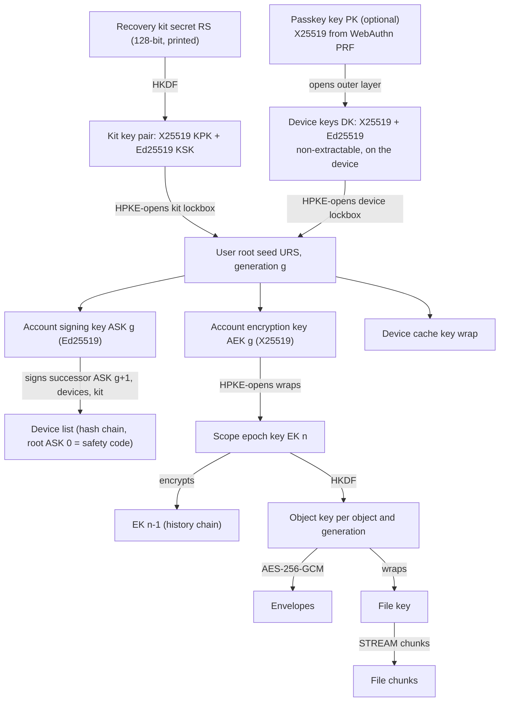

# F-030 (proposed) — end-to-end encrypted workspaces

**Status: proposed, 2026-10-23.** Not accepted; no implementation. Owner
@PelikanFix16 (`claude-hubert`); independent evaluator @Zamojski5 or another eligible
independent peer. Issue [#615](https://github.com/ColdPhase/flux/issues/615)
(founder request, Hubert, 2026-10-18). Evidence:
[research, 2026-10-23](research/2026-10-23-e2ee.md). Decision row: F-030 in the
[decision register](decisions.md).

- **Founder direction, 2026-10-23** (Hubert, [#615 comment](https://github.com/ColdPhase/flux/issues/615#issuecomment-6368095188))
  answered the twelve product questions; they are recorded in
  [Founder answers](#founder-answers-2026-10-23) and govern this page.
- **Independent security review** of the first revision `356b60f5`
  ([PR #652 comment](https://github.com/ColdPhase/flux/pull/652#issuecomment-6356018693),
  changes requested: P1 1–3, P2 4–12, P3) is addressed in this revision; each finding
  is mapped in [Review findings addressed](#review-findings-addressed).

This page covers #615 AC1–AC4 at design level and the AC5 delivery plan. The AC5
proof of concept is slice [E0](#e0--feasibility-proof-of-concept-615-ac5), not done.
Agent reviews are not an external cryptographic audit; by founder direction they and
the tests are the accepted bar.

## In one paragraph

An installation can offer **encrypted workspaces**. In one, every conversation, DM,
task text, decision, result, map, Wiki page, draft and file is encrypted on the device
that writes it and decrypted only on devices the person has approved. People still
sign in through the installation's OIDC provider (F-024), but that sign-in never
yields a key: the first device creates the person's keys and a printable recovery
kit; further devices are approved by a QR code or a short code on a trusted device,
or by the kit. Keys are shared with a new member only to a key that someone allowed
to add them has bound to that person. The server stores and relays ciphertext,
checks signatures, sizes, order and permissions. AI stays, but only inside the open
app on the person's own device and with the person's own AI connection; the return
summary is prepared when Flux is opened. Server search, server AI, background AI and
content in notifications do not exist there.

## Threat model (AC1)

**Protected assets.** The content of every object in an encrypted workspace,
including history, drafts, CRDT updates, snapshots, saved versions, attachments,
thumbnails, file names, project and DM names, task titles, descriptions, comments and
labels, map content, presence text, the person's AI provider key and browser exports.

| Attacker | Capability | Outcome in an encrypted workspace |
| --- | --- | --- |
| Thief of the database, files volume, a backup or a VM snapshot | Reads every stored byte, offline | **No content.** Sees the [visible metadata](#data-inventory). Lockboxes are encrypted to device keys, passkey-derived keys or the kit's 128-bit-seeded key pair; none is guessable offline. |
| Thief of one device's disk image, signed out | Reads browser storage | **No content.** Device private keys are readable from disk (Web Crypto's `extractable: false` does not encrypt storage), but the device's lockbox is on the server and the local cache is wrapped under keys that need it. |
| **Disk image plus server data** (database or backup) | Combines both, no session needed | **Everything that person could read** at the generations wrapped to that device, unless the device uses passkey unlock (then the passkey is also needed). Stated in the product. |
| Read-only or passive server compromise | Watches requests, logs and queues | No content; metadata, sizes and timing. |
| IdP administrator, impersonation, password reset, IdP compromise, F-024 host recovery | Obtains a valid Flux session for a person | **No key.** A new device waits for approval by a trusted device or the kit. A key reset is delayed, announced to every trusted device and vetoable, and a reset identity receives shared keys only after an out-of-band verification by a colleague ([Reset](#reset-and-restore-of-shared-access)). |
| Malicious server substituting keys | Registers its own key for a person | Key-holders share only to a key fingerprint bound in an entry signed by someone allowed to add that person: by invite link, by safety code, or by a visible "not verified" acceptance ([Adding people](#adding-people-key-binding)). Only the last can be exploited, and everyone sees the badge. |
| Malicious server forking, rolling back or withholding | Shows different valid logs to different clients, serves old logs, holds back entries | Envelopes and pairing payloads carry signed log heads, so a fork or rollback is detected as soon as any envelope or device crosses it ([Heads](#log-heads-and-detection)). **Withholding cannot be prevented**: a removal takes effect for a writer only once its device receives it. |
| Active operator or attacker who changes the served web code | Ships JavaScript that exfiltrates keys or plaintext | **Not protected** ([research §6](research/2026-10-23-e2ee.md#6-delivery-of-the-client-code)). |
| XSS in Flux | Runs script in the origin | **Full compromise while it runs**: it can hook Web Crypto before unlock, read the user root seed when it is unwrapped and read every key and plaintext in memory. Non-extractable storage only stops a later copy of device keys through the API. CSP, Trusted Types and the [sandboxed file viewer](#product-integration-ac4) are the defense. |
| Stolen device, signed in and unlocked | A running app | Reads what that person can read until suspended. Cannot remove the owner's other devices, replace the kit or reset without a delay that other devices and the kit can cancel ([Sensitive actions](#sensitive-actions-on-a-trusted-device)). Can pair one more device, which every other device is told about. |
| Revoked device plus later database or backup theft | Holds old root seeds | Reads every epoch that was wrapped to those generations, including old content, until it is re-encrypted. |
| Removed member | Holds old keys and anything downloaded | Keeps what they had (the UI says so). Content written after their removal reached the writer's device is unreadable to them. |
| Deleted content | Backups and members' keys | Deletion removes ciphertext from the live server only; backups still hold it and members still hold the keys. There is no crypto-erasure. |
| Offline attack on the recovery kit | Has every stored kit lockbox | The kit key pair is derived from a 128-bit random secret: infeasible. A copied kit equals a device; replace it. |

### Guarantees, stated precisely

- **G1.** Without a trusted device, a passkey-protected layer or the kit, no session,
  administrator or server operation releases a person's keys.
- **G2.** A scope key is wrapped only to a key fingerprint named in an entry signed by
  a person with authority over that scope at a pinned roster head. With invite link or
  safety-code binding, a malicious server cannot obtain a member's keys; with a
  visible "not verified" acceptance it can, if it substituted the key at that moment.
- **G3.** Every envelope is authenticated to a device of the author's account; a
  server cannot forge, alter or misattribute content.
- **G4.** A fork, a rollback below a head a device has seen, or a gap in a device's
  sequence is shown to the user when it is observed; it is not silently applied.
- **G5.** Content written under an epoch created after a member's removal is
  unreadable to that member, provided the writer's device received the removal.
- **G6.** The recovery kit keeps working across device removals and generations until
  the person replaces it.

### Honest limits

1. The served web code is trusted; an active operator can read content.
2. Disk image plus server data opens a device without passkey unlock.
3. XSS while the app runs is a full compromise.
4. Withholding is undetectable until another envelope or device reveals it.
5. Removed members and revoked devices keep what they had; old epochs are not
   re-encrypted by default; deletion is not erasure and backups keep ciphertext.
6. Post-compromise security comes only from rotation: on removal and on the first write
   after a scope's epoch is 30 days old. A copied epoch key reads that epoch.
7. A freshly recovered device (kit only, no trusted device) trusts the server's log
   heads until it sees other members' envelopes.
8. Metadata, sizes and timing stay visible ([inventory](#data-inventory)).
9. The on-device AI and the [AI lock](workspace-ai-lock.md) are enforced by the
   served client for provider calls; a member can always paste text they can read
   elsewhere.

## Options considered (AC2)

| Option | Summary | Verdict |
| --- | --- | --- |
| A. MLS (RFC 9420) per scope | Standards-track group key agreement with FS and PCS | **Rejected for now.** No browser implementation has an independent audit; newcomers get no history; ratchet state forks when browser storage is cleared. Reconsider with an audited browser implementation. |
| B. Megolm/Olm or Sender Keys | Per-sender ratchets | **Rejected.** History sharing and "unable to decrypt" states; server-controlled membership was exploitable in Matrix (S&P 2023). |
| **C. Signed key lists with scope epoch keys** | Per-scope epoch keys wrapped to bound member keys with HPKE; signed, hash-chained device lists, rosters and key logs; heads in every envelope | **Recommended.** Only standard primitives in Web Crypto; history for newcomers; simple offline behavior. Cost: no PCS within an epoch; Flux's composition is reviewed by independent agents and adversarial tests, not an external audit. |
| D. Server-side encryption at rest | The server holds keys | **Not E2EE.** Operators may add it independently. |
| E. Owner-held recovery key (Bitwarden style) | Owners can decrypt members' keys | **Not now** (founder answer 3). |

## Mode, scope and policy

- **Encryption is a property of a workspace**, fixed at creation and irreversible
  (founder answer 7). `FLUX_E2EE` is `off` (default), `available` (owners choose per
  new workspace) or `required` (every new workspace is encrypted).
- The flag lives in its own row (`workspace_encryption`), written once; a trigger
  refuses changes. The workspace roster genesis entry, signed by the creator, says
  `encrypted`; devices pin it and never send plaintext to that workspace even if the
  server later claims otherwise.
- There is **no conversion** of existing workspaces (founder answer 10): no Flux
  deployment exists yet, so encryption applies to new workspaces only. Content never
  moves from plaintext storage into an encrypted workspace through the server, so no
  conversion residue (old rows, WAL, dead tuples, replicas, file unlinks) can arise.
- Leaving encryption is only a browser export into a new, ordinary workspace by an
  owner, announced to members. There is no server-side decryption fallback.
- A person's personal objects (personal capture, private drafts, private maps) in an
  encrypted workspace use their personal scope.

## Key hierarchy and primitives (AC2)

**Primitives.** Web Crypto on clients: AES-256-GCM, HKDF-SHA-256, SHA-256, Ed25519,
X25519; HPKE (RFC 9180, DHKEM(X25519, HKDF-SHA256), HKDF-SHA256, AES-256-GCM) through
`@hpke/core`'s native Web Crypto `DhkemX25519HkdfSha256` (not `@hpke/dhkem-x25519`,
which is pure JavaScript over raw key bytes). Its own key generation and import create
extractable keys, so E0 must show that it opens with a recipient `CryptoKey` Flux
generated with `extractable: false`, or select another RFC 9180 implementation that
does. No custom primitive, password-derived key or server-held decryption key.
Supported browsers: Chrome/Edge ≥137, Firefox ≥130, Safari/iOS ≥17; older ones see
"This browser can't open encrypted workspaces".

**Encoding.** Every hashed, signed, derived or AAD tuple uses one canonical
length-prefixed encoding (each field: 4-byte big-endian length, then bytes) with a
fixed label first, for example `lp("flux/e2ee/v1/ek-id") ‖ lp(scope) ‖ u32(n)`.

**Per person.**
- **User root seed URS** (256-bit, generation *g*). ASK*g* and AEK*g* are derived with
  HKDF and fixed labels and imported as non-extractable keys. URS bytes exist in
  JavaScript memory whenever a lockbox is opened, a device is paired or a generation
  is created; references are dropped after import, without a zeroization guarantee.
- **Identity continuity.** The device list starts with a genesis signed by ASK₀; its
  fingerprint is the person's **safety code** and never changes while the identity
  continues. A new generation is a `successor` entry naming ASK*g+1* and AEK*g+1*,
  signed by ASK*g* and by ASK*g+1*, bound to the current device-list head. Two valid
  successors for the same head are a fork: the account is frozen for sharing until
  the person resolves it with the kit, which signs the chosen branch. A reset starts
  a new root and a new safety code, shown as a reset, never as continuity.
- **Generations.** Removing a device or replacing a kit creates *g+1*. The acting
  device writes a lockbox of URS*g+1* to every remaining device's DK (and passkey key)
  and to the kit public key, encrypts URS*g* under URS*g+1* (history), and the scopes
  the person holds rotate before their next write.
- **Recovery kit as a key pair** (review P2-4, founder answer 2). RS (128 random bits)
  derives the kit's X25519 KPK and Ed25519 KSK with HKDF; the public halves are a
  `kit` entry in the device list. Every generation's URS is wrapped to KPK, so the kit
  never goes stale.

**Per device.** DK = an X25519 key pair and an Ed25519 key pair, generated with
`extractable: false`, stored as `CryptoKey` objects in IndexedDB, partitioned per
account. A passkey device also registers PK: an X25519 key whose private half is
derived from the WebAuthn PRF output at each unlock and never stored.

**Unlock layering** (review P2-5):

| Piece | Where it lives | What protects it |
| --- | --- | --- |
| DK private keys | Device IndexedDB | Origin isolation and the OS account only; readable from a disk image |
| Device lockbox *L(d, g)* = HPKE(DK, URS*g*); for passkey devices HPKE(PK, HPKE(DK, URS*g*)) | Server | Released only to a live session of that device after a challenge signed by its DK; deleted on suspension or removal |
| Kit lockbox = HPKE(KPK, URS*g*) for each *g* | Server | The kit secret |
| URS, ASK, AEK, scope and object keys | JavaScript memory while unlocked | Nothing beyond the page |
| Device cache key (search index, decrypted cache, unsent drafts) | Device, wrapped under HKDF(URS*g*, `cache`, device id); rewrapped after a generation change | Needs an unlocked hierarchy |
| Drafts written while locked or offline | Device, sealed with HPKE to AEK*g* | Readable only after unlock |

Any device creating a generation knows every device's DK and PK public keys and KPK,
so it writes every lockbox; no local layer of another device is needed.

**Per scope.** Scopes follow existing audiences ([access policy](../development/access-policy.md)):
`workspace`, `project:<id>`, `dm:<id>`, `personal:<user>`. Each has epoch keys EK*n*
(256-bit random) wrapped with HPKE to each recipient's AEK; EK*n* encrypts EK*n−1*,
so a newcomer with the current key reads the whole history (the add dialog says so).
Each wrap entry carries a key id = HKDF(EK*n*, label `ek-id`, scope, *n*), signed; the
recipient derives it from the unwrapped key and rejects a mismatch, so a malicious
member cannot hand different keys to different people. AES-GCM is not key-committing:
every envelope names its scope and epoch, and no client tries one ciphertext under
several keys.

**Per object.** Object key = HKDF(EK*n*, salt = object id, label = `<kind>`, generation).
A long-lived object moves to a new generation at each client snapshot, keeping each
key far below 2³² AES-GCM encryptions with random 96-bit nonces (NIST SP 800-38D).

**Envelope** (one versioned wire type in `@flux/contracts`):

| Field | Bytes | Meaning |
| --- | --- | --- |
| `v`, `suite`, `kind` | 3 | Format 1, suite 1, object kind |
| `scope`, `object` | 32 | UUIDs |
| `epoch`, `generation` | 8 | Scope epoch, object key generation |
| `seq` | 8 | Per device and object counter |
| `device` | 16 | Author device id |
| `scopeHead`, `rosterHead`, `deviceHead` | 96 | SHA-256 heads of the scope log, the workspace roster and the author's device list that the author had |
| `nonce`, tag | 28 | AES-256-GCM; the canonical header is the AAD |
| `sig` | 64 | Ed25519 by the device key over header and ciphertext |

Fixed overhead is 255 bytes, within a 288-byte budget. `seq` is allocated under a
Web Lock per device and object (Web Locks: Chrome 69, Firefox 96, Safari 15.4; BCD),
with the counter in IndexedDB; without Web Locks each tab enrolls as its own
sub-device id.

The server verifies `sig` against the device list, the device's account against the
access policy, `epoch` against the scope's minimum epoch and `seq` monotonicity, then
stores the envelope opaquely.

**Files.** A random file key per file, wrapped by the object key; 1 MiB chunks with
the STREAM construction (nonce prefix, chunk counter, last-chunk flag in the AAD);
name, type and thumbnail in an encrypted metadata envelope; stored size padded to
buckets. Thumbnails are made on the device.

**Padding.** Message, task, decision, result and saved-version envelopes are padded
to 256-byte buckets up to 4 KiB, then to the next power of two. Live updates and
presence frames are not padded; their sizes and timing stay visible.

## Log heads and detection

Three kinds of signed, hash-chained logs: each person's **device list**, each
workspace's **roster** (members, roles, invitations, bindings, the encrypted flag),
and each scope's **key log** (`create`, `share`, `rotate`, `remove`, project
`visibility` and `grant`). The server accepts an entry only on the current head and
only from an account allowed under the access policy; clients verify every chain and
signature themselves.

- **Heads everywhere** (review P1-3). Every envelope carries the author's three heads;
  every pairing payload carries the approving device's heads for all logs it knows.
  A client receiving a head it does not know fetches the chain to it; if the server
  cannot produce a chain that extends the client's pinned head, the client shows
  "This workspace's history doesn't match what other devices see" and stops sharing
  keys in that scope. Peers' envelopes therefore act as gossip.
- **Rollback.** A head older than one the device pinned is shown, never adopted.
- **Contiguity.** Clients track `seq` per device and object; a gap that persists for
  60 seconds shows "Some changes from <device> are missing".
- **Fresh devices** pin the heads in their pairing payload. A device recovered with
  only the kit pins the server's heads and shows "Checking with your colleagues'
  devices" until envelopes from other members confirm them (limit 7).
- **Cross-log authority** (review P2-8). A key-log or grant entry names the roster head
  that gave its signer authority; references are monotonic within each log; a client
  that knows a later roster head in which the signer lost that authority rejects
  entries appended after an entry that references that later head.
- **Recipient sets.** A `rotate` entry's recipients must equal the audience computed
  from the signed roster and grant entries at its referenced heads, minus the removed
  accounts; any difference is shown and blocks writing in that scope.
- **Withholding.** A writer's device writes only under the newest epoch it knows, and
  refuses to write under an epoch it knows was shared with a removed account. A server
  that hides the removal from a writer keeps that writer on the old epoch; G5 is
  conditional on that delivery, as stated.
- **Revoked device keys.** A client accepts an envelope only if the device is valid at
  the referenced device-list head and that head is not older than the head at which
  the client saw the device removed; envelopes that arrive after a removal and claim
  an earlier head are shown as "arrived after this device was removed", not applied.

## Identity, first device and recovery kit (AC3)

1. **Sign in** through OIDC as today (F-024). Account identity stays issuer + subject;
   the encryption identity is attached to the Flux account, never derived from claims.
2. **First device**: "Set up encryption on this device". It creates DK, URS₀ and the
   kit, publishes the device-list genesis, the device and kit lockboxes and the public
   keys.
3. **Recovery kit** before any content: a printable page made in the browser with RS as
   26 base32 characters in groups and as a QR code, the installation origin, account
   label, date and kit id. The person confirms it by typing two groups or scanning it.
   Copy: "This kit is the only way back in if you lose every device. Flux and your
   administrator cannot recover it. It keeps working when you remove a device."
4. **Replace the kit** is a [sensitive action](#sensitive-actions-on-a-trusted-device):
   new RS and KPK, a new generation, old kit lockboxes deleted. Backups may still hold
   old kit lockboxes: an old kit plus an old backup opens the generations of that time.
5. **Recovery** on a new device: sign in, "Use recovery kit", enter or scan RS; the
   device opens the newest kit lockbox, enrolls itself with a device-list entry signed
   by ASK and KSK, then offers to suspend devices the person no longer has. The kit
   may approve sensitive actions immediately.
6. **Everything lost** (founder answer 2): private content is gone for good; shared
   content returns through [Reset and restore](#reset-and-restore-of-shared-access).

## Trusted devices (AC3)

### Pairing

New device B and trusted device A of the same person, both signed in. All keys below
are derived with HKDF from a 128-bit pairing secret PS with distinct labels
(`pair/mac`, `pair/sas`); every MAC and AEAD covers the transcript: protocol version,
both device ids and the SHA-256 fingerprints of both devices' public keys.

- **B shows the QR, A scans it.** The QR holds B's device id, the fingerprint of B's
  public keys and PS. A fetches B's pending keys from the server and checks the
  fingerprint. A sends HPKE(B's DK, URS*g*, A's heads, A's signed device-list entry for
  B), with an HMAC under the `pair/mac` key. B checks the MAC; a server without PS
  cannot produce it.
- **A shows the QR, B scans it.** The QR holds A's device id, the fingerprint of A's
  public keys and PS. B uploads its public keys with an HMAC under the `pair/mac` key
  over the transcript; A accepts only keys whose MAC verifies, then proceeds as above,
  and B checks A's entry against the fingerprint it scanned.
- **No camera on either side: short code with commitment.** B sends a commitment
  SHA-256(lp(label) ‖ lp(nonce_B) ‖ lp(B's keys)); A then sends its 256-bit random
  nonce_A; B reveals nonce_B; both show four words from the 2,048-word BIP-39 English
  list (44 bits) derived from both nonces and both keys. Because B committed first, a
  man in the middle gets one guess per attempt (2⁻⁴⁴). One attempt: a mismatch or a
  cancel discards the pending device, and a retry starts with new keys and nonces.
- Pending devices expire after 10 minutes. A new device is announced on every other
  trusted device with "Not me? Suspend it". A device with passkey unlock asks for the
  passkey before approving.

### Unlock, lock and leaving

| Mode | Behavior |
| --- | --- |
| Signed in (default, founder answer 8) | Opening Flux with a valid session fetches the device lockbox after a DK-signed challenge and unlocks without a prompt. |
| Passkey unlock (optional per device, where PRF works) | The outer lockbox layer needs the passkey's PRF output; opening Flux asks for the passkey. Detected at run time; never the only way in (the kit remains). |
| Offline cold start | Encrypted content is unavailable until the device reaches the server. Drafts written meanwhile are sealed to AEK. |

Sign out clears memory; the device stays trusted. "Sign out and forget this device"
removes it. Cleared storage or a reinstall loses the device keys; the old entry shows
"No longer on this device — remove it?". iOS: a Safari tab and the Home Screen app are
separate devices; a Safari tab may lose its keys after seven days without use, so Flux
asks for persistent storage and recommends the Home Screen app on phones.

### Sensitive actions on a trusted device

| Action | Immediate effect | Takes cryptographic effect |
| --- | --- | --- |
| Suspend a device (lost phone) | The server stops releasing its lockbox and ciphertext and ends its sessions; all devices are notified | — (no keys change) |
| Remove a device | Suspension | After **48 hours**, or at once when confirmed on a second trusted device or with the kit; any other trusted device or the kit can cancel |
| Replace the kit | — | After 48 hours, or at once with a second device; cancelable likewise |
| Turn passkey unlock off on a device | — | After 48 hours, or at once with the passkey |
| Pair a new device | Immediate (needs the physical QR or code), announced everywhere | — |
| Reinstate a suspended device | — | With the kit, or a second trusted device |

Each action asks for confirmation, and for the passkey on devices that use one.
The server enforces the delay (the threat is a thief with a device, not the server);
pending actions show on every device with Cancel. The kit can cancel or revert any
of them: reinstate suspended devices and remove devices added since a chosen point.

### Verification of other people

The safety code is the fingerprint of the person's root ASK₀, shown as 12 groups of
five digits and as a QR. People → a person → "Verify" compares it in person, by QR or
over a call. Devices pin colleagues' roots. A reset (new root) is shown everywhere as
"<Name> reset encryption" and is never treated as verified.

## Adding people: key binding

When someone with authority adds a person to an encrypted workspace, project, grant
or group DM, the roster or key-log entry they sign names the person's account id
**and the fingerprint of the root key that will receive the keys**, bound one of
three ways. Key-holder devices share automatically only to that fingerprint.

1. **Invite link** (default in the add dialog). The adder's device creates a one-time
   Ed25519 invite key, puts its public half in the signed entry, and shows a link whose
   fragment holds the private half. The adder sends it through their own channel; Flux
   never emails it, because the server must not see it. The invitee, signed in as the
   named account, signs (account id, their root fingerprint, roster head) with the
   invite key; key-holders verify against the signed entry. The link expires after
   seven days and works once.
2. **Safety code.** The adder compares the person's safety code in person, by QR or
   over a call, and signs the verified fingerprint.
3. **Share without verifying.** The adder confirms "The server supplied this key; if it
   was replaced, the server could read <place>." The entry is marked `unverified`, and
   the person carries a "Not verified" mark in that workspace for everyone until
   someone verifies them.

Guarantee G2 follows. A person with no encryption identity yet first sets up a device;
the add stays pending ("Waiting for <Name> to set up encryption") and nothing is
shared before the binding.

## Reset and restore of shared access

"Start over with new encryption keys" is available when a person has lost every device
and the kit, or chooses to.

- If the person's current identity has any trusted device or kit, the request waits
  **seven days**. Every trusted device shows it at once with "This wasn't me", which
  cancels it with an ASK signature; the kit cancels it too. The person's email address
  gets a notice as well (an IdP that controls the email can suppress it; the devices
  are the real defense).
- After the wait, the new root is published as a reset. Personal-scope content is gone.
- **Restore access** to shared places requires binding 1 or 2 above; option 3 is not
  offered for a reset identity. The person restoring access sees "Check <Name>'s new
  safety code with them directly, not through Flux".
- Therefore an IdP impersonator alone never obtains keys: they would also have to
  outlast the veto window unseen and deceive a colleague over an out-of-band channel.
- E1 and E2 acceptance include this attack ([test plan](#test-plan)).

## Removal and rotation

- **Triggers:** membership removal, a role change that loses access, a grant revoked
  or denied, a project restricted, a DM left, a device removed (through its person's
  generation change), and the first write after a scope's epoch is **30 days** old.
- The server stops serving that scope's ciphertext to removed accounts at once and
  records the scope's minimum epoch; the acting device rotates when it holds the keys,
  otherwise the next writer's device rotates before writing. Clients refuse to write
  under an epoch shared with a removed account they know about.
- Old content stays under old epochs (founder answer 9); the removal dialog says
  "<Name> keeps anything they already saw." An optional later job re-encrypts current
  objects under the new epoch; saved versions stay as they were.

## AI and agents in encrypted workspaces

AI stays, inside the open app on the person's own device, with the person's own AI
connection (F-019/F-020). Nothing runs while nobody has the app open; there is no
headless agent device, no server-side AI and no key ever reaches an agent.

- **The assistant in Flux** runs in the app. Its provider key is stored in the
  person's personal scope (the server never sees it) and the app calls the provider
  directly from the browser, for providers that accept browser requests (Anthropic
  documents a browser-access header; each provider is checked in E6; a self-hosted
  OpenAI-compatible endpoint needs CORS from its operator). The `runtime` transport
  (official CLI in a server slot) is unavailable; subscription users use their agent
  app over the local bridge.
- The assistant uses the same EXT-1 tool schemas and F-027 approval rules, executed by
  the app's own tool layer over decrypted data; its writes are encrypted and signed by
  the person's device and attributed to the `owner_assistant` connection (visible
  metadata). Key-log, roster, device and share operations are never tools.
- **Prepared on open.** When the person opens Flux, Home shows at once the
  deterministic return view (changes since their return point, Needs you from visible
  metadata, decrypted titles) and, where the assistant is on, the greeting line reads
  "Preparing your summary…" with Stop while the app decrypts the changes and the
  assistant writes the summary (the morning summary when it is the first open of the
  day). The line becomes the summary with its sources; on failure it says why and the
  deterministic view stays. Closing the app stops the run. Schedules and reactions do
  not run while the app is closed; missed runs are skipped (F-027).
- **The local MCP bridge (mode (b)).** A small stdio MCP server that the person's agent
  app starts on their computer. It creates an ephemeral X25519 key and pairs with an
  open, unlocked Flux tab of the same person by the commit-then-reveal short code
  above. Each tool call goes bridge → server (the agent connection's OAuth token, grants
  ∩ owner rights ∩ place, S6 switches, F-029) → that tab, sealed with HPKE to the tab's
  session key; the tab executes it over decrypted data and returns the result sealed to
  the bridge. The bridge holds no scope key and signs nothing; with no open tab it
  answers `E2EE_APP_NOT_OPEN`. The remote `/mcp` content tools answer
  `E2EE_LOCAL_BRIDGE_REQUIRED`. Plaintext of tool results exists in the bridge and the
  agent app, by design.
- **AI lock (F-029).** Before each assistant run or bridge session the app obtains a
  short-lived admission from the server, which checks the workspace AI policy, its
  epoch, the owner and the caps; the server refuses relay to bridges while the lock is
  on. Provider calls themselves leave the browser directly, so a modified client could
  skip the admission (limit 9).

## Data inventory

| Data | In an encrypted workspace |
| --- | --- |
| Message and DM bodies, attachments, edits | Encrypted |
| Conversation titles, project names and descriptions, DM group titles | Encrypted |
| Task title, description, comments, labels, checklists, notices by people or agents | Encrypted |
| Task assignee, status, due date and GitHub PR link (founder answer 6) | **Visible** |
| Dependencies and object links | Ids visible |
| Decisions and results text; decision state, actor and time (O-009) | Text encrypted; state visible |
| Wiki saved versions, live updates, snapshots, cursors | Encrypted; contributor ids visible |
| Maps (thoughts, positions, links, drag previews) | Encrypted (one CRDT document per map) |
| Drafts, personal capture, private maps, the AI provider key | Encrypted (personal scope) |
| Files: content, name, type, thumbnail | Encrypted; padded size and chunk count visible |
| Search index | Only on devices, under the cache key |
| Notifications (inbox, push, email) | No content; reason, actor, place id, time visible |
| Assistant prompts, summaries, bridge tool results | Only in the app and the bridge on the person's computer |
| GitHub-written notices (PR number, check name) | Visible, marked as written by the server |
| Workspace name, people (IdP name, email, avatar), roles, grants, memberships | **Visible** |
| Object existence, kind, padded size, live update sizes, timestamps, typing timing, authors, versions, read observations, presence, live participants | **Visible** |
| Device lists, public keys, logs, wraps, IP addresses, request timing | **Visible** |
| Server logs, queues, caches | No content by construction; tests scan them |

## Product integration (AC4)

| Area | Change in encrypted workspaces |
| --- | --- |
| Conversations and DMs | Body encrypted; the request carries `notify: [userIds]` with the reason computed on the device; the server checks each recipient's access. |
| Tasks, decisions, results | Encrypted fields per the inventory; Needs you, O-009 acceptance, Undo and GitHub status rules work on visible fields. Undo re-sends the previous envelope as a new one. |
| Wiki live editing (F-021) | The server relays and logs: it checks signature, writer access, epoch, `seq` and the 65,536-byte frame cap, then stores and fans out under the existing delivery fence. Yjs validation and the 100,000-unit limit move to every client, which refuses and flags invalid updates by author device. A writer's device writes an encrypted snapshot every 64 updates (B1 moved to clients); initialization and Save version happen on the device. Presence is encrypted ephemeral frames. #228's p95 ≤200 ms gate applies. |
| Maps (F-021) | One Yjs document per map; drag previews as encrypted ephemeral frames at most 20 per second; concurrent drags converge last-writer-wins per thought. Differs deliberately from native maps in ordinary workspaces. |
| Files | Chunked encryption; no server previews or scanning. Decrypted previews render only in a sandboxed iframe without `allow-same-origin` (or a separate preview origin), fed by `postMessage`; SVG and HTML never render in the app origin; no `blob:` navigation in the app origin; downloads use the `download` attribute. CSP and Trusted Types are part of acceptance (review P2-11). |
| Live media (#59/#63) | Media keys derived on clients from the project epoch key through LiveKit's custom key provider; off until E7 proves Chromium and WebKit. |
| Search (#114, founder answer 1) | Server search returns people only; everything else, including place names, is searched on the device over what it has synced ("Search on this device"), capped on phones. The server gets no words, hashes or blind index. Losing access purges the scope's index entries. |
| Notifications (#116, #41, founder answer 5) | Inbox rows hold no text; push and email say who and why ("Marek mentioned you"); tap-time recheck unchanged. |
| AI and MCP | [Above](#ai-and-agents-in-encrypted-workspaces). `requireWorkspaceAi` refuses every server AI path in encrypted workspaces (both F-022 mode (a) transports, F-027 schedules and reactions, O-007/O-008). |
| Import and export (EXT-2) | Built in the browser in format 1; the server export endpoint refuses encrypted workspaces. |
| Backups and restore | Unchanged commands. After a restore to an older point, devices detect heads older than pinned ones, show it, and re-publish signed entries and CRDT state the server lacks. |
| Logs, telemetry, errors | Client error reports carry no content; the scanner checks server logs. |
| Operator | Sees metadata and runs backups; cannot decrypt, recover or approve devices, **unless they change the served code** (limit 1). Documentation says so before `FLUX_E2EE` is enabled. |

**Code placement.** A new package `app/packages/e2ee` holds the envelope, logs,
device list, recovery, pairing and short-code logic over `globalThis.crypto`. `@flux/web`
and the bridge use it; `@flux/server` and `@flux/worker` may import only its `verify`
entry (parsing, chains, signatures). The architecture test enforces that no server or
worker file imports a decrypt function. Wire types go to `@flux/contracts`, tables to
`@flux/db`; the access-policy choke point stays the single authorization path.

## Mixed mode and failures (AC4)

- **Database invariant.** Plaintext content columns are empty for encrypted workspaces
  (CHECK or trigger); search triggers skip their rows; notification text is never
  written.
- **Between workspaces.** Copying from an encrypted to an ordinary workspace is a
  device-side copy with "The server will be able to read this in <workspace>".
- **Failure states** shown in place: "Waiting for <Name> to set up encryption";
  "Waiting for a member's device to share access"; "This device was suspended";
  "<Name> isn't verified"; "<Name> reset encryption — check their safety code";
  "This workspace's history doesn't match what other devices see"; "Some changes from
  <device> are missing"; "Couldn't verify this change; it's hidden"; "Server data is
  older than this device has seen"; "Open Flux on this computer to let your agent
  work"; "This browser can't open encrypted workspaces".

## Performance budgets

Targets, measured in E0 on Chromium and WebKit (desktop and phone emulation); desktop
Node figures are in [research §9](research/2026-10-23-e2ee.md#9-measurement-observed).

| Path | Budget |
| --- | --- |
| Added client time per live update (encrypt + sign, or verify + decrypt) | ≤2 ms p95 on phone emulation; #228's p95 ≤200 ms unchanged |
| Cold open of a 100,000-character Wiki page (snapshot + tail) | ≤1 s on phone emulation |
| Rotation of a 50-member project | ≤2 s on desktop |
| Envelope fixed overhead | ≤288 bytes; live updates batched per frame or typing pause |
| File encryption | ≥100 MB/s on desktop; memory bounded by one chunk |
| Local search index | ≤50 MB on phones by default; incremental |
| Return view on open | Deterministic part ≤1 s after unlock for 500 changed items on desktop |

## Delivery slices

A milestone of its own after v0.1.0 (founder answer 12). Each slice has its own issue,
owner and independent evaluator. No "Preview" label and no paid audit gate (founder
answer 11); every slice's acceptance includes an independent security-focused agent
review and the adversarial tests that apply.

### E0 — Feasibility proof of concept (#615 AC5)

A bounded Compose stack with Keycloak 26.x, two people and three devices (Chromium
desktop, WebKit phone emulation, second Chromium), using a prototype of `@flux/e2ee`
outside the product build, plus the malicious-server harness.

- First device, kit, both QR directions (payload injected in emulation), short code,
  recovery on a fresh profile after a generation change, suspension of an open tab,
  storage clearing.
- Encrypted messages, one live Yjs page, one file; invite-link binding; member removal
  with rotation; newcomer reads history.
- Every harness attack below is detected or refused; offline edits merge; backup →
  restore → re-sync.
- The canary scanner finds no plaintext in a database dump, the files volume, the
  backup archive, server logs or queue payloads; a negative control fails it.
- Benchmarks for the budgets; the HPKE non-extractable check.
- Evidence under `docs/agents/evidence/615-e2ee/`; independent security-focused review.

### E1 — Identity, devices and recovery

Identity chain, device list, lockboxes, passkey layer, both pairing directions and the
short code, kit as key pair, recovery, sensitive actions with delays, suspension,
reset with veto, safety codes, `workspace_encryption` and `FLUX_E2EE`.
**Accepted when** a person sets up, pairs a phone, suspends and removes a lost device,
recovers with the kit after that removal, and resets, in Chromium and WebKit; an IdP
impersonation session obtains no key, and its reset is vetoed by a trusted device; a
stolen unlocked device cannot remove the owner's other devices before the delay, and
the kit reverts its actions; SAS and QR man-in-the-middle attempts fail.

### E2 — Scopes, conversations and DMs

Rosters, key logs with heads, invite/safety-code/unverified binding, restore after
reset, rotation (removal and 30-day), envelopes with heads, encrypted conversations
and DMs, client-computed notification recipients, generic push and email, device
search for messages, database invariants.
**Accepted when** two people converse with no plaintext found by the scanner; a
server-substituted invitee key receives nothing under link or code binding; a forged
reset plus restore obtains nothing; split views, withheld removals and stale logs to a
fresh device are shown; a removed person cannot read later messages even with a
database copy, given delivery of the removal.

### E3 — Work objects and files

Tasks, decisions, results, saved Wiki versions, drafts, personal capture, files with the
sandboxed viewer, browser export and import, device search for all of them.
**Accepted when** each type round-trips with only the inventory's visible fields;
Needs you, O-009 acceptance, Undo and GitHub status work; export matches EXT-2 format 1;
a malicious SVG or HTML attachment cannot reach the app origin; CSP and Trusted Types
violations fail the check.

### E4 — Encrypted live editing

Wiki relay mode, maps as Yjs documents, client snapshots, encrypted presence,
client-side validation and quarantine.
**Accepted when** #231's live gates pass in an encrypted workspace with two people and
two API processes, including p95 ≤200 ms and revocation during a live session.

### E5 — Operations

Backup/restore re-sync, operator documentation, scanner in the check script, rollback
detection after restore, `required` policy.
**Accepted when** a restore to an earlier backup leaves every device consistent or
explicitly warned and the scan of a restored stack is clean.

### E6 — On-device AI and the local bridge

The assistant in the app with a provider key in the personal scope, browser provider
calls (each supported provider verified), the app tool layer with F-027 approval
rules, "Preparing your summary…" on open with Stop, the deterministic return view,
the local MCP bridge with short-code pairing and sealed relay, AI admissions and
F-029 enforcement, server AI refusals.
**Accepted when** the summary is prepared on open from decrypted changes with the
person's own connection and nothing AI runs with the app closed; an owner's Claude
Code or Codex works on a granted project through the bridge only while the app is
open, never sees a non-granted project, and stops when the AI lock turns on; every
F-029 enforcement point refuses server AI in encrypted workspaces; the server never
receives a provider key, prompt or summary (scanner).

### E7 — Live media

LiveKit media E2EE with client-derived keys in Chromium and WebKit.

## Test plan

| Level | What | Where |
| --- | --- | --- |
| Crypto core | RFC 9180 vectors; Wycheproof vectors for AES-GCM, Ed25519, X25519 in Chromium and WebKit; every-byte tamper of envelopes, log entries, lockboxes and pairing messages; canonical-encoding ambiguity tests; nonce uniqueness | `app/tests/app/e2ee-*.test.ts` and a browser lane |
| Logs | Property tests: forks, reorders, replays, unauthorized and demoted signers, stale epochs, key-id mismatch, recipient-set mismatch, rival successors | core tests |
| **Malicious-server harness** (review P2-12) | A Compose proxy between browsers and the API that substitutes an invitee's key, shows split views to two members, withholds a removal, serves a stale log to a fresh device, forges a reset and restore, attacks QR and short-code pairing, keeps a stale kit lockbox after a generation change, and replays or reorders envelopes; plus a stolen-unlocked-device scenario | E0, then a lane of `check_application.sh` |
| API and persistence | Refusal of foreign signatures, wrong devices, stale epochs, oversized frames, non-head entries, early sensitive actions; plaintext columns empty; migrations up and down | Compose PostgreSQL tests |
| Browser journeys | Setup, kit, pairing both ways, short code, recovery after removal, reset with veto, suspension of an open tab, storage clearing, logout, invite link, unverified mark, removal and rotation, offline merge, generic push, device search, summary on open, bridge with app open and closed | `app/tests/ui/` Chromium and WebKit lanes |
| Plaintext scanner | Canary strings across database dump, files volume, backup, logs, pg-boss payloads; provider keys and prompts included; negative control | E0 script, then the check script |
| Live editing | #231 gates in an encrypted workspace | live-editing checks |
| Performance | Budgets, recorded with browser, CPU and commit | E0 evidence, then `docs/development/performance/` |
| Unverified until devices exist | WebAuthn PRF on real authenticators, iOS Home Screen storage | recorded as unverified |

## Founder answers (2026-10-23)

Founder direction by Hubert (@PelikanFix16), [#615 comment](https://github.com/ColdPhase/flux/issues/615#issuecomment-6368095188).

| # | Question | Answer |
| --- | --- | --- |
| 1 | Search | Local only, on the device; no words, hashes or blind index on the server. |
| 2 | Losing every device and the kit | Private content is gone; colleagues restore shared content. The kit must stay valid when a device is removed (done: kit key pair). |
| 3 | Owner-held recovery key | Not now. |
| 4 | AI | Stays, only on the person's own device while they are in the app; assistant and return summary (what happened while away, morning summary, Needs you) prepared on open with the person's own connection; no headless agent device, no server AI, no schedules or reactions while the app is closed. |
| 5 | Notifications | Who and why, never the text. |
| 6 | Tasks | Assignee, status, due date and GitHub PR link visible; title, description, comments and labels encrypted. |
| 7 | Enabling | Per workspace at creation, irreversible; `FLUX_E2EE` off / available / required. |
| 8 | Trusted devices | No prompt while signed in, optional passkey prompt; removing devices or replacing the kit always needs confirmation and a delay. |
| 9 | Removing a member | Rotate for new content; no re-encryption; the UI says removed people keep what they saw. |
| 10 | Existing workspaces | No conversion path; new workspaces only. |
| 11 | Label and audit | No "Preview" label; independent agent reviews and tests are the bar; no paid audit gate; honest limits stated. |
| 12 | Delivery | After v0.1.0, as its own milestone. |

## Review findings addressed

Review of `356b60f5`, [PR #652 comment](https://github.com/ColdPhase/flux/pull/652#issuecomment-6356018693).

| Finding | Change |
| --- | --- |
| P1-1 invitee key substitution | [Adding people: key binding](#adding-people-key-binding); G2; E2 acceptance |
| P1-2 reset and restore bypass | [Reset and restore](#reset-and-restore-of-shared-access): seven-day veto, notices, forced binding; E1/E2 acceptance |
| P1-3 fork, rollback, withholding | [Log heads and detection](#log-heads-and-detection); heads in envelopes and pairing payloads; G4/G5 and limits 4, 7 |
| P2-4 stale kit | Kit key pair; G6 |
| P2-5 unlock claims | Unlock layering table; disk-image-plus-server row; XSS and memory; cache key from the hierarchy; drafts sealed to AEK |
| P2-6 stolen unlocked device | [Sensitive actions](#sensitive-actions-on-a-trusted-device) |
| P2-7 pairing gaps | [Pairing](#pairing): both directions bound, commit-then-reveal, 44 bits, one attempt, key separation, transcript |
| P2-8 identity continuity, cross-log authority | Successor entries, root safety code, cross-log heads, recipient sets |
| P2-9 honest limits | [Honest limits](#honest-limits) 1–9; 30-day rotation |
| P2-10 agent devices | No agent devices; the bridge holds no keys and signs nothing |
| P2-11 rendering files | Sandboxed viewer, CSP, Trusted Types in E3 |
| P2-12 adversarial tests | Malicious-server harness |
| P3 | HPKE labeling corrected; size/timing metadata and padding; length-prefixed encoding and key id; Web Locks `seq`; 255-byte header count; conversion residue not applicable (no conversion); history for new members stated in the add dialog |

## Reconsider when

- An independently audited MLS implementation runs in Chromium and WebKit.
- A signed web-manifest mechanism ships in mainstream browsers, or a desktop wrapper is
  accepted (limit 1).
- An organization requires owner-held recovery (founder answer 3).
- E0 misses the budgets, or Web Crypto/HPKE cannot keep device keys non-extractable.

## Unverified and open

- No prototype exists; budgets and browser support are targets or documented platform
  statements, not Flux observations.
- WebAuthn PRF on Safari `get` and iOS Home Screen storage need real devices.
- Browser access to each AI provider other than Anthropic is unchecked.
- LiveKit E2EE in WebKit is unverified.
