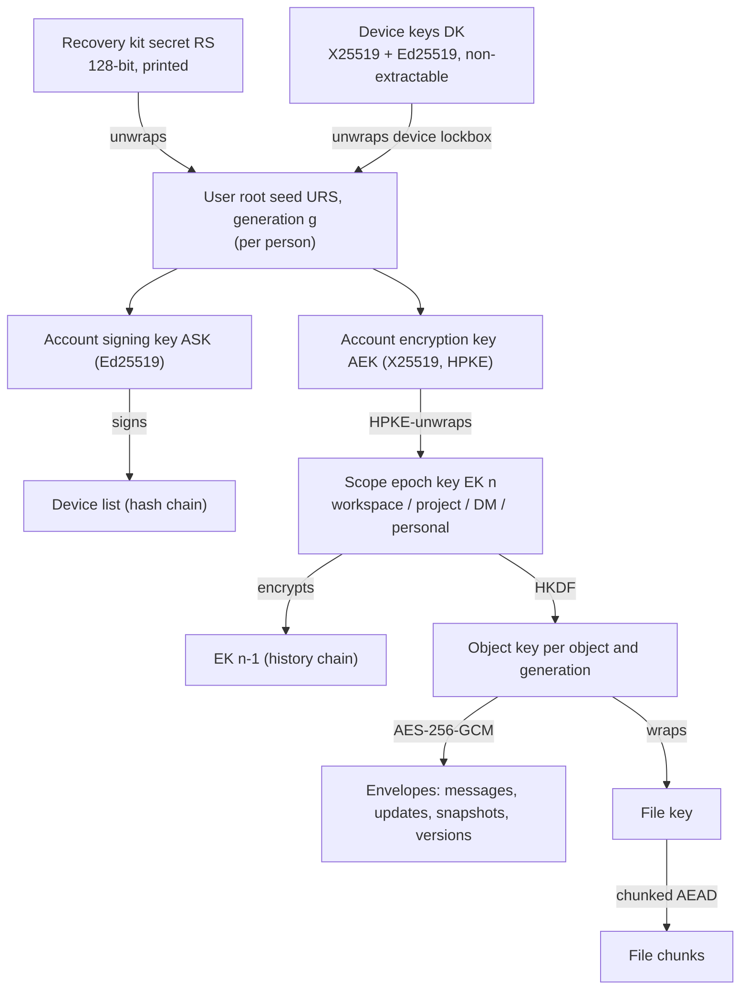

# F-030 (proposed) — end-to-end encrypted workspaces

**Status: proposed, 2026-10-23.** Not accepted; no implementation. Owner
@PelikanFix16 (`claude-hubert`); independent evaluator @Zamojski5 or another eligible
independent peer. Issue [#615](https://github.com/ColdPhase/flux/issues/615)
(founder request, Hubert, 2026-10-18). Evidence:
[research, 2026-10-23](research/2026-10-23-e2ee.md). Decision row: F-030 in the
[decision register](decisions.md). [Founder questions](#founder-questions-pending-founder-answer)
are pending; the recommended answers are assumed below and marked where they matter.

This page covers #615 AC1–AC4 at design level and the AC5 delivery plan. The AC5
proof of concept is slice [E0](#e0--feasibility-proof-of-concept-615-ac5), not done.
No agent review is an external cryptographic audit.

## In one paragraph

An installation can offer **encrypted workspaces**. In one, every conversation, DM,
task, decision, result, map, Wiki page, draft and file is encrypted on the device
that writes it and decrypted only on devices that a member has approved. People
still sign in through the installation's OIDC provider (F-024), but that sign-in
never yields a key: the first device creates the person's keys and a printable
recovery kit; further devices are approved by scanning a QR code on a trusted
device or by the kit. The server stores and relays ciphertext, checks signatures,
sizes, order and permissions, and cannot add a reader. Server search, server AI,
content in notifications and server export are not available there; the
replacements are on-device search, MCP agents through a local bridge on a trusted
computer, generic notifications and export in the browser.

## Threat model (AC1)

**Protected assets.** The content of every object in an encrypted workspace,
including history, drafts, CRDT updates, snapshots, saved versions, attachments,
thumbnails, file names, project and DM names, map content, typed presence text
and exports made in the browser.

| Attacker | Capability | Outcome in an encrypted workspace |
| --- | --- | --- |
| Thief of the database, files volume, a backup or a VM snapshot | Reads every stored byte, offline, without time limit | **No content.** Sees the [visible metadata](#data-inventory). Recovery lockboxes are protected by a 128-bit secret, so offline guessing is infeasible. Device unlock shares are useless without the device's local half. |
| Read-only or passive server compromise (operator, DBA, log reader) | Watches requests, logs and queues | No content; metadata and access patterns. |
| IdP administrator, impersonation, password reset, IdP compromise | Obtains a valid Flux session for a person | A **new, unapproved device**. It receives no key until a trusted device of that person approves it by QR/short code or the recovery kit is used. The person's trusted devices show the pending device. |
| Flux host recovery (F-024 issuer/subject re-key) | Moves an account to a new issuer/subject | Same as above: identity recovery never releases keys. |
| Malicious server substituting keys | Serves a false device list or a false public key for a colleague | Device lists and membership changes are signed by the person's account key and hash-chained; clients reject unsigned additions. A first-contact substitution (trust on first use) is detectable only by comparing safety codes; a later change shows "encryption identity changed". |
| Malicious server reordering, replaying, withholding or rolling back | Controls delivery | Tampering and forged authorship are rejected (AEAD + Ed25519 signature). Replays are idempotent or rejected by per-device counters. Rollback below a head this device has seen is detected and shown. **Withholding cannot be prevented**, only noticed when a gap is visible. |
| Active operator or attacker who changes the served web code | Ships JavaScript that exfiltrates keys or plaintext | **Not protected.** Any web E2EE trusts the code it runs ([research §6](research/2026-10-23-e2ee.md#6-delivery-of-the-client-code)). Stated in product copy. A later signed-manifest check or desktop wrapper can narrow it. |
| XSS in Flux | Runs script in the origin | Can use keys while the app is unlocked and read what is open; non-extractable device keys cannot be copied out as bytes. Content Security Policy and the absence of HTML injection remain the defense. |
| Lost or stolen device, signed out or locked | Disk image | The local half of the unlock key is on disk; the server half is released only to a fresh session on that device; revoking the device deletes the server half. With PRF unlock, a passkey is also needed. |
| Lost or stolen device, signed in and open | A running, unlocked app | Reads what that person can read until revoked; revocation stops new ciphertext at once and rotates keys, but **cannot recall what the device already decrypted or downloaded**. |
| Removed member | Holds old keys and anything already downloaded | Keeps what they had. Keys rotate on removal, so content written afterwards is unreadable to them; the server stops serving them ciphertext. Old content is not re-encrypted by default. |
| Offline attack on the recovery kit | Has the stored lockbox and tries secrets | 128-bit random secret: infeasible. A kit that is photographed or copied is equivalent to a device and must be replaced (kit rotation). |

**What the server can still verify without plaintext:** the author device's Ed25519
signature over every envelope, that the device belongs to a current writer under
the existing access policy, envelope size and kind, per-device counters, the current
key epoch of the scope, the linear order and signatures of key logs, file sizes and
chunk counts, and quotas. It cannot verify content rules (text length, Yjs
structure, mentions); clients enforce those and reject invalid content from others.

## Options considered (AC2)

| Option | Summary | Verdict |
| --- | --- | --- |
| A. MLS (RFC 9420) per scope | Standards-track group key agreement with FS and PCS; ts-mls, OpenMLS (WASM) or mls-rs | **Rejected for now.** No browser implementation has an independent audit; MLS gives newcomers no history, so a second history-key layer would still be needed; per-device ratchet state forks when browser storage is cleared or a device is offline; FS is moot for persistent, history-readable content. Reconsider when an audited browser MLS exists, as the transport for the key log or for DMs. |
| B. Megolm/Olm (vodozemac) or Sender Keys | Per-sender ratchets distributed over pairwise sessions | **Rejected.** Built for message streams; history sharing and "unable to decrypt" states are Matrix's long-standing pain; its server-controlled membership was exploitable (S&P 2023). |
| **C. Signed key lists with scope epoch keys** | Per-scope symmetric epoch keys wrapped to members' account keys with HPKE; client-signed, hash-chained membership logs; rotation on removal; per-device keys signed by the account key | **Recommended.** The model of Keybase, any-sync, Bitwarden and Proton; only standard primitives in the browser's Web Crypto; history for newcomers; simple offline behavior. Cost: no PCS within an epoch; Flux's own composition needs external review. |
| D. Server-side encryption at rest (database/volume encryption, KMS) | The server holds keys | **Not E2EE.** Protects a stolen disk only; every server compromise reads everything. Operators may add it independently. |
| E. Bitwarden-style organization escrow | A workspace recovery key held by owners decrypts members' keys | **Not default.** Violates "IdP/admin must not decrypt automatically". Kept as [founder question 3](#founder-questions-pending-founder-answer). |

## Mode, scope and policy

- **Encryption is a property of a workspace**, fixed at creation and irreversible
  (recommended answer to [question 7](#founder-questions-pending-founder-answer)).
  The installation setting `FLUX_E2EE` is `off` (default), `available` (owners
  choose per new workspace) or `required` (every new workspace is encrypted).
- The flag lives in its own row (`workspace_encryption`, like F-029's policy table),
  is written once at creation, and a database trigger refuses any change. The
  workspace's key log genesis entry, signed by the creator, also says `encrypted`;
  devices pin it and never send plaintext to that workspace even if the server later
  claims otherwise (downgrade protection).
- Leaving encryption is only a browser export into a new, ordinary workspace by an
  owner, announced to members. There is no server-side decryption fallback.
- Personal objects not in a workspace (personal capture, private drafts, private
  maps) of a person in an encrypted workspace use the personal scope below.

## Key hierarchy and primitives (AC2)

**Primitives.** Web Crypto only on clients: AES-256-GCM, HKDF-SHA-256, Ed25519,
X25519; HPKE (RFC 9180, DHKEM(X25519, HKDF-SHA256), HKDF-SHA256, AES-256-GCM) through
`@hpke/core` + `@hpke/dhkem-x25519` unless E0 finds that they cannot operate on
non-extractable `CryptoKey`s, in which case E0 selects another maintained RFC 9180
implementation. CSPRNG `crypto.getRandomValues`. No custom primitive, no
password-derived key, no server-held decryption key. Supported browsers: Chrome/Edge
≥137, Firefox ≥130, Safari/iOS ≥17 (Ed25519/X25519 support); older browsers see
"This browser can't open encrypted workspaces".

**Per person.**
- **User root seed URS** (256-bit, generation *g*). ASK and AEK are derived from it
  with HKDF and fixed labels (`flux/e2ee/v1/ask`, `…/aek`), imported as
  non-extractable keys, and the seed bytes are dropped from memory after import
  (best effort; JavaScript cannot guarantee zeroization).
- URS exists only (a) encrypted to each trusted device's DK (device lockbox, stored
  on the server), (b) encrypted under the recovery kit (recovery lockbox, on the
  server), (c) transiently in memory during enrollment and approval.
- **Generations.** Revoking a device or replacing a possibly exposed kit creates
  generation *g+1*: a new URS encrypted to remaining devices and the new kit, the
  old URS encrypted under the new one, a signed device-list entry, and lazy rotation
  of every scope the person holds (below).

**Per device.** DK = an X25519 key pair (HPKE recipient) and an Ed25519 key pair
(envelope signing), generated with `extractable: false` and stored as `CryptoKey`
objects in IndexedDB, partitioned per account. The account's device list entry
(signed by ASK) binds device id, kind (`human` or `agent`), label, both public keys
and the generation. The Ed25519 device key signs every envelope it writes.

**Per scope.** Scopes follow existing audiences ([access policy](../development/access-policy.md)):
`workspace` (owners, admins, members), `project:<id>` (everyone with current read
access), `dm:<id>` (current participants), `personal:<user>` (the person alone:
drafts, private maps, personal capture). Each scope has epoch keys EK*n* (256-bit
random). EK*n* is wrapped with HPKE to each recipient's AEK; EK*n* also encrypts
EK*n−1*, so a newcomer with the current key reads the whole history. Each wrap entry
carries a signed commitment `SHA-256("flux/e2ee/v1/ek" ‖ scope ‖ n ‖ EK)`, and every
recipient checks the unwrapped key against it, so a malicious member cannot hand
different keys to different people.

**Per object.** Object key = HKDF(EK*n*, salt = object id, info = `flux/e2ee/v1/<kind>/<generation>`).
A long-lived object (a Wiki Yjs log) moves to a new generation at each client
snapshot, keeping each object key far below 2³² AES-GCM encryptions with random
96-bit nonces (NIST SP 800-38D limit).

**Envelope.** One versioned wire type in `@flux/contracts`:

| Field | Meaning |
| --- | --- |
| `v`, `suite` | Format 1, suite 1 (the primitives above) |
| `scope`, `epoch`, `kind`, `object`, `generation`, `seq` | Binding of the ciphertext to its place; `seq` is the per-device counter for that object |
| `device` | Author device id |
| `nonce`, `ciphertext` | AES-256-GCM; the canonical encoding of all header fields is the AAD |
| `sig` | Ed25519 by the device key over header and ciphertext |

The server verifies `sig` against the device list, the device's account against
the access policy for a write, `epoch` against the scope's minimum epoch and `seq`
monotonicity, then stores the envelope opaquely.

**Files.** A random file key per file, wrapped by the object key; content in 1 MiB
chunks with the STREAM construction (nonce prefix, chunk counter, last-chunk flag in
the AAD) so truncation and reordering fail; name, type and thumbnail in an encrypted
metadata envelope; stored size padded to buckets. Thumbnails are made on the device.

## Identity, first device and recovery kit (AC3)

1. **Sign in** through OIDC as today (F-024). Account identity stays issuer + subject;
   encryption identity is attached to the Flux account, not derived from IdP claims.
2. **First device** in an encrypted workspace (or at account creation under
   `required`): "Set up encryption on this device". The device creates DK and URS,
   publishes its signed device list genesis, the device lockbox and the account
   public keys.
3. **Recovery kit** before any content is shown: a printable page made in the
   browser (never sent to the server) with the 128-bit recovery secret as 26 base32
   characters in groups and as a QR code, the installation origin, the account label,
   the date and the kit id. The person confirms it by typing the characters at two
   positions or scanning it. Copy: "This kit is the only way back in if you lose every
   device. Flux and your administrator cannot recover it." The recovery lockbox =
   AES-256-GCM(HKDF(RS, kit id), URS) is stored on the server.
4. **Replace the kit** (Settings → Encryption): a new RS and lockbox; the old lockbox
   is deleted; if the person says the old kit may have been seen, a new generation is
   created as well.
5. **Recovery** on a new device: sign in, choose "Use recovery kit", enter or scan
   RS; the device decrypts URS, enrolls itself, then offers to remove devices the
   person no longer has and requires a new kit.
6. **All devices and the kit lost** (recommended answer to [question 2](#founder-questions-pending-founder-answer)):
   "Start over with new encryption keys". The person gets a new account identity;
   colleagues see "Marek's encryption identity changed"; shared content comes back
   when a person allowed to share the scope approves "Restore access for Marek"
   (owners/admins for the workspace, managers for projects, any participant for a
   DM). Personal-scope content is lost. The UI states this before reset.

## Trusted devices (AC3)

**Pairing** (new device B, trusted device A, same person, both signed in):

- B creates its DK and shows a QR code with its device id, the SHA-256 fingerprint of
  its public keys and a 128-bit one-time pairing secret. A scans it, checks the
  fingerprint against the pending device the server lists, encrypts URS to B's DK
  with HPKE, authenticates the payload with an HMAC keyed by the pairing secret
  (which never reaches the server), and signs B into the device list.
- When A has no camera (a desktop approving a phone shows the QR instead and B scans
  it), the same exchange runs in the other direction.
- Fallback without any camera: both devices show a six-word code derived from both
  public keys and a fresh nonce; the person confirms that the codes match on A.
- Pending devices expire after 10 minutes; A shows the device label, browser and
  approximate sign-in time. Nothing is approved by the server or an administrator.

**Unlock.** The device lockbox is double-wrapped: inner layer under a local
non-extractable AES key in IndexedDB, outer layer under a 256-bit **unlock share** that
the server releases only to a live session on that device after a device-signature
challenge. A disk image alone or the database alone opens nothing.

| Mode | Behavior |
| --- | --- |
| Signed in (default, [question 8](#founder-questions-pending-founder-answer)) | Opening Flux with a valid session fetches the unlock share and unlocks without a prompt. |
| Passkey unlock (optional per device, where PRF works) | A third layer from the WebAuthn PRF output; opening Flux asks for the passkey. Detected at run time; never the only way in. |
| Offline cold start | Encrypted content is unavailable until the device reaches the server (or with passkey unlock and a cached outer layer, in a later slice). Drafts written offline stay encrypted on the device. |

**Lock and leave.** Sign out ends the session and clears in-memory keys; the device
stays trusted and unlocks after the next sign-in. "Sign out and forget this device"
also revokes it. Closing all tabs clears memory. Browser storage cleared or app
reinstalled: the device's keys are gone; the old entry shows "No longer on this
device — remove it?", and the person pairs again or uses the kit. iOS: the Safari tab
and the Home Screen web app are different devices and are paired separately; a Safari
tab may lose its keys after seven days without use ([research §5](research/2026-10-23-e2ee.md#5-browser-platform)),
so Flux asks for persistent storage and recommends the Home Screen app on phones.

**Remove a device** (from any trusted device, or by the kit): the server deletes its
unlock share and lockbox and ends its sessions at once; a signed device-list removal
and a new generation follow; scopes the person holds rotate before their next write.
A tab that is open on the removed device keeps what is in its memory until closed.

**Verification of other people.** Each person has a safety code (fingerprint of their
ASK). Devices pin colleagues' keys on first sight. People → a person → "Verify" compares
codes in person or by QR. A changed identity shows a notice in shared places and is not
used for new key shares until someone allowed to share approves it.

## Scopes, membership, rotation and sharing (AC2)

- **Key logs.** Each scope has an append-only log of signed entries (`create`,
  `share`, `rotate`, `remove`), each naming the previous entry's hash. The server
  accepts an entry only on the current head (no forks) and only from a device whose
  account may perform that change under the access policy; clients verify the chain,
  each signature and the signer's authority as recorded in the workspace log.
- **Authority clients can verify.** The workspace log records owner/admin/member/guest
  roster changes signed by an owner or admin; project logs record grants signed by a
  project manager. A key-holding device shares a scope only to a recipient backed by
  such a signed statement, never because the server says so (the Matrix lesson).
- **Adding someone.** The person who adds a member or grant signs the statement and,
  if their device holds the scope keys, shares at once. Otherwise any key-holder's
  device shares automatically when it is next online; until then the newcomer sees
  "Waiting for a member's device to share access" in that place.
- **Removing someone** (membership removal, role change to guest without grant, grant
  revoked or denied, project restricted, DM left, device removed): the server stops
  serving that scope's ciphertext to them at once and records the scope's
  `rotation_required` minimum epoch; the acting device rotates immediately when it
  holds the keys, otherwise the next writer's device rotates before writing (the server
  refuses envelopes below the minimum epoch). Clients also refuse to write under an
  epoch shared with a removed account.
- **Old content** stays under old epochs (question 9). An optional later job lets a
  member's device re-encrypt current objects under the new epoch; history versions
  stay as they were.

## Data inventory

| Data | In an encrypted workspace |
| --- | --- |
| Message and DM bodies, attachments, edits, reactions text | Encrypted (scope of the place) |
| Conversation titles, project names and descriptions, DM group titles, workspace description | Encrypted |
| Task title, description, checklist, discussion, notices written by people or agents | Encrypted |
| Task assignee and status | **Visible** (recommended answer to [question 6](#founder-questions-pending-founder-answer)): routes notifications, Needs you and GitHub task rules |
| Due dates, dependencies (ids), object links (ids) | Due dates encrypted; ids visible |
| Decisions and results text; decision state and who accepted (O-009) | Text encrypted; state, actor and time visible (the server enforces acceptance authority) |
| Wiki: saved versions, live Yjs updates, snapshots, cursors | Encrypted; contributor ids per saved version visible |
| Maps: thoughts, positions, links, drag previews | Encrypted (one CRDT document per map, see below) |
| Drafts, personal capture, private maps | Encrypted (personal scope) |
| Files: content, name, type, thumbnail | Encrypted; padded size and chunk count visible |
| Search index | Only on devices, encrypted under a device key |
| Notifications (inbox, push, email) | No content; reason, actor, place id and time visible |
| Exports | Built in the browser; the server never sees them |
| Agent prompts, results and run context | Only on the owner's trusted computer (local bridge) |
| GitHub-written notices (PR number, check name) | Visible: authored by the server from GitHub, marked as such |
| Workspace name, people (IdP name, email, avatar), roles, grants, project and DM membership | **Visible** |
| Which objects exist, their kinds, sizes, timestamps, authors, versions, read observations, presence and typing, live session participants | **Visible** |
| Device lists, public keys, key logs, wrap entries, IP addresses, request timing | **Visible** |
| Server logs, queues, caches | Contain no content by construction; tests scan them |

## Product integration (AC4)

| Area | Change in encrypted workspaces |
| --- | --- |
| Conversations and DMs | Client encrypts the body; the request carries `notify: [userIds]` with the reason (`mention`, `question`) computed on the device; the server checks each recipient's current access. Client message ids and idempotency unchanged. |
| Tasks, decisions, results | Encrypted fields as in the inventory; server rules that use state (Needs you, O-009 acceptance, Undo receipts) work on visible state and ids. Undo of an encrypted edit re-sends the previous envelope as a new one. |
| Wiki live editing (F-021) | Yjs stays; the server becomes a relay and log: it checks envelope signature, writer access, epoch, `seq` and the 65,536-byte frame cap, then stores and fans out under the existing delivery fence. Codec validation (Yjs structure, 100,000 UTF-16 units) moves to every client, which refuses and flags invalid updates by author device. A writer's device writes an encrypted snapshot every 64 updates (the B1 rule, moved to clients); initialization from the saved body and Save version are done on the device; saved versions are immutable encrypted envelopes. Cursors and presence are encrypted ephemeral frames. The p95 ≤200 ms gate of #228/#231 applies unchanged. |
| Maps (F-021) | One Yjs document per map (thoughts, positions, links) instead of native SQL objects, because the server can no longer compute postimages or leases; drag previews are encrypted ephemeral frames at most 20 per second; concurrent drags converge last-writer-wins per thought. This deliberately differs from the native map design for ordinary workspaces. |
| Files and media | Chunked encryption above; server-side image processing, previews and scanning are unavailable. Live sessions (#59/#63): media keys derived on clients from the project epoch key with LiveKit's custom key provider; until slice E7 proves Chromium and WebKit, live media in encrypted workspaces is off. |
| Search (#114) | Recommended answer to [question 1](#founder-questions-pending-founder-answer): server search returns only people and the names of places the server can see; content search runs on the device over what it has synced, labeled "Search on this device", with a size cap on phones. Losing access to a scope purges its index entries. |
| Notifications and push (#116, #41) | Inbox rows hold no text; the app decrypts the referenced object when shown. Push and email say who and why without content ("Marek mentioned you"), recommended answer to [question 5](#founder-questions-pending-founder-answer); the tap-time recheck stays. Decrypted previews in the service worker are a later option. |
| Server AI (F-022 mode (a) both transports, F-027 schedules, reactions, morning summary, O-007/O-008) | **Unavailable** (recommended answer to [question 4](#founder-questions-pending-founder-answer)). `requireWorkspaceAi` also refuses every server AI path when the workspace is encrypted, whatever the F-029 switch says; the interface does not offer them. |
| MCP agents (F-016, mode (b)) | Through the **Flux local bridge**: a local MCP server the person runs on a trusted computer, paired like a device of kind `agent` and linked to one agent connection. The owner's device shares to it only the epoch keys of projects in that connection's grant. It serves the EXT-1 tools locally, decrypts and encrypts on that computer and calls the API with its own OAuth token; every server check (grants ∩ owner rights ∩ place, S6 switches) still applies. The remote `/mcp` content tools answer `E2EE_LOCAL_BRIDGE_REQUIRED` in encrypted workspaces. Revoking the grant removes the bridge from those scopes and rotates them. |
| Workspace AI lock (F-029) | When the lock is on, the server refuses all requests from `agent` devices, owners' devices stop sharing keys to them, and bridges delete their keys. A bridge that ignores the instruction keeps only ciphertext it already downloaded: stated as a limit. A member can always disclose plaintext they can read, as today. |
| GitHub bridge (O-011) | Works on visible task status; its notices are visibly server-authored. |
| Import and export (EXT-2) | Export is assembled in the browser from decrypted content in format 1; the server export endpoint refuses encrypted workspaces. Import encrypts on the device. |
| Backups and restore | Unchanged commands; backups hold ciphertext and key material that is useless without devices or kits. After a restore to an older point, devices detect key-log and document heads older than they saw, show it, and re-publish signed entries and CRDT state they hold that the server lacks. |
| Logs, telemetry, errors | Server code never sees plaintext; client error reports carry no content; the test scanner checks logs. |
| Operator | Can see metadata and run backups; cannot decrypt, recover or approve devices. Documentation states this before enabling `FLUX_E2EE`. |

**Code placement.** A new package `app/packages/e2ee` holds the envelope, key log,
device list, recovery and pairing logic over Web Crypto, with no Node or DOM
dependency beyond `globalThis.crypto`. `@flux/web` and the local bridge use all of it;
`@flux/server` and `@flux/worker` may import only its `verify` entry (envelope parsing
and signature checks). The architecture test enforces that no server or worker file
imports a decrypt function. Wire types go to `@flux/contracts`; tables for identities,
devices, lockboxes, scopes, key logs and wraps to `@flux/db`; the access-policy
choke point stays the single authorization path.

## Migration, mixed mode and failures (AC4)

- **Existing workspaces** (recommended answer to [question 10](#founder-questions-pending-founder-answer)):
  first delivery covers new workspaces only. Conversion is slice E7: an owner's device
  creates the scopes, encrypts every object and version, uploads them resumably while
  the workspace is read-only, then the server deletes plaintext rows, search rows,
  notification text and stored emails in one transaction and reports: "Backups made
  before <date> still contain readable content. Delete them." Flux cannot erase
  historical backups; the operator must.
- **Database invariant.** For an encrypted workspace, plaintext content columns must
  be empty (CHECK or trigger), search triggers skip its rows, and notification text
  is never written; a bug then fails loudly instead of storing plaintext.
- **Between workspaces.** Copying or moving content from an encrypted workspace to an
  ordinary one is a device-side copy with the warning "The server will be able to
  read this in <workspace>". No cross-mode link previews.
- **Failure states** shown in place, never as silent blanks: "Waiting for a member's
  device to share access"; "This device was removed — sign in again to pair it";
  "Encryption identity changed for Marek — verify"; "Couldn't verify this change; it's
  hidden" (with the author device); "Server data is older than this device has seen";
  "This browser can't open encrypted workspaces".

## Performance budgets

Measured in E0 on Chromium and WebKit (desktop and phone emulation) and confirmed on
the reference phone used for #231 if available; numbers below are targets, not results.
Desktop Node figures are in [research §9](research/2026-10-23-e2ee.md#9-measurement-observed).

| Path | Budget |
| --- | --- |
| Added client time per live update (encrypt + sign, or verify + decrypt) | ≤2 ms p95 on phone emulation; #228's end-to-end p95 ≤200 ms unchanged |
| Cold open of a 100,000-character Wiki page (snapshot + tail) | ≤1 s on phone emulation |
| Rotation of a 50-member project (50 HPKE wraps + log entry) | ≤2 s on desktop |
| Envelope overhead | ≤160 bytes per envelope; updates batched per frame or typing pause |
| File encryption | ≥100 MB/s on desktop; memory bounded by one chunk |
| Local search index | ≤50 MB on phones by default; incremental |

## Delivery slices

Each slice has its own issue, owner and independent evaluator; later slices depend on
earlier ones. Until slice E8's external audit, the mode is labeled **Preview** in the
product and the documentation (question 11).

### E0 — Feasibility proof of concept (#615 AC5)

A bounded Docker Compose stack with Keycloak 26.x, two people and three devices
(Chromium desktop, WebKit phone emulation, second Chromium), using a prototype of
`@flux/e2ee` outside the product build.

- First device, kit, QR pairing (payload injected in emulation), short-code fallback,
  recovery on a fresh profile, device removal of an open tab, storage clearing.
- Encrypted messages, one encrypted Yjs page edited live by both people, one file;
  member removal with rotation; newcomer reads history.
- Wrong key, every-byte tampering, replay, reordering, rollback and fork attempts
  rejected or shown; offline edits merge on reconnect; backup → restore → re-sync.
- A canary scanner (unique strings written by tests) finds no plaintext in a database
  dump, the files volume, the backup archive, server logs or queue payloads; a
  negative control with encryption bypassed makes it fail.
- Benchmarks for the budgets above; HPKE library check with non-extractable keys.
- Security-focused independent agent review of the PoC and this contract; scope and
  quote for an external audit recorded. Done means evidence committed under
  `docs/agents/evidence/615-e2ee/`, not product delivery.

### E1 — Identity, devices and recovery

Tables, API and UI for encryption identity, device list, lockboxes, unlock share,
pairing (QR and code), kit creation/replacement/recovery, removal, generations,
safety codes and the encrypted-workspace flag with `FLUX_E2EE`.
**Accepted when** a person can set up, pair a phone, lose a device, recover with the
kit and reset, in Chromium and WebKit; an IdP impersonation session gets no key;
the server rejects unsigned device-list entries; downgrade attempts are refused.

### E2 — Scopes, conversations and DMs

Key logs, sharing, rotation, waiting states, encrypted conversations and DMs,
client-computed mention recipients, generic push/email, device-local search for
messages, database invariants.
**Accepted when** two people converse and DM with no plaintext found by the scanner;
removal rotates and the removed person cannot read later messages even with a
database copy; a server-asserted member without a signed statement receives nothing.

### E3 — Work objects and files

Tasks, decisions, results, saved Wiki versions, drafts, personal capture, files,
thumbnails, browser export/import, local search for all of them.
**Accepted when** each object type round-trips encrypted with the inventory's visible
fields only; Needs you, O-009 acceptance, Undo and GitHub status still work; export
in the browser matches EXT-2 format 1 snapshots.

### E4 — Encrypted live editing

Wiki relay mode and maps as Yjs documents, client snapshots, encrypted presence,
client-side validation and quarantine.
**Accepted when** #231's live gates pass in an encrypted workspace with two people
and two API processes, including the p95 ≤200 ms latency gate and revocation during
a live session.

### E5 — Operations

Backup/restore re-sync, operator documentation and warnings, log/queue scanning in CI
lanes, rollback detection, installation policy `required`.
**Accepted when** a restore to an earlier backup leaves every device consistent or
explicitly warned, and the canary scan of a restored stack is clean.

### E6 — MCP local bridge and F-029

Bridge pairing, grant-scoped key sharing, EXT-1 tools locally, `E2EE_LOCAL_BRIDGE_REQUIRED`
remotely, AI lock enforcement for agent devices, server AI refusal in encrypted
workspaces.
**Accepted when** an owner's Claude Code or Codex works on a granted encrypted project
through the bridge, a non-granted project stays unreadable to it, grant revocation
rotates, and the AI lock stops it; every F-029 enforcement point refuses in encrypted
workspaces.

### E7 — Conversion and live media

Existing-workspace conversion with the backup warning; LiveKit media E2EE with
client-derived keys in Chromium and WebKit.

### E8 — External cryptographic audit

An independent paid audit of `@flux/e2ee`, the envelope, key logs, pairing and
recovery. Findings fixed and re-reviewed before "Preview" is removed.

## Test plan

| Level | What | Where |
| --- | --- | --- |
| Crypto core | RFC 9180 test vectors; Wycheproof vectors for AES-GCM, Ed25519, X25519 run in Chromium and WebKit; every-byte tamper of envelopes, key-log entries and lockboxes; nonce uniqueness property test | `app/tests/app/e2ee-*.test.ts` and a browser lane |
| Key logs | Property tests: fork, reorder, replay, unauthorized signer, stale epoch, mismatched EK commitment, rollback | core tests with in-memory ports |
| API and persistence | Server refuses foreign signatures, wrong device, stale epoch, oversized frames, non-head log entries; plaintext columns stay empty for encrypted workspaces; migration up/down | Compose PostgreSQL tests |
| Browser journeys | Setup, kit, pairing, recovery, reset, removal of an open tab, storage clearing, logout/login, waiting states, removal and rotation, offline merge, generic push with tap-time recheck, device-local search | `app/tests/ui/` Chromium and WebKit lanes |
| Plaintext scanner | Canary strings across database dump, files volume, backup archive, logs, pg-boss payloads; negative control | E0 script, then a check in `check_application.sh` |
| Live editing | #231 gates in an encrypted workspace | existing live-editing checks |
| Performance | Budgets above, recorded with browser, CPU and commit | E0 evidence, then `docs/development/performance/` |
| External | Audit (E8); WebAuthn PRF and iOS Home Screen behavior on real devices when available | recorded as unverified until done |

## Founder questions (pending founder answer)

Product trade-offs only; each has a recommended answer that the design assumes.

1. **Search.** In encrypted workspaces, may server search of content be dropped, so that
   search finds only what is synced to the device being used? *Recommended: yes.* A
   server-side encrypted index leaks word and query patterns.
2. **Losing everything.** If a person loses every device and the recovery kit, their
   private drafts and personal notes are gone for good; shared content comes back when a
   colleague restores access. Acceptable? *Recommended: yes*, stated clearly at setup.
3. **Administrator recovery.** Should a workspace be able to opt in to an owner-held
   recovery key (as Bitwarden requires for SSO trusted devices), trading "the admin can
   never read it" for "nobody loses data"? *Recommended: not now*; reconsider when an
   organization asks for it, as a visible, opt-in workspace policy.
4. **Server AI.** In encrypted workspaces the assistant in Flux, its schedules, reactions,
   morning summary and comparisons are unavailable; only your own agent app works,
   through the local bridge on your computer. Acceptable? *Recommended: yes.*
5. **Notifications.** Lock-screen pushes and emails say who and why ("Marek mentioned you")
   but never the text. Acceptable? *Recommended: yes*; decrypted previews on a device can
   come later as an opt-in.
6. **Task routing.** May the server see a task's assignee and status (not its title or
   description), so that assignment notifications, Needs you and GitHub status updates
   keep working? *Recommended: yes.*
7. **Where the choice lives.** Encryption chosen per workspace at creation and
   irreversible, with an installation setting to require it, rather than one switch for
   the whole installation? *Recommended: per workspace, with the installation setting.*
8. **Convenience on trusted devices.** A trusted device opens without a prompt while the
   person is signed in; a passkey prompt on open is optional per device. *Recommended: yes.*
9. **Removed people.** Someone removed keeps whatever they already saw or downloaded;
   only later content is protected. Old content is not re-encrypted automatically.
   *Recommended: accept*, and say so in the removal dialog.
10. **Existing workspaces.** Deliver encryption for new workspaces first and conversion of
    existing ones later (with the warning that old backups stay readable)? *Recommended: yes.*
11. **Audit and label.** Keep the mode labeled "Preview" until an external paid
    cryptographic audit is done, and budget that audit? *Recommended: yes.*
12. **Release.** Is this mode outside v0.1.0, delivered after the current v0.1 gates
    (#228/#231 live editing in particular)? *Recommended: yes, after v0.1.0.*

## Reconsider when

- An independently audited MLS implementation runs in Chromium and WebKit: evaluate it for
  the key-log transport or DMs.
- A signed web-manifest mechanism ships in mainstream browsers, or a desktop wrapper is
  accepted: close part of the code-delivery gap.
- An organization requires administrator recovery (question 3).
- E0 measurements miss the budgets or show that HPKE/Web Crypto cannot keep device keys
  non-extractable.

## Unverified and open

- No prototype exists; every budget and browser claim above is a target or a documented
  platform statement, not a Flux observation.
- Safari WebAuthn PRF on `get` and iOS Home Screen storage behavior need real devices.
- LiveKit E2EE in WebKit is unverified.
- The client-verifiable authority model mirrors roster and grants, not every policy rule
  (deny grants and restrictions reduce access and therefore trigger removal and rotation);
  the external audit must assess this composition.
