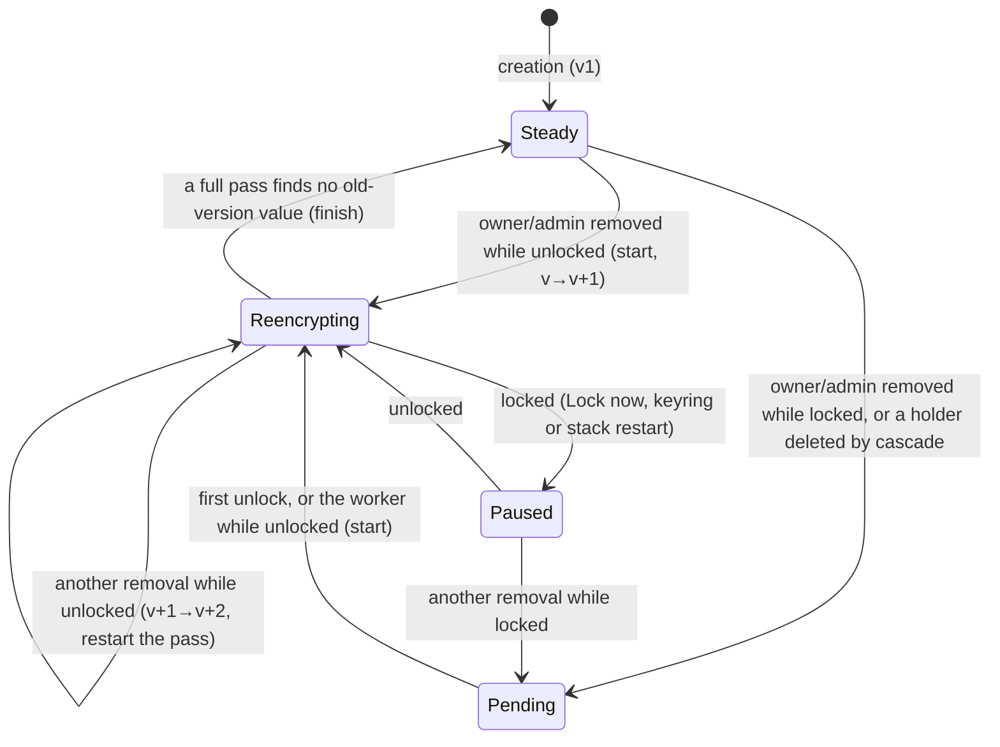

# F-030 — encrypted workspaces

**Status: proposed.** A security assessment of `d8b6e073` asked for changes
([PR #657 comment](https://github.com/ColdPhase/flux/pull/657#issuecomment-6369609716)); the next revision
addressed them, and the re-check of `b5f33f22`
([comment](https://github.com/ColdPhase/flux/pull/657#issuecomment-6369832437)) found no remaining P1
and asked for two additions, which are in this revision together with the founder's rotation
direction. Both assessments were posted from the shared author account, so they are not the
independent acceptance. The contract is implemented in the [slices](#delivery-slices) below after
the independent check. Owner @PelikanFix16 (`claude-hubert`);
independent evaluator @Zamojski5. Issue [#655](https://github.com/ColdPhase/flux/issues/655)
(founder direction, Hubert, 2026-10-23, required in v0.1.0). Decision row: [F-030](decisions.md).
It replaces the set-aside full E2EE research ([#615](https://github.com/ColdPhase/flux/issues/615)), which
recorded no decision. The [founder answers](#founder-answers-2026-10-23) are fixed. The engineering
choices below are the agents' under the [delegation](autonomy.md).

When the owner creates a new workspace, they can turn on **encryption**. It is optional and
cannot be undone. Each encrypted workspace has its own key. Its content is encrypted in the
database, in the files volume and in the search index, and nothing inside it is written to disk
in plaintext. After every start of the server the workspace is **locked** until an owner or
admin enters their unlock password. The key then lives only in RAM. An encrypted workspace is
**always without AI**: the [F-029 AI lock](workspace-ai-lock.md) is forced on and cannot be
turned off. Only people work there.

The contract was written against `main` at `3bbae96a` (2026-10-23). File and function names are
from that revision, and paths are relative to `app/`. An implementer who finds another column, job
or path that carries workspace content adds it to the [inventory](#inventory) in the same PR.

## Threat model

| | Covered | Not covered |
| --- | --- | --- |
| **The adversary has** | A copy of the database (dump, volume, WAL, a backup archive), the files volume, the container logs and writable layers, or the whole server taken away powered off, including its swap device ([swap is enforced](#memory-what-is-enforced-and-what-is-not)). | A running, unlocked server: root on the host, a debugger in a process, a memory snapshot of a live VM, or a **hibernated** host or **suspended VM whose memory image was written to disk** while unlocked. Such an attacker can read RAM, where the unlocked key and plaintext live. This is accepted by founder answer 1. |
| **Guarantee** | Without an unlock password or the recovery code, no workspace content can be read from what is on disk. Ciphertext moved between rows, columns, tables or workspaces fails to decrypt. | Tampering by someone who can write to the database: a field rolled back to an older ciphertext of the **same** row and column is not detected. Theft only reads data; tampering is outside the founder's threat. |
| **Visible** | The [metadata](#what-stays-visible-metadata) listed below: ids, structure, people, times, task status, owner and due date, and value lengths. No digest of content is stored in the clear. | — |
| **Former holders** | **Removing or demoting an owner or admin [rotates the key](#rotation)** ([founder direction 2026-10-23](#founder-answers-2026-10-23)). Once the rotation has finished, that person's unlock password, together with any copy of the data taken after it finished, opens nothing. | Rotation closes only the **later-copies** part. A copy the person already holds from before (an old backup or dump) still opens with their old password: old ciphertext and old wraps in it cannot be changed. During the rotation, a copy can still hold old-key values. A raw image of the disk can hold old-key ciphertext in freed blocks after the rotation ([limits](#rotation-limits)). |
| **Weak passwords** | The [password rule](#password-strength) | The weakest unlock password protects the whole workspace: each holder's key is an independent target for an offline guess. |

Account data (names, e-mail addresses, sessions, passwords managed by Better Auth) is not
workspace content and is unchanged. Live audio and video are not stored ([live media](../development/live-media.md)).

## Terms

- **Sealed workspace.** A workspace with `workspaces.encrypted = true`. "Encrypted workspace" in the
  UI and "sealed" in code mean the same thing.
- **DEK.** A workspace data key: 32 random bytes with a **key version** (1, 2, …). A new version is
  made at creation and at every [rotation](#rotation). A DEK never reaches PostgreSQL or a disk
  unwrapped.
- **Live versions.** The key versions that may still have ciphertext: just the current one, except
  during a rotation.
- **Holder.** An owner or admin with an unlock password, or the recovery code. Each holder has an
  X25519 key pair. Its private key is encrypted under a key derived from the password or code, and
  every live DEK is sealed to its public key.
- **Keyring.** A new process that holds one random **boot key** in RAM only (see
  [unlock lifecycle](#unlock-lifecycle-across-processes)).
- **Unlock rows.** The live DEKs sealed under the boot key, stored in `workspace_unlocks`, one row per
  version. While current rows exist for every live version, the workspace is unlocked.
- **Seal / open.** To encrypt or decrypt one value. **Envelope** is the stored ciphertext format.

## Data model

Migration `0119_encrypted_workspaces.sql` (0118 was taken by #664 when S1 landed; later slices take
the next ones):

```sql
ALTER TABLE workspaces ADD COLUMN encrypted boolean NOT NULL DEFAULT false;
-- BEFORE UPDATE trigger: refuses any change of encrypted (raise WORKSPACE_ENCRYPTION_IMMUTABLE).
ALTER TABLE workspaces ADD COLUMN creation_id uuid;   -- the client's id for POST /encrypted-workspaces retries
CREATE UNIQUE INDEX workspaces_creation ON workspaces (created_by, creation_id) WHERE creation_id IS NOT NULL;
CREATE FUNCTION workspace_sealed(uuid) RETURNS boolean STABLE LANGUAGE sql AS
  $$ SELECT coalesce((SELECT encrypted FROM workspaces WHERE id = $1), false) $$;

CREATE TABLE workspace_keys (
  workspace_id uuid PRIMARY KEY REFERENCES workspaces(id) ON DELETE CASCADE,
  current_version integer NOT NULL DEFAULT 1 CHECK (current_version >= 1),  -- new seals use it
  live_versions integer[] NOT NULL DEFAULT '{1}',                            -- versions that may still have ciphertext
  rotation text NOT NULL DEFAULT 'none' CHECK (rotation IN ('none', 'pending', 'reencrypting')),
  tampered_at timestamptz,     -- set when a holder, wrap or commitment fails verification; unlock refuses
  rotation_reason jsonb,       -- {"kind":"removed"|"demoted"|"left","userId":…}; ids only
  created_at timestamptz NOT NULL DEFAULT now()
);  -- a trigger keeps current_version = max(live_versions) and live_versions non-empty
CREATE TABLE workspace_holders (
  id uuid PRIMARY KEY,
  workspace_id uuid NOT NULL REFERENCES workspace_keys(workspace_id) ON DELETE CASCADE,
  kind text NOT NULL CHECK (kind IN ('password', 'recovery')),
  user_id text REFERENCES auth_users(id) ON DELETE CASCADE,  -- null exactly for 'recovery'
  kdf jsonb NOT NULL,          -- {"alg":"argon2id","v":19,"m":65536,"t":3,"p":4,"salt":"<b64url 16 bytes>"}
  public_key text NOT NULL,    -- X25519, raw 32 bytes, base64url
  wrapped_private text NOT NULL, -- AES-256-GCM of the X25519 private key under the KEK; the public key is in its AAD
  holder_mac text NOT NULL,      -- HMAC under a key from DEK v(holder_mac_version) over [id, kind, user id, public key, kdf, wrapped_private, secret_check]
  holder_mac_version integer NOT NULL,
  created_at timestamptz NOT NULL DEFAULT now(),
  updated_at timestamptz NOT NULL DEFAULT now(),
  CHECK ((kind = 'recovery') = (user_id IS NULL))
);
CREATE UNIQUE INDEX workspace_holders_person ON workspace_holders (workspace_id, user_id) WHERE kind = 'password';
CREATE UNIQUE INDEX workspace_holders_recovery ON workspace_holders (workspace_id) WHERE kind = 'recovery';
CREATE TABLE workspace_dek_wraps (           -- each live DEK sealed to each holder's public key
  holder_id uuid NOT NULL REFERENCES workspace_holders(id) ON DELETE CASCADE,
  workspace_id uuid NOT NULL REFERENCES workspace_keys(workspace_id) ON DELETE CASCADE,
  key_version integer NOT NULL,
  ephemeral_public text NOT NULL, sealed_dek text NOT NULL,
  confirm text,                -- HMAC under a key from this holder's KEK over [version, SHA-256(DEK)]; null until the holder confirms
  PRIMARY KEY (holder_id, key_version)
);
CREATE TABLE workspace_key_versions (        -- one row per version ever made while it is live
  workspace_id uuid NOT NULL REFERENCES workspace_keys(workspace_id) ON DELETE CASCADE,
  key_version integer NOT NULL,
  commitment text,             -- HMAC(HKDF(DEK v-1), [v, SHA-256(DEK v)])
  check_value text NOT NULL,   -- a fixed text sealed under DEK v at creation of the version
  created_at timestamptz NOT NULL DEFAULT now(),
  PRIMARY KEY (workspace_id, key_version),
  CHECK ((key_version = 1) = (commitment IS NULL))   -- required for every version after the first
);
CREATE TABLE workspace_removed_holders (     -- tombstones: holders removed since the last finished rotation
  workspace_id uuid NOT NULL REFERENCES workspace_keys(workspace_id) ON DELETE CASCADE,
  holder_id uuid NOT NULL, user_id text, public_key text NOT NULL,
  removed_at timestamptz NOT NULL DEFAULT now(),
  PRIMARY KEY (workspace_id, holder_id)
);
-- workspace_holders: AFTER DELETE of a 'password' holder writes its tombstone and sets workspace_keys.rotation =
-- 'pending' when it is 'none' or 'reencrypting' (a holder of n+1 removed mid-rotation needs n+2), so an account
-- deletion (ON DELETE CASCADE) still leads to a rotation; BEFORE DELETE refuses removing the last
-- 'password' holder while its workspace still exists (LAST_UNLOCK_PASSWORD).
CREATE TABLE workspace_unlocks (
  workspace_id uuid NOT NULL REFERENCES workspace_keys(workspace_id) ON DELETE CASCADE,
  key_version integer NOT NULL,
  boot_id uuid NOT NULL,       -- the keyring boot whose key sealed the DEK
  sealed_dek text NOT NULL,    -- AES-256-GCM under the boot key, see Unlock
  unlocked_by text REFERENCES auth_users(id) ON DELETE SET NULL,
  unlocked_at timestamptz NOT NULL DEFAULT now(),
  PRIMARY KEY (workspace_id, key_version)
);
CREATE TABLE workspace_rotation_progress (  -- one row while a rotation runs; ids and counts only
  workspace_id uuid PRIMARY KEY REFERENCES workspace_keys(workspace_id) ON DELETE CASCADE,
  target_version integer NOT NULL,
  step text NOT NULL,          -- the SEALED_COLUMNS table being processed, then 'files', then 'verify'
  cursor jsonb,                -- the last primary key processed in that step
  rows_done bigint NOT NULL DEFAULT 0, rows_estimate bigint NOT NULL DEFAULT 0,
  passes integer NOT NULL DEFAULT 0, updated_at timestamptz NOT NULL DEFAULT now()
);
ALTER TABLE project_files ADD COLUMN key_version integer;  -- of the stored object; null for a plain workspace
CREATE TABLE password_attempts (            -- failed password or code checks on any route; pruned after 15 minutes
  workspace_id uuid NOT NULL REFERENCES workspaces(id) ON DELETE CASCADE,
  user_id text NOT NULL REFERENCES auth_users(id) ON DELETE CASCADE,
  at timestamptz NOT NULL DEFAULT now()
);
CREATE TABLE workspace_wrap_grants (       -- a holder's permission for one person to add a password; no key material
  workspace_id uuid NOT NULL REFERENCES workspace_keys(workspace_id) ON DELETE CASCADE,
  user_id text NOT NULL REFERENCES auth_users(id) ON DELETE CASCADE,
  granted_by text NOT NULL REFERENCES auth_users(id) ON DELETE CASCADE,
  expires_at timestamptz NOT NULL,         -- one hour
  PRIMARY KEY (workspace_id, user_id)
);
CREATE TABLE sealed_job_waits (            -- work that needs a DEK and arrived while locked; ids only
  id uuid PRIMARY KEY, workspace_id uuid NOT NULL REFERENCES workspaces(id) ON DELETE CASCADE,
  queue text NOT NULL, payload jsonb NOT NULL, created_at timestamptz NOT NULL DEFAULT now()
);
-- notifications.reason: the CHECK (0015, extended since) gains 'security'.
```

- The F-029 trigger that writes the new workspace's `workspace_ai_policies` row writes `'blocked'`
  when `NEW.encrypted`, and a `BEFORE UPDATE` trigger on `workspace_ai_policies` refuses `'allowed'`
  for a sealed workspace (`WORKSPACE_ENCRYPTED_AI_OFF`). See [AI forced off](#ai-forced-off).
- `idempotency_keys.workspace_id` already exists (nullable, migration 0004). The command runner
  (`apps/server/src/http/commands.ts`, `runCommand`) fills it only when the route declares a `scope`.
  S2a makes it complete ([idempotency](#idempotency-store)).
- One [password limiter](#password-checks) covers every route that checks a password or the recovery
  code. It is per person and workspace only, because a workspace-wide limit would let one admin
  session lock the others out.
- S2a adds `search_documents.sealed`, `search_changes`, the search placeholder triggers, the
  [plaintext backstops](#enforcement) and the relaxed checks, so no sealed column is ever copied into
  `search_documents`.
- The reverse migration drops the new tables and columns. It refuses to run while a sealed
  workspace exists, because the data cannot be read without the new tables.

## Cryptography

All primitives come from `node:crypto` in the pinned Node image (24.21.0, OpenSSL 3.5.8,
observed 2026-10-23). That build offers AES-GCM, ChaCha20-Poly1305 and X25519, but not
XChaCha20-Poly1305 or AES-GCM-SIV (`crypto.getCiphers()`, observed). Flux already uses AES-256-GCM
for the background key (`packages/db/src/background-key-crypto.ts`) and the search cursor. The only
new dependency is the password strength estimator ([Password strength](#password-strength)).

### Keys

| Key | Derivation | Use |
| --- | --- | --- |
| DEK v*n* | `randomBytes(32)` at creation and at each rotation | Root of one key version. Never used directly. |
| `K_seal` v*n* | HKDF-SHA256(DEK v*n*, salt = workspace UUID bytes, info `[flux seal v1, key version]`) | Database fields, per row (below). |
| `K_file` v*n* | same, info `[flux file v1, key version]` | File objects, per file. |
| Holder key pair | X25519, generated when the holder is created | Receives every live DEK; its private key is wrapped by the password or code. |

### Field envelope

`fx1.<key version>.<base64url(nonce 12 ‖ ciphertext ‖ tag 16)>`, AES-256-GCM. The key version in the
envelope chooses the DEK, which is how rows sealed under different versions are read during a
rotation.

- **Context encoding.** Every AAD and HKDF `info` in this contract is a length-prefixed list:
  each component is its UTF-8 bytes preceded by a 4-byte big-endian length, starting with a
  purpose label (`flux seal v1`, `flux wrap v1`, `flux holder v1`, `flux unlock v1`, `flux file v1`).
  Identities can contain client-chosen text (an idempotency key), so no separator character can make
  two contexts equal.
- **AAD** binds the value to its place: `[flux seal v1, workspace id, field, row identity…, key version]`.
  `field` is the registry name (`project_messages.body`). The row identity is the row's primary-key
  values as separate components (material id and version for a material version). A ciphertext
  copied to another row, column, table or workspace fails authentication. That stops row and column
  swapping, and the key version in the AAD stops a version label being changed.
- **A key per row.** Each seal uses `K_row = HKDF-SHA256(K_seal, info = the same context as the AAD)`
  with a random 96-bit nonce. NIST SP 800-38D §8.3 limits random 96-bit IVs to 2^32 encryptions per
  key. With a key per row, that limit applies to re-seals of **one** field of **one** row. A live
  Wiki head body is re-sealed once per admitted update, so a single document needs 2^32 updates
  (about 27 years at five a second for that one document, whatever the number of editors). With one
  key per workspace, N concurrent editors at five updates a second and three seals each would reach
  2^32 in 6.8/N years, and nothing would observe it. The cost is one HKDF (two HMAC-SHA256) per seal
  or open, a few microseconds. No seal counter is needed.
- **Values copied in SQL** keep their identity. Where SQL copies a sealed value between tables, both
  columns share one registry field and identity. Only one copy is allowed: the live Wiki head and its
  archive, `doc_live.body` and `doc_live.codec_state`, identity `[doc id, generation]`. The other SQL
  copy in the schema, `preserve_draft_version` (migration 0006, `drafts` → `draft_versions`), is
  replaced in S2a. For a sealed workspace the trigger writes nothing, and the drafts repository inserts
  the `draft_versions` row itself, sealed with that row's identity. The registry test reads
  `pg_trigger` and `pg_proc` and fails on any other function that copies a sealed column. Such a copy
  must be moved to the application, which opens and re-seals the value.
- **jsonb columns** store `{"$sealed":"fx1…"}`, so `jsonb_typeof = 'object'` checks still hold. Text
  columns store the envelope string.
- **Lengths are not hidden.** There is no padding. Ciphertext length is plaintext length plus 28
  bytes, then base64.

### Files

Files are limited to 5 MiB (`FILE_LIMITS.fileBytes`), so one GCM pass per file is enough. The
object is `FXF1 ‖ key version (uint32) ‖ nonce 12 ‖ ciphertext ‖ tag 16`, with a per-file key
`HKDF(K_file, info = [flux file v1, workspace id, file id, key version])` and the same list as AAD.
The file id is the reservation id (`files/service.ts` reserves before `storage.receive`), so it is
known before the first byte. `FileStorage.receive` takes an optional `FileCipher`. It encrypts each
chunk as it streams into the scratch file, so plaintext never reaches `attachments/tmp`. `read`
returns bytes only after the tag verifies, choosing the DEK by the header's key version.
`project_files.key_version` repeats it so a rotation can find old objects. `size` stays the
plaintext size. `sha256` is a [sealed digest](#digests), and `has` compares it with the SHA-256 of
the decrypted bytes. Thumbnails are made only in the browser (`composer/Attachments.tsx`), so nothing
else is stored.

### Digests

A stored unkeyed SHA-256 of content lets an attacker confirm a guess ("does this workspace hold
`leaked.pdf`?", "is this message `ok`?"). In a sealed workspace every **stored** digest of content is
the SHA-256 hex **sealed like any other field** (a sealed digest), under its own registry field. That
covers `request_fingerprint` and `fingerprint` columns, `doc_live_*.hash`, `project_files.sha256`,
`idempotency_keys.request_hash` and the plan-intent `creation_fingerprint`. A comparison opens the
stored value and compares it in RAM. That happens only on a replay or a Save, so it is cheap.

- The first revision used keyed HMAC digests instead. Sealing them was chosen once rotation became
  required. A sealed digest is re-encrypted by the rotation like everything else; a keyed digest
  cannot be recomputed for a request whose body is not stored, so it would keep the old key's
  digests forever. Sealed digests also hide equal content, which keyed digests revealed.
- No SQL compares these columns for workspace content. Checked 2026-10-23: equality lookups on a
  fingerprint exist only in `agent_oauth_flows` and the runtime tables, which are AI-class and empty
  for a sealed workspace.
- One helper, `sealedDigest(seal, field, identity, bytes)` in `packages/core/src/encryption`,
  replaces `createHash('sha256')` at each storage site (the files using it today are listed by
  `grep -rl "createHash('sha256')" packages/core/src packages/db/src apps/server/src`). Where a wire
  protocol compares a SHA-256 that the client computes (the live Wiki head `hash` on Save), the server
  compares it in RAM and never stores it in the clear.

### Holder keys and the KDF

- **Why key pairs.** Rotation must give the new DEK to every remaining holder without knowing their
  passwords, and without sealing it under anything the removed person could have learned. Sealing a
  DEK to each holder's **public** key does that. Passwords are needed only to open a holder's own
  private key at unlock. **A new DEK is never wrapped under an older DEK**, because the person removed
  may know the older one.
- **KEK** = Argon2id(password or normalised code as UTF-8 NFC, salt = 16 random bytes, **m = 64 MiB,
  t = 3, p = 4**, 32-byte tag). This is the "second recommended option" of
  [RFC 9106 §4](https://www.rfc-editor.org/rfc/rfc9106.html#section-4) (read 2026-10-23), meant for
  when much less memory is available than the 2 GiB of the first option. It uses `crypto.argon2`
  (added in Node v24.7.0 per the [v24 API docs](https://nodejs.org/docs/latest-v24.x/api/crypto.html),
  read 2026-10-23). It runs off the event loop on libuv's thread pool. Observed on this host on
  2026-10-23: 55 ms with p = 4 and 106 ms with p = 1, on 24 cores. A small VPS will be slower.
  The parameters are stored per holder (`kdf`). A successful unlock with older parameters re-wraps
  the private key under the current ones.
- `wrapped_private` = AES-256-GCM(KEK, random nonce, X25519 private key), with AAD
  `[flux wrap v1, workspace id, holder id, kind, user id or "", public key]`. S1 adds
  `workspace_holders.secret_check` = `HMAC(HKDF(KEK, [flux secret-check v1, workspace id, holder id]), [holder id,
  kind, user id or ""])`: a wrong password fails it (`400 UNLOCK_INCORRECT`), and a right password whose row no longer
  opens (a replaced public key or wrapped private key) is tampering (`409`). It is no easier to guess against than
  the tag (both need the Argon2id derivation). After opening, the API derives the public key from the
  private key and compares it with the stored one. A mismatch is [tampering](#authenticating-holders-and-wraps).
- **Sealing a DEK to a holder** (`workspace_dek_wraps`), in the style of HPKE base mode (RFC 9180)
  built from Node primitives: make an ephemeral X25519 key pair; `shared = X25519(ephemeral private,
  holder public)`; `key = HKDF-SHA256(shared, info = [flux holder v1, workspace id, holder id, key
  version, ephemeral public, holder public])`; `sealed_dek = AES-256-GCM(key, random nonce, DEK)`
  with the same list as AAD. Opening uses the holder's private key and the stored ephemeral public
  key.
- **Recovery code.** 160 random bits as 32 Crockford base32 characters, shown in 8 groups of four
  (`K7QD-2M9X-…`). Input is normalised: upper case, spaces and hyphens removed, `O→0`, `I/L→1`.
  It is a holder of kind `recovery` with its own key pair, so there is one code path. The code is
  never stored.
- **Passwords**: see [Password strength](#password-strength). **Checks and limits**: see
  [Password checks](#password-checks).

### Authenticating holders and wraps

Anyone who can write to PostgreSQL could otherwise insert a holder row, replace a holder's public key,
or replace a DEK wrap with a box carrying a DEK of their own choice. Sealing to a public key needs no
secret. The next rotation would then seal the new DEK to the attacker, and the re-encryption would
move all content under it. Four checks close this. None needs anything the attacker has.

1. **Holder MAC.** `holder_mac = HMAC-SHA256(HKDF(DEK v, [flux holder-auth v2, workspace id, v]),
   [holder id, kind, user id or "", public key, kdf, wrapped private key, secret check])`, with
   `v = holder_mac_version`, the current version when the MAC was written. `kdf` is compared in the fixed
   key order `[alg, v, m, t, p, salt]`, so jsonb's reordering does not matter. (S2a-1, from the S1 review:
   v1 covered only the identity and the public key, so a changed `kdf`, `wrapped_private` or
   `secret_check` showed up only as a failed derivation, not as tampering.) `confirm` is not covered: it
   is itself a MAC under the holder's KEK, written later than this one, and unlock refuses a changed one. A holder is created only while the workspace is unlocked, so the server
   holds the DEK then. At a rotation's start every remaining holder's MAC is rewritten under the new
   version. Two rules use it, and they are deliberately different. **Receiving a new DEK:** only the
   **holder set** does, meaning rows whose MAC verifies, whose user (for kind `password`) is currently
   an owner or admin, and that have no tombstone. **Unlocking:** every holder row must verify. A row
   that fails, whether rogue, replayed with a stale MAC version or altered, makes the unlock refuse as
   tampering. So a planted row can never receive a key, and its presence locks the workspace instead
   of being skipped silently.
2. **Public key bound to the password.** It is in the AAD of `wrapped_private` and checked against
   the private key after opening (above). A replaced public key makes the real holder's unlock fail
   loudly instead of silently sealing to someone else.
3. **Key confirmation.** A DEK opened from a wrap is accepted by exactly one of these rules, chosen
   by whether the holder has a confirmation for that version:
   - **if a confirmation exists, it decides.** The holder's own confirmation (`workspace_dek_wraps.confirm`) must verify:
     `HMAC(HKDF(KEK, [flux confirm v1, workspace id, holder id]), [version, SHA-256(DEK)])`. Only
     someone with the password or code can write it. It is written when the holder is created (for
     every live version) and at each later unlock for any version it lacks;
     A mismatch is tampering **even if the commitment chain would verify**. The chain is a MAC under
     DEK v-1, which an earlier holder may know, so it must never override the holder's own proof.
   - **only if there is no confirmation**, the **commitment chain** must verify from a DEK already accepted:
     `commitment(v) = HMAC(HKDF(DEK v-1, [flux commit v1, workspace id, v-1]), [v, SHA-256(DEK v)])`,
     written when version v is made. It reveals nothing about DEK v to a holder of v-1.

   In both cases the accepted DEK must also open that version's `check_value`, and one existing
   envelope of that version if there is one (cheap, by the key-free version prefix). Version 1 has no
   commitment. The creator's and recovery holder's confirmations, written at creation, are its
   root, so a forged v1 wrap fails even in an empty workspace.
4. **Order at unlock.** Open the private key; check the derived public key; open the wraps for every
   live version; accept each DEK by rule 3, oldest first; verify every holder MAC with the current
   DEK; write any missing confirmations for this holder. Only then are unlock rows written.

**Tampering** (any check fails). The unlock answers `409 ENCRYPTION_TAMPERED`, writes no unlock row,
and runs no rotation step. It sets `workspace_keys.tampered_at`, records
`workspace.encryption_tampered.v1` (ids only), and sends every holder a `security` Inbox notification:
"Garden club's encryption keys were changed outside Flux. It stays locked." **The flag is not
sticky.** Every unlock attempt verifies everything from scratch, whatever the flag says. The flag is
only for display and alerting, and it is cleared when a full verification passes. So a fixed bug or
a repaired restore unlocks normally. Nothing is deleted or repaired automatically. The
[operations guide](../operations/backup-restore.md) says that restoring **only** `workspace_keys`,
`workspace_holders`, `workspace_dek_wraps`, `workspace_key_versions` and `workspace_removed_holders`
from the last good backup is enough, as long as no rotation finished after that backup. Otherwise the
whole instance is restored.

**Removal tombstones and the one remaining path.** A holder's deletion writes a tombstone (id, user,
public key). The start never seals to a holder id or public key that has a tombstone, and the
tombstones are cleared at the finish. A person removed and later added again creates a **new**
holder with a new key pair through the [grant flow](#password-lifecycle). This is defence in depth.
One tampering path cannot be closed with cryptography, and it is stated here: during `pending`
(a removal while locked), no key is available to authenticate the removal itself. An ex-holder who
kept their own holder row, and who can write to the database, could restore that row and their role
and delete the tombstone. The next unlock would then seal DEK *n*+1 to them. To make that visible,
the start records the holder set in `workspace.key_rotation_started.v1` (ids), and the Encryption
section shows "The new key opens for Ada and Cy." Every holder can see who received it.

### Password checks

Four routes check a password or the recovery code: unlock, unlock-password grants (the holder's
password), `PUT …/unlock-password` (`currentPassword` or `recoveryCode`) and `POST …/recovery-code`.
Each of them is an online guessing oracle for a hijacked or impersonated session, and each costs an
Argon2id derivation, so they share **one** limiter and **one** semaphore:

- **Limiter.** `password_attempts` counts failed checks per person and workspace across all four
  routes. Five failures in 15 minutes answer `429 UNLOCK_RATE_LIMITED` with `Retry-After` on all of
  them. The count is read and written in the checking transaction. A failure records its row before
  the answer is sent.
- **Semaphore.** At most two derivations run at once per API process (64 MiB each), across all four
  routes. Others queue, and the ninth waiting request answers `503 UNLOCK_BUSY`.

### Password strength

The unlock password is the only barrier between a stolen disk and the content, and the weakest
holder's password protects the whole workspace.

- **Cost per guess.** One Argon2id derivation at these parameters takes 55 ms on four lanes of the CPU
  above (measured 2026-10-23) and needs 64 MiB of memory. That memory limits how many guesses a GPU
  can run in parallel. The first security assessment estimated (an inference, not a measurement)
  that a rented GPU fleet reaches about 2^40 to 2^45 guesses a year against these parameters.
  Human-chosen 12-character passwords do not resist that.
- **Default: a generated passphrase.** The form fills in **six words** from the EFF large word list
  (7,776 words, 12.9 bits each, so 77 bits). It is generated in the browser with
  `crypto.getRandomValues`. The word list's licence is to be confirmed and credited in `NOTICE` when
  S3 adds it (stated as CC BY 3.0 US on the EFF page; not re-checked here). At 2^45 guesses a year,
  half the space takes about 2^31 years.
- **Own password.** The person may type their own instead. The API enforces **at least 20
  characters** after NFC normalisation **and** a strength estimate of at least 10^17 guesses
  (`guessesLog10 ≥ 17`, about 56 bits; at the estimated 2^45 guesses a year that is over two thousand
  fleet-years, and the generated passphrase stays the default), using
  `@zxcvbn-ts/core` with its common and English dictionaries (MIT; the version is pinned when S1
  lands). The browser runs the same estimator to explain a refusal before sending:
  "abcdefghabcdefghabcd" has 20 characters and is refused. The form shows "Every owner's and admin's
  password protects the whole space. The weakest one counts." A refusal is `400 PASSWORD_TOO_WEAK`.
- **Upgradable.** `kdf` is stored per holder, so stronger parameters can be applied on the next
  unlock without a migration.

### Password lifecycle

| Event | Effect |
| --- | --- |
| Creation | DEK v1. The creator (owner) becomes a `password` holder, and a `recovery` holder is made. v1 is sealed to both. The code is returned once. |
| A person becomes owner or admin | No holder yet, and a session alone can never add one. A **current holder** allows it by entering their own unlock password: `POST …/unlock-password-grants { userId, password }`. This creates `workspace_wrap_grants` for **one hour**, holding no key material; the holder and the new admin normally do this together. While the grant is valid and the workspace is unlocked, the person sets their password (`PUT …/unlock-password` without `currentPassword`). Alternatively they enter the recovery code instead of a grant. Setting the password takes `workspace_keys` `FOR UPDATE` and re-reads `live_versions` in the same transaction, so a rotation starting at the same moment cannot leave a version without a wrap. It verifies the existing holders, consumes the grant, creates their holder (MAC under the current version), and seals **every live DEK** to it with a confirmation for each, records `workspace.unlock_password_set.v1`, and sends every other holder an Inbox notification (reason `security`): "Ben now has an unlock password for Garden club." |
| Change own password | Needs `currentPassword` (or the recovery code). Re-wraps the private key under a new salt; the key pair and the DEK wraps stay. |
| Demoted to member or guest, removed, leaves, or account deleted (an owner or admin) | Their holder and its wraps are deleted, and a [rotation](#rotation) starts in the same transaction if the workspace is unlocked, or becomes `pending` if it is locked. An account deletion that cascades to a holder sets `pending` through the trigger. The account-deletion path first refuses to delete the last password holder of any sealed workspace (`409 LAST_UNLOCK_PASSWORD`). |
| The last person with a password would lose it | Refused with `409 LAST_UNLOCK_PASSWORD`: "Garden club needs at least one unlock password. Ask another owner or admin to set theirs first." The recovery code alone is not counted. |
| New recovery code | Owner only, while unlocked, with their own unlock password. It replaces the `recovery` holder, and every live DEK is sealed to the new one with confirmations and a MAC. The old code stops working. |

Stated limit. Someone who holds an owner's or admin's **session** while the workspace is unlocked
can read everything and export it, but cannot add an unlock password without a holder's password or
the recovery code.

### Rotation

**Required in this version** ([founder direction 2026-10-23](#founder-answers-2026-10-23)): removing
an owner or admin changes the workspace key and re-encrypts all content in the background. After
that, the removed person's password, together with any copy of the data taken after the rotation,
opens nothing. Delivered in slice [S2c](#delivery-slices), before S3 makes creation possible in
production.

#### What triggers it

A rotation starts whenever an **owner or admin** stops being one: removed, demoted to member or
guest, leaving, or their account deleted. It starts even if that person never set a password. They
might have seen the recovery code, and one rule is simpler to check than a proof that someone never
held anything. Members and guests never hold a key, so their removal changes nothing.

#### The state machine



1. **Removal.** In the role change's transaction, locked or unlocked: lock `workspace_keys` `FOR
   UPDATE` (before the membership lock, see the lock order below), delete the person's holder (writing its tombstone) (and so its DEK wraps) and the **recovery holder** (see
   [recovery code](#the-recovery-code-after-a-rotation)), and set `rotation = 'pending'` with
   `rotation_reason`. The removed person's password stops working at once: their holder is gone, and
   the role check refuses them anyway. **No new DEK is made while locked.** Re-encryption needs the
   old DEK, so a new one made earlier would protect nothing and would have to trust unverified
   holder rows.
   **Start** (pending to reencrypting) happens in the same transaction when the workspace is unlocked.
   Otherwise it happens in the first unlock's transaction after its [checks](#authenticating-holders-and-wraps),
   or in the worker's rotate job when the workspace is unlocked and `pending` (after a cascade). The
   process holds DEK *n* in RAM then:
   - verify every holder MAC under DEK *n* (a failure marks tampering and stops the start);
   - make DEK v*n*+1 in RAM; write `workspace_key_versions` for *n*+1 with its commitment from DEK *n*
     and its `check_value`; seal DEK *n*+1 to every member of the **holder set** (never under DEK *n*);
     rewrite their MACs under *n*+1;
   - set `current_version = n+1`, add *n*+1 to `live_versions`, set `rotation = 'reencrypting'`, and upsert `workspace_rotation_progress` (`target_version = n+1`, first
     step, empty cursor, `passes = 0`, `rows_estimate` from `pg_class.reltuples` of the registry
     tables);
   - ask the keyring to seal DEK *n*+1 and insert its unlock row. If the keyring cannot be reached,
     roll the start back and leave `pending`, so the workspace is never half unlocked;
   - record `workspace.key_rotation_started.v1` (ids only), send `workspace-encryption.rotate.v1`,
     then zero DEK *n*+1 in the API's memory.

   The role change reads the unlock rows without a lock and takes no row lock on them, so it cannot
   deadlock with Lock now. A concurrent Lock can leave a stray unlock row for *n*+1, but `sealFor`
   treats a workspace as unlocked only when **every** live version has a current-boot unlock row.
   Otherwise it is locked and the stray rows are deleted.
2. **Seal and read during the rotation.** Every new seal, from any process, uses `current_version`.
   Every open chooses the DEK by the envelope's version, which must be in `live_versions`. Reading
   both versions at once is just this: an envelope names its own version. **Writer invariant:** a
   writer takes `workspace_keys` `FOR SHARE` first, then the unlock rows `FOR SHARE`, and seals with
   the `current_version` it read under that lock. The start and the finish both take `workspace_keys`
   `FOR UPDATE`, so each is ordered strictly before or after every write. No write sealed under
   version *n* can commit after the start, or after a finish that deletes *n*'s wraps. A
   long transaction that began before the start either commits first, so the next pass finds its
   value, or waits and then sees the new version.
   **Lock order** for a sealed workspace: `workspace_keys`, unlock rows, then the F-029 order (policy
   row, workspace row, memberships, project and grant rows, event `seq` lock). A role change of an owner or
   admin therefore takes `workspace_keys` `FOR UPDATE` **before** its membership lock. It reads the
   target's role without a lock first to decide whether it must. Lock now takes only the unlock rows
   and a membership share, so it cannot cycle with either.
3. **Re-encrypt** (worker, `apps/worker/src/workspace-encryption/rotate.ts`), only while unlocked.
   - It walks `SEALED_COLUMNS` table by table in a fixed order, by primary key in pages of 500. Each
     page is one transaction that takes the unlock rows `FOR SHARE`. It selects the workspace's rows
     where a sealed column's envelope version is below `current_version`. That is a prefix test on
     the visible envelope header (`fx1.<v>.`, or the `$sealed` value), which needs no key. It opens
     each value, seals it under the current version, and writes it back **compare-and-set**: `UPDATE
     … WHERE` the column still equals the ciphertext it read. A value that changed meanwhile was
     written by a live process under the current version and is skipped. The page ends by storing
     the step, the cursor and `rows_done` in `workspace_rotation_progress`, so the page's writes and
     its progress commit together.
   - **Files** come next. For each file of the workspace with `key_version < current_version`, the
     worker reads and verifies the object, encrypts it under the current version into
     `attachments/tmp`, `fsync`s it, renames it over the object (atomic on the same filesystem) and
     syncs the directory. It then sets `project_files.key_version` in a transaction. After a crash
     between the rename and the update, the header already names the new version. The resumed step
     reads the header, sees the new version and only updates the row.
   - Pages pause 20 ms between them, so a rotation never takes the database for itself. A
     workspace of a million sealed values takes minutes (to be measured in S2c and stated in the
     operations guide).
4. **Locked mid-rotation** (Lock now, a keyring restart, a stack restart). A page transaction finds
   the workspace locked and changes nothing. The job records a `sealed_job_waits` row
   (`workspace-encryption.rotate.v1`) and ends. Progress stays where the last committed page left
   it. Unlocking opens every live version (each remaining holder has a wrap for each) and the
   resume job continues from the stored cursor.
5. **Crash or restart of the worker.** pg-boss retries the job. At start the worker also sends one
   rotate job for every unlocked workspace with `rotation = 'reencrypting'`. The pass continues from
   the cursor. Rows already at the current version are filtered out, so repeating a page is harmless.
6. **Another removal during a rotation** starts a rotation to *n*+2 the same way (at once while
   unlocked, or `pending` until the next unlock while locked). Wraps for *n* and
   *n*+1 stay for the remaining holders, and the pass restarts from the first table, because rows
   already re-encrypted to *n*+1 must move to *n*+2.
7. **Finish.** **Verify invariant:** passes repeat until one complete pass over every table and file
   changes nothing (`step = 'verify'`, counted in `passes`). Only such a pass can lead to the finish. In one transaction the worker then deletes the DEK
   wraps and unlock rows of every version below `current_version`, sets `live_versions =
   {current_version}` and `rotation = 'none'`, deletes the progress row, and records
   `workspace.key_rotated.v1`. Afterwards it runs `VACUUM` on the tables it touched, then
   `CHECKPOINT` (the Compose database role may). That makes the dead row versions holding old
   ciphertext reusable sooner and lets WAL segments be recycled.

A holder never has "only an old wrap". The start seals the new DEK to every member of the holder
set, and a holder added during a rotation gets a wrap and a confirmation for every live version. So
any holder's unlock opens every live version. A new version is accepted at that holder's next unlock
through the commitment chain, and their own confirmation is written then.

#### The recovery code after a rotation

**The old code stops working when a rotation starts, and an owner makes a new one.** The server
cannot know who has seen the code: the creator printed it, an owner may have made one, and an admin
may have been present. A code that survived a removal would let the removed person open every later
copy, which the founder's rule forbids. Until an owner makes a new code, the workspace has none. The
`LAST_UNLOCK_PASSWORD` rule keeps at least one password holder. The Encryption section then says
"Garden club has no recovery code since Ben left. Make a new one and keep it safe." with **Make a new
recovery code**. When the person removing is an owner and the workspace is unlocked, the removal
confirmation offers it straight away. A new code made during a rotation is sealed to every live
version.

#### Rotation limits

- **Copies taken before the finish** can still hold old-version values, readable with the old key.
  The People panel shows the progress, and the guarantee is stated from the finish onwards.
- **Logical copies** (`pg_dump`, `./flux backup`) taken after the finish hold only the current
  version and no old wraps. The guarantee holds for them in full, and AC-13 tests it.
- **A raw image of the disk** taken after the finish can still hold old-version ciphertext. That is
  in freed filesystem blocks of rewritten pages and old file objects, and in dead row versions until
  `VACUUM` reuses their space and WAL segments until they are recycled. PostgreSQL and a filesystem
  cannot securely erase freed blocks. Someone holding the old key could read those remnants. The
  operations guide says: if that matters, use full-disk encryption, or move the instance to a fresh
  volume with `./flux backup` and `./flux restore` after the rotation.
- Backups taken before the finish keep the old key's data and wraps, as they must.

## Inventory

Each workspace-content table is listed with its columns. **S** means sealed (envelope), **D** means
sealed digest ([Digests](#digests)), and **V** means visible metadata. A column not named is an id, foreign key, number,
enum, boolean or timestamp (V). One registry, `SEALED_COLUMNS` in `packages/db/src/sealed-columns.ts`,
holds every S and D entry with its field name and identity columns. `VISIBLE_COLUMNS` holds every
text or jsonb V column of these tables with a one-line reason.

**The registry is checked against the live database, not `schema.ts`.** Sixteen tables exist only in
migrations: `draft_versions`, `search_documents`, `flux_schema_version`, `live_webhook_events`,
`cowork_review_verdicts`, `agent_thread_artifact_boundaries`, `agent_thread_artifact_mutations`,
`agent_thread_artifact_resets`, `agent_thread_guard_events` and seven `agent_runtime_*` tables
(found by comparing `CREATE TABLE` in `packages/db/migrations` with `schema.ts`, 2026-10-23). The
[registry test](#tests-and-acceptance-criteria) reads `information_schema.tables` and `columns` for
the `public` schema after all migrations. It requires every table to be in `TABLE_CLASSES` as
**content** (columns classified as above), **account** (user, session, OAuth, push and preference
data), **system** (schema version, queue, cursor, rate limits and the key tables), **AI** (empty for a
sealed workspace, [backstopped](#enforcement)) or **refused** (a feature not offered in a sealed
workspace, GitHub: `a_sealed_workspace_refused` refuses a row of one with
`409 WORKSPACE_ENCRYPTED_UNSUPPORTED`). `idempotency_keys` is a content table: its stored responses are sealed. It fails on any table or text/jsonb column of a
content table that is in no list. It also reads `pg_trigger` and `pg_proc` and fails on a function
that copies a sealed column outside the allowed pair. The pg-boss schema is classed as system, with
its own [error-path rule](#error-paths).

| Table | S (sealed) | D (sealed digest) | V (visible text/jsonb, reason) |
| --- | --- | --- | --- |
| `workspaces` | — | — | `name`: shown to members while locked ("Garden club is waiting to be unlocked") |
| `projects` | `name` | — | `visibility`, `views` (enums) |
| `project_goals` | `title` | — | — |
| `project_conversations` | — | — | `space` (enum) |
| `project_messages` (includes task discussion replies) | `body` | `request_fingerprint` | `contribution_kind` (enum) |
| `project_message_observations`, `dm_message_observations`, `return_points` | — | — | ids and positions only |
| `dms` | `title` | — | `kind`, `pair_key` (user ids) |
| `dm_messages` | `body` | `request_fingerprint` | — |
| `project_materials` | — | `request_fingerprint` | `kind` |
| `project_material_versions` (docs and Wiki) | `title`, `body`, `url`, `reason` | `request_fingerprint` | `state` |
| `project_work_items` (tasks) | `title`, `outcome`, `blocker`, `criteria`, `creation_baseline` | `request_fingerprint` | `status`, `owner_user_id`, `waiting_for_user_id`, `due_on`, `number`, `creation_origin` |
| `project_task_activity` | `detail` (old and new values) | — | `kind` (status, owner, due or title changed) |
| `project_task_updates` | `reason` | — | `kind` |
| `project_task_notices` | — | — | `sources` (object refs) |
| `project_task_plan_intents` | — | `creation_fingerprint` | `intent_key` (client-chosen opaque key; the web client sends random UUIDs) |
| `task_creation_undo_receipts`, `native_command_receipts` | — | `request_fingerprint` | operation names |
| `project_decisions` | `title`, `rationale` | — | `status` |
| `project_results` | `title`, `evidence` | — | `finding` (positive or negative) |
| `project_object_links` | — | — | `role`, types |
| `drafts` | `title`, `body` | — | `visibility` |
| `draft_versions` (migration 0006, filled by `preserve_draft_version`) | `title`, `body` (written by the application for a sealed workspace) | — | `visibility` |
| `sketches` (maps) | `title` | — | `scope` |
| `sketch_thoughts` | `text` | — | `shape`, `x`, `y`, `width`, `height`, `source_author_name` (a person's name, account data) |
| `sketch_links` | `label` | — | endpoints |
| `project_files` | `name`, file bytes ([Files](#files)) | `sha256` | `size`, `state` |
| `doc_live_heads`, `doc_live_archives` | `body`, `codec_state` (field `doc_live.*`) | `hash` | sequences, generation |
| `doc_live_updates` | `bytes`, `ledger` | `fingerprint` | actor, command id |
| `doc_live_snapshots` | — | `hash` | `contributors` (people ids) |
| `doc_live_presence`, `map_live_presence`, `map_live_gestures` | — | — | `cursor`, `selected`, `positions`: Yjs relative positions or coordinates in leases of 5–30 s, with no text |
| `live_editing_intents` | `receipt` | `fingerprint` | `operation` |
| `map_live_journal` | `change` | `fingerprint` | actor |
| `notifications` | — | — | `title`, `body`: **content-free**, backstopped ([Notifications](#notifications-push-and-e-mail)); `url` (ids); `summary_sources` (refs) |
| `notification_generation_failures`, `notification_emails` | — | — | `last_error`, `skip_reason`: an error class and code only for a sealed workspace ([error paths](#error-paths)) |
| `events` | — | — | `data`: ids, versions and enums only, backstopped ([Enforcement](#enforcement)) |
| `idempotency_keys` (every row of a command on a sealed workspace's objects) | `response_body` | `request_hash` | `operation`; `key` is client-chosen ([below](#idempotency-store)) |
| `search_documents` (rows of a sealed workspace) | — (placeholder rows hold no content, [Search](#search)) | — | `kind`, `audience_key`, `status`, author, time |
| pg-boss `job.data`, `output` | — | — | `data` ids only; `output` and the stored error an error class and code only for a sealed workspace's jobs ([error paths](#error-paths)) |
| `live_sessions`, `live_presentations`, `live_invitations`, `live_admissions` | — | — | room ids, states, references |

**Tables that stay empty for a sealed workspace.** The F-029 lock is forced on, so its entry checks
refuse AI work. Its `ai_work_admission` trigger (0115) guards only six tables (`personal_runs`,
`proactive_comparison_outbox`, `assistant_reaction_events`, `cowork_requests`, `cowork_units`,
`agent_runtime_sessions`). S1 therefore adds `sealed_workspace_no_ai`, a `BEFORE INSERT` trigger on
**every table of class AI** that can carry content or name a workspace: `agents`, `agent_*`,
`agent_thread_*`, `agent_runtime_*` (those with a workspace), `assistant_*`, `cowork_*`,
`personal_run*`, `proactive_comparison_*`, `agent_proposals`, `agent_questions`,
`assistant_join_question_identity_snapshots` and `background_compute_connections` where it names a
workspace. It raises `WORKSPACE_ENCRYPTED_AI_OFF` when the row's workspace (direct or through its
project, agent or connection) is sealed. The registry test checks that each AI-class table with a
workspace path has it. The dump-scan test proves the tables empty for A.

**Client-chosen visible text.** Some visible columns hold keys chosen by the client: the idempotency
`key`, `project_task_plan_intents.intent_key` and `clientMessageId`-style ids. The server cannot police
what a client puts there. The Flux web client sends random UUIDs (`apps/web/src/api/intent-keys.ts`),
and the API constrains them to their formats (`[a-zA-Z0-9_:.-]{1,200}` for intent keys). A third-party
client that puts content into a key leaves it visible.

**GitHub is not offered in sealed workspaces in this version.** A webhook can arrive while the
workspace is locked, and `github_deliveries.payload` would then hold repository and PR text in
plaintext with no key to seal it. Binding a project of a sealed workspace answers
`409 WORKSPACE_ENCRYPTED_UNSUPPORTED`. The founder's list of what works ("conversations, tasks,
maps, live Wiki, files and search") does not include it. Reconsider when deliveries can be held
sealed under a per-workspace public key.

### What stays visible metadata

This is stated plainly for the review and for the operations guide. Someone with the disk can see:

- the workspace's name, that it is encrypted, its members and their roles, invitations, who has an
  unlock password, and when and by whom it was unlocked or locked;
- how many projects, conversations, messages, tasks, docs, versions, maps, thoughts, links and
  files exist, with their ids, authors, times, sizes and value lengths;
- the structure: which message is in which conversation and task, reply order, attachment counts,
  DM participants, task dependencies and links between objects;
- **tasks: number, status, owner, waiting-for person and due date**; decisions' status; results'
  positive or negative finding; doc states (draft or published) and contributors;
- maps: thought positions, sizes, shapes and link endpoints (not their text or labels);
- that an activity of a kind happened ("title changed", "due changed"), but not the values;
- notifications: who did what, of which kind, for whom, in which workspace;
- the client-chosen keys described above.

Nothing listed is text that a person wrote, a name of a thing, or file bytes.

## Enforcement

- **The seal port.** Core declares `WorkspaceSeal { sealed: boolean; seal(field, identity, value); open(field, identity, envelope); digest(domain, bytes); fileCipher(fileId) }`
  in `packages/core/src/encryption/ports.ts`. One adapter, `sealFor(tx, workspaceId, { write })`
  in `packages/core/src/encryption/seal-for.ts` over the `@flux/db` reader `workspaceEncryptionRows`
  (S1: `@flux/db` cannot import core, which depends on it), returns the identity seal for a workspace
  that is not sealed. For a sealed one it reads the unlock rows (`FOR SHARE` when `write`) and
  returns a real seal, or throws `WorkspaceLockedError` (`423 WORKSPACE_LOCKED`). **There is no
  plaintext fallback.** A sealed workspace never gets the identity seal, so a lock fails reads and
  writes closed with no per-route check.
- **Repositories** seal on write and open on read through `sealRow(table, values, seal)` and
  `openRow(table, row, seal)`. These read `SEALED_COLUMNS` and compute the identity from the row.
  Raw SQL readers (search, notification facts, export) open the aliased columns they select.
- **SQL never computes over sealed columns.** No `ORDER BY`, `WHERE`, `ILIKE`, `char_length`,
  `ts_headline` or concatenation runs over them for a sealed workspace. Such work moves to the
  application after `openRow`. The known site is the task text filter in
  `packages/db/src/repositories/work-read-keys.ts` (`ILIKE`), which filters opened rows in the
  application for a sealed workspace. A source-scan test lists every SQL fragment that references
  a sealed column outside a plain select, insert or update and fails on any not marked as handled.
- **Checks on sealed columns** (`doc_live_head_body`, the message body check from 0045, `jsonb_typeof`
  array checks and others) become `flux_is_sealed(col) OR (<old check>)`. `flux_is_sealed` is an
  `IMMUTABLE` SQL function that accepts only an envelope string or `{"$sealed": <envelope>}`. The
  application still enforces the original limits before sealing.
- **Plaintext backstop.** A generated `BEFORE INSERT OR UPDATE` trigger on each table in
  `SEALED_COLUMNS` resolves the row's workspace (directly, or through `doc_id`/`sketch_id`) and,
  when `workspace_sealed`, raises `WORKSPACE_PLAINTEXT_REFUSED` unless every sealed column is
  `flux_is_sealed`. The raise names the column, never the value. The heap tuple is never written,
  and PostgreSQL does not log bind parameters on error by default (`log_parameter_max_length_on_error = 0`).
  The application never relies on the backstop. It makes a forgotten seal fail loudly instead of
  leaking.
- **Event data.** `recordEvent` in a sealed workspace rejects any string value in `data` that is not
  a UUID, a registered enum or a principal key. A write that needs content in an event seals it in a
  nested `{"$sealed": …}` field. None does at `3bbae96a`: the record sites pass ids, for example
  `{ conversationId, messageId }` in `conversation/store.ts`. **Database backstop:** a `BEFORE INSERT`
  trigger on `events` raises `EVENT_CONTENT_REFUSED` for a sealed workspace when any string scalar
  (`jsonb_path_query(data, 'strict $.**') ? (@.type() == "string")`) is none of: a UUID; an ISO
  timestamp; a sealed envelope; an **existing** `auth_users.id`, or a principal key (`human:` or
  `agent:`) whose id exists in `auth_users` or `agents`; a token present in `event_data_tokens`. That
  table is seeded by the migration from the enum values in `packages/contracts` (kinds, states,
  reasons), and the registry test compares the two. No free word passes. The remaining bound: a
  string equal to a real user id or a registered enum value carries no content.
- **Notification backstop.** A `BEFORE INSERT OR UPDATE` trigger on `notifications` raises
  `NOTIFICATION_CONTENT_REFUSED` for a sealed workspace unless `body = ''` and `title` is one of the
  nine [fixed templates](#notifications-push-and-e-mail), with an account name and the workspace's
  current name as the only variable parts.
- **Cross-workspace reads** skip locked workspaces instead of failing. They are the shell loader's
  project list, Home tasks, Inbox and Needs you, search and ⌘K, and the morning summary. Each answers
  with the unlocked items and `lockedWorkspaces: [{ id, name }]`, so the interface draws one "Waiting
  to be unlocked" row per locked workspace.
- **Idempotency.** See [idempotency store](#idempotency-store).
- **Error text.** See [error paths](#error-paths).
- **Logs.** The Fastify logger (`logger: true` in `apps/server/src/app.ts`) logs `req.url`. A request
  serializer drops the query string, so `GET /api/v1/search?q=…` cannot write a query to the Docker
  log on disk. Request bodies are never logged, and the unlock routes mark `password`,
  `newPassword`, `currentPassword` and `recoveryCode` as redacted paths.

### Idempotency store

At `3bbae96a` the runner fills `idempotency_keys.workspace_id` only for routes that declare a `scope`.
Content commands such as `PATCH` doc (`docs/routes.ts:88`), add a doc section (`:94`), `PATCH` work
item (`work/routes.ts:154`) and accept a decision (`:173`) declare `scope: null`. The web client sends
an Idempotency-Key on doc changes (`apps/web/src/docs/api.ts`). Without a change, a doc edit in a
sealed workspace would store the doc body in `response_body`, with an unkeyed SHA-256
`request_hash`, and no workspace on the row. S2a therefore:

- Makes `scope` **mandatory** in `CommandSpec`: an object scope (`project`, `conversation`, `doc`,
  `work`, `decision`, `sketch`, `draft`, `dm`, `file` …) that the runner resolves to its workspace, or
  the literal `'account'`. `'account'` is allowed only for operations in
  `IDEMPOTENCY_ACCOUNT_OPERATIONS` (`packages/contracts`), such as notification preferences, push
  subscriptions and account-level AI connections, each with a reason. A test reads every registered
  command and fails on an `'account'` operation that is not in the list, or on any command whose
  scope cannot be resolved.
- For a sealed workspace, stores `response_body` as `{"$sealed": …}` (field
  `idempotency_keys.response_body`, identity `[principal, operation, key]`) and `request_hash` as a
  sealed digest. A replay opens the body, so a replay while locked answers `423`.
- Adds a database backstop on `idempotency_keys`. A row whose `workspace_id` is sealed must have a
  sealed `response_body`. A row with no `workspace_id` must name an operation in
  `idempotency_account_operations`, a table that the migration seeds from the contract list and the
  test compares. Otherwise the insert raises `IDEMPOTENCY_SCOPE_REQUIRED`.
- Never stores secrets. The unlock, password, grant, recovery-code and create-encrypted-workspace
  routes do not use the store at all.

### Error paths

Error text can quote content. `notification_generation_failures.last_error` keeps 500 characters of
the exception message (`packages/db/src/repositories/notifications.ts`, `recordFailure`), and
`notification_emails.last_error` and `skip_reason` keep 300 and 200. pg-boss stores a failed job's
error and `output`. The same messages go to the Docker log. Whenever work concerns a sealed workspace
(a request or job for which `sealFor` returned a real seal, or any job whose payload names one), one
helper, `redactedError(error)` in `packages/core/src/encryption`, replaces the message everywhere it
is stored or logged. It keeps the error class, the domain code, the PostgreSQL SQLSTATE and constraint
name, and the ids, and never the message, `detail` or stack text that quotes values. Worker handlers
wrap such errors in `SealedJobError(code)` before pg-boss sees them. API 500 responses for these
requests carry only the code. AC-7 has an [error-path part](#tests-and-acceptance-criteria).

## Unlock lifecycle across processes

### Options considered

The key entered in one API process must reach every API replica and the worker without touching a
disk, and PostgreSQL must never see it.

| Option | For | Against | Verdict |
| --- | --- | --- | --- |
| **A. Keyring process holding one boot key; DEKs sealed under it in PostgreSQL** | The only RAM-only secret is one key in one tiny process. Lock state is a row, so every process sees it transactionally, ordered by row locks like the F-029 policy. A keyring restart makes every unlock row unopenable, which locks all at once. | One new small service and network. | **Chosen** |
| B. Keyring holding the DEKs themselves | Same RAM property. | Two sources of truth: a keyring restart leaves "unlocked" rows in PostgreSQL that point at nothing, and every lock-state read becomes a network call. | Rejected |
| C. Redis with persistence disabled | Off-the-shelf. | Flux has no Redis (O-002 is PostgreSQL only). Redis turns RDB snapshots on by default, and one wrong setting puts the keys on disk with no error. It is a heavier service than A for the same job. | Rejected |
| D. A shared `tmpfs` volume holding the boot key | No new process. | Single host only. A Docker volume left without its tmpfs options silently becomes a disk volume. Whether it survives `compose restart` depends on reference counting. | Rejected |
| E. Broadcasting the DEK through PostgreSQL (`NOTIFY`, a table) | No new process. | PostgreSQL would see the key, which is forbidden. | Rejected |

### The keyring (`apps/keyring`)

- **Process.** A new app, `@flux/keyring`: Node built-ins only, about 100 lines, in the same image
  with its own command. At start it creates `bootKey = randomBytes(32)` and `bootId = randomUUID()`.
  It writes nothing, has no volume and keeps no state beyond these two.
- **Single host only.** Requests are plain HTTP on `keyring:8090`, on a dedicated Compose bridge
  network `keyring` (`internal: true`) on **one Docker host**, joined only by `api`, `worker` and
  `keyring`. Runtime slots, LiveKit, mocks and the database are not on it. DEKs cross that network,
  which never leaves the host's kernel. **Sealed workspaces are supported only when `api`, `worker`
  and `keyring` run on one host.** A deployment that spreads them over hosts (the `docker/k3s`
  values today hold only live media) must add TLS with mutual authentication first. Until then such
  a deployment has no keyring, and every sealed workspace stays locked; creation answers
  `503 KEYRING_UNAVAILABLE`.
- **Authentication.** Every request carries `Authorization: Bearer <FLUX_KEYRING_TOKEN>` (32 random
  bytes, base64url). The keyring compares `timingSafeEqual(sha256(given), sha256(expected))`, so the
  time taken does not depend on the token. `./flux` generates the token into `docker/.env` like the
  other secrets, and `./flux upgrade` adds it to an existing install that lacks one. A stolen token is
  useless without the running keyring.
- **Parsing.** The keyring reads at most 4 KiB per body and answers a malformed one with a fixed
  `400` and no echo. It logs only method, path, status and duration, never a body or a parse-error
  snippet.
  - `GET /v1/boot` → `{ bootId }`, the heartbeat. Its answer holds no secret, but it needs the
    bearer token like the other two, so there is one rule for the whole keyring.
  - `POST /v1/seal { workspaceId, keyVersion, dek }` → `{ bootId, sealed }`: AES-256-GCM under the
    boot key, AAD `[flux unlock v1, workspace id, boot id, key version]`.
  - `POST /v1/open { workspaceId, keyVersion, bootId, sealed }` → `{ dek }`, or `409 STALE_BOOT` when
    `bootId` is not its own.
  - Nothing else. Bodies are never logged.
- **Single instance.** Exactly one keyring per deployment. Two would have two boot keys. API
  replicas scale freely.
- **Hardening.** `read_only: true`, `cap_drop: [ALL]`, `ulimits: { core: 0 }`, `mem_limit: 128m` and
  `memswap_limit: 128m` (S1 measured a 40 MB peak, healthcheck included; 64m was the starting value). With `--memory-swap` equal to `--memory` the container
  "doesn't have access to swap" ([Docker resource constraints](https://docs.docker.com/engine/containers/resource_constraints/),
  read 2026-10-23). This needs kernel swap-limit support, and `docker info` warns when it is missing,
  so the keyring also [checks its own cgroup](#memory-what-is-enforced-and-what-is-not) at boot.
- **Every Compose file that runs `api`** (`compose.yaml`, `compose.source.yaml`, `compose.dev.yaml`,
  `compose.test.yaml`, the `compose.live*.yaml` and `compose.mcp*.yaml` test stacks) gets the keyring
  service and network in S1. A stack without them, or with the keyring disabled, is valid: there every
  sealed workspace is locked and creation answers `503 KEYRING_UNAVAILABLE`. A test lists the Compose
  files and fails on one with `api` but neither the keyring nor an explicit `FLUX_KEYRING: off`.

### Unlock

1. An owner or admin sends `POST /api/v1/workspaces/:id/unlock { password }` (or `{ recoveryCode }`).
2. The API checks `swapSafety()`, then `workspace.manage_encryption` (owner or admin, humans only),
   then the shared [password limiter](#password-checks), and takes a slot of the shared semaphore.
3. It derives the KEK (Argon2id) and opens that person's private key, or the recovery holder's. A tag
   failure records a `password_attempts` row and answers `400 UNLOCK_INCORRECT`. With the private key
   it opens the holder's DEK wrap for **every version in `live_versions`** and runs the
   [checks in order](#authenticating-holders-and-wraps). A missing wrap or a failed check marks
   tampering and answers `409 ENCRYPTION_TAMPERED`, never a partial unlock. If `rotation = 'pending'`,
   the same transaction then performs the rotation's start.
4. It calls the keyring's `seal` once per live version. In one transaction it upserts one
   `workspace_unlocks` row per version (replacing stale rows from another boot), records
   `workspace.unlocked.v1` (`{ by: <user id> }`) and sends the `workspace-encryption.resume.v1` job,
   which also resumes a paused rotation. It then zeroes the DEK, private key and KEK buffers it no
   longer needs.
5. Already unlocked under the current boot gives `200` with no change. The password is then not
   checked, so a repeat gives no oracle.

### Every content operation

`sealFor` reads `workspace_keys` and the unlock rows in the operation's own transaction. The
workspace is unlocked only if **every** version in `live_versions` has a row whose `boot_id` is the
process's last known boot id. Then the process uses its cached DEKs for `(workspace, version,
boot_id, unlocked_at)`, or calls `open` once per missing version. If a row's boot id differs, the
process asks `GET /v1/boot`. A different boot means the row is stale, so the workspace is treated as
locked and its unlock rows are deleted. A version missing a row (a Lock raced a rotation's start)
also counts as locked, and the remaining rows are deleted.

- **Writes** take `workspace_keys` and then the unlock rows `FOR SHARE` first, before the F-029 policy row and every other lock, so a
  Lock is ordered strictly before or after each write.
- Reads take no lock. A read that started before a Lock may finish, but nothing is written afterwards.

### Lock and restart

- **Lock now.** `POST /api/v1/workspaces/:id/lock` (owner or admin) deletes the workspace's unlock
  rows (`FOR UPDATE`), then takes only the person's membership `FOR SHARE`, and records
  `workspace.locked.v1` (`{ reason: 'person' }`). Role changes read the unlock rows without a lock,
  and only insert a new version's row at a rotation's start, so there is no lock cycle.
- **Restart.**

  | What restarts | Result |
  | --- | --- |
  | The keyring, the whole stack (`docker compose restart` or `down` then `./flux up`, `./flux upgrade`, which recreates every container) or the host | Every sealed workspace is **locked**. The boot key is gone, so every unlock row is stale. |
  | Only an API replica or the worker, including the stop and start around `./flux backup` | Still unlocked. The process asks the keyring again. |

- **Heartbeat.** Every API and worker process polls `GET /v1/boot` every 5 s, with its bearer token
  like every keyring request, and runs `swapSafety()` again. If swap has become possible, the process
  drops its DEK cache, live rooms and search indexes and stops opening keys until the check passes. When the boot id
  changes, the process drops its DEK cache, live rooms and search indexes. It deletes the stale rows
  and records one `workspace.locked.v1` (`{ reason: 'restart' }`) for each; concurrent deleters do no
  harm. An unreachable keyring leaves cached keys in use: availability, not secrecy, is at stake,
  and the threat model excludes a running server. A process that starts while the keyring is
  unreachable treats every sealed workspace as locked, and unlock answers `503 KEYRING_UNAVAILABLE`.
- **On lock** (either reason) each API process closes that workspace's live rooms with close code
  `workspace_locked`, drops its in-RAM search index and zeroes its DEK and subkey buffers.

### Memory: what is enforced and what is not

API and worker processes hold DEKs, subkeys and plaintext in heap while unlocked. If Linux pages that
heap out to a disk swap device, a stolen powered-off server holds the key. So swap is **enforced**,
not only warned about.

- **Swap check.** One function, `swapSafety()` in `packages/core/src/encryption`, passes when any of
  these holds:
  1. the process's own cgroup forbids swap: on cgroup v2 `/sys/fs/cgroup/memory.swap.max` is `0`; on
     v1 `memory.memsw.limit_in_bytes` equals `memory.limit_in_bytes` **and that limit is real** (below
     2^62; "no limit" is a page-rounded 2^63 - 1 in both files, which are then equal without forbidding swap);
  2. `/proc/swaps`, which shows the host's swap devices inside a container, lists none, or only
     `zram` devices (compressed RAM; an operator who sets up zram writeback to disk must not use
     this case);
  3. the operator has set `FLUX_SWAP_ACKNOWLEDGED=encrypted-swap`, declaring that every swap device is
     encrypted with a key that is not stored on the disk. This cannot be detected from a container.
- **Enforced where keys appear.** The keyring refuses to start unless `swapSafety()` passes. API and
  worker processes that fail it never open a DEK: for them every sealed workspace is locked, unlock
  and creation answer `503 SWAP_UNSAFE` ("This server can write memory to disk. Its operator needs to
  turn off swap or confirm it is encrypted."), and the API logs a warning at start. (S1 review: the
  unauthenticated `/api/v1/health` does not report it.) The heartbeat runs the check again every 5 s and
  drops every key when it fails.
- **Defaults that pass.** The shipped Compose files give `api` and `worker` `mem_limit` with
  `memswap_limit` equal (`FLUX_API_MEMORY`, default `2g`; `FLUX_WORKER_MEMORY`, default `1g`;
  configurable, never unset), so case 1 holds wherever the kernel accounts swap. Elsewhere, case 2 or 3
  must hold.
- **Core dumps** are off (`ulimits: core: 0`) for `api`, `worker` and `keyring`.
- **Secure heap.** The DEK and subkeys are held as `KeyObject`s, never as JavaScript strings, and the
  keyring starts with `--secure-heap=65536`. Node documents that this secure heap is used "for
  selected types of allocations within OpenSSL"; it does not say whether secret `KeyObject` bytes go
  there. So it is defence in depth only. **`api` and `worker` run without it** (S1, observed
  2026-10-23 on Node 24.21.0 / OpenSSL 3.5.8): OpenSSL allocates Argon2's memory from the secure heap
  when one is set, so with 64 KiB every derivation failed with `secure malloc failure`, and a 16 MiB
  heap could not be mapped under Docker's default memory-lock limit; 64 MiB per derivation would not
  fit either. Plaintext content in the JS heap is outside it either way.
  Raw key `Buffer`s that must exist briefly (Argon2 output, keyring answers) are zeroed with
  `fill(0)` after use.
- **Not covered:** hibernation and suspend-to-disk of the host, VM memory snapshots, and a hypervisor
  that swaps guest memory. The [threat model](#threat-model) says so, and so does the creation form's
  help link. JavaScript strings holding plaintext cannot be zeroed and stay in the heap until garbage
  collection; RAM is outside the threat model.
- PostgreSQL never receives a DEK, KEK, boot key, password or recovery code, in a statement, a
  parameter or a row. The unlock and password routes do not use the Idempotency-Key store,
  because its `request_hash` would be a fast hash of a password.

## Locked behaviour

**Fail closed everywhere. Nothing falls back to plaintext.**

| Surface | While locked |
| --- | --- |
| Any route that reads or writes a sealed column of that workspace | `423 WORKSPACE_LOCKED` `{ code, message: "Garden club is waiting to be unlocked.", details: { workspaceId } }`. No partial body. |
| Workspace list and read, members, roles, invitations, People, leave, the encryption status, unlock | Work (metadata). `encryption.state = 'locked'`. |
| Cross-workspace lists (Home, Inbox, ⌘K, search, the morning summary) | Omit the workspace's items and return it in `lockedWorkspaces`. |
| The event stream | Delivers id-only events as today. Fetching the object answers 423. |
| Live Wiki and maps | No room opens (WebSocket refusal `workspace_locked`). Open rooms close on lock. Unsaved typing stays in the browser's visit copy (#651) and is offered again after unlock. |
| Files | Upload and download answer 423. |
| Notification generation (worker) | An event of a locked sealed workspace is recorded in `sealed_job_waits` (`notifications.generate`, `{ eventId }`) and the cursor moves on, so other workspaces never wait. |
| `draft.summarize.v1` | The handler records a wait and completes the job. |
| Push and e-mail sends | Go out. Their text is content-free and never needs the key. |
| `idempotency.cleanup.v1`, `workspace-ai.sweep.v1` | Run. They read no sealed column. |
| AI jobs | Never exist (F-029). |
| **After unlock** | `workspace-encryption.resume.v1` replays that workspace's waits in creation order and deletes each once handled. Notifications are unique per `(user_id, event_id)`, so a replay never duplicates. |

The API test enumerates every registered route (Fastify `onRoute`), resolves its parameters to
objects of a locked sealed workspace, and expects either `423` or membership in `LOCKED_ALLOWED_ROUTES`
(`packages/contracts/src/encryption.ts`), the metadata routes above, each with a reason. A new
route must be classified.

## Behaviour while unlocked

Everything except AI works as in any workspace: conversations, DMs, tasks and task discussions,
decisions, results, goals, drafts, maps, the live Wiki, files, search, live sessions and export.

### Search

Today's search runs entirely in PostgreSQL: SQL triggers write plaintext `title` and `body` into
`search_documents`, and `tsv`/`keys` are generated from them ([search](../development/search.md)).
PostgreSQL cannot index ciphertext. A blind index of keyed tokens in the same GIN index was
considered and rejected: its deterministic tokens reveal term frequency and co-occurrence to anyone
with the dump, and the one-character prefix keys are nearly as guessable as letters. The choice is
an **encrypted index at rest, decrypted into RAM**:

- **At rest.** `search_documents.sealed boolean`. For a sealed workspace the existing triggers branch
  on `workspace_sealed(NEW.workspace_id)` and write a **placeholder row**: kind, `audience_key`,
  project, object, version, status, author and time, with `title = ''` and `body = ''`. The generated
  `tsv` and `keys` are empty when `sealed`. Each trigger also appends `(workspace_id, doc_key)` to
  `search_changes (seq bigserial)` on insert, update and delete. The content stays only in the
  source tables, sealed. Person rows (account names) keep the SQL path.
- **In RAM.** Each API process keeps a `SealedSearchIndex` per unlocked workspace
  (`apps/server/src/search/sealed-index.ts`), partitioned by `audience_key`. It is built on the first
  search after unlock, or eagerly by the process that unlocked. It reads the placeholder rows and
  each kind's content through a `sealedContent` loader added to `SEARCH_SOURCES`
  (`packages/core/src/search/sources.ts`), which opens the source columns and composes title and body
  as the triggers do today (a task's body is `#number`, outcome and blocker). Before every search the
  process applies `search_changes` after its watermark (one indexed query), so a committed edit is
  searchable at once on every replica. Changes older than 24 hours are pruned by the hourly cleanup
  job, and an index older than the oldest kept change is rebuilt. The index is never written to disk
  and is dropped on lock.
- **Query.** It accepts the same grammar and the same refusals (`QUERY_NEEDS_WORD`,
  `QUERY_UNSUPPORTED`), `simple`-style lowercasing without stemming, a prefix match on the last word,
  title trigram similarity with pg_trgm's default threshold of 0.3, and websearch quotes, `or` and
  `-word`.
- **Access before ranking.** The visible audience keys come from `policySearchAccess` on every request,
  as today. The in-RAM lookup reads only the partitions of those keys, so hidden rows never become
  candidates. The `EXPLAIN (BUFFERS)` saturation property applies to the SQL part. For the in-RAM part
  the test asserts that the work counter (postings read) does not change with hidden matches.
- **Merge.** Plain and sealed results are merged by `(score, at, doc_key)`. The in-RAM score
  approximates `ts_rank` (title weight 1.0, body 0.4) plus title similarity, so ordering between the
  two sources is approximate. The sealed cursor carries the last merged key, and both sources resume
  after it. Counts add up, and each is capped at 500.
- **Bound.** `FLUX_SEALED_SEARCH_MAX_BYTES`, by default 256 MiB of decrypted text per workspace per
  process. A larger workspace answers with `sealedUnavailable: [workspaceId]`, and the page says
  "Search isn't available in Garden club: it is too large to search in memory."

### Live Wiki and maps

Rooms run in the API as today (`apps/server/src/editing`). Every persisted update, ledger, head,
archive, snapshot state, receipt and map journal change is sealed by the controller's repository
call (`packages/db/src/repositories/doc-live.ts`, `live-editing.ts`, `live-map.ts`) inside the same
transaction, which reads the unlock rows `FOR SHARE`. The two-API arrangement
([live-editing-two-api](../development/live-editing-two-api.md)) works because each API gets the DEK
through the keyring. The `synchronous_commit = off` transient writes carry no sealed values except
presence, which stays visible.

### Files

Upload and download use the [file format](#files) above. Export bundles decrypt in the API while
streaming. The size and digest checks run on plaintext.

### Notifications, push and e-mail

In a sealed workspace the generator (`packages/core/src/notifications/generate.ts`) opens the message,
task or decision only in RAM, to decide the reason (a mention or question in the body, an assignment).
It then writes a **content-free** row: `title` is "who and why", `body = ''`, and `url` holds ids. The
Inbox, push (`packages/core/src/push/delivery.ts`) and e-mail (`notifications/email.ts`) therefore never
carry content.

| Reason | Title in a sealed workspace |
| --- | --- |
| `mention` | "Ada mentioned you in Garden club" |
| `question` | "Ada asked you in Garden club" |
| `reply` | "Ada replied in Garden club" |
| `dm` | "Ada sent you a message in Garden club" |
| `assigned` | "Ada assigned you a task in Garden club" |
| `review` | "Ada asked for your review in Garden club" |
| `invitation` | "Ada invited you to work together in Garden club" |
| `security` | "Ben now has an unlock password for Garden club" |
| `security` | "Garden club's encryption keys were changed outside Flux. It stays locked." |

The workspace name is visible metadata, and the project name is not used. Opening the item rechecks
access and, while locked, shows the locked state.

### Exports and backups

- **API export** (`GET /api/v1/projects/:id/export`) works while unlocked and streams the plaintext
  bundle to the person who asked (with `project.manage`). That is a deliberate copy leaving Flux. The
  API never writes it to disk.
- **`./flux export`** writes the bundle into `exports/` on the server, which would put plaintext on
  disk. For a sealed workspace it refuses: "Garden club is encrypted. Export it from the app." The
  command exits non-zero.
- **`./flux backup`** copies the database and the files volume as they are, so sealed content stays
  sealed, together with the wraps and `flux.env`. That file holds `FLUX_KEYRING_TOKEN`, which opens
  nothing without the running keyring.
- **`./flux restore`** truncates `workspace_unlocks`, so a restored sealed workspace is **locked**. A
  backup taken during a rotation restores with its progress row, and the rotation continues after
  the first unlock. It
  opens with any owner's or admin's unlock password **as it was when the backup was taken**, or the
  recovery code valid then. The [backup guide](../operations/backup-restore.md) says so. A backup
  without its passwords and code cannot be read by anyone.

## AI forced off

- At creation the policy row is `blocked` (trigger above) and stays so. `PUT /api/v1/workspaces/:id/ai-policy`
  answers `409 WORKSPACE_ENCRYPTED_AI_OFF` before any other check that could pass. The database
  trigger refuses `allowed` as a backstop. Every F-029 enforcement point then applies unchanged:
  no agent, assistant, MCP client, run, schedule, reaction, comparison or event audience for an agent.
- `Workspace.ai` gains `fixed: 'encrypted' | null`. While it is `'encrypted'`, the client shows no
  switch.
- The People panel's AI row (`WorkspacePeople.tsx`, the section **AI in Garden club**) keeps its place
  and shows, to everyone including members: "Off · Garden club is encrypted, so AI can never be turned
  on here." There is no button.
- `<AiSurface>` already renders nothing while blocked, so the human-only interface comes for free.

## UI contract

The [final design](../design/final/README.md) and [Spokój](../design/spokoj/README.md) apply:
calm text, few buttons, controls that never move. "Space" is the interface's word for a workspace.

### Creating an encrypted space

Today the only workspace creation in the interface is the first space in project setup
(`app/newProject.ts`, `ProjectSetup.tsx`). S3 adds **New space** as the last row of Home → Details
→ People (`app/Details.tsx`, `PeopleEntries`). It opens a small form in the Details panel (the
Details sheet on a phone):

- **Name** (as today).
- A checkbox row, **Encrypt this space**, with the line: "Everything inside is encrypted on the
  server. Only people work here: no agents, no assistant, no AI. This can't be changed later."
- When checked, **Unlock password** appears in place below it, already filled with a generated
  six-word passphrase that is shown in full, with a quiet **Other words** that draws new ones and
  **Use my own**, which empties the field and adds **Repeat password**. The hint reads: "Each owner and
  admin has their own. It's needed after every server restart. Every owner's and admin's password
  protects the whole space, and the weakest one counts. Your own needs at least 20 characters." Then
  one line: "If every unlock password and the recovery code are lost, everything in this space is gone
  for good. Nobody can recover it, not even whoever runs this server." Then a quiet link, **What
  encryption protects**, which opens the [threat model](#threat-model) in plain words. It explains
  that it protects a copy of the data or a server taken away switched off, and not a running server,
  a hibernated host or a VM memory snapshot.
- The button reads **Create space**, or **Create encrypted space** when the box is checked.

The next step, in the same panel, is **Your recovery code**. The code is shown in monospace groups
with the text "This code unlocks Garden club if every password is lost. It's shown only now. Print
it or write it down and keep it somewhere safe." A **Print** button sits above a checkbox "I've kept
the recovery code", and **Done** is enabled only after it is checked. There is **no Copy button**: a
copied code can stay in clipboard history and sync between devices. A person who selects the text
and copies it themselves takes that choice. Nothing about the code is stored in the browser. If the answer to the create call was lost, a retry with the same
`creationId` returns the space without the code. The panel then says "The recovery code was shown
once and can't be shown again. Make a new one in People." and offers **New recovery code**.

Project setup's first space keeps its form and is never encrypted. The new space appears in the
project picker and in Create like any other space.

### Locked

- **Sidebar and Home.** In place of the workspace's projects there is one row: the lock glyph,
  "Garden club", and on the second line "Waiting to be unlocked". It opens the locked panel.
- **The locked panel**, also used for every deep link into the workspace while it is locked (the URL
  is kept, Back works):
  - For a member or guest: **Garden club is waiting to be unlocked** · "Its content is encrypted.
    After the server restarted, an owner or admin needs to unlock it. You can come back then."
  - For an owner or admin: **Unlock Garden club** · field **Your unlock password** · button **Unlock**
    · quiet link **Use the recovery code**, which swaps the field in place. Errors are shown in place:
    "That password doesn't unlock Garden club." and "Too many tries. Try again in 15 minutes."
  - For an owner or admin without a password: "You don't have an unlock password for Garden club
    yet. Another owner or admin can unlock it, or you can use the recovery code."
- An open page in that workspace turns into the locked panel on `workspace.locked.v1` or on any
  `423`, and back on `workspace.unlocked.v1`, without a reload.

### Inside an encrypted space

- **The People panel** gets an **Encryption** section, its own `details__sec` placed before the AI
  section and kept in place in every state:
  - "Encrypted · only people, no AI. Unlocked by Ada at 09:12."
  - For holders (owners and admins with a password): **Change your unlock password**. An owner or admin
    without a password sees "You don't have an unlock password yet. Another owner or admin can let you
    set one, or use the recovery code." with **Use the recovery code**. Once a holder has allowed it,
    they see **Set your unlock password** for 24 hours.
  - For holders: each owner or admin without a password is listed with **Let Ben set an unlock
    password**, which asks for the holder's own unlock password in the inline confirm group.
  - While a rotation runs, one line below the first: "Changing the key · 62%. It continues while
    Garden club is unlocked." While locked: "Changing the key · paused until Garden club is
    unlocked." After the finish, quietly: "New key since 23 Oct, after Ben left." Below it, from the start
    onwards: "The new key opens for Ada and Cy." That is the holder set the start sealed to.
  - For owners and admins: a quiet **Lock now**, which uses the panel's inline confirm: "Everyone in
    Garden club loses access until an owner or admin unlocks it again." with **Lock Garden club** and
    **Keep it unlocked**. Owners also get **New recovery code**, behind the same inline confirm and
    their password: "The old code stops working."
  - Members and guests see only the first line.
- **Removal and demotion.** Removing, demoting or the leaving of an owner or admin in an encrypted
  space uses the panel's existing inline confirm, with this text in place of the usual one:
  - Remove: **Remove Ben from Garden club?** · "Garden club gets a new key, and everything in it is
    encrypted again in the background. When that finishes, Ben's unlock password opens nothing made
    from then on. The recovery code stops working, and an owner makes a new one. A copy Ben may already
    have, such as an old backup, still opens with his old password." Buttons **Remove Ben** (emphasised)
    and **Keep Ben** (quiet).
  - Demote: **Make Ben a member?** with the same text and **Make Ben a member** and **Keep Ben an admin**.
  - Leave (an owner or admin themselves): "Garden club gets a new key when you leave. Your unlock
    password stops opening anything made after that."
  - Afterwards, for an owner while unlocked: **Make a new recovery code** in place, then the recovery
    code step as at creation. Otherwise, the Encryption section's no-code line.
- **The project's Details**, audience section: one line, "Encrypted space · only people work here,
  no AI."

## API

`packages/contracts/src/encryption.ts`. Every command needs a live session, passes the origin check,
answers `Cache-Control: no-store`, and does not use the Idempotency-Key store.

| Route | Body | Answers |
| --- | --- | --- |
| `POST /api/v1/encrypted-workspaces` | `{ name, creationId, password }` | `201 { workspace, recoveryCode }`. The same person and `creationId` again (`workspaces.creation_id`) gives `200 { workspace, recoveryCode: null }`; a different name with the same id gives `409 IDEMPOTENCY_CONFLICT`. `400 PASSWORD_TOO_WEAK`, `503 KEYRING_UNAVAILABLE` or `SWAP_UNSAFE`. In S1 and S2 the route exists only in a test deployment (`FLUX_FIXTURE_TOKEN` set **and** `FLUX_TEST_FAILURE_INJECTION=true`) and needs the fixture bearer besides the session; a `./flux up` install, which always has a fixture token, never gets it. |
| `POST /api/v1/workspaces/:id/unlock` | `{ password }` or `{ recoveryCode }` | `200 { encryption }`, `400 UNLOCK_INCORRECT`, `403 WORKSPACE_ENCRYPTION_ADMIN_REQUIRED`, `409 NO_UNLOCK_PASSWORD`, `429 UNLOCK_RATE_LIMITED`, `503 KEYRING_UNAVAILABLE`, `SWAP_UNSAFE` or `UNLOCK_BUSY`. |
| `POST /api/v1/workspaces/:id/lock` | — | `200 { encryption }`, `403`. |
| `POST /api/v1/workspaces/:id/unlock-password-grants` | `{ userId, password }` (the holder's own) | `201 { expiresAt }`, `400 UNLOCK_INCORRECT`, `403` (not a holder, or the target is not an owner or admin), `409 ALREADY_HAS_PASSWORD`, `423`. |
| `PUT /api/v1/workspaces/:id/unlock-password` | `{ currentPassword?, recoveryCode?, newPassword }` | Changing needs `currentPassword` or `recoveryCode`. A first password needs a valid grant or `recoveryCode`, otherwise `403 UNLOCK_PASSWORD_GRANT_REQUIRED`. `200`, `400 UNLOCK_INCORRECT`, `400 PASSWORD_TOO_WEAK`, `423`. |
| `POST /api/v1/workspaces/:id/recovery-code` | `{ password }` | `200 { recoveryCode }` (owner only), `423`. |
| `GET /api/v1/workspaces[/:id]` | — | `Workspace.encryption`: `null`, or `{ state: 'locked' \| 'unlocked', unlockedAt, unlockedBy: { id, name } \| null, myPassword: boolean, canUnlock: boolean, recoveryCode: boolean, rotation: null \| { percent, paused: boolean, startedAt }, keyChangedAt }`. `myPassword` and `canUnlock` are filled for owners and admins; others get `false`. |

The new action `workspace.manage_encryption` in `WORKSPACE_ACTIONS` is allowed for a human owner or
admin (`isManager`). `New recovery code` additionally needs the owner role. Events
`workspace.unlocked.v1`, `workspace.locked.v1`, `workspace.unlock_password_granted.v1` and
`workspace.unlock_password_set.v1`, `workspace.key_rotation_started.v1` and `workspace.key_rotated.v1`
carry ids only. A new password also creates an Inbox notification
for every other holder, with the new reason `security`.
Their audience is the workspace's people, and agents are excluded explicitly as for F-029.

## Tests and acceptance criteria

All tests run in Docker. Ports and Compose project names follow [containers](../development/containers.md).
The fixture has an owner Ada, an admin Ben, a member Cy and a guest Dee in sealed workspace A, and
the same people in plain workspace B as the control. In S1 and S2, A is created through the fixture
route.

| AC | Slice | Test | Where |
| --- | --- | --- | --- |
| AC-1 | S1 | Crypto: envelope round trip. A ciphertext moved to another row, column, table or workspace fails, as do a tampered tag, a wrong key version and a wrong DEK. Wraps use the stored KDF parameters, and a wrong password fails the tag. Recovery code normalisation. A sealed digest round trip compares equal in RAM, and two equal inputs give different stored values. Sealing a DEK to a holder's public key and opening it with the private key; the wrong holder, the wrong version or a changed ephemeral key fails. Holder MAC, the public key in the private key's AAD, the confirmation and the commitment chain each reject a changed value. File object round trip, truncation and tampering refused before any byte is returned. | `tests/app/encryption-crypto.test.ts` |
| AC-2 | S1 | Lifecycle: create, unlock with the right password (`200`), the wrong one (`400`), the sixth failure by one person (`429`) while another admin can still unlock, the recovery code. A non-holder admin gets `409`. A member, a guest and an agent get `403`. A promoted admin with only a session gets `403 UNLOCK_PASSWORD_GRANT_REQUIRED`; after a holder's grant (wrong holder password `400`) or with the recovery code they can set one, the grant is consumed, an expired grant is refused, and the other holders get the `security` notification. Change password (needs the current one), new recovery code (the old one stops working), demotion deletes the wrap, `409 LAST_UNLOCK_PASSWORD`, `PASSWORD_TOO_WEAK` under 20 characters and for `abcdefghabcdefghabcd`. **One limiter:** five wrong secrets spread over unlock, a grant, a password change and a new recovery code give `429` on all four; a third concurrent derivation waits for the shared semaphore, Lock now gives `423` on the next content call. The create retry with the same `creationId` has no code; a different name gives `409`. | `tests/app/encrypted-workspaces.test.ts` |
| AC-2 | S1 | AI forced off: the policy is `blocked` at creation; `PUT ai-policy` gives `409`; a direct SQL update to `allowed` is refused by the trigger. A direct SQL insert into every AI-class table for A is refused by `sealed_workspace_no_ai`, while the same insert for B passes. The F-029 gated-route list gives `403 WORKSPACE_AI_BLOCKED` in A and works in B. | same, with `workspace-ai-routes.test.ts` cases |
| AC-2 | S1 | Keyring and swap: a wrong token, a malformed or oversized body all get a fixed answer with nothing echoed or logged; token comparison is `timingSafeEqual`. The keyring refuses to start with swap possible (S1: the keyring process run with fake cgroup and `/proc/swaps` files under the test-only `FLUX_TEST_SWAP_ROOT`, because Docker refuses a mount over `/proc`; it gives no more power than `FLUX_SWAP_ACKNOWLEDGED`). An API that fails `swapSafety()` answers `503 SWAP_UNSAFE` for unlock and creation; `FLUX_SWAP_ACKNOWLEDGED=encrypted-swap` lets it pass. Every Compose file with `api` has the keyring or `FLUX_KEYRING: off`; `./flux upgrade` adds a missing token. | `tests/app/encryption-keyring.test.ts`, `tests/test_compose_keyring.py` |
| AC-3 | S1 | **Restart is locked.** Unlock A and write. `docker compose restart` of the whole stack makes A's content routes answer `423` and `encryption.state = 'locked'`, and unlock works again. Restarting only `api` keeps A unlocked. Restarting only `keyring` locks A within 5 s, with one `workspace.locked.v1 { reason: 'restart' }`. | `app/tests/app/encryption-restart.check.ts`, called by `check_application.sh` |
| AC-4 | S1 | **Multiple processes.** Two API containers, the worker and the keyring (pattern of the [two-API fixture](../development/live-editing-two-api.md)). Unlock on API-1, then read on API-2 at once. Lock on API-2, then API-1's next write gives `423`. The test stack runs PostgreSQL with `log_statement = all` and `log_parameter_max_length = -1`, and the **whole PostgreSQL log** of the run is scanned for the DEK, the subkeys, the KEK, the passwords and the recovery code (hex, base64, base64url, and the texts as typed). S1 needs no key hook: the test derives the KEKs, holder private keys, DEKs and subkeys from the passwords, the code and the stored rows, as the API does. The boot key never leaves the keyring process. There must be zero hits; the API, worker and keyring logs are scanned too (`scripts/check_encryption.sh`). | `tests/app/live/encryption-two-api.test.ts`, `docker/compose.encryption.test.yaml` |
| AC-5 | S2a | Registry, read from the **live catalog** after all migrations: every table is in `TABLE_CLASSES`, and every text or jsonb column of a content table is in `SEALED_COLUMNS` or `VISIBLE_COLUMNS` (default-deny; `draft_versions` and `search_documents` included). Each sealed table has its backstop trigger. `pg_trigger` and `pg_proc` show no SQL copy of a sealed column except the allowed pair, and `preserve_draft_version` writes nothing for A. An insert of plaintext into each sealed column of A is refused, while B is unchanged. The notification backstop refuses a body or a title outside the templates; the events backstop refuses a free-text string. Every command declares a resolvable scope or an `'account'` operation in the list; the `idempotency_keys` backstop refuses an unscoped row and an unsealed row of A. The SQL source scan finds no unhandled computation over a sealed column. | `tests/app/encryption-registry.test.ts` |
| AC-6 | S2a | Locked routes: every registered route gives `423` for A's objects or is in `LOCKED_ALLOWED_ROUTES`, with no `500` and no content. Cross-workspace lists return B's items plus `lockedWorkspaces: [A]`. Until S2b, live Wiki, live map and search requests for A answer `409 WORKSPACE_ENCRYPTED_UNSUPPORTED` and write nothing to the live tables. | `tests/app/encryption-locked-routes.test.ts` |
| AC-7 | S2a, S2b | **A stolen dump contains no plaintext and no key.** **Writes:** random canaries go into every content type of A through the real API and live sockets, and **every mutating request carries an Idempotency-Key**: project name, message, task discussion reply, DM and group title, task title, outcome, blocker and criteria, a task title change, a doc `PATCH` and an added section, a decision accepted, result, goal, draft and a draft edit (so `draft_versions` gets a row), map title, thought text and link label (live map), Wiki text typed live and saved, material URL, file name and file bytes, a mention notification, a search for a canary, the unlock passwords and the recovery code. **Large canaries:** for each text kind, one value over 8 KiB of repetitive text, so PostgreSQL TOASTs and pglz-compresses it. **Error paths:** a canary in a request that fails validation, one that hits a constraint violation, one that causes an injected 500 (`FLUX_TEST_FAILURE_INJECTION`), a notification generation that fails, an e-mail send that fails (Mailpit refusing), a failing pg-boss job, and a write raced by Lock now mid-request. **Keys:** a fixture-only hook (`FLUX_FIXTURE_TOKEN` and `FLUX_TEST_FAILURE_INJECTION` both set) returns the DEK, `K_seal`, `K_file`, one KEK and the boot key, which become canaries too. **Scan:** the test then **stops the whole stack** and scans `pg_dump` output (the pg-boss schema included; it decompresses TOAST), the raw PostgreSQL volume including `pg_wal`, the files volume, the writable layer of every container (`docker diff` lists the changed paths and `docker export` provides them), every container's log, and the whole PostgreSQL log. Each canary is searched raw, in JSON-escaped form, in hex and in base64 (standard and URL alphabets, at all three offsets; Yjs update bytes are stored as base64 text). **Positive control:** the same canaries in B, including a large compressed one, must be found in the dump. In the raw volume only the uncompressed ones are expected; that is why the dump is scanned too. A must give zero hits, and every AI-class table must have zero rows for A. **PostgreSQL logs, two passes.** Pass 1 runs the whole journey with the production logging settings (`log_statement = none`, the default) and scans the whole PostgreSQL log for **every** canary. Pass 2 repeats it with `log_statement = all` and scans for every canary **except query text**: the search query and the task filter text are sent to PostgreSQL as bind parameters for the plain workspaces' half of a merged search, and PostgreSQL 13 and later log bind parameters in full under `log_statement` (`log_parameter_max_length` defaults to -1). They are transient there and are never written under the default setting. **Digests:** every scan also looks for the SHA-256 hex of each canary and of each request body sent, which would reveal an unkeyed digest. **Per slice:** S2a covers every canary except live Wiki and map typing and search; S2b adds those. Each PR states the canaries it covers, and the S3 PR names the S2 head SHA on which the full AC-7 passed. | `app/tests/app/encryption-dump-scan.check.ts`, `scripts/check_encryption_scan.sh` |
| AC-8 | S2b | Features in A match B: messages, DMs, tasks and filters, decisions, results, docs and versions, drafts, maps, live Wiki and maps across two APIs, files (upload, download, tampered object refused), export bundle content and digests, and notifications content-free on push (mock) and e-mail (Mailpit). Search covers every kind, labels, typo tolerance, prefix, web syntax, access before ranking (no candidates from hidden audiences; a work counter that does not grow with hidden matches), an edit searchable at once on the other API, merged paging with B, and rebuild after lock and unlock. | `tests/app/encryption-features.test.ts`, `encryption-search.test.ts` |
| AC-9 | S2a | Locked jobs wait: a message posted, then Lock before the generator runs, gives no notification; after unlock, exactly one. A draft summary is deferred and resumed. Push and e-mail of earlier rows still go out with no content. | `tests/app/encryption-worker.test.ts` |
| AC-10 | S2a | Backup and restore: the backup holds no canary (the AC-7 scanner on the archive). After restore A is locked and opens with the password valid at backup time; a password set after the backup does not open it. `./flux export` of A exits non-zero with the message. | `scripts/check_backup.sh` case |
| AC-11 | S3 | Chromium and WebKit, on desktop and phone viewports: create an encrypted space (the copy is present; the button label changes; the repeat mismatch shows an error in place), the recovery code step (Done is disabled until the box is checked; nothing in `localStorage` or `sessionStorage`), the People panel encryption and AI rows in fixed places, the project's Details line, zero `[data-ai-surface]` in A. Restart the stack: Cy sees "Waiting to be unlocked" in the sidebar and at a deep link; Ada gets the wrong-password message, then unlocks, and Cy's open tab updates without a reload. Ben sets his password. Lock now with the inline confirm, and focus returns. Keyboard only. Then a visual review under a neutral brief. | `tests/ui/test_encrypted_workspaces.py` (`./scripts/check_ui.sh`) |
| AC-13 | S2c | **Rotation.** Before Ben (admin, holder) is removed, the test keeps what Ben could have copied: his holder row, his password, DEK v1 (through the key hook) and a dump. It removes him while A is unlocked and waits for the finish. In a **post-rotation** `pg_dump` and files volume, the offline checker (`app/tests/app/support/encryption-offline.ts`, built on the S1 crypto library) finds that Ben's password opens no holder, DEK v1 opens no envelope and no file object, and the old recovery code opens nothing. No envelope or object has a version below 2. There are no v1 DEK wraps or unlock rows. Ada unlocks and reads every canary. Then: **crash mid-rotation** (a test hook pauses after page 3; `docker kill` of the worker; restart) resumes from the cursor and finishes, with every row exactly once at v2 and none lost. A crash between a file's rename and its row update finishes correctly. **Lock mid-rotation** (Lock now, and separately a keyring restart) shows `paused`; unlock resumes and finishes. **Removal while locked** sets `pending` with no v2 until the first unlock, which starts the rotation; re-encryption follows. **Two removals** in a row end at v3, and neither person's keys open the post-rotation dump. During the rotation, live Wiki typing, messages and file uploads on both APIs keep their newest content (compare-and-set), and reads of v1 and v2 values both work. A demotion, leaving, and the removal of an owner without a password each start a rotation; a member's removal does not. A new admin's password set during a rotation opens both versions. **Tampering, with direct SQL writes and no key:** (a) a holder's `public_key` replaced; (b) a rogue `password` holder inserted for a member's account; (c) every holder's wrap of a version replaced by a box to the real public key carrying an attacker DEK; (d) a commitment or `check_value` changed. Each makes the next unlock answer `409 ENCRYPTION_TAMPERED` with no unlock row, or makes the start refuse. No DEK is ever sealed to an attacker key (the wraps table holds none for it), and the offline checker run with the attacker's private key finds nothing it can open. A removal while locked makes no new version until the first unlock, and an account deletion cascading to a holder leads to `pending` and then a rotation. Deleting the last password holder is refused by the trigger. A holder with a confirmation whose wrap is replaced by a DEK with a valid forged commitment (made with DEK v-1) is refused. A restored old holder row with its tombstone present is not sealed to, and the started event lists the holder set. An unlock after a repaired restore of the key tables succeeds and clears `tampered_at`. A cascade deletion during `reencrypting` leads to a rotation to *n*+2. Inserting version 2 with no commitment is refused. A writer that read `current_version` before a start, held open across it, cannot commit a v*n* value after the finish. | `tests/app/encryption-rotation.test.ts`, `app/tests/app/encryption-rotation.check.ts` |
| AC-12 | each | Final candidate evaluated independently under the [bounded review policy](../agents/evaluation.md). | PR review |

## Delivery slices

One issue, #655, and one owner. Each slice is its own PR with its own review, and each can be merged
alone. **Nothing lets a sealed workspace be created in production until S3.** In S1 and S2 the create
route exists only in a test deployment (`FLUX_FIXTURE_TOKEN` set and `FLUX_TEST_FAILURE_INJECTION=true`)
and needs the fixture bearer as well as a session. `./flux up` always generates a fixture token, so the
token alone is not enough (S1 review): a real deployment never holds a half-sealed workspace.

- **S1: keys, the keyring and the lock lifecycle.** Migration 0119. `packages/core/src/encryption`
  (context encoding, envelope, per-row keys, HKDF, Argon2id wraps, recovery code, digest,
  `swapSafety`, `redactedError`). `apps/keyring` with its service, network, token, constant-time check
  and hardening in **every** Compose file with `api`, the token in `./flux` setup and `./flux upgrade`,
  default memory and swap limits for `api` and `worker`, and the [architecture](../development/architecture.md)
  table row for `@flux/keyring`. Also the unlock, lock, grant, password and recovery routes;
  `sealFor` with the heartbeat and cache; holder key pairs and DEK wraps per version (the shape
  rotation needs, used with one version until S2c); the shared password limiter and semaphore; AI
  forced off with `sealed_workspace_no_ai`; the `encryption` wire field; and AC-1 to AC-4. S1 also
  **measures** the peak RSS of `api` and `worker` over `check_application.sh` and of an idle keyring,
  sets the default limits to at least twice the observed peaks (2g, 1g and 64m are starting values),
  and records the numbers in the upgrade notes. No content is sealed yet, and that is safe because
  production cannot create a sealed workspace.
- **Carried from the S1 review into S2a and S2c.** (1) After a rotation finishes only the current version is live, so a
  holder who did not unlock during it has neither a confirmation for that version nor the previous DEK: accept such
  a version by `check_value` plus an existing envelope of that version (S2a adds them), not by the chain, and test
  the confirmation precedence and the chain with two live versions. (2) `hkdfSync` limits `info` to 1024 bytes and the
  per-row key uses the whole AAD as `info`: S2a adds a guard test so no identity (idempotency key, principal,
  operation) can make sealing throw. (3) The S1 lock gate names objects by route parameters and refuses the
  cross-workspace reads (`CROSS_WORKSPACE_READ_ROUTES`); AC-6 must enumerate every route, including upgrade handlers.
- **S2a is delivered in two PRs, each safe alone** (2026-10-29). Every sealed table gets its plaintext
  backstop in S2a-1, so a table whose repository does not seal yet refuses a sealed workspace's writes
  (`409 WORKSPACE_PLAINTEXT_REFUSED`) instead of storing text, and S1's route-level lock gate stays until
  S2a-2 has every repository sealing.
  - **S2a-1** (migration 0120): the registry (`packages/db/src/sealed-columns.ts`, with a fifth class
    `refused` for GitHub, backstopped by `a_sealed_workspace_refused`), the live-catalog test, the
    plaintext backstops and relaxed checks, `flux_is_sealed`, the search placeholders and
    `search_changes`, `preserve_draft_version` writing nothing for A, the repository seal resolver
    (`configureSeals`/`sealOf`/`sealRow`/`openRow` in `packages/db/src/sealing.ts`, installed with core's
    `sealFor` in the API and the worker), and sealing in the repositories of projects, goals, project
    messages and task discussion replies, DMs and DM messages, decisions, results, drafts with their
    versions, and scoped idempotency rows. It also fixes the agent-thread witness triggers, which made a
    decision, result, doc version, thought or published file in A fail with `WORKSPACE_ENCRYPTED_AI_OFF`
    (they now skip a sealed workspace), and hashes an AAD over 1024 bytes into the HKDF `info`
    (`[flux seal long v1, SHA-256(AAD)]`; the AAD itself is unchanged), so no identity can make sealing throw.
  - **S2a-2**: tasks (and their activity, updates, plan intents and receipts), docs and materials, maps,
    files, mandatory command scopes with the account-operation list and its backstop, the notification
    and event backstops with content-free notifications, error-path redaction, `sealed_job_waits` and
    the resume job, the SQL source scan, cross-workspace `lockedWorkspaces`, the replacement of the
    route-level gate, `./flux export` refusal and restore truncation, and AC-6, AC-9, AC-10 and AC-7.
- **S2a: sealed database content and files.** `TABLE_CLASSES`, `SEALED_COLUMNS` and `VISIBLE_COLUMNS`
  with the live-catalog test, the backstops (plaintext, notifications, events, idempotency) and relaxed
  checks, **the search placeholder triggers and `search_changes`** (so no sealed column is ever
  copied into `search_documents`; search in A answers empty until S2b), `draft_versions` written by
  the application, sealing in every listed repository, mandatory command scopes and the sealed
  idempotency store, digests, file encryption, content-free notifications, error-path redaction,
  `sealed_job_waits` and the resume job, log redaction, `./flux export` refusal and restore
  truncation. Live editing and search answer `409 WORKSPACE_ENCRYPTED_UNSUPPORTED` for a sealed
  workspace until S2b. AC-5, AC-6, AC-9, AC-10 and AC-7 for its canaries. Fixture-only.
- **S2b: live editing and search.** Sealed live Wiki and map persistence, the in-RAM search index and
  merge, AC-8 and the rest of AC-7. Fixture-only.
- **S2c: key rotation** ([design](#rotation)). The start inside every owner/admin removal, demotion,
  leaving and account deletion; the rotate job with progress, compare-and-set, the files step, crash
  and lock resume, and the finish with `VACUUM`; the recovery code invalidation; the `rotation` wire
  field; AC-13. Fixture-only. **S3 may not merge until the full AC-7 and AC-13 pass on S2c's final
  head**, named by SHA in the S3 PR.
- **S3: creation and interface.** The production route; New space with encryption and the recovery
  code step; the removal, demotion and leave confirmations and the rotation progress line; the locked panel and sidebar row; the People panel sections; the project Details line;
  `lockedWorkspaces` drawn on Home, Inbox and ⌘K; and the operations guides (install, backup and
  restore, upgrade: "upgrading locks encrypted spaces; have an unlock password ready"; swap and
  hibernation). Then AC-11 and the visual review.

## Founder answers (2026-10-23)

Recorded on #655 by Hubert in the supervising session. These are founder direction, not proposals:

1. **Encryption model.** Server-side per-workspace encryption, not E2EE. Each encrypted workspace has
   its own key for its content in the database, the files and the search index. Nothing is written
   to disk in plaintext.
2. **Key location.** The key never lies on disk unwrapped. After a start or restart, encrypted
   workspaces are locked until an owner or admin enters their unlock password. The key is then held
   only in RAM. A server taken away powered off cannot decrypt anything. Members of a locked
   workspace see "Waiting to be unlocked".
3. **Passwords.** Every owner and admin sets their own unlock password, and the key is wrapped for
   each of them. A one-time recovery code is shown at creation for printing. If every password and
   the code are lost, the data is gone, and the UI says so.
4. **What works while unlocked.** Everything except AI: conversations, tasks, maps, the live Wiki,
   files and search (with an encrypted index). Push and e-mail carry only "who and why", never
   content.

The founder also fixed that encryption is optional, chosen at creation and irreversible, and that an
encrypted workspace is always without AI.

5. **Key rotation** (a later comment on #655, same day). Key rotation is required in this version.
   Removing an owner or admin from an encrypted workspace triggers a key change and a background
   re-encryption of all content under the new key. After that, a removed admin's password, combined
   with a copy of the data taken after the rotation, opens nothing.

## Not in scope

- E2EE or client-side keys ([#615](https://github.com/ColdPhase/flux/issues/615), set aside).
- Encrypting an existing workspace, or turning encryption off. Encryption is chosen only at creation.
  Moving content into a new encrypted space is a later import feature.
- Rotation on a schedule or on request without a removal (the mechanism allows it later), hardware
  security modules, a highly
  available keyring, and a keyring across hosts (single host only until TLS is added).
- GitHub bindings and `./flux export` for encrypted spaces.
- Protecting a running server's memory beyond the measures listed.
