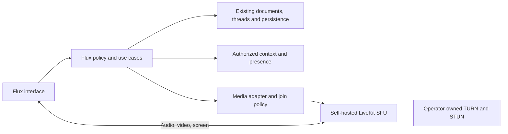

# Live collaboration at the work

**Status:** founder-required product behavior, 27 September 2026. Implementation
and real media acceptance remain open. [Design/reference task #59](https://github.com/ColdPhase/flux/issues/59)
records the source, with backend [#61](https://github.com/ColdPhase/flux/issues/61),
interface [#62](https://github.com/ColdPhase/flux/issues/62), and deployment/quality
[#63](https://github.com/ColdPhase/flux/issues/63).

This extends the [creative collaboration direction #44](https://github.com/ColdPhase/flux/issues/44),
[personal AI requirement #57](https://github.com/ColdPhase/flux/issues/57),
[mobile contract](mobile-pwa.md), and [working application milestone](milestones/02-working-application.md).
The [supplied interactive reference](../design/references/live/README.md) illustrates
the interaction; its palette, demo data and monolithic script are not a new
production design or architecture. Appearance follows the
[final design](../design/final/README.md) (F-026).

## 1. Job and complete journey

Two collaborators encounter a problem in existing work and want to solve it
together. Start a session at a task, selected map material, wiki section or
conversation, with the current context and audience already known. Use the
ordinary human workflow even when no agent is connected.

**Required journey:** blocked camera test → colleague joins at the task → show
the relevant map/wiki fragment or external screen → perform the test → save its
result and any authorized edits → leave and continue independently. Repeat with
four participants. Joining a person, discussing a task or ending a session never
automatically resolves a blocker or completes work.

“Let's work on this together” is the primary action. Starting tells the space's
people that a call is on and lets them join with one click
([calls are noticed](#calls-are-noticed-f-041), which replaced the earlier quiet
start). A targeted invitation is one ordinary inbox item, with join, later or text
response and the recipient's notification controls. Avoid a meeting wizard, ringing
in a loop, an answer/reject takeover, missed-call pressure, or a separate meeting
home that replaces the material being worked on. The useful difference is
continuity of context and outcomes.

### Calls are noticed (F-041)

**Founder decision, Hubert, 2026-11-12** ([#1223](https://github.com/ColdPhase/flux/issues/1223),
all seven points accepted as written; [#1230](https://github.com/ColdPhase/flux/issues/1230);
the sound rule from [#1243](https://github.com/ColdPhase/flux/issues/1243)). In use
the quiet start read as broken: nobody knew a call had started, it was named after
the conversation's last message, and Join hid as a dot on More. This section
supersedes the quiet start of #59 (2026-09-27).

1. **Place and label.** A call started from a space's conversation (the stream or an
   open thread) is the space's call: the strip says "Call in Gesture lamp", never the
   text of a message. A task, a map or a Wiki page is the call's place only when the
   call is started from it (the task's Call, or the header's Call while that task,
   map or page is open). The session's context is then `{ type: 'space', id: <space> }`.
   From the click on Call or Join the strip is there at once, saying "Connecting…", so a
   slow connection never looks like nothing happened (#1304); a second click starts nothing more.
2. **Join where you are** (#1230). Any call of the space with someone in it takes the
   header's Call slot on every view of the space (Conversation, Tasks, Map, Wiki), on
   the computer, the tablet and the phone, within 2 s of starting. It says who is in it
   and, for a call at another task, map or page than the one open, where: "Join · Nia ·
   at “Loan rules”". More keeps any further calls and **Start a call here** for a
   separate call. Under 360 px, where Call is in More, More carries the live dot and
   Join takes Call's row (after Search, which stays More's first row, #1239).
3. **Others are told, and nothing waits** (amended by founder direction, Hubert,
   2026-11-13, [#1438](https://github.com/ColdPhase/flux/issues/1438) point 11). A call
   started in a space is no Inbox item and nothing on Home: its people see it where they
   are, in the header's **Join** (point 2), the call glyph on the space's row and the
   conversation's line (point 7), and the corner notice of an open tab and push tell
   them once. Push follows the person's level: "Everything" pushes for any call in
   their spaces; "Only what needs me" pushes only for an invitation (point 4), and a
   level that sends no push tells nobody. Quiet hours hold push as for every notice.
   The notice is never emailed (a call may be over before the mail is read). Only a
   personal invitation (point 4) waits in the Inbox, and it stops asking anything when the
   call ends (the tab's "(N)" counts it only while the call runs). The same person's
   notice about the same place (the space, a task, a map or a page) is sent once in
   **5 minutes**: a call that ends and is started again inside that still starts and still shows its Join in the space, but tells
   nobody a second time (#1347; `CALL_NOTICE_PAUSE_MINUTES`). A muted space (#1249) sends no notice of an open call
   there; an invitation to a call still arrives. While a call runs, the space's row in
   the sidebar and the Spaces list carries the call glyph (a shape, not a dot).
4. **Invite.** After starting, the strip offers **Invite someone** (the strip's one invite control, #1424) with the space's people
   who are not in the call. An invitation is an Inbox item and a push with Join / Later,
   as before, plus one soft chime on the invited person's open tab. The same inviter's invitation of the same person to the same place is
   noticed once in 5 minutes (the pending invitation is there, the Inbox item, the push and the chime are not repeated).
5. **Sound.** Only for a direct invitation, never for an open call in a space. One
   soft chime, no ringing loop and no answer/reject takeover screen. It is on by
   default and follows the one "Sounds" switch in Settings ›
   Notifications (founder decision on #1419 item 18, 2026-11-13, which merged #1243's
   two switches), the level and quiet hours. #1243's
   notice plays it.
6. **Nobody joined.** While nobody else has joined, the starter's strip says "Nobody
   joined · Invite someone". A call nobody else joins ends after **10 minutes** alone;
   its conversation line then reads "Hubert called · nobody joined". (The existing
   grace periods for an empty room are unchanged.)
7. **A line in the conversation.** Starting a call from a space's conversation, thread
   or task posts one compact event line in that conversation, in the style of the
   task-update lines: "**Hubert** started a call · **Join**".
   - While the call runs, the line updates live: who is in it, with faces, and how long
     it has run.
   - It is not a message: no reply, no reactions and no notification of its own (point
     3 does that).
   - When the call ends, the same line becomes "Call · 12 min · Hubert, Maurycy"; a
     call nobody joined becomes "Hubert called · nobody joined".
   - It is anchored to the call's context: a call from a task posts in the task's
     discussion, a call from the space in its main conversation. A call started at a
     map or a Wiki page posts no line.
   - What was decided or made keeps its durable home ([section 4](#4-outcomes-stay-in-existing-work));
     the line may link the optional exit recap.
   - Never in a place the reader can't read. In an encrypted space the line holds only
     who and when, never a recap of content.
   - An agent's brief sees the line as an event ("a call took place, 12 min, Hubert and
     Maurycy"), not as a message to answer. An API-key run's `<conversation>` carries it
     as `<event kind="call">` among the messages by when the call started, with the
     names its readers see and nothing else, for the space's main conversation and a
     task's discussion (a thread has none); the brief says events are not messages. The
     owner's Claude Code and Codex read messages through the Flux tools, which do not list
     calls.
8. **A shared screen is seen.** When someone starts sharing, each other participant's
   stage opens on that screen once, unless they closed the stage for that share (a
   reconnect does not open it again); on a phone a sheet offers **View Nia's screen**.
   A screen of the person's own other device is not a share by someone else: nothing
   opens for it. While the person is typing (a text field, the composer included, has focus) nothing
   opens: the stage would cover the field they type in, so the strip's **View** is the
   offer. A line in the strip says "**Nia** is sharing a screen · View", and the
   sharer's face in the strip carries a screen badge while they share. A screen that
   stops sharing closes its stage and says so ("Nia stopped sharing"). The sharer's own
   line stays: "You are sharing your screen. Everyone in the session can see it." Joining
   a call where a screen is already shared opens the stage as a new share does.

The appearance of each piece is drawn in the [final design](../design/final/README.md#calls).

## 2. States people can understand

| State/action | Required behavior |
| --- | --- |
| Session available | Show purpose, audience and actual participants only to people with access. Invitations do not grant project membership. |
| Join | Show the participant, including listen-only participants. Request no microphone, camera or screen access. Devices start off; acknowledge browser playback restrictions before claiming the person can hear. |
| Enable a device | A direct user action requests that device. Show permission, capture, publication and failure truthfully; a stopped or muted device is never shown as transmitting. |
| Navigate | Maintain one session across conversation, task, map and wiki routes. Preserve drafts, selection and scroll where possible. Private navigation is not a broadcast. |
| Work quietly | Stop capture/publication of microphone, camera and screen; stop incoming audio and following. Keep visible quiet presence and access to the actual work. |
| Return | Resume listening when permitted; microphone, camera and screen remain off until explicitly enabled. |
| Reconnect | Show reconnecting/lost states, recheck access, avoid duplicate identity or sessions, and preserve mute/quiet intent. Never reacquire a stopped screen silently. |
| Leave / session ends | Release device tracks and subscriptions. Persisted work remains. Define last-person exit and bounded reconnect grace so abandoned rooms do not run forever. |

Keep a compact session control strip while the material remains primary. Camera
tiles are optional, stable in position and sized for their use. Speaking can be
indicated without rearranging the screen. Keep mute and leave discoverable;
additional controls must not duplicate a full second control panel.

On phones/tablets, fit safe areas, rotation, split view, large text and the virtual
keyboard. The reference's tall fixed mobile strip obscures part of the work: the
production layout must reserve space or adapt the controls without hiding the
composer, result actions or focused content. Preserve visible state when opening
the device menu. Verify keyboard/focus and touch separately from screenshots.

### Call audio: devices and volumes (#1244)

Founder request (Hubert, 2026-11-10). In a call a person chooses their devices and sets how loud they are and how loud others are.
Everything here is local to this browser: nobody else is told, nobody else's sound changes, and nothing is stored on the server. The
screens are drawn in the [design](../design/final/README.md#call-audio).

- **Where.** One popover (a sheet on the phone), **Audio settings**: from the small arrow beside the microphone button on a
  computer, and from the "You" section of ⋯ on every device. It exists only while a call is running and not worked quietly.
- **Microphone.**
  - The device is chosen from `enumerateDevices()` (`audioinput`). While the microphone is on, the local track's `restartTrack()` with the chosen `deviceId`
    gives the same publication the new capture (no gap, no new publication); while it is off the choice is kept for the next start. A
    start asks for the chosen device with `deviceId: { exact }`; if that device is gone it starts the default one and says so.
  - **Volume 0 to 200 % (100 % by default)** is a Web Audio `GainNode` in a LiveKit audio track processor before the track is sent
    (`LocalAudioTrack.setProcessor`, with the application's own `AudioContext`). At 100 % no processor is installed, so the capture goes
    out untouched; a context the browser keeps suspended (WebKit without a recent gesture) leaves the capture untouched and the
    popover says the volume could not be applied.
  - **Noise suppression, echo cancellation and automatic gain** are the `getUserMedia` constraints of the same names, on by default
    (they were already requested). A change restarts the running capture (`LocalAudioTrack.restartTrack`) and is kept for the next
    start. A switch is shown only where `getSupportedConstraints()` lists the constraint.
  - **Level meter.** It shows the capture's level times the chosen volume, so the person sees what others receive, and the word
    "Speaking" or "Quiet" is its text alternative. While the microphone is on it reads the published capture. While it is off the meter
    needs a capture that is **never sent**: it opens only while the popover is open and only when the browser already allows the
    microphone (Permissions API `granted`, so no prompt appears from merely opening settings); otherwise the meter row offers **Test
    microphone**. It stops when the popover closes, on Quiet, on leave and when the microphone is turned on (the published capture takes
    over). Devices still start off and open only from a person's own action (§2).
- **Speakers or headphones.** Where `HTMLMediaElement.setSinkId` exists, the device is chosen from `enumerateDevices()`
  (`audiooutput`) with `Room.switchActiveDevice('audiooutput', id)`, which calls `setSinkId` on every playing voice and on voices that
  arrive later; **Test sound** plays one short soft tone through that device at the chosen volume. **Everything you hear** is one master
  volume from 0 to 100 % (it only lowers; the device's own volume sets the top, and one quiet person is raised with their own volume).
  Where the browser cannot choose an output nothing is drawn for it. Where it cannot set the media volume (iOS, where `volume` stays
  1) the master and per-person sliders are not drawn and the popover says "Use your phone's volume buttons."; **Mute for me** still
  works (`muted`). Firefox lists output devices only after a permission: the Select is replaced by **Choose speakers or headphones**,
  which calls `MediaDevices.selectAudioOutput()`.
- **Per person.** Each remote person has **Volume 0 to 200 %** and **Mute for me**, on their face in the strip and in ⋯ › Here now.
  A voice plays at master × person; above 100 % in total the element's output goes through a `GainNode` (`createMediaStreamSource`),
  and is capped at 100 % where that cannot reach the chosen output (a non-default output in a browser without
  `AudioContext.setSinkId`). Several devices of one person share one volume. "Quiet" still stops every voice.
- **Remembered.** `localStorage` key `flux.live.audio` (read and written inside `try/catch`; a blocked or full store means the settings
  last only for this call): devices (id and label), the three switches, the volumes, and each person's volume and mute (at most 200
  people, the oldest dropped). A call that starts later or after a rejoin uses them. When a remembered device is no longer listed, the
  call uses the default, says so in one toast ("“Headphones” was disconnected. Sound plays through the default output.") and forgets
  the id; a device that comes back is not chosen again by itself.
- **Not in this change.** No recording or monitoring of your own voice, no per-participant output device, no noise filter beyond the
  browser's, no setting shared with other people or devices, and no change to who may use a device (§2).

Browser support, from MDN browser-compat-data 8.1.9 (released and read 2026-11-12, `@mdn/browser-compat-data`; first version that
supports it):

| Feature | Chrome / Edge | Firefox | Safari | Safari on iOS | Used for |
| --- | --- | --- | --- | --- | --- |
| `HTMLMediaElement.setSinkId` | 49 / 17 | 116 | 18.4 | 18.4 listed, `volume` below | Speakers or headphones |
| `MediaDevices.selectAudioOutput` | no | 116 | no | no | Output permission on Firefox |
| `AudioContext.setSinkId` | 110 | no | no | no | A boosted voice on a chosen output |
| `HTMLMediaElement.volume` | 3 | 3.5 | 3.1 | 3, partial: always 1, setting has no effect | Master and per-person volume |
| `createMediaStreamSource`, `createGain` | 15 / 24 | 25 / 25 | 6 / 7 | 6 / 7 | Boost above 100 %, microphone volume |
| `MediaDevices.enumerateDevices` | 47 | 116 (inputs and outputs; the promise waits for focus) | 11 | 11 | Device lists |
| `getSupportedConstraints().echoCancellation` | 53 | 46 | 13.1 | 13.4 | Echo switch |
| `getSupportedConstraints().noiseSuppression`, `.autoGainControl` | 67 | 55 | no | no | Noise and gain switches |

Chrome on Android and Firefox on Android do not support `setSinkId` either (the platform limits it). The code does not read the
table: it asks the browser (`'setSinkId' in HTMLMediaElement.prototype`, a write-and-read of `volume`, `getSupportedConstraints()`),
and treats iOS and iPadOS by their user agent, because BCD lists `setSinkId` for Safari on iOS 18.4 while the media volume stays
fixed there. WebKit's behaviour on the Playwright build is for the independent reviewer's WebKit run; physical devices stay optional.

## 3. Two ways to show something

**Show this fragment** sends an authorized object reference and selection: map
thought IDs/viewport, a stable wiki text anchor and revision, a task result, or a
message. The recipient opens usable Flux content, can read sources and navigate
independently. This is not a screen stream or a new copy of the material.

Use the existing synchronization and access model. A presentation event never
grants edit permission, merges threads, changes a task's status or overwrites
someone else's selection. Handle a removed/moved target and changed revisions.
Only publish material allowed for the session's audience; a private title or
preview must not leak through a pointer, participant metadata or notification.

Showing offers **View**; **Follow** is a separate, reversible choice. Following
ends on independent navigation or deliberate pan/zoom/editing. It must not pull
someone back repeatedly. A presenter entering a private project does not change
what the session sees. Revalidate every later presented target; previous access
to one map does not authorize another map or project.

**Share screen** transmits an explicitly selected external window, tab or display
for an IDE, terminal or demo. Keep source/stop indicators visible, handle browser
stop and permission denial, avoid unnecessary local preview feedback loops, and
let each viewer choose a screen, zoom or use 1:1 pixels. Support two simultaneous
screens without forcing both into unreadable thumbnails.

Browser capture requires a fresh user gesture/selection; permission cannot be
silently reused. Audio-source support varies by browser and OS.
[MDN capture documentation](https://developer.mozilla.org/en-US/docs/Web/API/MediaDevices/getDisplayMedia)
describes these constraints. Flux must explain unavailable functions, not suggest
that an administrator or another participant can remotely switch them on.

## 4. Outcomes stay in existing work

| Change made during a session | Durable home |
| --- | --- |
| Reply or agreement | The existing work conversation, with author and sources |
| Task blocker/result/status | The existing task through its normal authorized action |
| Thought or connection | The same map with its normal history |
| Wiki improvement | A new version of the existing page |

Showing a wiki section does not move the session's conversation into that page.
Map, conversation, work and knowledge retain their separate identities and
many-to-many relationships. The session adds a temporary collaboration context.

An optional exit recap links the operations actually committed during the
session. It must distinguish a participant's written note from inferred speech.
No saved operation and no consented audio processing means no invented minutes.
Do not require a closing form or create an empty meeting document each time.
Media failure never rolls back a saved result or prevents ordinary text work.

## 5. Personal AI help and optional audio notes

Apply [#57](https://github.com/ColdPhase/flux/issues/57) without a shared workspace
bot exception. Hubert may enable his personal agent to help within authorized
application context and an explicit request or standing rule. Other participants
can see permitted output; they cannot invoke, retry or continue Hubert's agent,
spend his quota, or acquire his private context. Attribute owner and initiator.

Default help has no access to room audio, camera or shared screen. A bounded rule
may prepare a sourced wiki change after a written test result; it must remain
quiet, version-aware, editable/dismissible and consistent with the human workflow.
Session entry, an invitation, another person's message or audio consent is not
permission to consume somebody else's AI connection. Human media sessions work
with AI entirely disabled.

Audio notes are a future, separately scoped capability outside milestone 2 and
off by default:

- The connection owner initiates; every current participant explicitly consents
  to the disclosed processor, output audience and retention before audio flows
  to a processor. Consent is product behavior, not a blanket legal certification.
- Display the named processing participant, continuous state and a stop control
  available to everyone. Never use a hidden agent/listener grant.
- A newcomer or withdrawal pauses processing before further audio is delivered;
  discard pending unconsented audio. Reconnection must not bypass this boundary.
  A late “participant joined” UI notification is insufficient for that guarantee.
- Explain audio, transcript and note storage separately. Default recording is
  off. An optional external model requires explicit disclosure/configuration;
  local processing keeps an entirely self-hosted option. Do not infer agreement,
  assignments or deadlines from casual suggestions.
- Analyzing a screen or camera needs its own scoped permission. Text help comes
  first; the agent does not spontaneously interrupt with synthesized speech.

Room-media recording, egress or transcription is outside milestone 2, including
when an operator configures a LiveKit service. The deployment must leave those
paths disabled. A later scoped implementation must show every participant a
visible state before capture, collect each current participant's explicit
consent, pause before any newcomer receives or sends captured media, and let
any participant stop processing. Operator configuration alone never grants
participant consent.

Choose and document the encryption/key boundary before claiming E2EE. LiveKit
supports E2EE, but the application handles keys; signaling/API protection has a
different scope. An audio-analyzing agent must be an explicitly authorized
decrypting recipient. Never silently downgrade protection to enable notes.
[Official encryption documentation](https://docs.livekit.io/transport/encryption/)
is a capability reference, not evidence that Flux has implemented that guarantee.
The current boundary is recorded in the
[encryption boundary record](../development/live-media-encryption.md): media is
encrypted in transit (DTLS-SRTP, checked automatically) and readable in the SFU.
E2EE is not implemented and is not claimed.

## 6. Self-hosted architecture and access

**Recommended transport:** self-hosted LiveKit, integrated behind a Flux adapter.
Its [server uses Apache-2.0](https://github.com/livekit/livekit/blob/master/LICENSE)
and supports [self-hosted realtime media](https://docs.livekit.io/transport/self-hosting/).
The final version/configuration requires the implementation task's independent
review and real proof. Do not start another broad stack selection exercise.

Own the signaling, SFU, relay and persisted application data. No mandatory cloud
account, external public relay, hosted analytics or paid media quality tier.
Inventory outbound dependencies. Recording, egress and transcription stay
disabled for milestone 2 under section 5; model inference is optional. Human
calling must remain available without them. Self-hosting still consumes
bandwidth and server capacity.

Keep domain session/audience rules and use cases independent of SDK objects.
Use adapters for grants, media events and diagnostics, existing policy for
objects, and existing persistence for results. Do not copy the demo's global
state machine into a giant production component or adopt a new document-sync
library merely because the supplied description mentions Yjs.

Session discovery, invitation, join, context delivery and reconnect need current
authorization. An Arduino + AI session is not discoverable to an unrelated
Marketplace participant. Use opaque room/participant identifiers, minimal grants,
backend-only signing secrets, checked callbacks and idempotent event processing.
A media token is not an application data token.

**Revocation is a concrete implementation gate.** LiveKit's documentation says
self-hosted removal does not invalidate existing tokens; connected clients can
also receive refreshed reconnect tokens. Therefore a short original TTL and
client-side hiding do not prove immediate cutoff. Test cached and refreshed
tokens against the actual deployed versions. Adopt a reviewed server enforcement
or session/room-generation strategy that prevents recovery of current media and
context after revocation, and record the measured cutoff. Never market an
unverified guarantee. [Tokens and grants](https://docs.livekit.io/frontends/reference/tokens-grants/).

## 7. Quality that can be checked

These are starting capture/quality targets, not guaranteed support on every
device. The implementation/evaluation pair records reproducible network profiles
and actual pass/fail thresholds before the final run; it cannot lower them to
hide a discovered failure.

| Material | Initial target under suitable hardware/network | Observe at the receiver |
| --- | --- | --- |
| Code / terminal / document | Up to 2560×1440, 15–30 fps | Readable 14–16px text and scrolling, zoom/1:1, time to a clear frame |
| Moving demo | Up to 1920×1080, 60 fps | Delivered frame rate, motion and latency |
| Camera | Up to 1080p30, smaller for thumbnails | Stable image without starving screen or speech |
| Voice | Clear, continuous speech; supported echo/noise handling | Interruptions, delay, clipping, loss and device switching |

Default to automatic quality. Prioritize speech, stop wasting bandwidth on hidden
camera tiles, and prefer lower frame rate over destroying code readability when
appropriate. Adapt per receiver where supported; one weak receiver need not
reduce everyone to the same quality. LiveKit supplies
[adaptive subscription mechanisms](https://docs.livekit.io/transport/media/subscribe/),
but actual results depend on publication layers, codecs, clients and hardware.

**Screen mode and a larger camera (agent decision, #63, 2026-10-31).** A shared screen
is sent as **Sharp text** by default: up to 2560×1440 at 15 fps, one layer that keeps
its resolution. While sharing, the sharing line under the live strip offers **Sharp
text · Smooth motion**; Smooth motion sends up to 1920×1080 at 60 fps (10 Mbit/s cap,
frame rate kept over resolution), also one layer: with simulcast layers the browser's
software encoder delivered about 12 fps at 1080p in the #63 simulation instead of 59.
Switching republishes the same capture: no new picker, and receivers keep
the screen in the same place. The choice is remembered for the next share on that
browser. Cameras capture up to 1920×1080 at 30 fps with simulcast; on the camera stage
each tile is its own toggle that shows that camera large (pressed again, all tiles
return), so the receiver asks for the 1080p layer only while it shows one. During a
screen share cameras stay a side column. The controls appear only where they act (the
sharing line, the camera tiles) and do not move other controls.

Expose measured resolution, fps and a useful reason for degradation on demand.
Record sender/receiver bitrate, jitter/loss, latency method, interruptions,
reconnect time and SFU/relay resource use. Configured values and a local preview
are insufficient. Screen/system audio has its own capability and permission
states; [LiveKit's screen-sharing guide](https://docs.livekit.io/transport/media/screenshare/)
separates browser and native platform paths.

## 8. Deployment and platform acceptance

Use Docker/Compose for development, tests and installation. Kubernetes (k3s, Helm) is
not supported yet (founder decision, 2026-10-31); Docker Compose is the only supported
install. Document the Compose topology with public reachability/NAT, HTTPS/WSS certificates, SFU UDP/TCP, relay addresses,
TURN/TLS and explicit firewall/load-balancer behavior. A web ingress alone does
not carry all media traffic. See the official
[port requirements](https://docs.livekit.io/transport/self-hosting/ports-firewall/).
Validate the chosen deployment, including restrictive networks with UDP blocked,
instead of assuming a chart installs a working call.

Keep services/version pins, health checks, metrics, capacity/room limits,
bandwidth estimates, drain/restart, update and rollback instructions reviewable.
Run media/real-device/network workloads locally or on authorized test hardware;
keep PR Actions to fast checks and release only the completed candidate.

Required matrix: two and four people; two concurrent screens; good and constrained
links; Fedora/Wayland, Windows and macOS with supported Chromium/Firefox/Safari;
Android phone/tablet, iPhone and iPad browser/PWA participation. Include denial,
device disappearance, headphones/Bluetooth changes, background/lock/foreground,
rotation, network changes and service-worker updates. Preserve unfinished work;
show suspension honestly instead of promising uninterrupted mobile background
audio without platform evidence. Founder direction
[#266](https://github.com/ColdPhase/flux/issues/266) item 10, 2026-10-05: the
platform rows run Chromium, Firefox and WebKit in Docker with emulated
phone/tablet viewports, touch and fake media devices, plus documented platform
capabilities with dated sources ([mobile evidence](mobile-pwa.md#acceptance-evidence));
physical phones, tablets and other machines are optional extra evidence.

**Mobile screen viewing and screen publication are different capabilities.** On
the research date, [MDN browser compatibility data](https://github.com/mdn/browser-compat-data/blob/main/api/MediaDevices.json)
marks `getDisplayMedia` unsupported in Chrome/Firefox Android and Safari iOS.
Installing a PWA does not create native capture APIs. Provide the supported
voice/camera, received screen and native Flux-fragment flows with clear capability
states; verify each in emulation against the documented capabilities. If full
mobile OS-screen publication is required, explicitly track a native
implementation with its lifecycle/permissions.
Do not silently remove the existing mobile requirements or claim universal capture.

**Status 2026-10-10 (#63 AC-3, emulation only).** Four emulated rows run in Docker:
Android Chrome and Android Firefox, iPhone and iPad Safari. The mobile
`getDisplayMedia` state is an explicit emulation, checked against
[MDN browser-compat-data](https://github.com/mdn/browser-compat-data/blob/main/api/MediaDevices.json)
(fetched 2026-10-10). Results, negative controls and findings are in
[live-media.md](../development/live-media.md#platform-rows-and-direct-path-dtls-63-ac-3-ac-4-2026-10-10).
On the merged head, "Back to work" and the tablet camera control are reached by
pointer, and the WebKit camera and microphone calls are observed. One reviewer
reported a Firefox join failure on another host; it is not reproduced here and is
recorded as such. Desktop rows, real devices and the public host remain open.

## 9. Evidence and delivery ledger

Research above was checked against official sources on **2026-09-27**. These are
vendor/documentation facts and a Flux design derived from them. No LiveKit server,
real remote call, throughput or hardware test was performed for this requirements
change. The [reference inspection](../design/references/live/README.md#inspection)
only verifies local prototype behavior with its stated limits.

| Work | Owner / evaluator | Completion evidence |
| --- | --- | --- |
| [#59 requirements and reference](https://github.com/ColdPhase/flux/issues/59) | Hubert / Maurycy | Source provenance, render/interaction observations, dated feasibility, linked tasks |
| [#61 server and context](https://github.com/ColdPhase/flux/issues/61) | Hubert / Maurycy | Real two-client transport, persisted context, policy and revocation regressions |
| [#62 live interface](https://github.com/ColdPhase/flux/issues/62) | Maurycy / Hubert | Independent visual review plus real integrated human journey |
| [#63 quality and operation](https://github.com/ColdPhase/flux/issues/63) | Hubert / Maurycy | Receiver/network/device results and operable self-hosted deployment at the candidate |

Status 2026-10-10 for #63: the direct-path DTLS assertion and the emulated mobile rows
are recorded in [live-media.md](../development/live-media.md#platform-rows-and-direct-path-dtls-63-ac-3-ac-4-2026-10-10).
Receiver calibration, public-host results and real devices are still open, so #63 stays open.
Status 2026-10-30: the emulated rows also cover a dispatched device change, the reload that
applies a Flux update (nothing is captured until the person joins again) and rejoining
([live-media.md](../development/live-media.md#device-change-update-reload-and-rejoin-on-the-platform-rows-63-ac-3-2026-10-30)).
The public host, the rest of receiver calibration and the desktop Firefox and WebKit rows
remain open. Real devices are optional.

Only the first row is documentation. The others are required full-application
outcomes and stay open until demonstrated. Optional audio notes require a later
scoped task and must satisfy section 5 before processing. They are not a
prerequisite for ordinary human calls. Agents can split
these tasks into bounded PRs while retaining their criteria and single owners.
